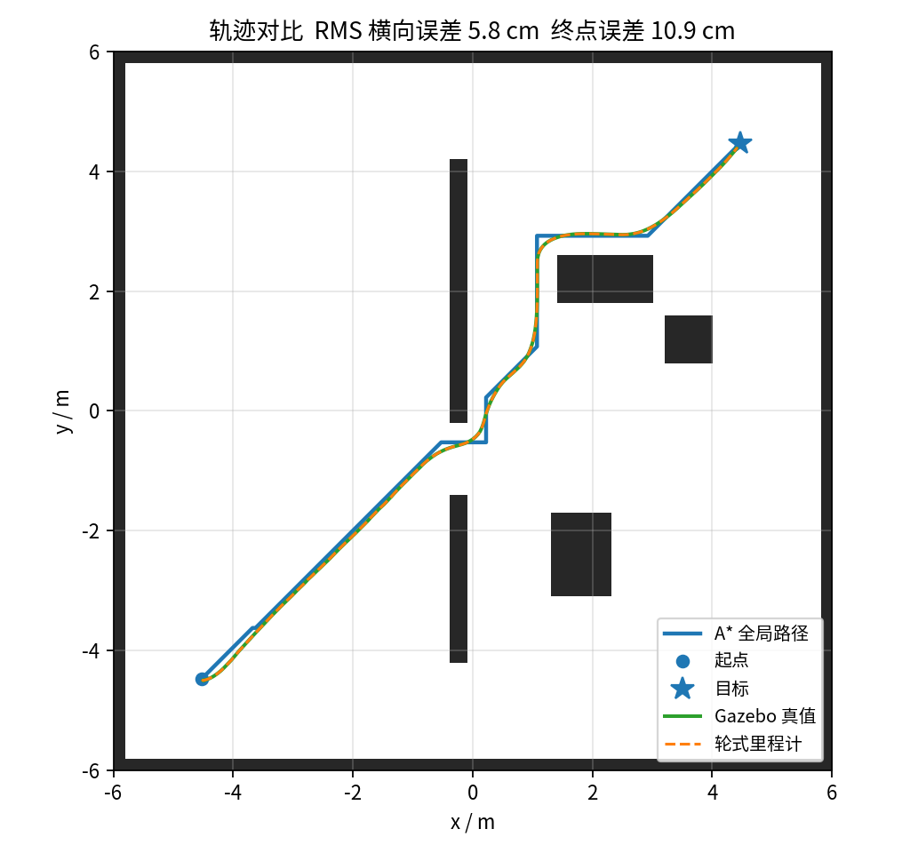
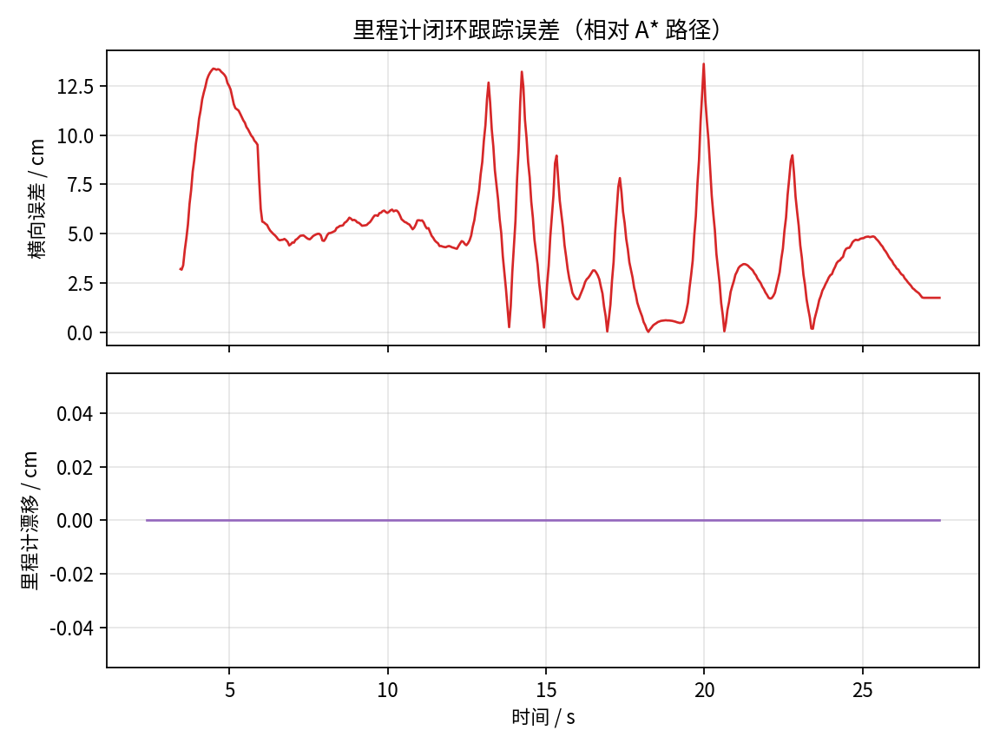
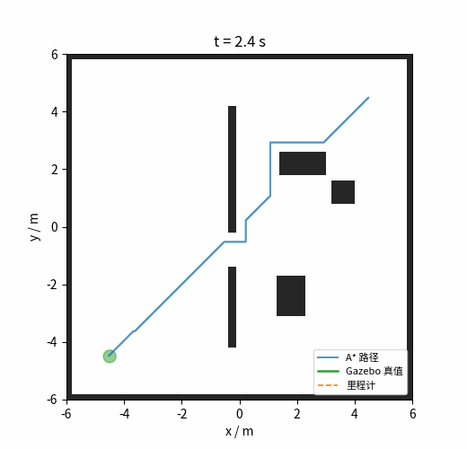

# 基于里程计反馈与 A* 算法的差速底盘静态全局路径规划

本页对应 `src/ground/diff_drive_astar_odom_nav`。在 Gazebo 中搭建两轮差速底盘与静态障碍场景：A* 在静态占用栅格上规划全局路径，纯追踪控制器仅用轮式里程计 `/odom` 反馈跟踪，Gazebo 真值 `/ground_truth` 只用于事后评估。

!!! info "数据来源"
    本页所有数字来自 **Ubuntu 22.04 + ROS 2 Humble + Gazebo Classic 11** 的虚拟机实跑（无显示器，`gzserver` 无界面模式），运行命令见 §4。同一命令重跑会有小幅波动。

与仓库已有的 [`ros2_pure_pursuit`](./ros2_pure_pursuit/index.md) 相比，本模块不重复纯追踪控制本身，而是补上静态全局规划与 Gazebo 差速底盘闭环，并给出真实运行数据：

| 对比项 | `ros2_pure_pursuit` | 本模块 |
| --- | --- | --- |
| 全局规划 | 无（路径由外部给定） | 0.05 m 栅格 A* |
| 机器人模型 | 离线运动学 / 简化 ROS 2 节点 | Gazebo 物理差速底盘 |
| 规划起点 | — | `/odom` 轮式里程计实时位姿 |
| 路径执行 | 纯追踪闭环 | 纯追踪闭环（30 Hz） |
| 评价数据 | 跟踪误差 | 真值轨迹、横向误差、里程计漂移、速度指令 |

## 1. 本模块实际实现范围

| 要求 | 实际情况 |
| --- | --- |
| 差速底盘模型 | **做了**。URDF 两驱动轮 + 低摩擦万向球，`gazebo_ros_diff_drive` 编码器里程计 |
| 静态全局路径规划 | **做了**。0.05 m 栅格 A*（8 邻接、严格穿角、机器人半径膨胀） |
| 里程计反馈控制 | **做了**。30 Hz 纯追踪，只用 `/odom`；不使用真值 |
| 动态障碍/局部避障 | **不做**。场景与地图均为静态 |
| SLAM/建图 | **不做**。地图由场景几何离线生成，规划与仿真严格对齐 |

## 2. 运行环境

| 组件 | 版本（实测） |
| --- | --- |
| 系统 | Ubuntu 22.04 LTS（虚拟机，无 GPU/显示器） |
| ROS | ROS 2 Humble |
| 仿真 | Gazebo Classic 11（`gzserver` 无界面） |
| Python / numpy | 3.10 / 1.26 |
| 其他 | PyYAML、matplotlib、Pillow（画图与 GIF） |

## 3. 场景与地图

`geometry.py` 是唯一几何来源，同一份矩形列表同时生成：

- `worlds/static_obstacles.world`：12 m × 12 m 房间、中间隔墙（1.2 m 门洞）与 4 个箱子；
- `maps/static_map.pgm`：240 × 240、分辨率 0.05 m 的占用栅格。

起点 `(-4.5, -4.5)`，目标 `(4.5, 4.5)`，二者被隔墙分开，A* 必须从门洞绕行。

## 4. 运行步骤

```bash
colcon build --packages-select diff_drive_astar_odom_nav
source install/setup.bash

cd src/ground/diff_drive_astar_odom_nav
python3 main.py                 # 无界面，完整实验 + 自动出图
python3 main.py --gui           # 有显示器时查看 Gazebo 画面
```

标准 launch 方式：

```bash
ros2 launch diff_drive_astar_odom_nav main.launch.py
```

修改场景后重新生成地图与世界（否则地图和仿真会不一致）：

```bash
python3 -m diff_drive_astar_odom_nav.geometry .
```

## 5. 原理

### 5.1 A* 全局规划

- 8 邻接，直行代价 1、对角 √2，octile 启发式，`weight=1` 时最优；
- 严格穿角检查，避免路径擦过障碍角；
- 机器人半径 0.22 m + 0.05 m 余量，对障碍做可分离膨胀（与膨胀半径无关的 O(HW) 实现）；
- 起点取 `/odom` 当前位姿；目标落在障碍内时用 BFS 修复到最近空闲格；
- 静态全局规划，只规划一次，不随位姿反复重规划。

### 5.2 里程计反馈纯追踪

每个控制周期（30 Hz）：

1. 在路径上找距里程计位姿最近的点，索引单调前进；
2. 沿路径前视 0.55 m 得到目标点，$w = v \cdot 2y_{local}/L^2$；
3. 按前视方位角与剩余距离减速，线速度限幅 0.75 m/s，角速度限幅 1.4 rad/s；
4. 距终点 0.12 m 内停车。

### 5.3 指标

| 指标 | 定义 |
| --- | --- |
| 横向误差 | Gazebo 真值位姿到 A* 折线的最短距离 |
| 终点误差 | 末次真值位姿到路径终点距离 |
| 里程计漂移 | 同一时间戳下 `/odom` 与 `/ground_truth` 的位姿差 |
| 规划/行驶长度 | A* 折线长度 / 真值轨迹累加长度 |

## 6. 真实运行结果

一次完整运行（`results/run_01`，25.05 s，502 个 20 Hz 采样）：

| 指标 | 实测 |
| --- | --- |
| 运行状态 | SUCCEEDED |
| 规划路径长度 | 14.23 m |
| 实际行驶长度（真值） | 13.54 m |
| 总耗时 | 25.05 s |
| 终点位置误差 | 10.9 cm |
| 横向误差 RMS / 均值 / 最大 | 5.8 / 4.9 / 13.6 cm |
| 里程计漂移 最终 / RMS | 0.0 / 0.0 cm |
| 最大线速度指令 | 0.75 m/s |







!!! note "关于 0 漂移"
    Gazebo 的刚性轮地接触是理想模型，编码器里程计积分与真值几乎完全一致，因此漂移为 0；控制回路仍然只读 `/odom`，真值不参与控制。横向误差主要来自纯追踪对栅格折线拐角的切角，最大 13.6 cm 出现在起步对准与 90° 拐角处。

## 7. 测试与复现

```bash
python3 -m pytest -q test        # 17 项：A*、纯追踪、地图/场景一致性
python3 main.py --out results/run_01
```

一次运行自动产出 `trajectory.csv`、`plan.csv`、`metrics.json`、`metrics.md`、`trajectory.png`、`error.png`、`speed.png`、`trajectory.gif`。仓库内 `results/run_01` 为真实运行结果，未手工修改。

## 8. 大模型使用声明

本模块代码与文档在开发过程中使用了 AI 编程助手辅助生成；作者已逐行核对并在 Gazebo 中实际运行验证，提交的实验数据与图表均由真实运行产生。
