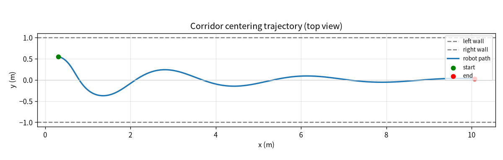
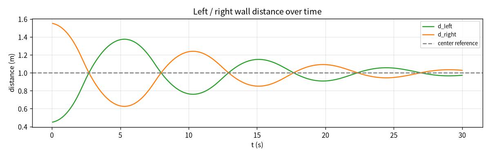
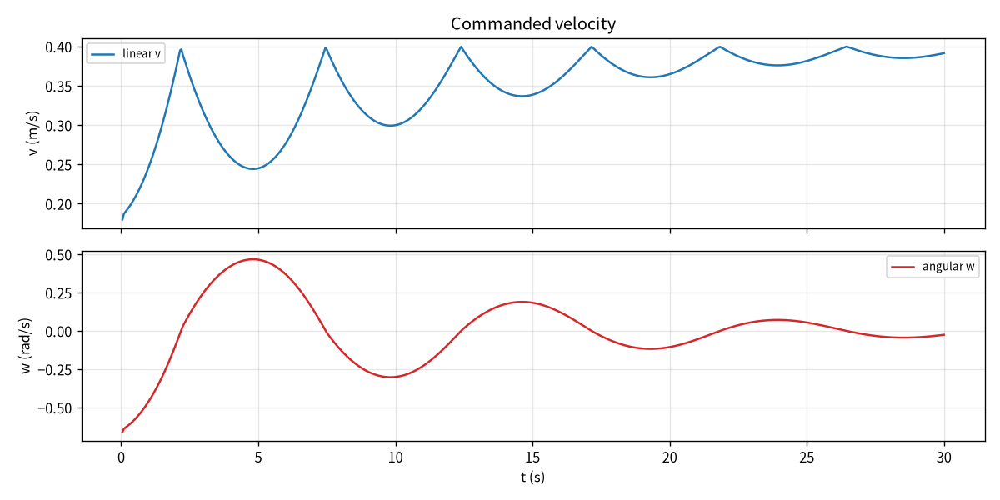

# 差速小车双侧墙通道居中 PD 巡航仿真

本页对应 `src/ground/diff_drive_corridor_centering`。两轮差速底盘在一条笔直
通道内前进，控制器只读取左侧墙、右侧墙和正前方三路测距，用 PD 把车体保持在
通道中线上。配套一个 2D 运动学积分的虚拟测距节点，不依赖 Gazebo / CARLA /
MuJoCo，在只有 rclpy 的环境即可跑通闭环。

与仓库已有地面模块的区别：

| 对比项 | 单侧墙跟随（如 `ground_wall_follower_pid`、`diff_drive_wall_following`） | 本模块 |
| --- | --- | --- |
| 控制目标 | 与某一侧墙保持固定距离 | 左右墙距离对称，车体居于通道中线 |
| 测距使用 | 一侧墙距离 + 前方距离 | 左、右两侧墙距离 + 前方距离 |
| 典型场景 | 沿墙巡检、靠墙通行 | 直通道居中行驶、巷道巡航 |

与在途的“狭窄通道通行（激光开口辨识 + 神经网络选口穿行）”相比，本模块不做
开口辨识和神经网络决策，只是纯反应式的双侧墙居中 PD 控制，也不依赖给定全局
路径（区别于 `ros2_pure_pursuit` 的路径跟踪）。

## 1. 实际实现范围

| 要求 | 实际情况 |
| --- | --- |
| 差速底盘运动学 | **做了**。2D 差速运动学积分，离线仿真与虚拟测距节点共用同一套模型 |
| 双侧墙居中控制 | **做了**。横向偏差 `e = (d_left - d_right)/2`，PD 输出角速度 |
| 前方受阻保护 | **做了**。前方距离低于阈值零速停车，恢复后继续巡航 |
| 全局路径规划 / SLAM | **不做**。反应式局部控制，不建图、不规划全局路径 |
| 物理仿真器联调 | **未在本机验证**。本机无 ROS 2 / Gazebo，ROS 端需另一台机器复验 |

## 2. 运行环境

| 组件 | 版本（本机离线实测） |
| --- | --- |
| 系统 | Ubuntu 22.04.5 LTS（虚拟机） |
| Python | 3.12.11 |
| numpy / matplotlib | 1.26.4 / 3.11.0 |
| ROS 目标环境 | Ubuntu 22.04 + ROS 2 Humble（本机未运行，待复验） |

## 3. 控制原理

### 3.1 横向偏差

通道半宽记为 `W/2`，车体横向偏移为 `y`，则左右墙距离：

- `d_left = W/2 - y`
- `d_right = W/2 + y`

定义横向偏差：

```
e = (d_left - d_right) / 2 = -y
```

车体居中时 `d_left = d_right`，`e = 0`。

### 3.2 PD 控制律

角速度由偏差与偏差变化率计算：

```
ω = Kp · e + Kd · de/dt
```

角速度限幅到 `w_max`；前进速度随转角衰减：

```
v = v_max · max(v_floor, 1 - |ω| / w_max)
```

状态机：

| 状态 | 触发条件 | 行为 |
| --- | --- | --- |
| `CENTER` | 前方距离 ≥ `forward_safety` | 双侧墙居中前进 |
| `BLOCKED` | 前方距离 < `forward_safety` | 零速停车；前方距离 ≥ `forward_recover` 后回到 `CENTER` |

测距超过 `scan_timeout` 未更新时，按前方受阻处理并发布零速，避免车体在传感器
失效时继续跑偏。

## 4. 运行步骤

离线仿真与单元测试（在仓库根目录）：

```bash
# 2D 离线仿真，生成三张效果图并打印指标
python3 src/ground/diff_drive_corridor_centering/offline_sim.py

# 控制器核心离线单元测试
PYTHONPATH=src/ground/diff_drive_corridor_centering \
  python3 -m unittest discover -s src/ground/diff_drive_corridor_centering/tests -v
```

ROS 2 端（需 Ubuntu + ROS 2 Humble，本机未执行）：

```bash
source /opt/ros/humble/setup.bash
cd ~/ros2_ws
colcon build --symlink-install --packages-select diff_drive_corridor_centering
source install/setup.bash
ros2 launch diff_drive_corridor_centering main.launch.py
```

另开终端观测：

```bash
ros2 topic echo /corridor/state
ros2 topic echo /corridor/cmd_vel
```

## 5. 离线仿真结果

仿真场景：宽 2.0 m、长 14.0 m 的直通道，车体起点 `(0.3, 0.55)`、初始航向
`-0.18 rad`，仿真步长 0.05 s。三张图由 `offline_sim.py` 在本机实际运行生成。

### 5.1 俯视轨迹

车体从偏左位置出发，经过两次衰减振荡后收敛到通道中线：



### 5.2 左右墙距离

左右墙距离围绕中线参考值 1.0 m 对称波动，逐渐收敛到等距：



### 5.3 速度指令

线速度随转角衰减，角速度纠偏幅度随偏差收敛而减小：



### 5.4 指标

| 指标 | 数值 |
| --- | --- |
| 仿真时长 | 30.0 s |
| 行驶路径长度 | 10.42 m |
| 最终横向偏差 | -0.0275 m |
| 平均绝对横向偏差 | 0.1323 m |
| 最大绝对横向偏差 | 0.55 m |
| 最小前方净空 | 0.626 m |
| 采样点数 | 600 |

## 6. 已知限制与待复验项

- 离线仿真是理想直通道 + 简化运动学，不含轮子打滑、激光噪声和墙面凹凸；
- ROS 端在 Gazebo / 实车激光雷达上的联调、`colcon build` 编译与
  `main.launch.py` 启动尚未在本机验证，需另一台机器复验后补充实机截图。
