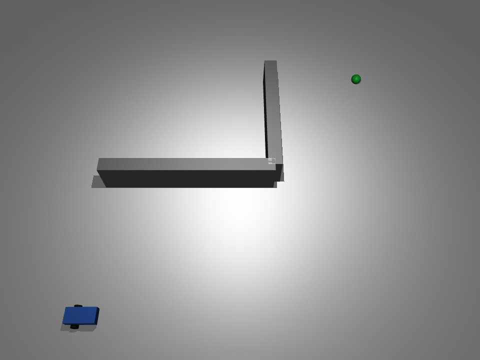

# MuJoCo 差速小车走迷宫

功能包源码位于仓库的 `src/ground/diff_drive_maze` 目录。

## 1. 问题描述

蓝色四轮差速小车（后两轮驱动、前两轮被动随动支撑）在 MuJoCo 平地仿真中从起点 `(-2.0, -2.0)` m 出发，场地中央布置一道
L 型隔墙（一道横墙 + 一道竖墙相接），挡住起点到终点的直穿对角线。小车沿预设走廊航点
依次「原地转向对准 → 直行」，先向东绕过横墙东端，再向北绕过竖墙北端，最终到达绿色终点
`(2.0, 2.0)` m。途中与墙壁几何接触即判定撞墙失败，进入终点附近判定成功。

说明场景性质：本作业的「迷宫」是**一道 L 型隔墙构成的两段走廊**，不需要搜索或多分支探索；
控制为**预置航点的闭环跟随**（每段按 yaw 反馈对准后直行），不是迷宫求解算法。

## 2. 运行环境（实际验证）

| 项 | 版本 / 说明 |
|---|---|
| 操作系统 | Ubuntu（无头云主机，无独立显卡） |
| Python | 3.12.11 |
| 模拟器 | MuJoCo `>=3.2,<4.1`（本机实测 3.17.0 与 4.0.0，闭环与测试结果一致），numpy 1.26.4；Pillow 仅录帧导出 GIF 时需要 |
| 渲染后端 | 可视化用 `MUJOCO_GL=glfw`；无头离屏录帧用 `egl`（mesa 软件渲染，无独立显卡也可出图） |

MuJoCo 不在 apt 仓库，需按 `requirements.txt` 用 pip 安装。

## 3. 算法

### 3.1 差速运动学

模型**后两轮**由 `velocity` 执行器驱动，前两轮为无执行器的被动随动轮，只承担支撑与滚动；
`ctrl` 单位是**轮子角速度 (rad/s)**，不是车体线速度。
给定目标车体线速度 `v` (m/s) 与车体角速度 `omega` (rad/s)，由差速逆解换算左右轮角速度：

```
ω_L = v/R - ω·L/(2R)
ω_R = v/R + ω·L/(2R)
```

其中轮半径 `R=0.05 m`，左右轮间距 `L=0.22 m`。

### 3.2 偏航角解算

车体是 `<freejoint/>`，其 7 个 `qpos` 为 `[x, y, z, qw, qx, qy, qz]`；
`qpos[5]` 是四元数 `qy`，绕 z 轴转动时恒为 0，**不能当作 yaw**。
偏航角由四元数分量解算：

```
yaw = atan2(2·(qw·qz + qx·qy), 1 - 2·(qy² + qz²))
```

### 3.3 航点闭环状态机

走廊航点（不含起点、终点）为 `(2.0, -2.0)`、`(2.0, 2.0)`。每一段航点：

- 当前航向误差大：原地差速转向，先把车头对准航点；
- 航向误差小：直行并叠加航向比例修正，边走边对准；
- 两档阈值带滞回（转入 `0.5 rad`、转回 `0.3 rad`），避免在切换边界来回抖动（极限环）；
- 距当前航点 `< 0.15 m` 切换下一段，重新进入原地转向。

闭环按 yaw 反馈转向、按位置对准直行，不像开环硬编码步数那样受轮地打滑与时间累积误差影响。

### 3.4 碰撞与到达判定

- 每步扫描 MuJoCo 接触对，任一接触几何名以 `wall` 开头即判定撞墙，停车失败；
- 距终点 `< 0.12 m` 判定到达，全部轮速置零停车；循环带步数上限 `20000`（`dt=0.005`，兜底 100 s）。

## 4. 模型参数（models/diff_drive_maze.xml）

| 部件 | 参数 |
|---|---|
| 底盘 | 长方体 `0.2 × 0.1 × 0.05 m`，蓝色，质量 2.0 kg |
| 车轮 | 左右各一，轮半径 0.05 m，hinge 绕 y 轴，`velocity` 驱动，`kv=2` |
| 横墙 `wall_h` | 长方体，中心 `(-0.75, 0.0)`，半尺寸 `1.25 × 0.1 × 0.25 m`，覆盖 x∈[-2.0, 0.5]、y∈[-0.1, 0.1]，参与碰撞 |
| 竖墙 `wall_v` | 长方体，中心 `(0.5, 1.0)`，半尺寸 `0.1 × 1.0 × 0.25 m`，覆盖 x∈[0.4, 0.6]、y∈[0, 2.0]，参与碰撞 |
| 终点 | 绿色小球，`(2.0, 2.0, 0.06)`，半径 0.08 m，`contype/conaffinity=0`，不参与碰撞 |
| 物理 | timestep=0.005 s，地面摩擦 `1.0 0.1 0.1` |

## 5. 运行步骤

### 5.1 安装依赖

在**包目录**下执行：

```bash
# 先进入本包目录（仓库内 checkout 路径如下）：
cd src/ground/diff_drive_maze
pip install -r requirements.txt
```

### 5.2 运行

在包目录下直接运行脚本：

```bash
python3 main.py              # 打开 MuJoCo 窗口，关闭窗口即退出
python3 main.py --headless   # 无头模式：到达终点 / 撞墙 / 超时后打印结果退出（无窗口）
```

也可以在 source 过 ROS 2 工作空间后用 ros2 launch 拉起：

```bash
ros2 launch diff_drive_maze main.launch.py                # 开窗可视化
ros2 launch diff_drive_maze main.launch.py headless:=true # 无头模式
```

### 5.3 测试与录帧

测试（`unittest.TestCase`，纯逻辑单测 + 闭环到达 / 撞墙判定 / 车体支撑断言，共 `9` 项）：

```bash
python3 test/test_diff_drive_maze.py
python3 -O test/test_diff_drive_maze.py   # -O 下同样全部执行（断言不会被剔除）
```

离屏渲染导出演示 GIF（无头环境用 EGL 软件渲染即可，无需独立显卡）：

```bash
python3 test/record_demo_gif.py
```

## 6. 实测结果（本机 mujoco 3.17.0 与 4.0.0 实测，结果一致）

`python3 main.py --headless` 实测：

- 到达终点；步数 `4491`，仿真时长 `22.46 s`；
- 终止位置 `(2.046, 1.894) m`，距终点 `0.116 m`（小于 `0.12 m` 到达阈值）；
- 闭环过程未接触墙壁；
- **墙距口径**：车体中心到墙几何（盒体表面，含墙端）的最小距离——横墙 `wall_h` `1.714 m`
  （出现位置约 `(2.21, 0.19)`）、竖墙 `wall_v` `1.446 m`（约 `(2.05, 1.89)`）。轨迹是在墙端
  外侧通过的，如果按「所在无限平面」计算会被墙端外的穿越误判为贴墙，故统一按盒体表面距离口径给出；
- **车体支撑**：四轮着地，**底盘与地面接触 `0` 步（0.0%）**，最大俯仰角 `2.98°`，底盘最低
  `z=0.099 m`（名义 `0.10 m`）；后轮触地步数 `76.3%`/`77.2%`，前轮 `90.2%`/`91.9%`，
  车体由轮胎支撑、不发生底盘擦地，`velocity` 下发的轮速与车体位移之间的差速逆解成立。

## 7. 运行效果



`docs/img/ground/diff_drive_maze_demo.gif` 由本包 `test/record_demo_gif.py` 离屏渲染生成，不是另外录屏：

- 闭环 `4491` 步（`dt=0.005 s`），脚本复用 `main.py` 的起点、终点、隔墙、航点与 `control_step`，每 `16` 步录一帧后写入 GIF；
- 实测：768×576、280 帧、每帧 80 ms（约 22.4 s）、循环播放，文件 525,989 B（0.50 MB）；
- 脚本直接输出 `823,688 B`（约 0.79 MB，实测），入库前再用 ffmpeg 调色板量化压到 `525,989 B`（0.50 MB）：
  `ffmpeg -i in.gif -vf "split[s0][s1];[s0]palettegen=max_colors=128:stats_mode=diff[p];[s1][p]paletteuse=dither=bayer:bayer_scale=3" -loop 0 out.gif`；
- 复现：在包目录执行 `python3 test/record_demo_gif.py`（录帧需 Pillow；离屏后端 `MUJOCO_GL=egl`，mesa 软件渲染）；
- 小车先沿下方向东绕过横墙东端，再沿右侧向北绕过竖墙北端，最后驶向绿色终点球。

## 8. 已知限制

- 只验证固定起点 `(-2.0, -2.0)`、终点 `(2.0, 2.0)` 与当前 L 型隔墙位置；其他起点 / 终点 / 墙布局未做回归；
- 走廊航点为预设固定序列，未做实时避障或全局路径规划；
- 到达判据只看位置距离，不约束最终车头朝向；
- 速度与增益为初始取值，未做整定优化；
- 在 mujoco **3.17.0 与 4.0.0**（本机实测，均属 `>=3.2,<4.1` 区间内）上验证通过，两者闭环结果（`4491` 步、终止位置、墙距统计）与全部测试一致；区间内其他版本未做回归；
- 录帧依赖 EGL/OpenGL 离屏上下文；个别极简容器若未带 mesa 软件渲染库，需先装好 EGL 驱动。

## 9. 大模型使用声明

本作业的代码与文档在编写过程中使用了**豆包（Doubao）** AI 大模型辅助，本人已核对并确认提交内容，对提交内容负责。
