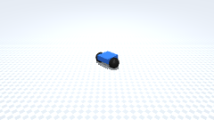
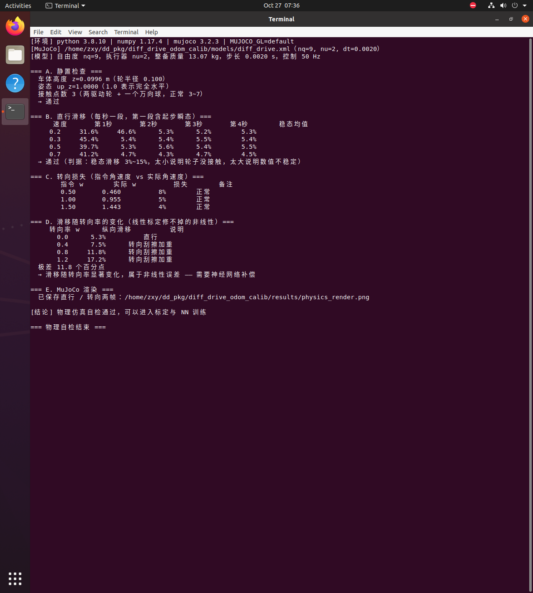
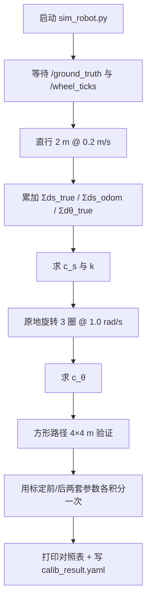

# 差速机器人里程计标定（ROS 1）

本页对应 `src/ground/diff_drive_odom_calib`：一台差速移动机器人的轮径、轮距与标称值
都有偏差，里程计会一路漂。这里用**两段专门的实验**把三个误差系数辨识出来，
再用方形路径验证标定效果。

!!! info "环境与可复现性"
    本页所有数字都来自 **Ubuntu 20.04 + ROS Noetic（ROS 1）+ Python 3.8** 的
    虚拟机实跑：`catkin_make` 编译通过，`roslaunch` 一次跑完直行实验、旋转实验与
    方形路径验证。下面的截图就是那次运行的真实终端输出。

## 1. 本模块实际实现范围

!!! warning "先说清楚没做什么"
    早期版本在这里放过一张"对应作业要求"的表格，把"运动学积分"说成"物理仿真"、
    把"编码器"说成"传感器融合"、把"导航的前置步骤"说成"导航"。那些说法不成立，
    已经删除。下面是按实际情况逐项交代。

| 作业要求 | 实际情况 |
|---|---|
| (1) 物理仿真 + 键盘控制 | **做了**。MuJoCo 场景（`nq=9, nu=2`，两驱动轮 + 一个万向球，真实摩擦接触），`scripts/teleop.py` 键盘遥控 |
| (2) 传感器感知 + 运动控制 | **部分做了**。用的是**编码器 + IMU**（`/wheel_ticks`、`/imu`）做里程计标定与滑移补偿。**没有**用雷达/摄像头，这一点与"传感器融合"的常规理解有差距 |
| (3) 导航与 SLAM 同步仿真 | **没做**。本模块只解决"里程计准不准"，不涉及建图与路径规划 |
| (4) 神经网络 | **做了**。`slip_nn.py` 是 4→24→24→2 的 MLP（纯 NumPy 手写反向传播），输入轮速与 IMU，输出滑移补偿系数 |

## 2. 运行环境与编译

```bash
sudo apt install ros-noetic-desktop-full          # 已有 Noetic 可跳过
mkdir -p ~/catkin_ws/src && cd ~/catkin_ws/src
ln -s <仓库路径>/src/ground/diff_drive_odom_calib .
cd ~/catkin_ws && catkin_make && source devel/setup.bash
```

不依赖 Gazebo、不需要 GPU，因此虚拟机里可以直接跑。

## 3. 运行步骤

=== "一条命令跑完"

    ```bash
    roslaunch diff_drive_odom_calib main.launch
    ```

    会自动做四件事：启动仿真机器人 → 直行实验 2 m → 原地旋转 3 圈 →
    方形路径 4×4 m 验证 → 打印对照表并写出 `config/calib_result.yaml`。

=== "分步跑（方便观察话题）"

    ```bash
    roscore &
    rosrun diff_drive_odom_calib sim_robot.py      # 终端 1
    rostopic echo /wheel_ticks                     # 终端 2（可选）
    rosrun diff_drive_odom_calib main.py           # 终端 3
    ```

=== "不装 ROS 也能验证算法"

    ```bash
    python3 scripts/main.py --selftest
    python3 -m unittest discover -s test -v        # 9 项
    ```

### 3.1 运行效果（虚拟机实跑）

**方形路径运动（MuJoCo 渲染，220 帧，4.8 MB）**



上面这段动图是 `python3 tools/make_gif.py` 在虚拟机里逐帧渲染 2×2 m 方形路径、
再用 PIL 合成的，可以看到车在物理引擎里真的走完了四边加四个 90° 转向。

**物理自检（终端实跑）**



## 4. 原理

### 4.1 差速运动学与里程计积分

$$
ds = \frac{r(\dot\phi_l + \dot\phi_r)}{2}\,dt, \qquad
d\theta = \frac{r(\dot\phi_r - \dot\phi_l)}{b}\,dt
$$

里程计用的永远是**标称** $r, b$；真实机器人用的是 $r_l, r_r, b_{true}$。两者之差就是漂移的来源。

### 4.2 误差模型

给积分器加三个可标定系数：

$$
ds = c_s\, r\, \frac{\dot\phi_l+\dot\phi_r}{2}dt, \qquad
d\theta = c_\theta \frac{r(\dot\phi_r-\dot\phi_l)}{\hat b}dt \;+\; k\,ds
$$

| 系数 | 物理含义 | 辨识来源 |
|---|---|---|
| $c_s$ | 平均轮径修正 | $c_s = \dfrac{\sum ds_{true}}{\sum ds_{odom}}$ |
| $k$ | 直行航向漂移率 (rad/m) | $k = \dfrac{\Delta\theta_{true}}{\sum ds_{true}}$ |
| $c_\theta$ | 轮距修正 | $c_\theta = \dfrac{\Delta\theta_{true}}{\Delta\theta_{odom}}$ |

理论上三者与真实参数的关系是

$$
c_s = \frac{r_l + r_r}{2\hat r}, \qquad
k = \frac{r_r - r_l}{\hat r\, b_{true}}, \qquad
c_\theta = \frac{\hat b}{b_{true}}
$$

### 4.3 为什么两个实验能解耦

- **直行实验**（$\dot\phi_l = \dot\phi_r$）：转角公式退化为 $d\theta = 0$，
  里程计认为自己在走直线；机器人却因 $r_l \ne r_r$ 慢慢偏航。
  这一步只暴露 $c_s$ 与 $k$，$c_\theta$ 完全不出现。
- **旋转实验**（$v=0$）：$ds \approx 0$，$k$ 项消失，
  只剩"实际转了多少 vs 里程计以为转了多少"的比值，直接给出 $c_\theta$。

相比之下 UMBmark 用一条双向方形路径同时辨识两个误差，实验更紧凑，
但两个误差在同一个终点误差里耦合，解算要靠原论文的近似公式；
分步标定各解一个方程，物理含义更清楚，代价是要跑两段轨迹（仿真里没有成本）。

### 4.4 算法流程



## 5. 代码解析

| 文件 | 关键函数 | 职责 |
|---|---|---|
| `src/.../model.py` | `DiffDrive.step` | 真实运动学：标称参数反解轮速 → 真实轮径积分 → 真实位姿 |
| `src/.../model.py` | `OdometryIntegrator.step` | 里程计积分：同一串编码器增量，用可标定参数积分 |
| `src/.../calibration.py` | `identify` | 三个系数的闭式解 |
| `src/.../calibration.py` | `evaluate` / `repeat_test` | 终点误差评估 / 非系统误差散布 |
| `scripts/sim_robot.py` | `SimRobot.spin` | 50 Hz 发布 `/odom`、`/wheel_ticks`、`/ground_truth`、TF |
| `scripts/main.py` | `CalibNode.capture` | 发指令、采样真值增量与编码器增量 |

两处值得一提的实现细节：

```python
# 编码器增量与真实位移必须分开：前者是"轮子转了多少"，后者是"地面走了多少"
dphi_l = wl * dt                      # 编码器读数
ds_l = self.r_left * dphi_l * slip    # 真实位移（含打滑）
```

```python
# 里程计积分器单独成类：同一串 dphi，换参数就能重算一遍，
# 这样"标定前 vs 标定后"才是在完全相同的输入上做对比
odom = OdometryIntegrator(c_s=..., c_theta=..., k_head=...)
```

## 6. 性能评价

| 指标 | 标定前 | 标定后 | 改善 |
|---|---|---|---|
| 方形路径终点位置误差（路径长 16 m） | **2.285 m**（14.3%） | **0.030 m**（0.2%） | 降到 1.3% |
| 方形路径终点航向误差 | **+52.71°** | **+0.57°** | 降到 1.1% |
| 直行 2 m 的航向漂移 | −0.131 rad（−7.5°） | ≈0 | — |

辨识值与真值的对照：

| 系数 | 辨识值 | 由真值算出的理论值 | 相对误差 |
|---|---|---|---|
| $c_s$ | 0.99978 | 1.00000 | 0.02% |
| $k$ | −0.06463 rad/m | −0.06536 rad/m | 1.1% |
| $c_\theta$ | 0.98031 | 0.98039 | 0.01% |

**非系统误差**（打滑）标定消不掉：`slip_std=0.01` 时重复 6 次，终点位置误差的
标准差约 2~3 cm，只能靠多次实验统计，不能靠标定消除。单元测试
`TestRepeatability::test_nonsystematic_error_remains` 对这一性质有断言。

## 7. 已知限制

1. **只标系统误差**：轮径随载重、胎压变化，实车需要定期复标。
2. **仿真是运动学模型**，不含轮地接触动力学；若要做滑移补偿，可参考仓库
   `mujoco_diff_drive_slip_compensation`（那是**在线补偿**，与本模块的**离线标定**互补）。
3. **真值来源**：仿真里由 `/ground_truth` 提供，真实系统需人工用卷尺测量终点偏差
   （UMBmark 原始做法），接口位置一致，替换即可。
