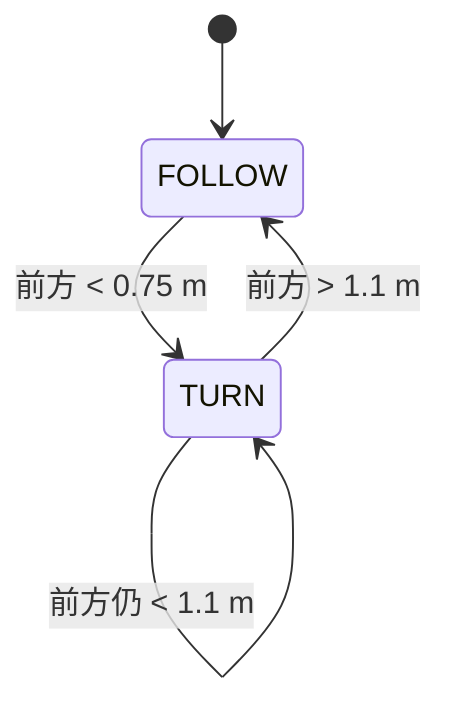
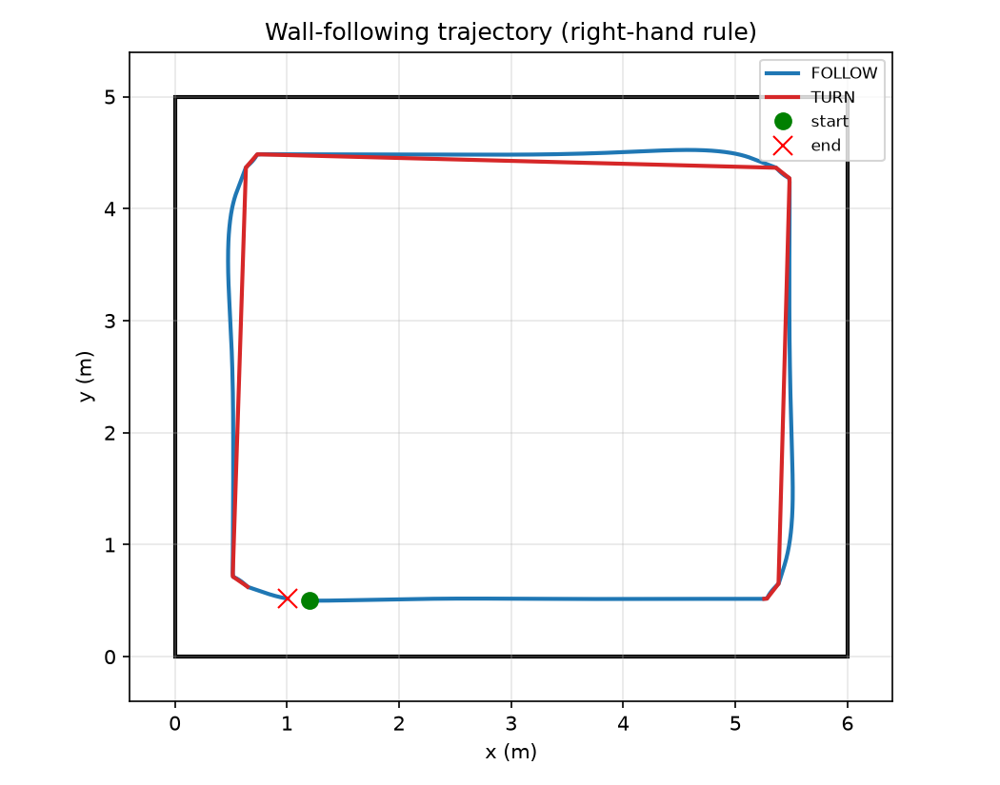
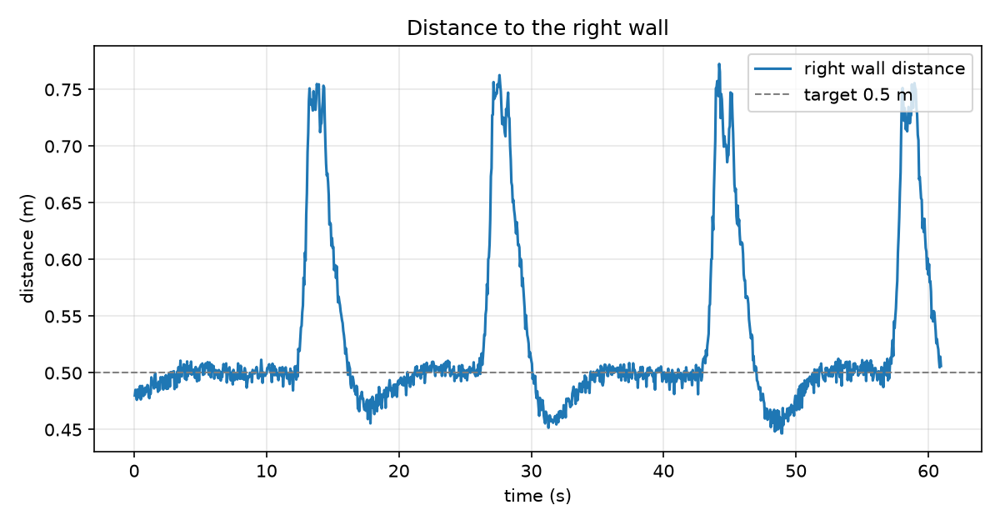
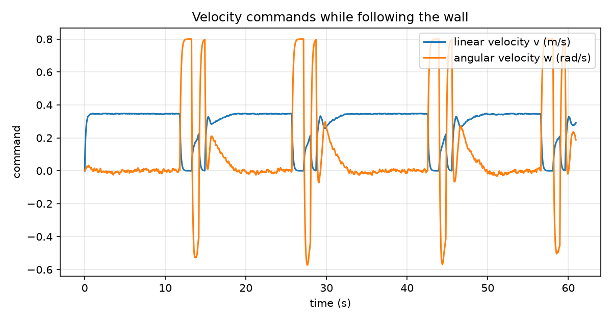

# 差速小车沿墙行驶实验

本实验让一台带 2D 激光雷达的差速小车沿着右侧墙壁行驶：正常段保持约 0.5 m 的墙距，
遇到墙角时原地左转，转过 90° 后继续跟随下一面墙，最终绕房间一圈回到起点。

## 一、实验目的与环境说明

### 1.1 实验目的

1. 掌握激光雷达数据的读取与分区：从 `LaserScan` 中提取正前、正右、右前、右后、正左五路距离；
2. 理解沿墙控制的两个误差来源：离墙距离误差、车身与墙的夹角误差；
3. 用有限状态机处理墙角：直行跟随与原地转向之间的切换；
4. 掌握差速小车 `/cmd_vel` 接口和 ROS 节点的超时保护；
5. 用离线仿真在没有机器人和 Gazebo 的情况下复现并量化控制效果。

### 1.2 实验环境

| 项目 | 配置 |
| ---- | ---- |
| 操作系统 | Ubuntu 20.04（ROS 端）；Windows/Linux（离线仿真） |
| ROS 发行版 | ROS Noetic（Python 3） |
| 依赖 | rospy、geometry_msgs、sensor_msgs |
| 机器人 | 带 2D 激光雷达的差速底盘（如 TurtleBot3 burger） |
| 离线仿真依赖 | Python 3、numpy、matplotlib |

功能包目录结构：

```text
diff_drive_wall_following/
├── main.py             # ROS 节点入口：读 LaserScan、发 Twist
├── wall_follower.py    # 纯 Python 沿墙控制器（可单独测试）
├── offline_sim.py      # 矩形房间离线仿真与出图
├── launch/main.launch  # roslaunch 入口
├── config/params.yaml  # 默认参数
├── test/test_diff_drive_wall_following_local.py  # 本地测试
├── package.xml
├── CMakeLists.txt
└── README.md
```

## 二、实验原理

### 2.1 五路测距

节点以机器人正前方为 0°，在五个方向各取 ±12° 范围内的最小有效距离：

| 名称 | 角度 | 用途 |
| ---- | ---- | ---- |
| `front` | 0° | 判断是否到达墙角 |
| `side` | −90° | 右侧墙距离，沿墙的主反馈 |
| `front_right` | −45° | 与 `back_right` 一起估计车身夹角 |
| `back_right` | −135° | 与 `front_right` 一起估计车身夹角 |
| `left` | +90° | 预留，用于窄通道判断 |

### 2.2 沿墙控制律

记右侧墙距离为 $d$、目标距离为 $d^*$，右前与右后距离分别为 $d_{fr}$、$d_{br}$，则

$$
e_d = d - d^*, \qquad e_a = d_{fr} - d_{br}
$$

$$
\omega = -\left(k_d e_d + k_a e_a\right), \qquad \omega \in [-\omega_{\max}, \omega_{\max}]
$$

$$
v = v_0 \cdot \max\left(0.35,\ 1 - 0.8\frac{|\omega|}{\omega_{\max}}\right)
$$

- $e_d > 0$ 表示离墙太远，此时 $\omega < 0$（右转靠近墙）；
- $e_a > 0$ 表示车头偏向外侧（右前比右后远），同样需要右转修正；
- 角速度越大线速度越低，转弯时不会因为速度过快而撞墙。

默认参数：$d^* = 0.5\ \mathrm{m}$、$k_d = 1.6$、$k_a = 1.2$、$\omega_{\max} = 0.9\ \mathrm{rad/s}$、
$v_0 = 0.35\ \mathrm{m/s}$。

### 2.3 墙角状态机



正前方小于 `front_block_distance`（0.75 m）时认为到了墙角：
停车并原地以 0.8 rad/s 左转；等到前方重新大于 `front_clear_distance`（1.1 m），
说明已经转过墙角，回到沿墙状态。

### 2.4 安全策略

- **激光超时**：超过 `scan_timeout`（0.5 s）没有新数据时持续发布零速度；
- **速度随转角降低**：角速度接近上限时线速度降到 35%，留出修正时间；
- **退出停车**：`Ctrl+C` 或异常退出都会发布零速度。

## 三、运行步骤

### 3.1 ROS + Gazebo

```bash
# 1. 编译
mkdir -p ~/catkin_ws/src
cp -r <本仓库>/src/ground/diff_drive_wall_following ~/catkin_ws/src/
chmod +x ~/catkin_ws/src/diff_drive_wall_following/main.py
cd ~/catkin_ws && catkin_make
source devel/setup.bash

# 2. 启动仿真世界（TurtleBot3 示例）
export TURTLEBOT3_MODEL=burger
roslaunch turtlebot3_gazebo turtlebot3_world.launch

# 3. 确认激光话题正常
rostopic hz /scan

# 4. 启动沿墙节点
roslaunch diff_drive_wall_following main.launch
```

启动前让小车离右侧墙约 0.5 m、车头与墙平行，效果最好。

### 3.2 离线仿真

```bash
cd <本仓库>
python -m pip install numpy matplotlib
python src/ground/diff_drive_wall_following/offline_sim.py
```

离线仿真在 6 m × 5 m 的矩形房间内按 1° 分辨率做激光射线求交，
用差速小车运动学积分（含 0.15 s 执行器滞后）复现同样的控制器，
输出三张图和一组指标。

## 四、实验结果

离线仿真的任务参数：目标墙距 0.5 m、房间 6 m × 5 m、小车从南墙附近出发，沿右侧墙逆时针绕行一圈。

### 4.1 轨迹



蓝色为沿墙跟随段，红色为墙角转向段。小车依次经过南、东、北、西四面墙，
四个墙角都通过原地左转通过，最后回到起点附近。

### 4.2 右侧墙距离



直墙段距离稳定在 0.5 m 附近；经过墙角时右侧墙暂时“消失”，距离升到约 0.75 m，
转过墙角后重新收敛到 0.5 m。

### 4.3 速度指令



直墙段线速度约 0.35 m/s、角速度接近 0；墙角处线速度降到 0，角速度升到 0.8 rad/s；
转过墙角后出现一次反向修正，随后回到沿墙状态。

### 4.4 指标

| 指标 | 数值 |
| ---- | ---- |
| 绕行一圈时间 | 60.95 s |
| 路径长度 | 17.06 m |
| 平均跟墙误差 | 0.031 m |
| 最大跟墙误差 | 0.273 m（墙角段） |
| 最小前方净空 | 0.698 m |
| 终点位置 | (1.007, 0.518) m |

平均误差约 3 cm，主要来自直墙段的控制噪声；最大误差出现在墙角，
这是“转角时右侧墙暂时丢失”的必然结果。最小前方净空 0.698 m 略小于
0.75 m 的触发阈值，是执行器滞后造成的，实际机器人需要保留更多余量。

## 五、讨论与限制

1. 控制器只有比例项，没有积分项，直墙段会残留几厘米的稳态误差；
2. 算法假设右侧始终有一面连续的墙，遇到门洞、玻璃或动态障碍会失效，
   工程上通常再叠加前向避障或局部地图；
3. 转角依赖固定的 0.75 m / 1.1 m 阈值，房间尺寸或激光安装位置变化时需要重新调整；
4. 离线仿真是理想矩形房间 + 简化运动学，不含轮子打滑、激光噪声模型和真实动力学；
5. 本机为 Windows，没有 ROS 与 Gazebo，**ROS 端的实际运行未验证**，
   需要在 ROS Noetic + TurtleBot3 仿真或实车上按 3.1 节复验。

## 说明

本文档与配套代码在整理过程中使用了 AI 助手（DeepSeek）辅助，实验参数、运行结果
和图表均由作者实际运行核对；作者对本文内容负全部责任。
