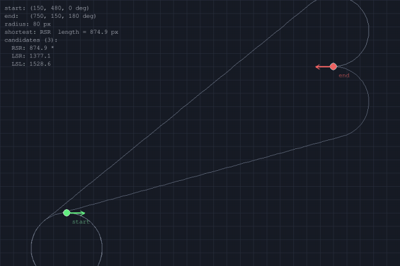

# Dubins 曲线轨迹生成与可视化

带运动学约束的最短可行路径生成模块：给定起末位姿与最小转弯半径，枚举 6 种基本组合（LSL/LSR/RSL/RSR/RLR/LRL）的最短 Dubins 路径，纯 pygame 2D 可视化。

## 概述

Dubins 曲线由 Lester E. Dubins 于 1957 年提出，是带曲率约束（最小转弯半径 R）的车辆在起末位姿已知时**最短可行路径**的标准解。Dubins 证明：最短路径必为以下 6 种基本组合之一：

- **CSC 类型**（圆-直线-圆）：LSL / LSR / RSL / RSR
- **CCC 类型**（圆-圆-圆）：LRL / RLR

其中 L = 左转圆弧（逆时针），R = 右转圆弧（顺时针），S = 直线段。本项目采用**几何构造法**计算 6 种组合长度（圆心 + 公切线 + 弧长），相比闭式参数公式更直观、数值稳定。

## 算法原理

### 问题定义

给定起点 (x0, y0, yaw0) 和终点 (x1, y1, yaw1) 及最小转弯半径 R，求带曲率约束 |κ| ≤ 1/R 的最短可行路径。

### 6 种基本组合

| 类型 | 组合 | 适用 | 几何构造 |
|---|---|---|---|
| CSC | LSL | 两端同向左转 | 左左圆外公切线 |
| CSC | RSR | 两端同向右转 | 右右圆外公切线 |
| CSC | LSR | 第一段左转、第三段右转 | 左右圆内公切线 |
| CSC | RSL | 第一段右转、第三段左转 | 右左圆内公切线 |
| CCC | LRL | 左转-右转-左转 | 中间反向相切圆 |
| CCC | RLR | 右转-左转-右转 | 中间反向相切圆 |

### 圆心计算

对于位姿 pose=(x, y, yaw)：

- 左转圆心 = (x - R·sin yaw, y + R·cos yaw)
- 右转圆心 = (x + R·sin yaw, y - R·cos yaw)

### 公切线

- **外公切线**（LSL / RSR）：两个等径同侧转圆心连线方向即为切线方向
- **内公切线**（LSR / RSL）：切线方向相对圆心连线偏角 φ=asin(2R/dist)，要求 dist ≥ 2R

### 弧长

沿圆心 c1 的 turn1 方向从起点角度走到切点 1 角度，再沿 c2 的 turn2 方向从切点 2 走到终点。单段弧长限定在 [0, 2πR)。

### 与 Bezier 曲线的区别

| 维度 | Bezier 曲线 | Dubins 曲线 |
|---|---|---|
| 输入 | 控制点序列 | 起末位姿 + R |
| 约束 | 自由（光滑插值） | 带曲率上界（车辆运动学） |
| 目标 | 形状插值 | 最短可行路径 |
| 用途 | 轨迹生成 | 路径规划 |

## 实现细节

### 源码结构

| 文件 | 内容 | 行数 |
|---|---|---|
| `dubins.py` | 核心算法：圆心、公切线、6 种组合、最短路径、采样 | ~280 |
| `main.py` | pygame 可视化：起末箭头、6 条候选、最短高亮、HUD、录制 | ~200 |
| `config.py` | 画布尺寸、颜色、起末位姿、R、采样参数 | ~45 |
| `test_dubins.py` | 24 项离线单测 | ~200 |

### 可视化效果

演示 gif（`dubins_demo.gif`）展示：

1. **6 条候选路径**（淡灰色细线）：所有可行组合，无解的不画
2. **最短路径高亮**（青色粗线）：6 种中长度最短者
3. **起末位姿箭头**（绿/红箭头）：标识起点朝向与终点朝向
4. **HUD**：起末位姿、半径 R、最短类型与长度、各候选长度对比



## 运行步骤

### 直接运行

```bash
pip install pygame numpy pillow
python main.py                  # 交互模式
python main.py --record         # 录制演示 gif
```

### ROS 2 运行

```bash
cd ~/ros2_ws
colcon build --packages-select dubins_path --symlink-install
source install/setup.bash
ros2 run dubins_path main
```

## 单元测试

```bash
cd dubins_path
python -m pytest test/ -v
```

24 项单测覆盖：mod2pi 边界、6 种组合非负、最短路径类型与长度、最短 ≤ 候选、缩放相似性、起末位姿对齐、双方向端点对齐、采样点数量、_advance 各段运动学等。

## 大模型使用声明

本项目在开发过程中使用了大语言模型辅助代码编写与文档生成，具体用于：

- Dubins 曲线几何构造算法的 Python 实现
- pygame 可视化代码框架
- 单元测试用例设计
- 文档撰写

核心算法逻辑（圆心构造、公切线方向、弧长积分）均基于经典教材与公开文献实现，AI 辅助部分经过人工审核与虚拟机实测验证。