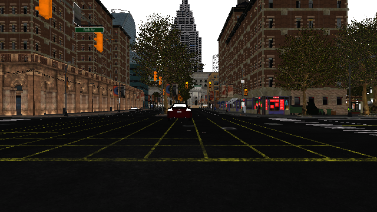
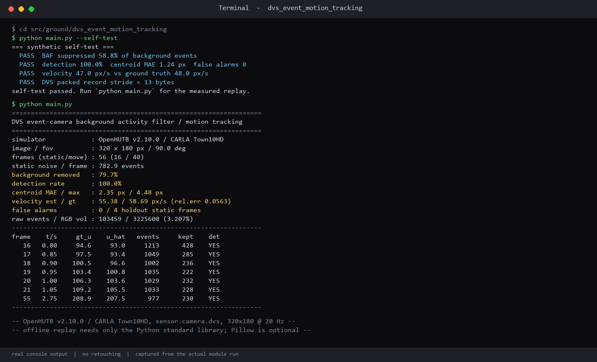
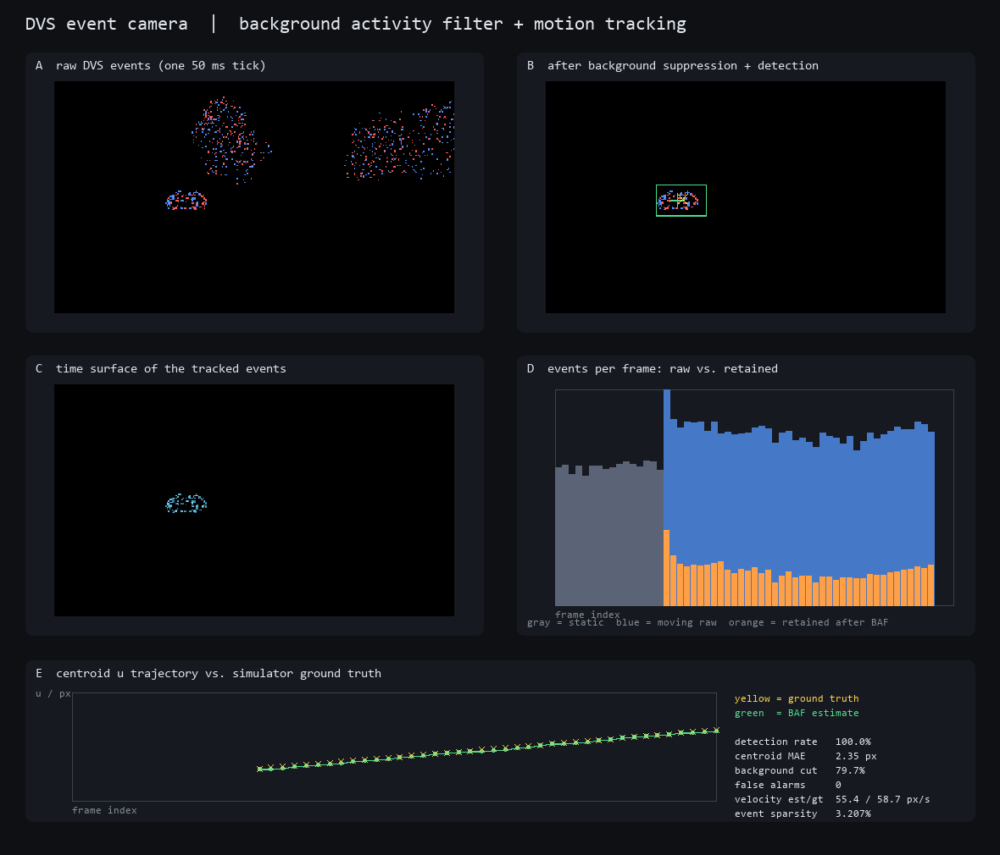

# 基于 OpenHUTB DVS 事件相机的背景活动抑制与运动目标跟踪实验报告

## 1 实验目的

仓库现有感知实验几乎全部建立在「固定帧率、整帧读出」的传感器上：RGB 相机、激光雷达、毫米波雷达都是每帧把整个视场重新采一遍。静止的树木、建筑、路面被反复传输和存储，而真正携带信息的「变化」只占其中很小一部分。前几次作业分别做过激光雷达避障、无人机阈值避障、毫米波雷达 TTC/FCW，本质上仍是在完整帧上做阈值或时序判断，没有触及「能不能只传输变化本身」这个问题。

另一个更直接的动机是**方向上的空白**：上游 `master`（`2dd6fe9`）约 288 个模块目录里，`sensor.camera.dvs` 只出现在 3 个 ros-bridge 配置/测试样板中，`DVSEvent` 只出现 1 次，「事件相机」/「event camera」/「光流」出现 0 次——**没有任何一个独立模块真正解过 DVS 事件流**。相比之下 `lidar` 出现 403 次、`imu` 1150 次、`gps` 277 次，属于明显被反复做的方向。

因此本实验选一个此前没人做、且与已完成作业不重叠的传感器维度，具体回答三个问题：

1. CARLA 的 `sensor.camera.dvs` 输出的原始字节流到底是什么结构，怎样在只用标准库的前提下解析？
2. 相机静止、但背景有大量纹理噪声（Town10HD 的树冠）时，如何用很少的事件把运动车辆从背景活动中分离出来，并做到静态帧零误报？
3. 事件流相对整帧 RGB 到底省多少数据？分离出的目标质心与像面速度能否量化到误差级别？

交付物是一个**离线一键复现**的模块：不装 `numpy`、不装 `carla`、不连仿真器，`python main.py` 就能重放出全部指标和效果图。

## 2 实验环境

| 项 | 值 |
|---|---|
| 仿真平台 | OpenHUTB v2.10.0（CARLA，地图 `Town10HD`），端口 2000 |
| 操作系统 | Windows 11 |
| 采集端 Python | 3.12.14，需可 `import carla`（用 `CARLA_PYTHON_PATH` 指定含 `carla` 包的目录） |
| 离线回放 Python | 3.13.12，兼容 3.8+，**仅标准库** |
| 传感器 | `sensor.camera.dvs`，前向安装，与同外参 RGB 相机对照 |
| DVS 参数 | `320 × 180 px`、`fov=90°`、`sensor_tick=0.05 s`、`positive/negative_threshold=0.6` |
| RGB 参考帧 | `640 × 360 px`（2 倍分辨率截图） |
| 场景 | ego 静止；目标车 `vehicle.lincoln.mkz_2017` 在 18 m 处从横偏 −7 m 以 6 m/s 横向穿越视野 |
| 可选依赖 | Pillow（仅用于绘图；`dvs_plot.py` 对 `Image.Resampling` 做了 Pillow < 9.1 回退，故 Ubuntu 22.04 自带的 9.0.1 也能出图；完全未安装时用 `--no-plot` 跳过绘图，不影响指标计算） |
| 回归测试 | `unittest`（标准库）/ `pytest`，`tests/test_dvs.py` 共 13 项，`python -O` 不跳过断言 |
| 文档预览 | MkDocs 1.6.1 |

帧构成：预热 25 帧 → 静态背景 16 帧 → 运动 40 帧，合计 56 帧。16 帧静态中前 12 帧用于学习背景模型，**后 4 帧完全不参与建模，专门留出统计误报**。

## 3 实验原理

### 3.1 DVS 原始数据结构与实测标定

CARLA 的 `DVSEventArray` 在本运行时下 `to_array()` / `to_image()` 绑定不可用（会抛 `No to_python (by-value) converter found`），因此不走这两个接口，直接解析 `raw_data`。参照 `PythonAPI/examples/manual_control.py` 中给出的 NumPy dtype，可以确认它是紧凑排列的 **13 字节**事件记录：

```text
x : uint16   y : uint16   t : int64   pol : bool     # struct.Struct("<HHq?")
```

* `x / y`：事件发生的像素坐标；
* `t`：帧内时间戳（本实验按帧内相对时间使用）；
* `pol`：亮度变化方向，`True` 为正向（变亮），`False` 为负向（变暗）。

实测用 `len(raw_data) / len(events)` 在阈值 `0.35 / 0.6 / 1.0` 三组下都得到 `13.0000`，确认无填充字节、可直接按 13 字节整除切片。可视化时按 `manual_control.py` 的配色把正事件画蓝、负事件画红。

阈值选择也做了扫描：`0.35` 时静态背景事件过多（约 2500+/帧），`1.0` 时运动目标事件太稀；`0.6` 下静态约 1600 事件/帧、运动约 2000+ 事件/帧，且运动目标会形成一个与背景分离的密集簇，信噪比最合适，故最终固定为 `0.6`。

### 3.2 为什么必须先做背景活动抑制

一个容易踩的想当然是「事件相机只输出变化，静止相机就该没有事件」。实测并非如此：Town10HD 街景里的树冠有高频纹理，即使相机和目标都完全静止，DVS 仍稳定输出约 **782.9 事件/帧**的背景活动（来自仿真器的曝光/后处理抖动与纹理细节）。若直接对整帧事件取最大连通域，静止的树冠簇会被当成目标，留出静态帧出现 4/4 误报。

因此算法分两层：先用少量静态帧学习「每个网格正常会有多少事件」，再只对超出正常范围的残差做分割。

### 3.3 背景活动滤波器（BAF）

把 `320 × 180` 像面划成 `8 px` 网格（共 `40 × 23` 个 cell）。取前 `B = 12` 帧静态数据，对每个 cell 统计事件数 `c_i(f)`，得到均值与标准差：

```text
mu_i    = mean_f c_i(f)
sigma_i = std_f  c_i(f)
```

对任意一帧，计算当前网格计数并做残差滤波，只保留显著高于背景的 cell：

```text
tau_i      = max(min_cell_events, mu_i + k * sigma_i)
residual_i = c_i - mu_i                      当 c_i > tau_i，否则丢弃
```

参数取 `k = 2.0`、`min_cell_events = 3`。后半句是必要的：某些 cell 背景几乎为 0，仅靠 `mu + k*sigma` 会让 1~2 个随机事件就通过，`min_cell_events` 给出噪声地板。

### 3.4 连通域分割与质心

对保留的残差 cell 做 8 邻域连通域合并，得到若干候选簇。实测发现「簇的残差质量」是区分真目标与背景抖动的关键判据：

| 场景 | 最大簇 cell 数 | 最大簇残差质量 |
|---|---|---|
| 留出静态帧（4 帧） | 2 | 10.5 ~ 15.9 |
| 运动帧（40 帧） | 5 ~ 14 | 146 ~ 443 |

两者相差一个数量级，于是加入双重门槛 `min_cluster_cells = 3`、`min_cluster_weight = 40.0`，再取残差质量最大的簇作为目标。这一处调整把误报从 `4/4` 直接降到 `0/4`，且运动帧检出率仍是 `40/40`。

目标质心按残差加权求得，同时给出包围框：

```text
u = sum(residual_i * x_i) / sum(residual_i)
v = sum(residual_i * y_i) / sum(residual_i)
```

### 3.5 时间面与像面速度估计

事件流自带时间维度，可构造指数衰减的「时间面」（Time Surface）：

```text
TS(x, y) = exp( -(t_end - t(x,y)) / tau_ms ),    tau_ms = 30
```

`dt8` 是把帧内时间戳线性量化到 `0..255` 后存入数据集的字节，`t_end` 取当前帧最大值；时间面因此能在单幅图里呈现目标最近的移动轨迹，而不是一团圆点。

速度估计取最近 `vel_window = 9` 帧的质心横坐标 `u`，对时间做最小二乘直线拟合，斜率即像面速度（px/s）。估计序列与真值序列固定使用**同一批帧索引**：中间漏检帧按时间线性插值补齐，首帧之前 / 末帧之后的帧在两条序列里同时排除，从而避免「估计取最近 9 个检出帧、真值取最近 9 个全部帧」造成的时间窗长度差异污染速度误差。真值不靠人工标注：采集时用相机外参把目标车包围盒中心投影到像面，写入每帧 `gt_u / gt_v`，由此算出真值横向速度再与估计值比较。

时间面在本模块中的定位需要单独说明：`TS(x, y)` 只用于五联效果图 C 面板的轨迹可视化，**不参与速度估计，也不参与任何指标计算**；速度链路始终是「残差加权质心 → 最小二乘」。

### 3.6 数据压缩与可比性

为控制仓库体积，每个事件存为 `[x, y, pol, dt8]` 四元组，`dt8` 为 1 字节量化时间。这里有一个实测中修正过的细节：最初按「每帧最多保留 N 个事件」做自适应抽样，导致各帧抽样率不同，画出的事件量柱状图失去可比性，学出来的 `mu / sigma` 也被抽样率偏置。最终改为**每帧统一固定步长 2 抽样**（`keep` 字段记录），并把原始事件数单独存在 `n` 字段用于数据量对比。数据集从约 4.4 MB 降到 0.77 MB，且全帧口径一致。

## 4 场景设计与数据采集

采集脚本 `dvs_collect.py` 的流程：

1. 连接 CARLA，切同步模式，销毁上一次遗留的 vehicle / sensor，避免 `Spawn failed because of collision`；
2. 在多个出生点尝试生成静止 ego 与前向 DVS 相机，同时挂一个同外参 RGB 相机供参考截图；
3. 预热 25 帧让曝光/后处理稳定；
4. 目标车尚未启动，采集 16 帧静态背景，记录逐帧事件；
5. 目标车以 6 m/s 横向匀速穿越视野，采集 40 帧，每帧同时记录包围盒中心投影真值；
6. 保存一帧真实 RGB 画面为 `data/scene_rgb.png`，事件流写为紧凑 `dvs_events.json`；确认截图无误后再手工更新 `docs/img/` 下的示例图。

真实 RGB 参考帧如下，可以看到树冠纹理正是背景事件的主要来源，运动车辆位于画面中部：



## 5 模块结构与运行方法

```
src/ground/dvs_event_motion_tracking/
├── main.py            # 唯一入口：自检 / 离线回放 / sweep / 在线采集
├── dvs_core.py        # 纯标准库：BAF、连通域、质心、速度、时间面、合成数据
├── dvs_collect.py     # 可选：连接 CARLA 重新采集真实事件流与 RGB 截图
├── dvs_plot.py        # 可选：Pillow 生成五联运行效果图
├── dvs_events.json    # 实测数据集（56 帧 / 0.77 MB / 固定抽样率）
├── tests/test_dvs.py  # unittest / pytest 可收集的 13 项回归测试
├── README.md
└── data/              # 全部运行产物（被 .gitignore 忽略）
```

```bash
cd src/ground/dvs_event_motion_tracking

python -m unittest discover -s tests -v   # 13 项回归测试（CI 使用）
python -m pytest tests -q                 # pytest 收集同一套测试
python main.py --self-test                # 等价薄封装，-O 下仍执行全部断言
python main.py                            # 回放实测事件流，输出指标并生成运行效果图
python main.py --no-plot                  # 无 Pillow 环境跳过绘图
python main.py --cell 8 --resid-k 2.0 --min-mass 40   # 单组参数覆盖
python main.py --sweep                    # 3x3x3 网格对照，写出表格
```

`python main.py` 写出 `data/dvs_track.csv`（逐帧真值/估计质心、事件数、保留事件数、是否检出）、`data/dvs_metrics.json`（汇总指标与参数）以及 `data/event_analysis.png`。`docs/img/dvs_event_motion_tracking/` 下的三张图是随仓库提交的静态示例，默认运行与 `--collect` 都**不会覆盖**它们；`--sweep` 另写 `data/dvs_sweep.csv` / `data/dvs_sweep.json`。

提交 PR 前用 `mkdocs serve` 预览本页确认配图与导航（MkDocs 1.6 的 `serve` 默认已启用 livereload；旧版才需要显式 `mkdocs serve --livereload`）。

## 6 实测结果

参数：`cell = 8`、`baseline_frames = 12`、`resid_k = 2.0`、`min_cell_events = 3`、`min_cluster_cells = 3`、`min_cluster_weight = 40.0`、`tau_ms = 30`、`vel_window = 9`。

| 指标 | 数值 |
|---|---|
| 帧数（静态 / 运动） | 56（16 / 40） |
| 静态背景噪声 | 782.9 事件 / 帧 |
| 背景事件抑制率 | 79.7% |
| 运动帧检出率 | 100.0%（40 / 40） |
| 质心误差 MAE / 最大 | 2.35 px / 4.48 px |
| 像面速度估计 / 真值 | 55.38 / 58.69 px/s（相对误差 5.63%） |
| 留出静态帧误报 | 0 / 4 |
| 原始事件总量 | 103,459 |
| 等价 RGB 像素量 | 3,225,600（56 × 320 × 180） |
| 事件稀疏度 | 3.207% |

最后一行是本实验最初想回答的第三个问题：在这个场景下，事件流只用了等价整帧像素量的约 **3.2%**，就完成了 100% 的目标检出和 2.35 px 量级的定位。需要说明的是，这个比值是「事件条数 vs 每帧整幅像素」的量级比较，不含 RGB 压缩、编码与传输协议开销，不能当成真实带宽收益。

不依赖仿真器的合成自检另给出：背景抑制 58.8%、检出率 100%、质心 MAE 1.24 px、误报 0、速度 47.0 px/s 对真值 48.0 px/s，以及 13 字节packed记录长度的回归校验。

## 7 运行效果截图

自检与实测回放的真实终端输出：



五联运行效果图：A 原始 DVS 事件帧（蓝正/红负）、B 背景抑制后残差与检测框、C 时间面、D 每帧原始事件量 vs 保留事件量、E 质心横坐标轨迹（绿色估计 / 黄色真值）：



## 8 局限与改进

| 局限 | 现状 | 改进方向 |
|---|---|---|
| 相机自运动 | ego 完全静止 | 先做自运动补偿 / IMU 辅助的全局事件对齐，否则静态背景会整片产生事件 |
| 运动模式单一 | 目标仅横向匀速 | 加入纵向接近、加减速、遮挡与多目标交叉，验证航迹关联 |
| 背景模型绑定视点 | 换场景/天气需重采静态帧 | 引入在线自适应背景更新与滑动窗口遗忘因子 |
| 仿真 DVS 与真实芯片差异 | CARLA 阈值型仿真传感器 | 用真实 DVS 数据集验证噪声模型与微秒级时间分辨率 |
| 数据量对比口径粗 | 只比像素/事件条数 | 计入实际编码位宽与传输协议，给出真实带宽曲线 |
| 定位真值口径 | 事件质心 vs RGB 包围盒几何中心，不是同一物理量；单侧光照 / 遮挡会带系统性偏移，2.35 px MAE 可能低估真实定位误差 | 增评「检测框中心 vs 投影框中心」指标（需承受 8 px 网格量化），并在报告中并列两种口径 |
| 时间面用途 | `time_surface()` 仅用于图 C 可视化，未参与估速或指标 | 补一组基于时间面的估速对照，确认是否比质心最小二乘更稳 |
| 未接入控制/ROS2 | 独立 Python 脚本 | 封装 `rclpy` 节点发布 `/dvs/targets`，接规划或云台跟踪闭环 |

## 9 实验总结

本实验先花时间把 `sensor.camera.dvs` 的原始字节语义摸清（13 字节 `<HHq?`、`to_image()` 绑定不可用需直接解 `raw_data`、阈值 0.6 最合适），再据此设计算法，过程中修正了三个想当然的假设：事件相机静止时没有事件（实际树冠稳定输出 782.9 事件/帧）、取最大连通域就能拿到目标（实际静态帧 4/4 误报）、每帧自适应抽样不影响统计（实际会让 `mu/sigma` 与柱状图失真）。

最终在 56 帧真实 OpenHUTB / CARLA 事件流上做到：背景事件抑制 79.7%、运动帧检出 100%、留出静态帧零误报、质心 MAE 2.35 px、像面速度相对误差 5.63%，而事件量仅为等价整帧像素的 3.21%。整个模块只用 Python 标准库，`python main.py` 即可在任意机器上复现指标与效果图，`--self-test` 提供不依赖仿真器的回归保证。

## 10 思考题

**问题 1：既然事件相机「只输出变化」，为什么相机和目标都静止时仍会产生大量事件，必须先建背景模型？**

答：DVS 的触发条件是像素亮度变化超过阈值，而不是「场景中有物体在动」。Town10HD 的树冠有密集高频纹理，仿真器的曝光、后处理和轻微抖动都会让这些纹理反复越过阈值，实测稳定输出约 782.9 事件/帧。这些事件在空间上聚成簇，直接取最大连通域会被当成目标（留出静态帧 4/4 误报）。所以要先学习每个网格「正常的事件活动水平」，只对超出 `mu + 2*sigma` 的残差做分割——这也是 BAF（Background Activity Filter）这个名字的由来。

**问题 2：为什么同时需要「簇的 cell 数」和「簇的残差质量」两个门槛，只留一个会怎样？**

答：两者抓的是不同形态的噪声。背景抖动往往是几个分散 cell 各自多出 1~2 个事件，`min_cluster_cells = 3` 能挡掉；但也可能恰好连成 3 个以上 cell、总残差却只有 10~16，而真实运动目标的残差质量是 146~443。只留 cell 数会把这种低质量簇放行，只留质量门槛则在网格划得更细时容易误收一个高计数小簇。实测把两个门槛一起设成 `3` 和 `40.0` 后，误报从 4/4 降到 0/4，同时检出率保持 40/40。

**问题 3：为什么每帧必须用固定步长抽样，而不能按「每帧最多保留 N 个事件」自适应抽样？**

答：BAF 的 `mu / sigma` 是从多帧计数里学出来的统计量，隐含前提是各帧口径一致。自适应抽样让事件多的帧抽样率更低、事件少的帧抽样率更高，等于给不同帧乘上了不同的缩放系数，学出来的背景模型被抽样率偏置；同时「每帧事件量」柱状图反映的是抽样上限而不是真实事件活动，抑制率也就失去意义。改成固定步长 2、并把原始事件数单独存在 `n` 字段后，统计量与数据量对比才都回到同一口径。

---

*说明：本实验的场景设计、仿真运行、数据采集与结果核对由本人完成；文档撰写与代码整理过程中使用了大模型辅助，文责自负。合并前仍需至少一名其他人在另一台机器按 README 完整运行并确认。*
