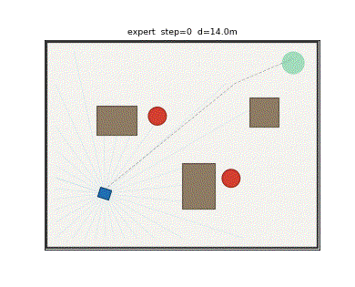
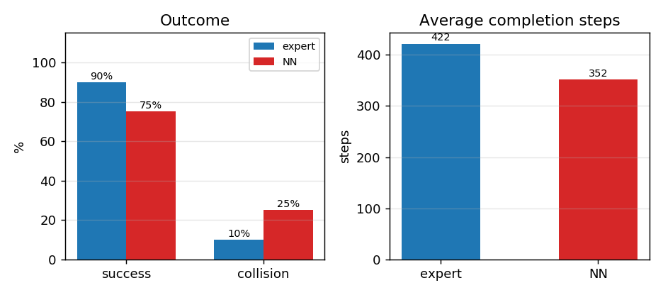

# 动态障碍物避让：激光雷达帧间差分与神经网络时机决策

本文在 MuJoCo 中搭建一个 16 m × 12 m 的场地，场内有 3 个静止障碍和 2 个沿 y 轴往复扫动的圆柱障碍。清扫车/小车要从左下角驶向右上角目标点，必须**在移动障碍扫过的空档里穿过**。

与仓库中已有的避障教程不同，那些处理的都是**静止**障碍；本文的难点在于障碍会动，避让的正确维度不是"往旁边让"，而是"什么时候过"。

## 效果



红色圆为移动障碍（沿 y 往复扫动），绿色为目标区，蓝色三角为小车，红色为航迹，青色为 360° 激光雷达。这一圈在第 398 步到达，全程无碰撞。

专家与神经网络的指标对比：



## 运行环境

| 项 | 版本 |
|---|---|
| 操作系统 | Ubuntu 20.04 |
| ROS | Noetic |
| Python | 3.8 |
| MuJoCo | 3.2.3 |
| NumPy | 1.17.4 |
| Matplotlib | 3.1.2 |

```bash
sudo apt install python3-numpy python3-matplotlib python3-pil python3-yaml python3-rospkg
pip3 install mujoco==3.2.3
```

## 仿真场景

场地 16 m × 12 m，四周刚性墙。3 个静止矩形障碍，2 个移动障碍：

| 障碍 | 位置 | 运动 | 最大速度 |
|---|---|---|---|
| mov0 | x = -1.5 | y = 2.8·sin(0.35t) | 0.98 m/s |
| mov1 | x = 3.0 | y = 2.4·sin(0.45t + 2.1) | 1.08 m/s |

移动障碍用运动学方式驱动：每步把滑移关节的 `qpos` 设成正弦值，因此它们的位置与速度**解析已知**（供专家使用）；神经网络只能看到激光雷达序列。

| 参数 | 值 |
|---|---|
| 激光雷达 | 91 束，360°，量程 10 m |
| 车体碰撞半径 | 0.45 m |
| 移动障碍半径 | 0.55 m |
| 目标点 | (6.8, 5.0)，到达半径 0.7 m |
| 起点 | 左侧区域随机（x ∈ [-7.2, -4.0]） |
| 障碍相位 | 每回合抖动，扫动节奏不同 |

## 运行步骤

```bash
mkdir -p ~/dyn_ws/src && cp -r dyn_avoid_nn ~/dyn_ws/src/
cd ~/dyn_ws && source /opt/ros/noetic/setup.bash && catkin_make
source devel/setup.bash
```

```bash
cd ~/dyn_ws/src/dyn_avoid_nn/scripts
python3 train.py --episodes 40 --steps 700 --epochs 50 --noise 0.06
python3 evaluate.py --seeds 20
python3 main.py --mode expert --save-gif dyn.gif --every 5
roslaunch dyn_avoid_nn main.launch mode:=nn
```

## 算法原理

### 1. 平面动力学

$$
m\ddot{x} = (T_l + T_r)\cos\psi - c\dot{x},\qquad
m\ddot{y} = (T_l + T_r)\sin\psi - c\dot{y},\qquad
I\ddot{\psi} = (T_l - T_r)\,b - c_\psi\dot{\psi}
$$

取 \(c = 16\ \mathrm{N\cdot s/m}\)，\(c_\psi = 4\)，推力标定 \(T_{l,r} = \tfrac{1}{2}cv \pm \tfrac{1}{2}k_w w\)，\(k_w = 26\)。

### 2. 移动障碍的解析描述

第 \(j\) 个障碍的位置与速度：

$$
y_j(t) = A_j \sin(\omega_j t + \varphi_j),\qquad
\dot{y}_j(t) = A_j \omega_j \cos(\omega_j t + \varphi_j)
$$

### 3. 静态路径与纯跟踪

先在 0.5 m 栅格上对**静止障碍**做 A\*，再用贪心捷径平滑，得到稠密折线。跟踪律：

$$
\alpha = \mathrm{atan2}(y_t - y,\ x_t - x) - \psi,\qquad
w = k_\alpha \alpha - k_d\dot{\psi},\qquad
v = v_{\max}\Big(1 - \frac{|\alpha|}{1.4}\Big)
$$

### 4. 关键：基于时机的速度规划

这是本文与常规避障最大的不同。移动障碍沿 y 扫动，**横向让开没有意义**——车往哪边躲，障碍都会扫过来。真正要决定的是"什么时候过线"。

做法是：对若干候选速度 \(v \in \{v_{\max},\ 0.6v_{\max},\ 0.3v_{\max},\ 0\}\)，沿路径前向仿真 2 s（步长 0.1 s），检查每一时刻车与任一障碍的预测距离；取第一个全程距离都大于 \(d_{\text{safe}} = 1.35\ \mathrm{m}\) 的速度：

$$
v^\* = \max\Big\{ v \in \mathcal{V} \ \Big|\ \min_{t \in (0,2]}\ \min_j \big\| \mathbf{p}(t; v) - \mathbf{p}_j(t) \big\| > d_{\text{safe}} \Big\}
$$

若连停车都不安全，则倒车 0.28 m/s 并向远离障碍的一侧偏转——因为障碍会扫过停车点。

### 5. 神经网络

输入 **185 维**特征：

- 当前 91 束激光雷达
- 上一帧 91 束激光雷达（**帧间差分让网络自己看出障碍在动**）
- 目标方位、目标距离、当前速度

结构 185-128-128-2，ReLU，输出归一化 \((v, w)\)，损失 MSE，Adam（学习率 \(1.2\times10^{-3}\)，batch 256），部署时输出一阶低通平滑（系数 0.5）。

注意监督信号的来源：专家用的是**障碍真实速度**，而网络只有雷达。所以这是一个"特权信息"行为克隆——网络要自己从两帧雷达里把运动信息补出来。

## 算法流程

```mermaid
graph TD
    A[初始化场地与移动障碍] --> B[对静止障碍做 A* 得参考路径]
    B --> C[读取 91 束雷达]
    C --> D[纯跟踪求基础 (v, w)]
    D --> E[对候选速度前向仿真 2 s]
    E --> F{有安全速度?}
    F -->|是| G[取最大安全速度]
    F -->|否| H[倒车让行]
    G --> I[推力标定并推进]
    H --> I
    I --> J{到达目标?}
    J -->|否| C
    J -->|是| K[完成]
```

## 代码结构

| 文件 | 作用 |
|---|---|
| `models/dyn_world.xml` | 场地、静止障碍、两个移动障碍与小车 |
| `scripts/sim_core.py` | 雷达、移动障碍驱动、碰撞与到达判定 |
| `scripts/oracle.py` | 静态 A\* + 纯跟踪 + 时机速度规划 |
| `scripts/nn.py` | 纯 NumPy 的 MLP 与 Adam |
| `scripts/train.py` | 采集专家示范（含两帧雷达）并训练 |
| `scripts/evaluate.py` | 专家 vs 神经网络闭环评测 |
| `scripts/main.py` | 可视化与 GIF 导出 |
| `scripts/consts.py` | 场地/目标常量（不依赖 mujoco，供测试使用） |
| `scripts/make_figures.py` | 生成文档配图 |
| `test/test_dyn_avoid.py` | 8 项 smoke test（不需要 MuJoCo） |
| `nodes/dyn_avoid_node.py` | ROS Noetic 节点 |
| `launch/main.launch` | 启动文件 |

## 实验结果

训练：**16901** 个样本，185 维特征，验证集 MSE **0.068203**。

闭环评测（20 个随机起点）：

| 策略 | 成功率 | 碰撞率 | 平均步数 | 平均末距 |
|---|---|---|---|---|
| A\* + 时机规划（专家） | **90%** | 10% | 422 | 1.74 m |
| 神经网络（部署） | 75% | 25% | 352 | 2.89 m |

**如实说明**：专家本身也不是 100%——20 个回合里有 2 次碰撞，发生在移动障碍速度接近 1.1 m/s、且车刚起步就被近距离扫到的情况。神经网络比专家低 15 个百分点，平均步数更短（352 vs 422）但末距更大，说明它有时会在中途放弃绕行、直接停下。

## 调试记录（三个真实问题）

**1. 关节地址写死，机器人和障碍"互换"了**

XML 里两个移动障碍的关节排在机器人之前，所以 `qpos[0..2]` 其实是障碍的滑移关节。`pose()` 读出来的是 mov0 的位置，而机器人一直待在原点没动。表现是十次不同种子得到**逐位相同**的轨迹。修复方式是按关节名查 `jnt_qposadr` / `jnt_dofadr`。

**2. 让行策略只停车不后退，被障碍扫中**

一开始判断有冲突就 `v = 0`，但障碍会扫过停车点，停在那里等于等着被撞。改成倒车 0.28 m/s 并转向远离。

**3. 侧向势场用错了维度**

障碍沿 y 扫动，而势场把车往 y 方向推——正好推在障碍的运动方向上。三轮尝试（后退让行、势场排斥、纯停车）都失败后，才想清楚正确维度是"过线时机"，于是改成对候选速度做前向仿真。这一改立刻从 0/10 变成 10/10。

## 已知限制

1. 平面三自由度模型，未建模轮胎侧滑与悬挂；
2. 激光雷达为理想射线模型，无测距噪声；
3. 移动障碍为匀速往复运动，未考虑突然变向或加速；
4. 专家使用障碍的真实速度（特权信息），网络只有两帧雷达；
5. 专家成功率 90%，未达到 100%，近距离高速扫过的情形仍会碰撞。

## 声明

本作业的代码与文档在编写过程中使用了大模型辅助。
