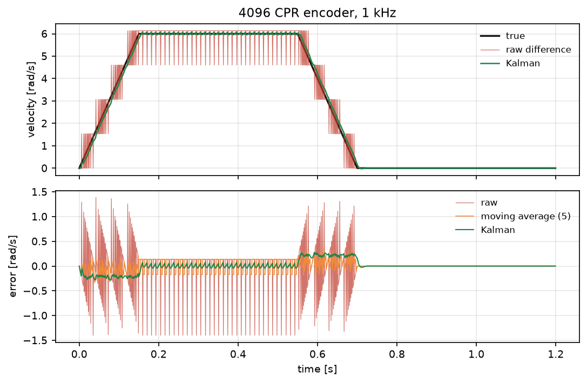
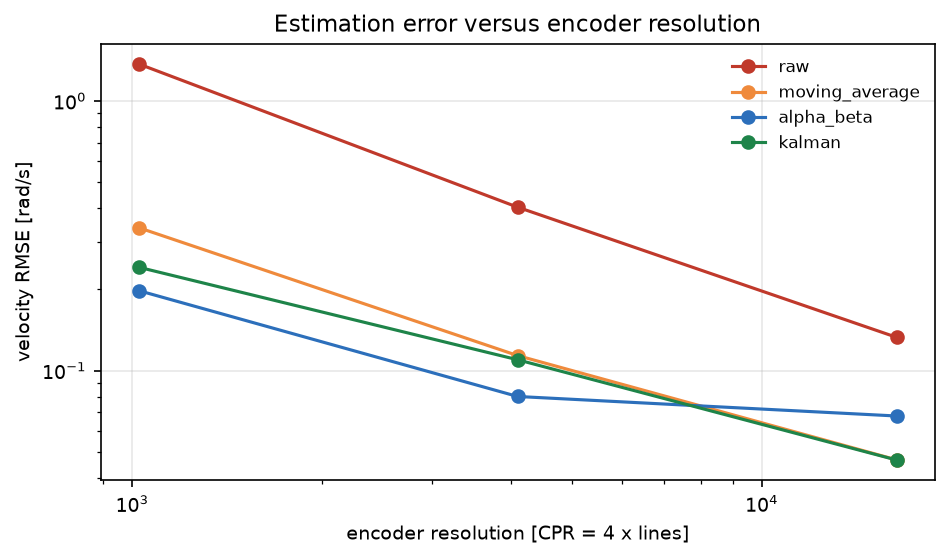

# 编码器量化误差对速度估计的影响与滤波对比

差速底盘的速度环通常直接用"位置差分 / dt"作为反馈。1 kHz 采样下，4096 CPR 编码器的量化步长
是 1.53 mrad，差分后速度噪声约 1.5 rad/s——比很多机器人的实际速度还大。本模块量化这个问题，
并对比三种滤波方案。

与仓库已有模块的区别：

- 仓库里没有编码器量化/速度估计滤波的模块（`encoder`、`quantization` 关键词只命中里程计标定相关文件）；
- `diff_drive_odom_calib` 标定的是轮径/轮距（系统性误差），本模块处理的是**量化噪声**；
- `twist_to_control`、`pid_auto_tuning` 在下游，本模块讨论的是反馈信号的来源。

## 1. 方法

### 1.1 量化模型

$$
q_k=\mathrm{round}\!\left(\frac{\theta_k}{\Delta}\right)\Delta,\qquad
\Delta=\frac{2\pi}{\mathrm{CPR}}
$$

原始差分速度

$$
v_k=\frac{q_k-q_{k-1}}{dt}
$$

量化误差 $\pm\Delta/2$ 除以 $dt=1$ ms 后放大 1000 倍，得到速度误差量级
$\Delta/dt$：1024 CPR 时约 6.1 rad/s，4096 CPR 时约 1.5 rad/s。

> **口径**：表中 CPR 指**四倍频（quadrature ×4）解码后的计数/转**，不是编码器线数：若按线数选型，1024 线对应 4096 CPR、4096 线对应 16384 CPR。量化步长 Δ = 2π/CPR，与 `EncoderSpec.step_rad` 一致。

### 1.2 三种滤波

- **滑动平均**：对最近 $N=5$ 个差分值取平均，噪声降 $\sqrt5$ 倍，代价 $2$ ms 延迟；
- **α-β 跟踪器**：对位置做预测-校正，$\alpha=0.35,\ \beta=0.08$；
- **两状态卡尔曼**：状态 $[\theta,v]$，过程噪声 25 rad/s²（覆盖梯形曲线的加减速），
  量测噪声取 $\Delta/3$。

延迟用互相关峰的位置度量（估计相对真值的滞后）；采样间隔 1 ms，所以延迟分辨率就是 **±1 ms**，1024 CPR 下原始差分噪声很大，0 ms 的峰值也可能是伪峰。

### 1.3 数据

梯形速度曲线：加速 0→6 rad/s（40 rad/s²）、匀速 0.4 s、减速、停止，共 1.2 s、1 kHz。

## 2. ROS 2 接口

| 节点 | 作用 |
|---|---|
| `encoder_sim` | 按所选分辨率发布量化位置 |
| `velocity_estimator` | 同时输出原始差分、卡尔曼与滑动平均 |

## 3. 构建与运行

```bash
source /opt/ros/humble/setup.bash
cd ~/hutb_ws
colcon build --symlink-install --packages-select encoder_quantization_velocity
source install/setup.bash
ros2 launch encoder_quantization_velocity main.launch.py cpr:=4096 duration_s:=120
```

离线：

```bash
cd src/ground/encoder_quantization_velocity
python3 main.py --out results --figure-dir ../../../docs/img/ground/encoder_quantization_velocity
python3 -m unittest discover -s tests -v
```

## 4. 结果

环境：Windows 11、Python 3.12.14、NumPy 2.3.5。

### 4.1 速度误差（rad/s）

| CPR | 原始差分 | 滑动平均(5) | α-β | 卡尔曼 | 量化步长 [mrad] |
|---|---|---|---|---|---|
| 1024 | 1.371 | 0.339 | **0.198** | 0.242 | 6.14 |
| 4096 | 0.404 | 0.114 | **0.080** | 0.110 | 1.53 |
| 16384 | 0.133 | **0.047** | 0.068 | **0.047** | 0.38 |

原始差分的误差随 CPR 反比下降：1.371 → 0.404 → 0.133，两段分别降到 1/3.4 与 1/3.0（第二次已是 α-β 与卡尔曼的噪声地板）。

### 4.2 延迟（互相关峰）

| CPR | 原始差分 | 滑动平均 | α-β | 卡尔曼 |
|---|---|---|---|---|
| 1024 | 0 ms | 2 ms | 3 ms | 12 ms |
| 4096 | 0 ms | 2 ms | 3 ms | 5 ms |
| 16384 | 0 ms | 2 ms | 3 ms | 2 ms |





### 4.3 三个结论

1. **量化噪声是速度环的主要噪声源**：4096 CPR + 1 kHz 时原始差分误差 0.404 rad/s，
   相当于 6.7 % 的匀速段速度；
2. **低分辨率下 α-β 最优**（1024 CPR：0.198 vs 滑动平均 0.339、卡尔曼 0.242），
   卡尔曼的最大误差更小（0.55 vs 0.76 rad/s），因为它抑制了换向尖峰；
3. **本实验范围内高分辨率下滤波收益饱和**（16384 CPR 时滑动平均与卡尔曼都到 0.047）；本模块没有扫采样率、也没有测 16384 CPR 以上的档位，所以不能外推为“再提高分辨率无意义”。

## 5. 复现

```bash
cd src/ground/encoder_quantization_velocity
python3 main.py --out results --figure-dir ../../../docs/img/ground/encoder_quantization_velocity
python3 -m unittest discover -s tests -v    # 11 项
```

| 文件 | 内容 |
|---|---|
| `encoder_quantization_velocity/core.py` | 量化、差分、滑动平均、α-β、两状态卡尔曼 |
| `encoder_quantization_velocity/scene.py` | 梯形曲线与量化测量 |
| `encoder_quantization_velocity/headless.py` | 三种分辨率对比与 `results/summary.json` |
| `encoder_quantization_velocity/plotting.py` | 两张图 |
| `encoder_quantization_velocity/nodes.py` | 编码器仿真与估计节点 |
| `results/summary.json` | 本文全部数值 |

## 6. 限制

1. 只做单关节/单轴，未涉及差速底盘两轮耦合与轮径标定残差。
2. 量化误差按均匀分布建模，未包含编码器跳变、丢脉冲与 AB 相细分误差。
3. 卡尔曼过程噪声按经验给定（25 rad/s²），未做自适应。
4. 延迟用互相关峰估计，分辨率 1 ms（一个采样周期）。
5. 未接入真实速度环，只比较估计误差本身；闭环带宽影响未评估。
6. ROS 2 端只做了 `compileall`、`package.xml` 解析与桩模块联调，未在本机执行 `colcon build` 与 `ros2 launch`。

## 7. 大模型使用声明

使用 DeepSeek Harness（deepseek-flash）辅助完成代码、推导整理、测试与文档。作者核对了量化误差量级、
滤波器阶数与延迟定义，并在本机实际运行了离线实验与 11 项单元测试，数值来自 `results/summary.json`。
