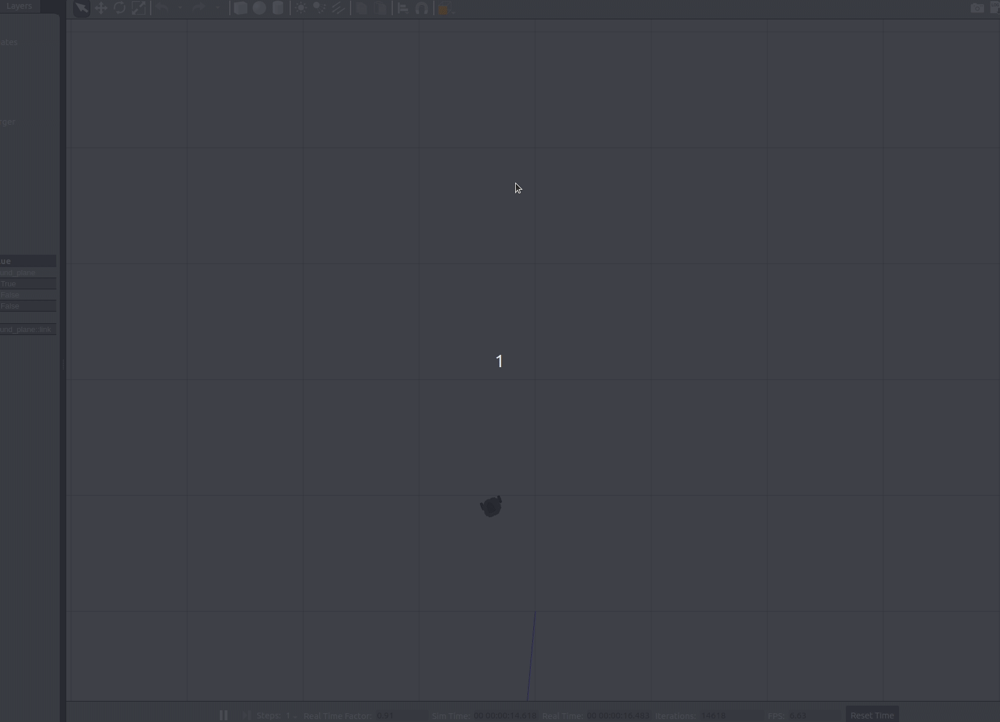

# 定点停车（fixed_point_stop）

`fixed_point_stop` 是一个定点停车的 ROS1 包，用 TurtleBot3（Gazebo 仿真）从起点驶向指定
目标点，到达后自动停车并打印停点误差。正前方障碍太近时会停车、原地右转躲一下再继续走。

源码在 `src/ground/fixed_point_stop/`，入口是 `main.py`。

## 它怎么工作的

节点订阅 `/odom` 拿到小车的位置和朝向，算出到目标点的距离和角度差，再发布 `/cmd_vel` 控制
小车：角度差大就先原地转向对准目标方向，对准了就直行逼近目标点，距离在容差内就自动停车。
同时订阅 `/scan` 看正前方的距离，太近了就停车右转躲一下。

默认目标点是 (1.5, 1.5)（单位米），可通过 launch 参数 `target_x`、`target_y` 修改。

## 运行

环境、编译和启动步骤见模块里的 [`README.md`](https://github.com/OpenHUTB/ros2/blob/master/src/ground/fixed_point_stop/README.md)。

快速启动：

```bash
cd ~/catkin_ws && catkin_make && source devel/setup.bash
export TURTLEBOT3_MODEL=burger
roslaunch turtlebot3_gazebo turtlebot3_world.launch
roslaunch fixed_point_stop fixed_point_stop.launch
```

## 运行效果



## 验证记录

在自己的机器上实际构建、启动、运行过：Ubuntu 20.04.6 LTS（focal）、ROS Noetic、Python 3.8.10、
catkin 0.8.12、Gazebo 11.15.1、TurtleBot3 burger。`catkin_make` 编译通过，仿真和节点正常启动，
小车驶向目标点并自动停车，终端输出 `ARRIVED! goal=(3.00,0.00) pos=(2.75,0.01) err=0.25m` 并打印实际位置与误差。

## 声明

`main.py` 是作业的原始代码，其余文件（`package.xml`、`CMakeLists.txt`、`launch`、`README.md`、本文档）在整理时用到了大模型辅助。我已逐项核对，对提交内容负责。
