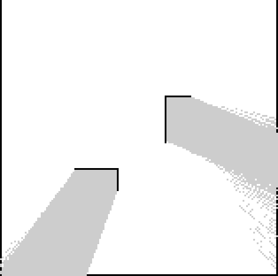

# MuJoCo 叉车同步建图与自主导航

本例在 MuJoCo 平面场景运行移动底盘、激光雷达和障碍物。底盘使用平面运动学积分更新位姿，激光扫描由 MuJoCo 射线查询生成。统一 launch 同时启动仿真、同步模式 `slam_toolbox` 和 Nav2。SLAM 消费 `/scan` 与 `/odom`，生成 `/map` 并维护 `map -> odom`；Nav2 根据在线地图和局部扫描规划并避障。



运行地图坐标系为 `map`，分辨率为 0.05 m/格。图像取自本次容器运行中的 `/map` 话题。

## 构建镜像

从仓库根目录先构建 ROS 2 Humble 基础镜像，再构建按依赖清单安装 MuJoCo 3.12.0、NumPy、SLAM 与 Nav2 的运行镜像：

```bash
docker build -t mujoco-forklift-pallet-docking:latest src/ground/mujoco_forklift_pallet_docking
docker build -f src/ground/forklift_slam_nav/Dockerfile -t forklift-slam-nav:humble .
```

## 启动与检查

```bash
docker run --rm -it --name forklift-slam-nav forklift-slam-nav:humble
```

启动后查看主要话题：

```bash
ros2 topic list
ros2 topic echo --once /scan
ros2 topic echo --once /odom
ros2 topic echo --once /map
ros2 run tf2_ros tf2_echo map base_link
```

坐标关系为 `map -> odom -> base_link -> laser`。其中 `odom -> base_link` 来自仿真里程计，`map -> odom` 由同步 SLAM 发布，激光安装位姿由静态 TF 发布。

## 发送导航目标

在地图已有观测后，通过 `NavigateToPose` action 指定地图坐标系下的目标：

```bash
ros2 action send_goal /navigate_to_pose nav2_msgs/action/NavigateToPose "{pose: {header: {frame_id: map}, pose: {position: {x: 0.0, y: 2.0}, orientation: {w: 1.0}}}}"
```

容器验收时，地图尺寸为 157×156；向 `(0, 2)` 下发的 `NavigateToPose` 目标返回 `SUCCEEDED`。

Nav2 会通过 `/cmd_vel` 控制底盘；局部代价地图使用 `/scan` 标记障碍物并清除空闲区域。

## 启动入口与模型高度

规范启动文件为 `launch/main.launch.py`（包含原 `launch/bringup.launch.py`，原命令仍可使用），通过 `ros2 launch forklift_slam_nav main.launch.py` 调用。仿真可执行入口 `mujoco_robot` 对应 `forklift_slam_nav.simulator:main`。`odom -> base_link` 的高度为 0.22 m；`base_link -> laser` 的相对高度为 0.04 m，激光在模型中的绝对高度为 0.26 m。

规范 Python 入口为 `main.py`，调用 `forklift_slam_nav.simulator:main`；安装后可用 `ros2 run forklift_slam_nav main` 启动仿真节点，原 `mujoco_robot` 可执行入口继续兼容。
