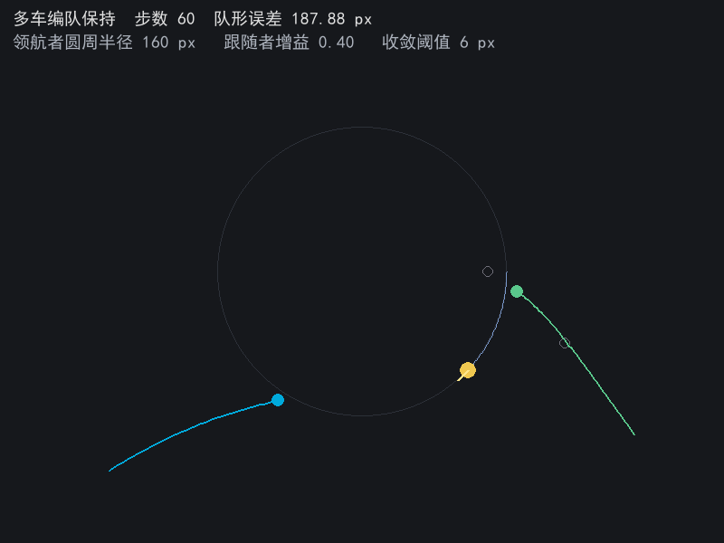
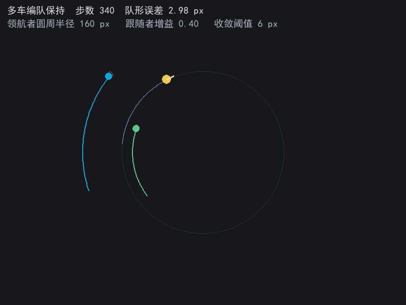
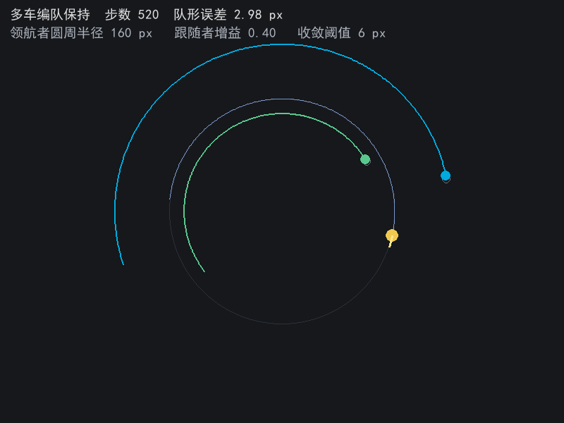

不对不对，# 多车编队保持（formation_keeping）

> **模块定位**：基于 pygame 的独立 2D 仿真演示，非 ROS 节点包；不发布话题、不创建 rclpy 节点，仅用于可视化编队控制效果。

演示移动机器人编队控制的队形保持问题。领航者按圆周轨迹运动，跟随者不直接跟随领航者位置，而是跟随以领航者朝向为参考的期望位置，这样队形随行进方向一起旋转。

## 分层
- `formation.py`：偏移旋转、期望位置解算、队形误差（均方根）、领航者圆周状态。
- `team.py`：编队状态机，逐帧推进领航者并让跟随者按比例控制逼近期望位置。
- `main.py`：绘制参考圆、期望队形虚点、各成员轨迹与朝向，显示队形误差。

## 误差口径
队形误差为各成员与期望位置距离的均方根（RMS）：参与统计的成员共 3 个，即领航者与两个跟随者，分母为成员数 3；领航者自身偏移为 0，其位置偏差也一并计入 RMS。

## 控制律
跟随者每帧朝期望位置方向移动 gain 倍的距离差，单帧位移上限 3.4 像素。领航者线速度为半径 160 与角速度 0.0125 的乘积，即每帧 2 像素，稳态滞后约 3 像素。

## 运行
见包内 README。

## 运行效果

第 60 帧：两个跟随者还在从初始散开位置追赶，队形误差 187.88 像素，灰色小圈是各自的期望位置。

第 340 帧：跟随者与期望位置基本重合，三角队形随领航者朝向旋转，队形误差 2.98 像素。为了让稳态队形看得清楚，这一帧的轨迹从队形收敛后重新起算。

第 520 帧：绕行大半圈后仍保持队形，误差仍是 2.98 像素。三条轨迹圆心相同，半径不同，分别对应领航者与两个跟随者的队形偏移。

## 声明

过程中借助大模型工具辅助代码编写、整理包目录结构与本描述排版，核心逻辑与操作、场景参数设定与实际运行调试为本人完成，作者对提交内容负责。
