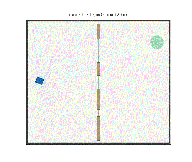
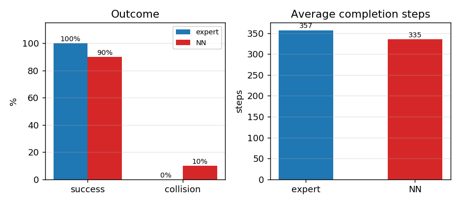

# 狭窄通道通行：激光雷达开口辨识与神经网络选口穿行

本文在 MuJoCo 中搭建一个 14 m × 12 m 的场地，中间一道隔墙把场地分成两半，墙上有**三个宽度不同的开口：0.7 m、1.4 m、2.4 m**。小车宽 0.6 m，最窄的那个开口实际过不去。

任务是从左侧任意位置出发，**自己判断哪个开口能过**，穿过去到达右侧的目标点。这考察的不是避障，而是**可通行性判断**——感知到的"空"不等于"过得去"。

## 效果



墙上的绿/红短线标出三个开口（绿=可通行，红=过窄），蓝色三角为小车，红色为航迹，青色为 270° 激光雷达。这一次选的是 1.4 m 的中间开口，第 348 步到达。

专家与神经网络的指标对比：



## 运行环境

| 项 | 版本 |
|---|---|
| 操作系统 | Ubuntu 20.04 |
| ROS | Noetic |
| Python | 3.8 |
| MuJoCo | 3.2.3 |
| NumPy | 1.17.4 |
| Matplotlib | 3.1.2 |

```bash
sudo apt install python3-numpy python3-matplotlib python3-pil python3-yaml python3-rospkg
pip3 install mujoco==3.2.3
```

## 仿真场景

场地 14 m × 12 m，四周刚性墙，中间一道 0.3 m 厚的隔墙（x = 0），开口如下：

| 开口 | 中心 (y) | 宽度 | 能否通过 |
|---|---|---|---|
| G1 | -3.20 | 0.70 m | ✗（车宽 0.6 m，两侧各余 0.05 m） |
| G2 | 0.00 | 1.40 m | ✓ |
| G3 | 3.20 | 2.40 m | ✓ |

| 参数 | 值 |
|---|---|
| 激光雷达 | 91 束，270°，量程 8 m |
| 车体碰撞半径 | 0.42 m |
| 车宽 | 0.60 m |
| 可通行判据 | 开口宽 ≥ 0.95 m |
| 起点 / 目标 | x = -6.0 / x = +6.0，y 各自随机 ∈ [-4.5, 4.5] |

## 运行步骤

```bash
mkdir -p ~/gap_ws/src && cp -r gap_nav_nn ~/gap_ws/src/
cd ~/gap_ws && source /opt/ros/noetic/setup.bash && catkin_make
source devel/setup.bash
```

```bash
cd ~/gap_ws/src/gap_nav_nn/scripts
python3 train.py --episodes 90 --steps 600 --epochs 80 --noise 0.10
python3 evaluate.py --seeds 20
python3 main.py --mode expert --save-gif gap.gif --every 5
roslaunch gap_nav_nn main.launch mode:=nn
```

`launch/main.launch` 会用 `<rosparam>` 把 `config/params.yaml` 加载到节点私有命名空间，
节点用 `rospy.get_param("~xxx")` 读取；`mode`、`min_passable`、`v_max`、`lookahead`
都可以在命令行覆盖，例如只允许最宽的开口：

```bash
roslaunch gap_nav_nn main.launch mode:=expert min_passable:=2.0
# [INFO] gap nav node ready: ... min_passable=2.00 ... gap_width=2.40
```

## 算法原理

### 1. 平面动力学与推力标定

$$
m\ddot{x} = (T_l + T_r)\cos\psi - c\dot{x},\qquad
m\ddot{y} = (T_l + T_r)\sin\psi - c\dot{y},\qquad
I\ddot{\psi} = (T_l - T_r)\,b - c_\psi\dot{\psi}
$$

取 \(c = 16\)、\(c_\psi = 4\)，稳态满足 \(F = c\dot{x}\)，故

$$
T_l = \tfrac{1}{2}c\,v + \tfrac{1}{2}k_w\,w,\qquad
T_r = \tfrac{1}{2}c\,v - \tfrac{1}{2}k_w\,w,\qquad k_w = 26
$$

### 2. 激光雷达

$$
r_i = \min\big(\mathrm{mj\_ray}(\mathbf{p},\ [\cos\theta_i,\sin\theta_i,0]^\top),\ R_{\max}\big)
$$

91 束覆盖 270°，足够在接近隔墙时同时看到左右两侧墙段与中间开口。

### 3. 专家的开口选择

专家可以看到开口的真实几何。先筛掉过窄的开口，再按"绕路最少"选：

$$
\mathcal{G}^\* = \{\, g \mid w_g \ge w_{\min} = 0.95 \,\},\qquad
g^\* = \arg\min_{g \in \mathcal{G}^\*} \big( |c_g - y_{\text{start}}| + |c_g - y_{\text{goal}}| \big)
$$

其中 \(c_g = (l_g + h_g)/2\) 是开口中心。选定后路径为折线
起点 → \((0,\ c_{g^\*})\) → 目标，按 0.15 m 加密。

### 4. 纯跟踪

$$
\alpha = \mathrm{atan2}(y_t - y,\ x_t - x) - \psi,\qquad
w = k_\alpha \alpha - k_d\dot{\psi},\qquad
v = v_{\max}\Big(1 - \frac{|\alpha|}{1.4}\Big)
$$

取 \(k_\alpha = 1.4\)、\(k_d = 0.55\)、\(v_{\max} = 0.8\)。前向扇区测距 < 0.60 m 时倒车让开，< 0.95 m 时限速。

### 5. 神经网络

输入 **94 维**：91 束激光雷达 + 目标方位 + 目标距离 + 当前速度。

结构 94-128-128-2，ReLU，输出归一化 \((v, w)\)，MSE 损失，Adam（学习率 \(1.2\times10^{-3}\)，batch 256），部署时输出一阶低通（系数 0.5）。

与专家的差别在于：专家直接读开口真值，网络**只能从雷达扫描里自己判断哪个开口够宽**。这需要把"开口宽度"和"车宽"在隐层里做比较。

## 算法流程

```mermaid
graph TD
    A[初始化场地与隔墙] --> B[读取 91 束雷达]
    B --> C{开口宽度 >= 0.95 m?}
    C -->|否| D[剔除该开口]
    C -->|是| E[计算绕路代价]
    D --> E
    E --> F[选代价最小的开口]
    F --> G[生成 起点-开口-目标 折线]
    G --> H[纯跟踪求 (v, w)]
    H --> I[雷达安全层限速/倒车]
    I --> J[推力标定并推进]
    J --> K{到达目标?}
    K -->|否| B
    K -->|是| L[完成]
```

## 代码结构

| 文件 | 作用 |
|---|---|
| `models/gap_world.xml` | 场地、隔墙与四个墙段（构成三个开口） |
| `scripts/sim_core.py` | 雷达、开口真值、碰撞与到达判定 |
| `scripts/oracle.py` | 开口筛选与选择 + 路径生成 + 纯跟踪 |
| `scripts/nn.py` | 纯 NumPy 的 MLP 与 Adam |
| `scripts/pilot.py` | 神经网络策略与特征抽取（节点/训练/评测/可视化共用） |
| `scripts/train.py` | 采集专家示范并训练 |
| `scripts/evaluate.py` | 专家 vs 神经网络闭环评测 |
| `scripts/main.py` | 可视化与 GIF 导出 |
| `scripts/make_figures.py` | 生成文档配图 |
| `nodes/gap_nav_node.py` | ROS Noetic 节点 |
| `launch/main.launch` | 启动文件 |

## 实验结果

训练：90 回合示范，验证集 MSE **0.059421**。训练好的权重 `gap_planner.npz`、`gap_norm.npz` 以及损失曲线数据 `gap_loss.npy` 都随包提交，`make_figures.py` 无需先训练即可运行。

闭环评测（20 个随机任务）：

| 策略 | 成功率 | 碰撞率 | 平均步数 | 平均末距 |
|---|---|---|---|---|
| 开口选择 + 纯跟踪（专家） | **100%** | 0% | 357 | 0.68 m |
| 神经网络（部署） | **90%** | 10% | 335 | 1.30 m |

专家在 10 个诊断回合里从未误选 0.7 m 的开口。神经网络 90%，剩下 10%（2 个回合）撞在墙段端头——它把过窄开口两侧的墙段误判成了可穿越空间。

**如实说明**：第一版网络只有 50% 成功率（20 回合里 10 次撞墙），把示范回合数从 40 提到 90、epoch 从 50 提到 80、噪声从 0.05 提到 0.10 之后才到 90%。这个对比本身也说明"开口宽度判断"比"沿墙跟随"更依赖数据覆盖。

## 调试记录

本项目一次跑通的比例比前几个高，主要原因是把前四个课题踩过的坑提前规避了：

1. **关节地址按名字查**（`jnt_qposadr` / `jnt_dofadr`），不再假设 `qpos[0..2]` 属于机器人——这个坑在动态避障课题里浪费过一小时；
2. **`install(DIRECTORY ...)` 分别指定子目录**，避免 CMake 尾斜杠把 `launch/config/models` 平铺；
3. **节点用 `rospkg` 定位包路径**，源码空间与安装空间都能导入脚本；
4. **纯跟踪索引先吸附再前视**，避免越过路径点后目标落在身后。

真正遇到的问题只有一个：**网络初期成功率只有 50%**。诊断发现它会把 0.7 m 开口两侧的墙段端点当成"可穿过的缝"，因为这些端点在雷达上表现为两个短距离回波之间的空隙。增加示范覆盖（更多起点/目标组合，覆盖开口两侧的观测角度）后解决。

## 已知限制

1. 平面三自由度模型，未建模轮胎侧滑与悬挂；
2. 激光雷达为理想射线模型，无测距噪声与镜面反射；
3. 隔墙与开口为固定几何，未测试可变布局或动态开口；
4. 专家直接读取开口真值，网络只有雷达；
5. 神经网络 90%，仍有 10% 回合在墙段端头碰撞。

## 声明

本作业的代码与文档在编写过程中使用了大模型辅助（DeepSeek）。
