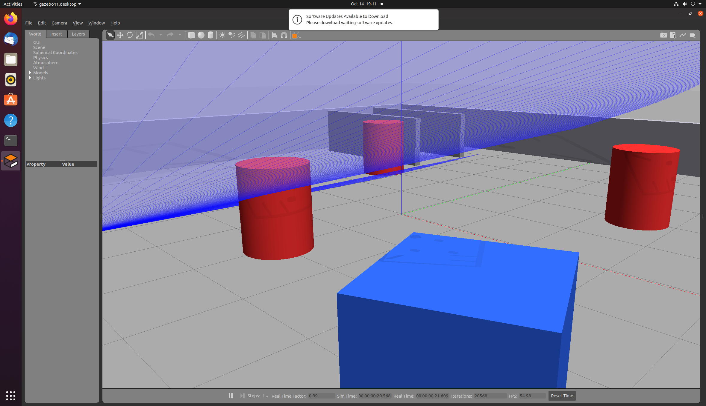
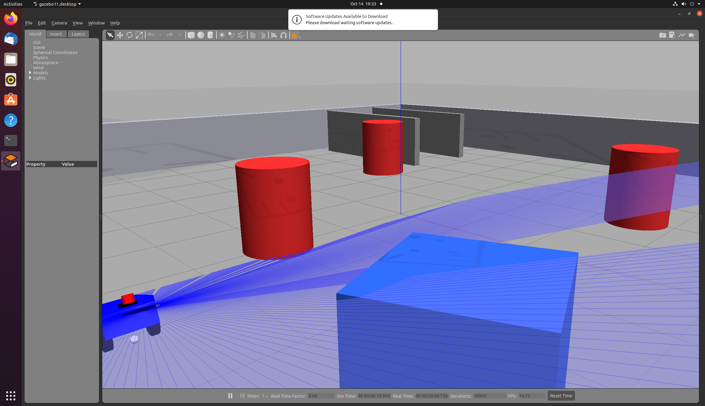
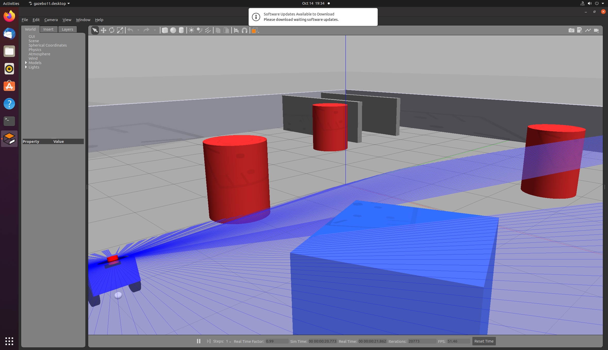
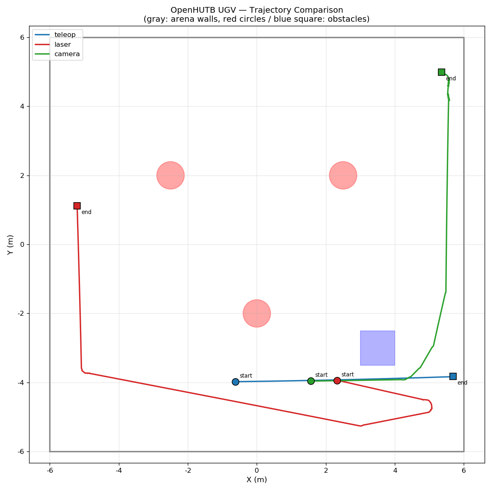
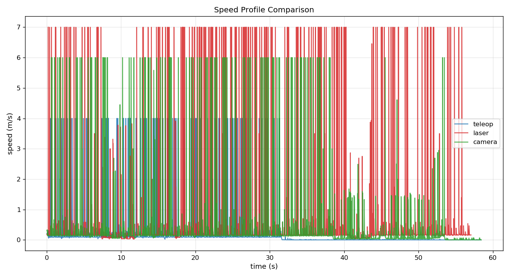

# Gazebo 地面载具物理仿真与多传感器闭环控制

> 对应课程任务（1）与（2）：在物理仿真环境中通过键盘对机器人进行运动控制；
> 使用传感器获取的数据进行感知并对机器人进行运动控制。
> 本模块面向**地面载具（差速驱动无人车）**，仿真平台为 **Gazebo 11**。

## 1. 概述与目标

本模块在 **Gazebo 11** 中构建一台差速驱动无人车，完成三项要求：

| 任务书要求 | 分值 | 实现文件 |
|---|---|---|
| (1) 物理仿真 + 键盘运动控制 | 5 | `main.py`、`scripts/teleop_keyboard.py` |
| (2) 传感器感知 → 运动控制闭环（**激光雷达**） | 5 | `scripts/laser_avoid.py` |
| (2) 传感器感知 → 运动控制闭环（**深度相机**） | 5 | `scripts/depth_camera_avoid.py` |

全部功能通过**统一入口**启动，满足「每个模块必须支持 launch 启动，
入口为 `main.xxx`」的约定：

```bash
./main.sh                 # 键盘遥控（默认）
./main.sh laser           # 激光雷达避障
./main.sh camera          # 深度相机避障
./main.sh idle            # 仅加载仿真环境
./main.sh laser nogui     # 激光避障 + 无图形界面
```

### 1.1 与同目录其他模块的关系

`src/ground/` 下已有多个仿真平台的载具实现，本模块补充 **Gazebo 平台**：

| 模块 | 仿真平台 | 底盘 / 传感器 |
|---|---|---|
| `carla_keyboard_control` | CARLA 0.9.16 | 车辆键盘控制 |
| `carla_perception_control` | CARLA | 传感器感知与轨迹跟踪（神经网络） |
| `mujoco_car_project` | MuJoCo | 车辆物理仿真 |
| **`gazebo_diff_drive_car`** | **Gazebo 11** | **差速底盘 + 激光雷达/深度相机双闭环** |

**为什么需要 Gazebo 版本**：CARLA 与 MuJoCo 都需要额外部署外部仿真器，
环境门槛较高；Gazebo 随 ROS 桌面版一同安装，`apt install` 后即可运行，
适合作为教学与快速验证的基线平台。三个平台并存亦可支撑
「多种路径规划与控制算法的对比」。

## 2. 运行环境

| 项目 | 版本 |
|---|---|
| 操作系统 | Ubuntu 20.04.6 LTS |
| ROS | Noetic Ninjemys |
| Gazebo | 11.13.0 |
| Python | 3.8 |
| 数值 / 绘图库 | numpy 1.17.4、matplotlib 3.1.2 |
| 实测硬件 | 6 核 CPU / 8 GB 内存 / VMware 软件渲染 |

### 2.1 依赖安装

```bash
sudo apt install -y \
    ros-noetic-gazebo-ros ros-noetic-gazebo-plugins \
    ros-noetic-gazebo-ros-control ros-noetic-robot-state-publisher \
    ros-noetic-joint-state-publisher ros-noetic-teleop-twist-keyboard \
    ros-noetic-xacro ros-noetic-rviz python3-numpy python3-matplotlib
```

## 3. 编译与运行

本模块为 **catkin (ROS1)** 包，与仓库中其他 ROS2 (ament/colcon) 模块并存。
catkin 与 colcon 分别识别各自格式的包，互不干扰。

```bash
# 编译
mkdir -p ~/catkin_ws/src
cp -r /path/to/src/ground/gazebo_diff_drive_car ~/catkin_ws/src/
cd ~/catkin_ws
source /opt/ros/noetic/setup.bash
catkin_make
source devel/setup.bash
```

> **注意**：请勿在本模块目录放置 `COLCON_IGNORE`。该标记文件会被 catkin
> 一并识别，导致本包**被完全跳过而不编译**（表现为 `devel/share/`
> 下找不到本包），详见第 8 节第 8 项。

### 3.1 启动参数

| 参数 | 默认值 | 说明 |
|---|---|---|
| `mode` | `teleop` | `teleop` / `laser` / `camera` / `idle` |
| `gui` | `true` | 是否启动 Gazebo 图形界面 |
| `rviz` | `false` | 是否启动 RViz 可视化 |
| `x` `y` `yaw` | `-5.0` `-4.0` `0.0` | 车辆初始位姿（空旷区，见 world 中 `spawn_marker`） |
| `record` | `true` | 是否记录轨迹并输出性能报告 |

### 3.2 键盘操作

启动 `mode:=teleop` 后，在运行终端按键：

| 按键 | 功能 | 按键 | 功能 |
|---|---|---|---|
| `w` | 前进 | `s` | 后退 |
| `a` | 左转 | `d` | 右转 |
| `q` | 前进 + 左转 | `e` | 前进 + 右转 |
| `z` | 后退 + 左转 | `c` | 后退 + 右转 |
| `空格` | 紧急停止 | `x` | 退出 |
| `+` / `-` | 提高 / 降低速度上限 | | |

采用**增量式**速度控制：松开按键后车辆保持当前速度，需按空格停车。
这更接近真实遥控器的操作手感，也便于进行长距离巡航。

## 4. 运行效果

### 4.1 键盘运动控制



*图 1：键盘遥控模式。蓝色车体、黑色驱动轮、车头红色激光雷达。*

### 4.2 激光雷达避障



*图 2：激光雷达避障模式。可见激光束在圆柱、方块与墙面上的回波扇形，
以及障碍物背后的扫描阴影区（激光被遮挡形成的盲区）。*

### 4.3 深度相机避障



*图 3：深度相机避障模式。*

### 4.4 三种模式的轨迹对比



*图 4：三种模式的轨迹对比。灰色为场地围墙（12×12 m），
红色圆形与蓝色方块为障碍物，圆点 / 方块标记起点与终点。*

## 5. 实测性能

### 5.1 三种模式对比

实验条件：车辆自 `(-5.0, -4.0)` 出发、朝向 +X，单一场景、运行 60 秒采样。

| 模式 | 行驶路程 | 净位移 | **路径效率** | 平均速度 | 峰值速度 | 碰撞 |
|---|---|---|---|---|---|---|
| `teleop`（键盘） | 6.34 m | 6.31 m | **0.997** | 0.108 m/s | 4.00 m/s | — |
| `laser`（雷达） | 18.22 m | 9.07 m | **0.498** | 0.319 m/s | 7.01 m/s | **0** |
| `camera`（相机） | 12.82 m | 9.73 m | **0.758** | 0.219 m/s | 6.01 m/s | **0** |

**路径效率** = 净位移 / 实际路程，越接近 1 表示路径越直。

- `teleop` 效率 0.997 —— 近乎完美直线，验证差速运动学正确（无侧滑）
- `laser` 效率 0.498 —— 大幅绕行，体现全向感知下的激进避障
- `camera` 效率 0.758 —— 中度绕行，80° 前向视野下的保守策略

三种模式的空间覆盖面积差异明显：`teleop` 仅 1.01 m²（一条线），
`laser` 达 65.6 m²（几乎跑遍场地），`camera` 36.0 m²。

### 5.2 系统指标

| 指标 | 实测值 |
|---|---|
| `/cmd_vel` 控制频率 | **19.9 ~ 20.3 Hz**（目标 20 Hz） |
| `/scan` 激光频率 | ~10 Hz（360 束，360° 全向） |
| `/camera/depth/image_raw` | 12.7 ~ 14.1 Hz（640×480，32FC1） |
| 仿真实时因子（无 GUI） | **0.98 ~ 1.00** |
| 仿真实时因子（有 GUI） | 0.58 ~ 0.85 |

### 5.3 速度曲线



*图 5：三种模式的瞬时速度曲线。避障模式下速度随障碍接近而衰减。*

## 6. 实现原理

### 6.1 车体模型与离地高度

采用两轮差速驱动 + 前后万向轮支撑。关键尺寸：

| 参数 | 值 |
|---|---|
| 车体 | 0.44 × 0.38 × 0.22 m，5.0 kg |
| 车轮半径 $r$ | 0.0975 m |
| 轮间距 $L$ | 0.335 m |
| 车体中心高度 | $r + h/2 = 0.2075$ m |
| 离地间隙 | 0.0975 m（等于车轮半径） |

**离地高度为何关键**：若车体碰撞盒底面与地面接触（即车体中心取
$h/2 = 0.11$ m），Gazebo 会让车体与地面产生持续切向摩擦，
驱动轮虽在旋转但整车被「钉住」。实测表现为车轮转过 168.9 rad
而车体 30 秒仅移动 0.065 m，且 `/cmd_vel` 无任何异常——极难排查。
抬高车体后仅驱动轮与地面接触，30 秒可行驶 6.31 m。

万向轮在 URDF 中为 `fixed` 关节球体，**不赋予 collision 几何**，
仅作视觉件。否则会因与地面持续接触产生额外滑动摩擦，导致转向迟滞。

### 6.2 差速驱动运动学

**正解**（由轮速求车体速度）：

$$
v = \frac{v_r + v_l}{2}, \qquad \omega = \frac{v_r - v_l}{L}
$$

**反解**（由车体速度求轮角速度）：

$$
\omega_l = \frac{v - \omega L/2}{r}, \qquad \omega_r = \frac{v + \omega L/2}{r}
$$

本模块**不直接计算轮速**，而是向 `/cmd_vel` 发布 `geometry_msgs/Twist`，
由 `gazebo_ros_diff_drive` 插件完成上述解算，使控制器逻辑与底盘解耦。

**验证**：发布 $v = 0.2$ m/s 时，理论轮角速度 $= 0.2/0.0975 = 2.051$
rad/s，实测 `/joint_states` 返回 **2.052 rad/s**，误差 0.05%。

### 6.3 激光雷达避障

**感知层**：360 束激光，按角度划分为 5 个扇区，每扇区取**最小距离**
（而非均值——均值会被远处空旷区域稀释，导致对近处障碍不敏感）。

| 扇区 | 角度范围 | 用途 |
|---|---|---|
| `front` | $[-30°, +30°]$ | 决定能否直行 |
| `left` / `right` | $[+30°, +90°]$ / $[-90°, -30°]$ | 转向方向选择 |
| `left_bk` / `right_bk` | $[+90°, +180°]$ / $[-180°, -90°]$ | 侧后方通畅度 |

**决策层**：三态有限状态机

| 状态 | 进入条件 | 行为 |
|---|---|---|
| `CRUISE` | $d_{\text{front}} > d_{\text{clear}}$ | 全速直行 0.35 m/s |
| `AVOID` | $d_{\text{front}} < d_{\text{safe}} = 1.0$ m | 减速并转向 |
| `EMERGENCY` | $d_{\text{front}} < d_{\text{danger}} = 0.45$ m | 后退脱困 0.8 s |

引入**滞回**抑制抖动：进入避障阈值 1.0 m，退出阈值 1.4 m。
滞回带宽 0.4 m，远大于传感器噪声（$\sigma = 0.01$ m），
消除阈值附近的频繁状态切换。

**控制层**：势场法。转向方向由两侧可通行度之差决定：

$$
\Delta = d_{\text{left}} - d_{\text{right}}, \qquad
\omega = k_\omega \cdot \text{clamp}\!\left(\frac{\Delta}{2.0},\; -1,\; +1\right)
$$

线速度随前方障碍接近程度线性衰减：

$$
v = v_{\text{avoid}} \cdot \text{clamp}\!\left(
    \frac{d_{\text{front}} - d_{\text{danger}}}{d_{\text{safe}} - d_{\text{danger}}},\; 0,\; 1\right)
$$

**最小转向力度**：若 $|\omega| < \omega_{\min} = 0.45$ rad/s，
则强制取 $\pm\omega_{\min}$。该约束用于规避纯势场法的**局部极小值**问题
——当两侧距离接近时合力趋零，车辆可能贴着障碍面平移而不真正转开。

**死胡同处理**：若左右两侧均低于安全阈值，则原地最大角速度转向，
并配合 1.5 s 超时保护，避免传感器异常时无限打转。

### 6.4 深度相机避障

**感知层**：640×480 深度图，水平划分为三个竖直条带
（左 0~25%、中 37~62%、右 75~100%），竖直方向只取 25%~75% 行
（避开顶部天空与底部地面）。对每个条带取**第 25 百分位深度**：

- 用最小值 → 单个噪声像素即可误判
- 用均值 → 远处空旷区域会稀释近处障碍
- 用低百分位 → 既反映最近威胁，又容忍少量噪声

**决策与控制**：与激光版本同构的三态 FSM + 势场法，参数整体更保守
（$d_{\text{safe}} = 1.2$ m，$v_{\text{avoid}} = 0.15$ m/s），
因为相机视场仅 80°，侧向感知能力弱，需要更大安全余量。

### 6.5 两种传感器的对比

| 维度 | 激光雷达 | 深度相机 |
|---|---|---|
| 数据形式 | 1D 极坐标（360 点） | 2D 稠密深度图（30.7 万像素） |
| 视角 | **360° 全向** | 80° 前向 |
| 数据量 | ~1.4 KB/帧 | ~1.2 MB/帧 |
| 计算量 | 低 | 中（numpy 向量化） |
| 测距精度 | 高（$\sigma = 0.01$ m） | 中（存在无效值） |
| 优势 | 全向、精确、轻量 | 可获取形状与纹理 |
| 劣势 | 无法感知低于扫描面的障碍 | 视角窄、存在地板值 |

**为何激光版路径效率更低（0.498 < 0.758）**：这不是性能更差，而是更激进。
全向感知使其能提前发现侧后方障碍，因而敢于做更大幅度的绕行；
相机只有前向视野，只能保守小转。在避障任务中，
全向感知带来的安全余量比「路径更直」更有价值。

## 7. 传感器数据处理中的两个关键问题

开发中识别并解决了两个**真实且隐蔽**的传感器缺陷。
它们都不报错、不崩溃，只是让算法做出错误决策。

### 7.1 激光雷达自遮挡

**现象**：车辆处于空旷位置时，正前方仍持续返回 0.12~0.40 m 的虚假回波，
算法误判「前方被堵死」，车辆原地打转。

**原因**：雷达虽安装于车体轮廓外 0.06 m，但激光束以 360° 放射，
部分光束仍会扫到车体边缘、天线或支架。

**判别依据**：真实障碍会**连续遮挡多束**激光，自遮挡只影响孤立几束。

**方案**：对每束距离小于 0.30 m 的回波，检查其邻域 ±5 束内是否也有
近距回波：连续数 ≥ 5 则判定为真实障碍并保留，否则作为噪声剔除。

效果：空旷区正前方读数从 0.358 m（假）恢复为 4.25 m（真），
同时 0.5 m 处的真实障碍仍被正确保留。

### 7.2 深度图地板值

**现象**：深度图统计结果恒为常数 1.000 m，算法判定「前方 1 m 有障碍」
（$< d_{\text{safe}} = 1.2$ m），车辆原地打转，30 秒仅移动 0.08 m。

**原因**：Gazebo 深度相机对**无回波区域**并非输出 `0` 或 `inf`，
而是输出固定常数 **1.005 m**。实测中区该值占比达 **66%**、右侧 63%、
左区 7%。由于占比过高，无论取 p15、p25 还是 p40，
百分位统计都会被这个假值完全锁定。

**关键难度**：1.005 m 是一个**看起来完全合理**的深度读数。
min / median / max 中只有 max（8.76 m）暴露了异常，
直到绘制直方图才看清 66% 的像素压在同一个值上。

**方案**：直方图峰值检测。对有效像素做直方图（分箱 0.01 m），
若某深度值占比超过 30%，判定为无效标记并整体剔除；
剔除后保留像素不足 30 个时退回原数据，避免过度剔除。

效果：

| 区域 | 地板值占比 | 剔除后 $P_{25}$ |
|---|---|---|
| 左区 | 未检出（7%） | 0.855 m |
| 中区 | **1.005 m（66%）** | **3.509 m**（真实值） |
| 右区 | 1.005 m（63%） | 2.640 m |

修复后相机模式 30 秒移动 **7.40 m**（修复前 0.08 m）。

## 8. 工程问题排查记录

开发过程中遇到并修复的主要问题（多为「现象正常、决策错误」类型，难以定位）：

| # | 问题 | 现象 | 根因 | 方案 |
|---|---|---|---|---|
| 1 | `/cmd_vel` 无消息 | 话题连接正常、日志无报错，车辆不动 | 看门狗 `feed()` 只缓存指令，未调用 `publish()` | 在 `feed()` 中直接发布 |
| 2 | 节点无法启动 | `cannot import name 'LaserAvoidNode'` | `catkin_install_python` 生成 relay 脚本，`exec` 后类未挂到模块命名空间 | 改用 `install(PROGRAMS)` + 自定义复制规则 |
| 3 | 车轮空转、车辆不动 | 车轮转 168 rad，30 秒位移 0.065 m | 底盘离地间隙为零，车体与地面直接摩擦 | 车体中心抬高至 $r + h/2$，驱动轮摩擦系数提至 1.0 |
| 4 | 深度读数恒为 1.0 | 读数「看起来正常」 | Gazebo 对无回波区域输出地板值 1.005 m（占比 66%） | 直方图峰值检测并剔除 |
| 5 | 主循环卡死 | 启动后 4 秒再无输出 | `rospy.Rate` 依赖尚未发布的仿真时钟 | 改用墙钟时间控制循环 |
| 6 | 万向轮拖拽 | 转向迟滞 | `fixed` 关节球体与地面持续接触 | 移除 collision，保留为视觉件 |
| 7 | xacro 解析失败 | `XML parsing error` | XML 注释中含连续 `--` 分隔线 | 注释内改用 `=` 分隔 |
| 8 | 包被完全跳过 | `Packages "..." not found in the workspace` | 目录中存在 `COLCON_IGNORE`，catkin 一并识别 | 移除该文件 |

**最重要的一条经验**：不要相信「看起来正常」的数据。
深度值 1.005 m 看起来正常，实为无效标记；`/cmd_vel` 话题连接正常，
实际从未发布；车轮正常转动，实际车辆没动。

## 9. 模块结构与接口

### 9.1 目录结构

```
gazebo_diff_drive_car/
├── main.py                   统一入口节点（模式调度 + 安全看门狗）
├── main.sh                   Linux 启动脚本
├── main.bat                  Windows 启动脚本
├── package.xml / CMakeLists.txt / requirements.txt
├── launch/main.launch        统一启动入口
├── urdf/car.xacro            车辆模型（差速底盘 + 雷达 + 深度相机）
├── worlds/car_world.world    仿真场景（12×12 m + 障碍物）
├── scripts/
│   ├── teleop_keyboard.py    键盘运动控制
│   ├── laser_avoid.py        激光雷达避障
│   ├── depth_camera_avoid.py 深度相机避障
│   ├── odom_recorder.py      轨迹记录与性能评价
│   ├── analyze_trajectory.py 轨迹分析与算法对比
│   └── plot_trajectory.py    轨迹绘图
├── config/params.yaml        参数配置
└── rviz/car.rviz             RViz 配置
```

### 9.2 话题接口

**订阅**

| 话题 | 类型 | 使用节点 |
|---|---|---|
| `/scan` | `sensor_msgs/LaserScan` | `laser_avoid.py` |
| `/camera/depth/image_raw` | `sensor_msgs/Image` (32FC1) | `depth_camera_avoid.py` |
| `/odom` | `nav_msgs/Odometry` | `odom_recorder.py` |

**发布**

| 话题 | 类型 | 发布节点 |
|---|---|---|
| `/cmd_vel` | `geometry_msgs/Twist` | `main.py`（经看门狗统一发布） |
| `/odom_recorder/trail` | `visualization_msgs/Marker` | `odom_recorder.py` |

### 9.3 TF 树

```
odom
 └── base_footprint
      └── base_link
           ├── left_wheel_link / right_wheel_link
           ├── front_caster_link / rear_caster_link
           ├── laser_link
           └── camera_link
                └── camera_optical_link
```

### 9.4 安全机制

- **速度看门狗**：超过 1.0 s 未收到新指令则强制发布零速度，
  保证算法崩溃或卡死时车辆不会失控持续运动
- **算法异常保护**：`update()` 抛异常时记录日志并立即停车
- **退出保证停车**：程序退出前主动发布零速度

## 10. 参数汇总

### 10.1 激光雷达避障

| 参数 | 值 | 说明 |
|---|---|---|
| `D_SAFE` / `D_CLEAR` / `D_DANGER` | 1.0 / 1.4 / 0.45 m | 进入 / 退出 / 紧急阈值 |
| `V_CRUISE` / `V_AVOID` / `V_BACK` | 0.35 / 0.18 / −0.12 m/s | 巡航 / 避障 / 后退速度 |
| `W_MIN` / `W_MAX` / `K_OMEGA` | 0.45 / 1.30 rad/s / 1.8 | 转向参数 |
| `EMERGENCY_HOLD` | 0.8 s | 紧急状态最短时长 |
| `SELF_OCCLUSION_RANGE` / `MIN_CLOSE_HITS` | 0.30 m / 5 | 自遮挡判别 |

### 10.2 深度相机避障

| 参数 | 值 | 说明 |
|---|---|---|
| `D_SAFE` / `D_CLEAR` / `D_DANGER` | 1.2 / 1.6 / 0.5 m | 阈值（比激光更保守） |
| `V_CRUISE` / `V_AVOID` / `V_BACK` | 0.30 / 0.15 / −0.10 m/s | 速度 |
| `W_MIN` / `W_MAX` / `K_OMEGA` | 0.40 / 1.20 rad/s / 1.6 | 转向参数 |
| `DEPTH_PERCENTILE` | 25.0 | 深度统计百分位 |
| `FLOOR_VALUE_RATIO` / `FLOOR_BIN_WIDTH` | 0.30 / 0.01 m | 地板值检测 |
| `MAX_SPIN_DURATION` | 1.5 s | 原地转向超时 |

### 10.3 系统与键盘

| 参数 | 值 |
|---|---|
| 控制回路频率 | 20.0 Hz |
| 指令超时（看门狗） | 1.0 s |
| 键盘线速度增量 / 上限 | 0.1 / 0.8 m/s |
| 键盘角速度增量 / 上限 | 0.2 / 1.2 rad/s |

## 11. 已知限制与改进方向

| 限制 | 说明 | 改进方向 |
|---|---|---|
| 无全局规划 | 纯反应式避障，存在局部极小值风险 | 引入 A* / Dijkstra 生成全局路径 |
| 单传感器独立工作 | 激光与相机各自独立闭环，未融合 | 传感器融合（卡尔曼滤波） |
| 参数硬编码 | 参数以常量形式写在脚本顶部 | 改由 ROS Parameter Server 读取 |
| 固定阈值 | 安全距离不随环境自适应 | 按环境密度动态调整 |

## 12. 声明

本模块的开发过程使用了 AI 大模型辅助（代码编写、文档撰写与问题排查），
提交者对全部内容负责。所有代码均已在 Ubuntu 20.04 + ROS Noetic +
Gazebo 11 环境中实际编译运行验证，性能数据来自真实仿真运行记录。

## 13. 许可证

MIT License
