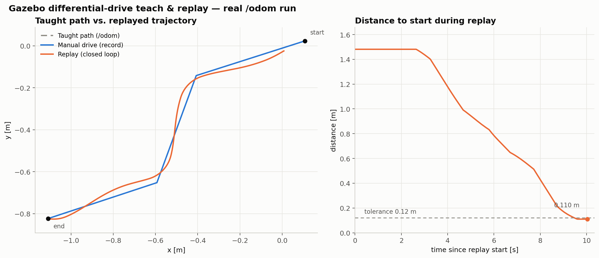
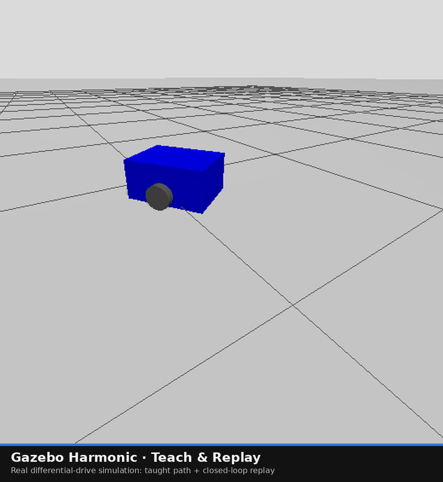
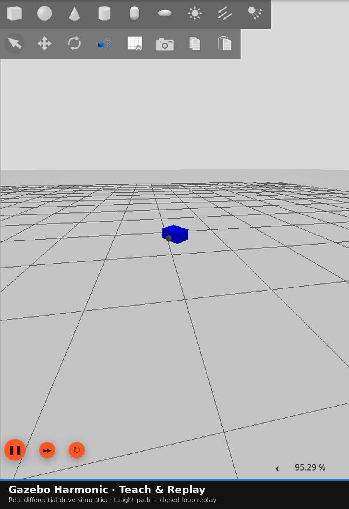

# Gazebo 差速小车键盘控制与示教录制/路径回放

## 1. 项目概述

本项目在 ROS 2 Jazzy + Gazebo Harmonic 中搭建两轮差速驱动小车，使用 `gz_ros2_control` 作为 Gazebo 与 `ros2_control` 之间的硬件接口，使用 `diff_drive_controller` 把速度指令换算成左右轮转速。

模块包含以下运行方式：

- **自动巡航**：`auto_drive` 持续发布固定速度，演示差速小车的圆弧运动。
- **键盘遥控**：`teleop_keyboard` 发布 `/cmd_vel`，手动驾驶小车。
- **示教录制与路径回放**：记录键盘驾驶产生的 `/odom` 轨迹，再使用纯追踪控制器沿记录路径自动返回，支持循环往返和手动接管。

本项目的重点是示教数据的采样、路径存储和闭环轨迹跟踪。所有实验都使用真实的 Gazebo 物理仿真和 `/odom` 里程计数据，不使用离线伪造轨迹。

## 2. 差速运动学基础

设左右轮半径均为 `r = 0.06 m`，轮距 `L = 0.36 m`，左右轮角速度为 `ωL`、`ωR`，则车体线速度 `v` 和角速度 `ω` 为：

```text
v = r (ωL + ωR) / 2
ω = r (ωR - ωL) / L
```

反过来，给定 `/cmd_vel` 的 `linear.x = v` 和 `angular.z = ω`，控制器计算左右轮目标转速：

```text
ωL = (v - ω L / 2) / r
ωR = (v + ω L / 2) / r
```

因此：

- `v > 0, ω = 0`：直行；
- `v < 0, ω = 0`：倒车；
- `v = 0, ω > 0`：原地左转；
- `v > 0, ω > 0`：左转弯。

差速底盘不能直接横移，转弯半径由 `R = v / ω` 决定。

## 3. 系统架构与控制链路

```text
键盘
  │
  ▼
功能节点（teleop_keyboard / auto_drive / teach_replay）
  │  geometry_msgs/Twist
  ▼
/cmd_vel
  │
  ▼
controller_bridge
  │  geometry_msgs/TwistStamped
  ▼
/diff_drive_controller/cmd_vel
  │
  ▼
diff_drive_controller ──▶ gz_ros2_control ──▶ Gazebo 差速小车
  │
  └── /diff_drive_controller/odom ──▶ controller_bridge ──▶ /odom
```

Gazebo Harmonic 的 `/clock` 通过 `ros_gz_bridge` 桥接到 ROS 2。控制器启用了 `use_sim_time`，如果没有 `/clock`，控制器不会更新里程计，功能节点也就无法闭环。

`controller_bridge` 解决了 Jazzy 的一个接口差异：

- Jazzy 的 `diff_drive_controller` 订阅 `geometry_msgs/TwistStamped`；
- 框架中的键盘节点和自动巡航节点发布 `geometry_msgs/Twist`；
- bridge 把 Twist 转成带时间戳的 TwistStamped，并把控制器里程计转发为标准 `/odom`。

## 4. 目录结构

```text
gazebo_diff_drive_teleop/
├── main.sh                                  # 一键编译/启动
├── README.md
├── package.xml / setup.py / setup.cfg
├── config/diff_drive_controller.yaml        # 控制器参数
├── launch/gazebo_diff_drive_teleop.launch.py
├── urdf/diff_drive_robot.urdf.xacro         # 车体、轮子、ros2_control
└── gazebo_diff_drive_teleop/
    ├── __init__.py
    ├── teleop_keyboard.py                   # 键盘遥控
    ├── auto_drive.py                        # 自动巡航
    ├── teach_replay.py                  # 本项目新增功能
    └── controller_bridge.py                 # Twist/TwistStamped 与 odom 桥
```

## 5. 运行环境与依赖

- Ubuntu 24.04
- ROS 2 Jazzy
- Gazebo Harmonic
- Python 3.12
- 依赖：`ros_gz_sim`、`ros_gz_bridge`、`ros2_control`、`ros2_controllers`、`gz_ros2_control`、`robot_state_publisher`、`xacro`

```bash
sudo apt install ros-jazzy-ros-gz ros-jazzy-ros-gz-bridge \
  ros-jazzy-ros2-control ros-jazzy-ros2-controllers \
  ros-jazzy-gz-ros2-control ros-jazzy-robot-state-publisher ros-jazzy-xacro
```

## 6. 构建与运行

在模块所在工作空间根目录执行：

```bash
bash main.sh                 # 自动巡航
bash main.sh manual          # 仅启动仿真
bash main.sh teach # 本项目功能
```

也可以手动构建：

```bash
source /opt/ros/jazzy/setup.bash
colcon build --base-paths src --packages-select gazebo_diff_drive_teleop
source install/setup.bash
ros2 launch gazebo_diff_drive_teleop gazebo_diff_drive_teleop.launch.py demo:=false
```

只启动 Gazebo 服务端、不打开 GUI：

```bash
bash main.sh teach gz_args:='-r -s'
```

`main.sh` 的后台/前台分工是有意的：`ros2 launch` 不会把终端 TTY 传给子节点，因此键盘节点必须由 `main.sh` 在前台通过 `ros2 run` 启动，才能在终端读取按键。

## 7. 键盘操作

通用驾驶按键：

| 按键 | 功能 |
| --- | --- |
| `w` / `↑` | 前进 |
| `x` / `↓` | 后退 |
| `a` / `←` | 左转 |
| `d` / `→` | 右转 |
| `s` / 空格 | 停止 |
| `q` / `Ctrl-C` | 退出（恢复终端并发送零速度） |

本项目功能按键：

| 按键 | 功能 |
| --- | --- |
| `r` | 开始 / 结束录制（重新开始会清空旧轨迹） |
| `p` | 开始 / 暂停回放 |
| `l` | 循环往返开关 |
| `c` | 清空轨迹 |
| `s` / 空格 | 停止；回放中暂停回放 |
| `+` / `-` | 调整线速度 |

## 8. 示教录制与纯追踪回放

### 8.1 状态机

`teach_replay` 有三个状态：

1. **manual**：键盘驾驶，不记录也不回放。
2. **record**：键盘驾驶，同时按采样规则把 `/odom` 位姿追加到路径。
3. **replay**：暂停键盘速度指令，由纯追踪控制器生成 `/cmd_vel`。

按 `r` 在 manual 和 record 之间切换；按 `p` 从 manual 或 record 进入 replay；按方向键、`s` 或 `c` 可以手动接管/停止。

### 8.2 轨迹采样

路径点不是按固定频率无脑记录，而是满足以下任一条件才追加：

```text
两点距离 >= record_min_distance (0.05 m)
或 两点航向差 >= record_min_angle (0.10 rad)
```

这样可以减少静止和低速抖动造成的重复点，同时保留转弯细节。路径保存在 `odom` 坐标系中，最大点数由 `max_path_points` 限制。

### 8.3 回放方向

开始回放时，节点比较当前位姿到路径首尾端点的距离，选择较近的端点作为起点，向另一端回放。因此：

- 录制结束后通常在路径末端，按 `p` 会自动反向沿原路返回起点；
- 如果从起点附近开始，则正向回放；
- 开启 `l` 后，到达端点会反转方向，在线路两端之间循环。

### 8.4 纯追踪控制

每一控制周期：

1. 在当前路径上找到离车体最近的点 `nearest`；
2. 沿回放方向搜索第一个与车体距离不小于 `lookahead_distance` 的点作为前视目标；
3. 把目标点变换到车体坐标系：

```text
dx = target.x - pose.x
dy = target.y - pose.y
local_x =  cos(yaw) dx + sin(yaw) dy
local_y = -sin(yaw) dx + cos(yaw) dy
distance = hypot(local_x, local_y)
heading = atan2(local_y, local_x)
```

4. 当 `|heading| > 1.0 rad` 时先原地转向；否则按距离比例给线速度，按航向误差比例给角速度；
5. 距离目标端点小于 `goal_tolerance` 时停车；循环模式则反转方向。

线速度、角速度都受 `linear_speed`、`angular_speed` 限制，接近端点时额外减速，避免过冲。

### 8.5 安全与终端处理

- 节点启动时要求标准输入是 TTY；否则给出明确错误，避免在后台静默失败。
- 使用 cbreak 模式读取单个按键，退出时恢复原终端设置。
- 正常退出和 Ctrl-C 都会连续发送零速度。
- 底层的 `main.sh` 在后台启动 Gazebo，在前台启动键盘节点；退出后清理整个仿真进程组。

## 9. 参数说明

| 参数 | 默认值 | 说明 |
| --- | --- | --- |
| `linear_speed` | 0.3 m/s | 最大线速度 |
| `angular_speed` | 1.0 rad/s | 最大角速度 |
| `publish_rate` | 20 Hz | 控制/发布频率 |
| `record_min_distance` | 0.05 m | 采样最小距离 |
| `record_min_angle` | 0.10 rad | 采样最小转角 |
| `lookahead_distance` | 0.25 m | 前视距离 |
| `goal_tolerance` | 0.12 m | 端点判定阈值 |
| `replay_linear_gain` | 1.2 | 线速度比例增益 |
| `replay_angular_gain` | 2.0 | 角速度比例增益 |
| `max_path_points` | 5000 | 最大路径点数 |
| `loop_replay` | false | 默认是否循环 |

## 10. 话题、TF 与状态

| 话题 | 类型 | 说明 |
| --- | --- | --- |
| `/cmd_vel` | `geometry_msgs/Twist` | 键盘/回放速度指令 |
| `/odom` | `nav_msgs/Odometry` | 差速控制器里程计 |
| `/teach_replay/path` | `nav_msgs/Path` | 示教路径，可在 RViz2 中显示 |
| `/teach_replay/markers` | `visualization_msgs/MarkerArray` | 起点、终点、当前前视目标 |
| `/diff_drive_controller/cmd_vel` | `geometry_msgs/TwistStamped` | 控制器原生输入 |
| `/diff_drive_controller/odom` | `nav_msgs/Odometry` | 控制器原生里程计 |

TF 关系：

```text
odom -> base_footprint -> base_link -> left_wheel / right_wheel / caster
```

其中 `odom -> base_footprint` 由 `diff_drive_controller` 发布，其余由 `robot_state_publisher` 根据 URDF 发布。

RViz2 查看路径：Fixed Frame 设为 `odom`，添加 `/teach_replay/path` 的 Path 显示，添加 `/teach_replay/markers` 的 MarkerArray 显示。

## 11. 实测结果与复现方法

实验方法：在无界面 Gazebo 中启动完整控制链路，通过伪终端向前台节点注入按键；订阅 `/odom` 和功能话题，记录真实位姿/电量/状态后计算指标。这样既复现了人工键盘操作，又避开了 GUI 截图对测量精度的影响。

```bash
# 终端 1：启动仿真
bash main.sh teach gz_args:='-r -s'

# 终端 2：观察话题
ros2 control list_controllers
ros2 topic hz /odom
ros2 topic echo /clock --once
```

真实 Gazebo 闭环测试结果：

| 指标 | 结果 |
| --- | --- |
| 示教路径点 | 39 |
| 回放耗时 | 10.04 s |
| 终点距起点 | 0.110 m |
| 端点阈值 | 0.12 m |
| 原模块回归测试 | 29 个路径点，终点误差 0.118 m，PASS |

图中蓝色为手动示教轨迹，橙色为回放实际轨迹；右侧曲线显示回放过程中到起点的距离收敛到阈值以内。两次运行（39 点/0.110 m 与 29 点/0.118 m）都通过了端点判定，说明结果不是单次偶然。




除数据图外，还记录了两张真实 Gazebo Harmonic 运行画面：





两张图均来自实际运行的 Gazebo 物理仿真，不是示意图：蓝色车体为 URDF 中的差速底盘，地面网格由 Gazebo 渲染。第一张为近距离跟随视角，第二张为广角场景视角。

## 12. 故障排查

| 现象 | 排查方向 |
| --- | --- |
| 小车不动 | 用 `ros2 control list_controllers` 确认 `diff_drive_controller` 为 `active`；确认 `/clock` 有数据 |
| 没有 `/odom` | 检查 `clock_bridge` 和 `controller_bridge` 是否启动；`ros2 topic info /diff_drive_controller/odom` |
| 键盘节点读不到按键 | 必须在交互式终端中运行；`main.sh` 已经用前台 `ros2 run` 启动，不要把它放到后台 |
| 控制器提示 Velocity command timed out | 确认 `/cmd_vel` 仍在发布；bridge 是否存活 |
| 功能节点启动后立即退出 | 查看终端是否提示“标准输入不是交互式终端”；改用 `main.sh` 或交互式终端 |
| `colcon build` 报重复包名 | `main.sh` 已使用 `--base-paths src`，避免扫描工作空间外的备份目录 |
| 路径点太少，按 p 没反应 | 确认录制期间确实在移动，并适当减小 `record_min_distance`；路径少于 2 点时节点会拒绝回放 |
| 回放轨迹偏离或画龙 | 先检查 `/odom` 是否持续更新；再降低 `linear_speed`、增大 `lookahead_distance` 或减小 `replay_linear_gain` |

## 13. 已知限制与后续工作

- 位姿全部来自轮式里程计，长时间运行会有累积漂移；没有使用激光雷达、相机或全局定位。
- 仿真场景为平面，未考虑坡道、打滑、悬挂和轮胎形变。
- 回放依赖里程计坐标系，`/odom` 漂移会直接反映到路径和终点误差；没有做全局重定位。
- 测试在单台 Ubuntu 24.04 + Jazzy 机器上完成；合并前仍需第二台机器复现。
- 后续可以加入 IMU/EKF 融合、`slam_toolbox` 或 Nav2，把当前功能扩展到真实定位与导航。

## 14. 与仓库已有模块的区别

- `gazebo_diff_drive_teleop` 原模块只做键盘速度和自动巡航，没有轨迹记忆。
- `odom_trace_recorder` 能记录里程计并发布 Path，但只回放记录结果，不做闭环路径跟踪。
- 本项目在录制后使用纯追踪闭环生成速度指令，能根据实时位姿修正偏差，属于真正的轨迹回放。

## 15. 说明

代码与文档使用 AI 大模型辅助编写。作者已核对代码、参数和实验数据，并对提交内容负责。

