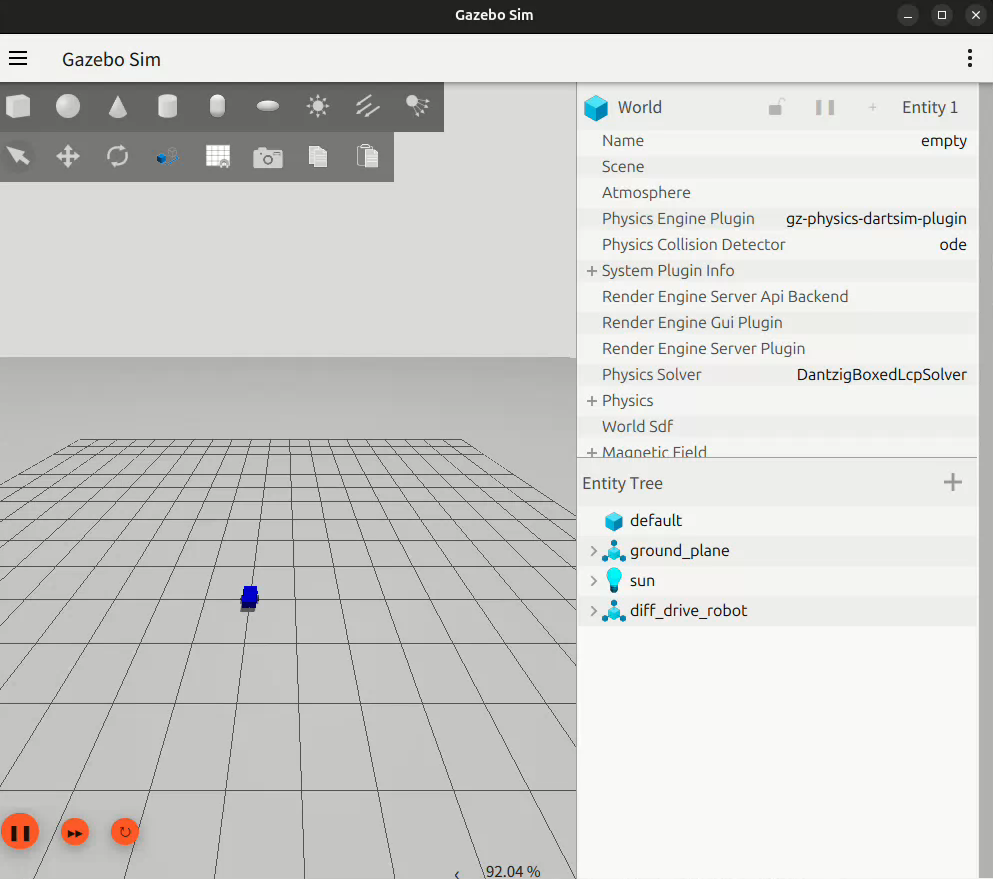

# Gazebo 差速小车键盘控制与示教回放

## 实验简介

本实验使用 ROS2 Jazzy + Gazebo Harmonic 搭建一个差速驱动小车，通过 `gz_ros2_control` 硬件接口配合 `diff_drive_controller` 控制器，将 `/cmd_vel` 速度指令换算为左右轮转速，实现小车在 Gazebo 中的运动。

模块提供三种运行方式：

- **键盘遥控**：`teleop_keyboard` 节点发布 `/cmd_vel`，手动驾驶小车。
- **自动巡航**：`auto_drive` 节点持续发布固定速度指令，使小车沿圆形轨迹行驶。
- **示教回放**：`teach_replay` 节点记录键盘驾驶产生的 `/odom` 轨迹，再用纯追踪控制器沿原路自动返回。

launch 中同时启动了 Gazebo `/clock` 桥和控制器话题桥，把控制器原生的 `TwistStamped` 速度接口、`/diff_drive_controller/odom` 与标准 `/cmd_vel`、`/odom` 对接。

## 运行环境

- Ubuntu 24.04
- ROS2 Jazzy
- Gazebo Harmonic（`gz sim`）
- 依赖：`ros_gz`、`ros_gz_bridge`、`ros2_control`、`ros2_controllers`、`gz_ros2_control`、`robot_state_publisher`、`xacro`

## 运行步骤

```bash
# 1. 安装依赖
sudo apt install ros-jazzy-ros-gz ros-jazzy-ros-gz-bridge \
  ros-jazzy-ros2-control ros-jazzy-ros2-controllers \
  ros-jazzy-gz-ros2-control ros-jazzy-robot-state-publisher ros-jazzy-xacro

# 2. 将 gazebo_diff_drive_teleop 包放入工作空间 src 目录，然后一键运行
bash main.sh          # 自动巡航演示
bash main.sh teach    # 示教录制与自动回放
bash main.sh manual   # 仅启动仿真，另开终端用键盘控制
```

键盘按键：`w`/`↑` 前进、`x`/`↓` 后退、`a`/`←` 左转、`d`/`→` 右转、`s`/空格 停止、`+`/`-` 调整线速度、`q` 或 `Ctrl-C` 退出（退出前自动停车）。

运行后 Gazebo 窗口出现蓝色小车，自动巡航模式下小车沿圆形轨迹行驶。可另开终端查看话题：

```bash
ros2 topic list          # 查看 /cmd_vel /odom /tf 等话题
ros2 topic info /cmd_vel # 查看话题类型与发布订阅关系
ros2 topic echo /odom    # 查看里程计数据
```



## 示教录制与路径回放

`bash main.sh teach` 启动仿真后，按 `r` 开始录制，用键盘驾驶小车；再按 `r` 结束录制。节点按最小距离/角度对 `/odom` 位姿抽稀，生成示教路径。

按 `p` 后，节点从离当前位姿较近的路径端点出发，沿路径方向搜索前视目标点，使用纯追踪计算线速度和角速度，自动开回另一端。接近端点时自动减速，到达后停车；按 `l` 可开启循环往返。

| 按键 | 功能 |
| --- | --- |
| `r` | 开始 / 结束录制 |
| `p` | 开始 / 暂停回放 |
| `l` | 循环往返开关 |
| `c` | 清空轨迹 |
| `s` / 空格 | 停止；回放中暂停 |
| 方向键 | 手动接管 |

示教路径发布到 `/teach_replay/path`，起终点和前视目标发布到 `/teach_replay/markers`，可在 RViz2 中添加 Path 和 MarkerArray 显示。


上图由一次真实 Gazebo 运行数据生成：蓝色为手动示教轨迹，橙色为纯追踪回放轨迹；右侧为回放过程中到起点距离的收敛曲线。此次运行记录 39 个路径点，回放约 10.04 s，终点距起点 0.110 m（端点阈值 0.12 m）。

## 效果说明

- 控制节点发布 `/cmd_vel`（Twist）→ `controller_bridge` 转换为 `TwistStamped` → `diff_drive_controller` 换算成左右轮目标转速 → `gz_ros2_control` 驱动 Gazebo 中的关节 → 小车运动；
- 差速控制原理：左右轮转速相同时直行，不同时转向，形成圆弧轨迹；
- 控制器发布 `/diff_drive_controller/odom`，由 `controller_bridge` 转发为 `/odom`，同时保留 `odom -> base_footprint` 的 `/tf` 变换；
- 示教回放不依赖外部导航栈，直接利用里程计位姿和纯追踪闭环完成路径跟踪。

## 说明

代码与文档使用 AI 大模型辅助编写，已核对并确认，对提交内容负责。
