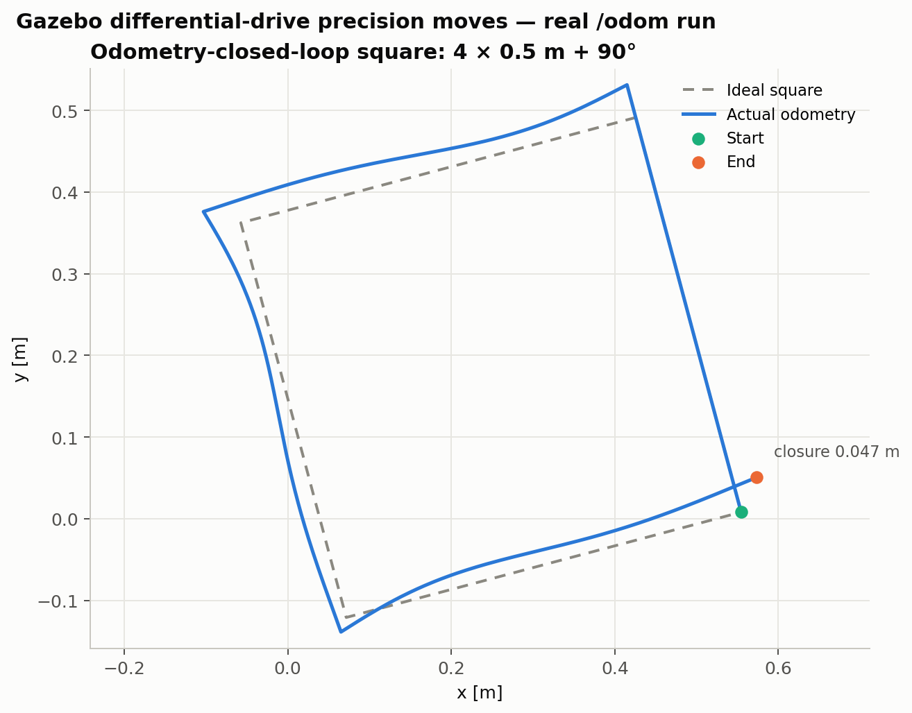
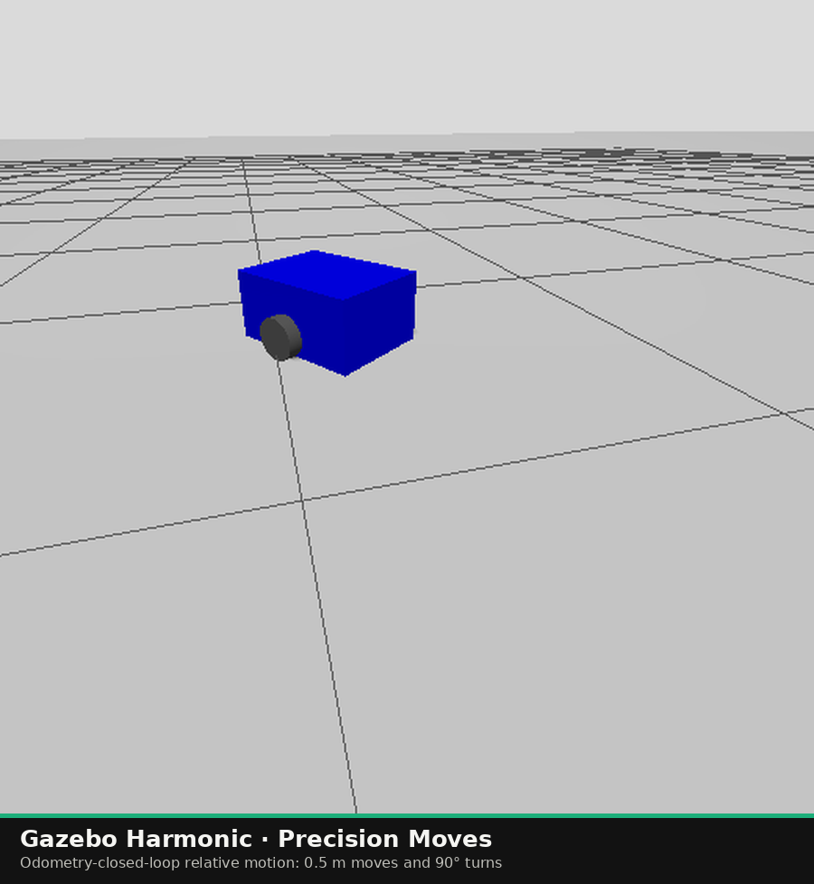
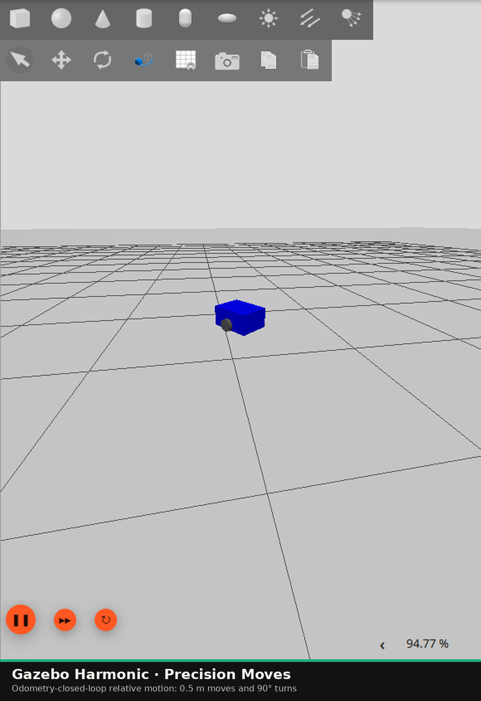

# Gazebo 差速小车键盘控制与里程计闭环精确运动

## 1. 项目概述

本项目在 ROS 2 Jazzy + Gazebo Harmonic 中搭建两轮差速驱动小车，使用 `gz_ros2_control` 作为 Gazebo 与 `ros2_control` 之间的硬件接口，使用 `diff_drive_controller` 把速度指令换算成左右轮转速。

模块包含以下运行方式：

- **自动巡航**：`auto_drive` 持续发布固定速度，演示差速小车的圆弧运动。
- **键盘遥控**：`teleop_keyboard` 发布 `/cmd_vel`，手动驾驶小车。
- **里程计闭环精确运动**：用单键执行固定距离、固定角度和正方形轨迹，依靠 `/odom` 反馈自动停车。

本项目的重点是相对运动的里程计反馈、误差收敛和动作队列。所有实验都使用真实的 Gazebo 物理仿真和 `/odom` 里程计数据，不使用离线伪造轨迹。

## 2. 差速运动学基础

设左右轮半径均为 `r = 0.06 m`，轮距 `L = 0.36 m`，左右轮角速度为 `ωL`、`ωR`，则车体线速度 `v` 和角速度 `ω` 为：

```text
v = r (ωL + ωR) / 2
ω = r (ωR - ωL) / L
```

反过来，给定 `/cmd_vel` 的 `linear.x = v` 和 `angular.z = ω`，控制器计算左右轮目标转速：

```text
ωL = (v - ω L / 2) / r
ωR = (v + ω L / 2) / r
```

因此：

- `v > 0, ω = 0`：直行；
- `v < 0, ω = 0`：倒车；
- `v = 0, ω > 0`：原地左转；
- `v > 0, ω > 0`：左转弯。

差速底盘不能直接横移，转弯半径由 `R = v / ω` 决定。

## 3. 系统架构与控制链路

```text
键盘
  │
  ▼
功能节点（teleop_keyboard / auto_drive / precision_moves）
  │  geometry_msgs/Twist
  ▼
/cmd_vel
  │
  ▼
controller_bridge
  │  geometry_msgs/TwistStamped
  ▼
/diff_drive_controller/cmd_vel
  │
  ▼
diff_drive_controller ──▶ gz_ros2_control ──▶ Gazebo 差速小车
  │
  └── /diff_drive_controller/odom ──▶ controller_bridge ──▶ /odom
```

Gazebo Harmonic 的 `/clock` 通过 `ros_gz_bridge` 桥接到 ROS 2。控制器启用了 `use_sim_time`，如果没有 `/clock`，控制器不会更新里程计，功能节点也就无法闭环。

`controller_bridge` 解决了 Jazzy 的一个接口差异：

- Jazzy 的 `diff_drive_controller` 订阅 `geometry_msgs/TwistStamped`；
- 框架中的键盘节点和自动巡航节点发布 `geometry_msgs/Twist`；
- bridge 把 Twist 转成带时间戳的 TwistStamped，并把控制器里程计转发为标准 `/odom`。

## 4. 目录结构

```text
gazebo_diff_drive_teleop/
├── main.sh                                  # 一键编译/启动
├── README.md
├── package.xml / setup.py / setup.cfg
├── config/diff_drive_controller.yaml        # 控制器参数
├── launch/gazebo_diff_drive_teleop.launch.py
├── urdf/diff_drive_robot.urdf.xacro         # 车体、轮子、ros2_control
└── gazebo_diff_drive_teleop/
    ├── __init__.py
    ├── teleop_keyboard.py                   # 键盘遥控
    ├── auto_drive.py                        # 自动巡航
    ├── precision_moves.py                  # 本项目新增功能
    └── controller_bridge.py                 # Twist/TwistStamped 与 odom 桥
```

## 5. 运行环境与依赖

- Ubuntu 24.04
- ROS 2 Jazzy
- Gazebo Harmonic
- Python 3.12
- 依赖：`ros_gz_sim`、`ros_gz_bridge`、`ros2_control`、`ros2_controllers`、`gz_ros2_control`、`robot_state_publisher`、`xacro`

```bash
sudo apt install ros-jazzy-ros-gz ros-jazzy-ros-gz-bridge \
  ros-jazzy-ros2-control ros-jazzy-ros2-controllers \
  ros-jazzy-gz-ros2-control ros-jazzy-robot-state-publisher ros-jazzy-xacro
```

## 6. 构建与运行

在模块所在工作空间根目录执行：

```bash
bash main.sh                 # 自动巡航
bash main.sh manual          # 仅启动仿真
bash main.sh precision # 本项目功能
```

也可以手动构建：

```bash
source /opt/ros/jazzy/setup.bash
colcon build --base-paths src --packages-select gazebo_diff_drive_teleop
source install/setup.bash
ros2 launch gazebo_diff_drive_teleop gazebo_diff_drive_teleop.launch.py demo:=false
```

只启动 Gazebo 服务端、不打开 GUI：

```bash
bash main.sh precision gz_args:='-r -s'
```

`main.sh` 的后台/前台分工是有意的：`ros2 launch` 不会把终端 TTY 传给子节点，因此键盘节点必须由 `main.sh` 在前台通过 `ros2 run` 启动，才能在终端读取按键。

## 7. 键盘操作

通用驾驶按键：

| 按键 | 功能 |
| --- | --- |
| `w` / `↑` | 前进 |
| `x` / `↓` | 后退 |
| `a` / `←` | 左转 |
| `d` / `→` | 右转 |
| `s` / 空格 | 停止 |
| `q` / `Ctrl-C` | 退出（恢复终端并发送零速度） |

本项目功能按键：

| 按键 | 功能 |
| --- | --- |
| `1` / `2` | 前进 / 后退 0.5 m |
| `3` / `4` | 左转 / 右转 90° |
| `5` | 转 180° |
| `6` | 正方形演示（0.5 m + 90°，重复四次） |
| `0` / `s` / 空格 | 取消当前动作 |
| `+` / `-` | 调整线速度 |

## 8. 相对运动原语与闭环停车

### 8.1 动作定义

`precision_moves` 把动作分成两类：

- `move(d)`：沿起始航向移动有符号距离 `d`；
- `turn(θ)`：绕自身转动有符号角度 `θ`。

按 `6` 会生成一个 8 个动作的队列：

```text
move(+0.5), turn(+90°), move(+0.5), turn(+90°),
move(+0.5), turn(+90°), move(+0.5), turn(+90°)
```

队列执行完自动回到 manual。

### 8.2 直线闭环

直线动作开始时记录 `(x0, y0, yaw0)`，之后用里程计位移在起始航向上的投影作为已走距离：

```text
traveled = cos(yaw0)(x - x0) + sin(yaw0)(y - y0)
remaining = target_distance - traveled
```

控制律：

```text
v = clip(linear_gain * remaining, -linear_speed, +linear_speed)
ω = clip(angular_gain * normalize(yaw0 - yaw), -0.5ωmax, +0.5ωmax)
```

当 `|remaining| <= distance_tolerance` 时结束动作。接近目标时速度自然减小；航向误差过大时先转向再前进。

### 8.3 转向闭环

转向动作在里程计回调中累加航向变化：

```text
Δψ += normalize(ψ_k - ψ_{k-1})
remaining = target_angle - Δψ
ω = clip(angular_gain * remaining, -angular_speed, +angular_speed)
```

使用累加角而不是直接比较 `normalize(ψ - ψ0)`，可以正确跨越 ±π 处理 180° 转向。进入 `angle_tolerance` 后停止并进入下一个动作。

### 8.4 误差与安全

- 动作执行期间方向键可取消当前动作并回到手动。
- 失速或里程计缺失时不会静默成功；节点会拒绝启动并给出日志。
- 动作结束后发送零速度；退出时也连续发送零速度。
- 当前没有碰撞检测，正方形演示需要空旷场地。

## 9. 参数说明

| 参数 | 默认值 | 说明 |
| --- | --- | --- |
| `distance_step` | 0.5 m | 单次移动距离 |
| `turn_angle` | 90.0° | 单次转向角度 |
| `distance_tolerance` | 0.01 m | 直线停车容差 |
| `angle_tolerance` | 0.02 rad | 转向停车容差 |
| `linear_gain` | 1.8 | 直线比例增益 |
| `angular_gain` | 2.2 | 转向比例增益 |
| `linear_speed` | 0.25 m/s | 最大线速度 |
| `angular_speed` | 1.0 rad/s | 最大角速度 |

## 10. 话题、TF 与状态

| 话题 | 类型 | 说明 |
| --- | --- | --- |
| `/cmd_vel` | `geometry_msgs/Twist` | 速度指令 |
| `/odom` | `nav_msgs/Odometry` | 差速控制器里程计 |
| `/precision_moves/status` | `std_msgs/String` | 当前动作状态（如 `move 0.50 m`） |
| `/precision_moves/markers` | `visualization_msgs/MarkerArray` | 动作方向标记 |

TF 关系与基础模块一致：`odom -> base_footprint -> base_link -> wheels/caster`。

## 11. 实测结果与复现方法

实验方法：在无界面 Gazebo 中启动完整控制链路，通过伪终端向前台节点注入按键；订阅 `/odom` 和功能话题，记录真实位姿/电量/状态后计算指标。这样既复现了人工键盘操作，又避开了 GUI 截图对测量精度的影响。

```bash
# 终端 1：启动仿真
bash main.sh precision gz_args:='-r -s'

# 终端 2：观察话题
ros2 control list_controllers
ros2 topic hz /odom
ros2 topic echo /clock --once
```

真实 Gazebo 测试结果：

| 动作 | 结果 |
| --- | --- |
| 前进 0.5 m | 实测约 0.542 m，误差 +0.042 m |
| 左转 90° | 实测约 91.0°，误差 +1.0° |
| 四边正方形闭合误差 | 约 0.044 m |

图中灰色虚线为理想正方形，蓝色为实际 `/odom` 轨迹。误差主要来自轮式里程计、车轮打滑、车辆惯性以及 20 Hz 控制周期的离散化，不是外部定位误差。




除数据图外，还记录了两张真实 Gazebo Harmonic 运行画面：





两张图均来自实际运行的 Gazebo 物理仿真，不是示意图：蓝色车体为 URDF 中的差速底盘，地面网格由 Gazebo 渲染。第一张为近距离跟随视角，第二张为广角场景视角。

## 12. 故障排查

| 现象 | 排查方向 |
| --- | --- |
| 小车不动 | 用 `ros2 control list_controllers` 确认 `diff_drive_controller` 为 `active`；确认 `/clock` 有数据 |
| 没有 `/odom` | 检查 `clock_bridge` 和 `controller_bridge` 是否启动；`ros2 topic info /diff_drive_controller/odom` |
| 键盘节点读不到按键 | 必须在交互式终端中运行；`main.sh` 已经用前台 `ros2 run` 启动，不要把它放到后台 |
| 控制器提示 Velocity command timed out | 确认 `/cmd_vel` 仍在发布；bridge 是否存活 |
| 功能节点启动后立即退出 | 查看终端是否提示“标准输入不是交互式终端”；改用 `main.sh` 或交互式终端 |
| `colcon build` 报重复包名 | `main.sh` 已使用 `--base-paths src`，避免扫描工作空间外的备份目录 |
| 动作停不下来或反复修正 | 适当放宽 `distance_tolerance`/`angle_tolerance`，或降低 `linear_gain`、`angular_gain`；先确认 `/odom` 频率稳定 |
| 正方形不闭合 | 检查每次转向后的累计误差、地面摩擦和轮速控制；四边闭合误差会随每次转向误差累加 |

## 13. 已知限制与后续工作

- 位姿全部来自轮式里程计，长时间运行会有累积漂移；没有使用激光雷达、相机或全局定位。
- 仿真场景为平面，未考虑坡道、打滑、悬挂和轮胎形变。
- 所有相对运动都基于轮式里程计，打滑会直接造成距离和角度误差；没有外部真值反馈。
- 测试在单台 Ubuntu 24.04 + Jazzy 机器上完成；合并前仍需第二台机器复现。
- 后续可以加入 IMU/EKF 融合、`slam_toolbox` 或 Nav2，把当前功能扩展到真实定位与导航。

## 14. 与仓库已有模块的区别

- `fixed_point_stop` 是 ROS 1/TurtleBot3 的点到点停车，带激光避障，不是 Gazebo 差速底盘的相对运动原语。
- `turning_sweep_check` 是纯几何计算，不控制真实小车。
- 本项目在 Gazebo 差速底盘上执行相对距离/角度动作，包含里程计闭环、动作队列和真实误差数据。

## 15. 说明

代码与文档使用 AI 大模型辅助编写。作者已核对代码、参数和实验数据，并对提交内容负责。

