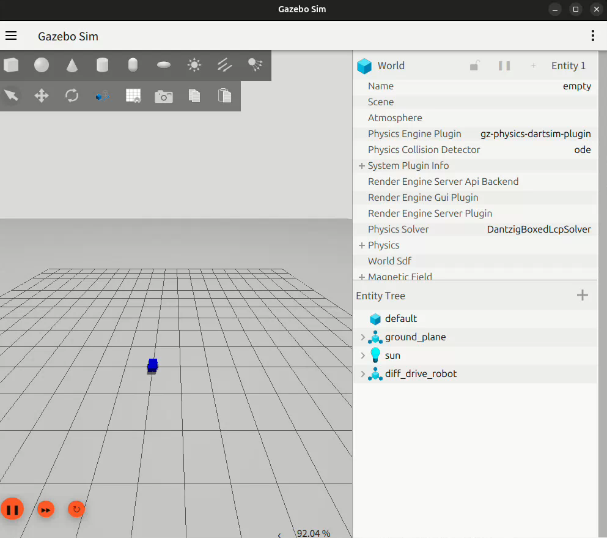

# Gazebo 差速小车键盘控制

## 实验简介

本实验使用 ROS2 Jazzy + Gazebo Harmonic 搭建一个差速驱动小车，通过 `gz_ros2_control` 硬件接口配合 `diff_drive_controller` 控制器，将 `/cmd_vel`（`geometry_msgs/Twist`）速度指令换算为左右轮转速，实现小车在 Gazebo 中的运动。模块提供键盘遥控与自动巡航两种运行方式：键盘节点向 `/cmd_vel` 发布消息遥控小车前进、后退、转向；自动巡航节点持续发布固定速度指令使小车沿圆形轨迹行驶。同时可在仿真中观察 `/odom` 里程计话题与 `odom -> base_footprint` 的 `/tf` 坐标变换。

## 运行环境

- Ubuntu 24.04
- ROS2 Jazzy
- Gazebo Harmonic（`gz sim`）
- 依赖：ros_gz、ros2_control、ros2_controllers、gz_ros2_control、robot_state_publisher、xacro

## 运行步骤

```bash
# 1. 安装依赖
sudo apt install ros-jazzy-ros-gz ros-jazzy-ros2-control ros-jazzy-ros2-controllers \
  ros-jazzy-gz-ros2-control ros-jazzy-robot-state-publisher ros-jazzy-xacro

# 2. 将 gazebo_diff_drive_teleop 包放入工作空间 src 目录，然后一键运行
bash main.sh          # 默认自动巡航演示（小车沿圆形轨迹行驶）
bash main.sh manual   # 仅启动仿真，另开终端用键盘控制
```

键盘按键：`w` 前进、`x` 后退、`a` 左转、`d` 右转、`s` 停止、`+`/`-` 调整线速度、`q` 退出。

运行后 Gazebo 窗口出现蓝色小车，自动巡航模式下小车沿圆形轨迹行驶。可另开终端查看话题：

```bash
ros2 topic list          # 查看 /cmd_vel /odom /tf 等话题
ros2 topic info /cmd_vel # 查看话题类型与发布订阅关系
ros2 topic echo /odom    # 查看里程计数据
```



## 效果说明

- 控制节点发布 `/cmd_vel`（Twist）→ `diff_drive_controller` 换算成左右轮目标转速 → `gz_ros2_control` 驱动 Gazebo 中的关节 → 小车运动；
- 差速控制原理：左右轮转速相同时直行，不同时转向，形成圆弧轨迹；
- 控制器同时发布 `/odom` 里程计与 `odom -> base_footprint` 的 `/tf` 变换，可用于后续建图与导航。

## 说明

代码与文档使用 deepseek v4-pro大模型辅助编写，已核对并确认，对提交内容负责。
