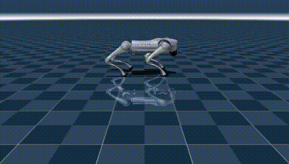

# 宇树 Go2 四足机器人 MuJoCo 物理仿真

---

## 1. 概述与目标

本模块基于 MuJoCo 物理仿真引擎与官方 Menagerie 模型库中的 `unitree_go2` 四足机器人模型，
实现一个小跑步态控制示例：机器人可在平坦地面上稳定前进，并自动渲染输出仿真视频。
不依赖 Gazebo、不需要自建 URDF。

### 核心任务目标
1. **四足小跑步态**：通过足端椭圆轨迹 + 平面逆运动学（IK）反解各腿关节目标角。
2. **力矩电机 PD 控制**：Go2 的 12 个执行器为力矩电机，脚本内实现 PD 控制器把关节拉到目标角。
3. **仿真视频自动渲染**：离屏渲染（Offscreen Rendering）自动生成 MP4 视频。

---

## 2. 模型与步态设计

### 2.1 模型来源
- 机器人：`unitree_go2`（宇树 Go2），来自官方 [mujoco_menagerie](https://github.com/google-deepmind/mujoco_menagerie) 模型库。
- 场景：Menagerie 自带 `scene.xml`（含地面网格与遮挡剔除），首次运行自动下载缓存。

### 2.2 控制方式
| 项目 | 说明 |
|------|------|
| 执行器 | 12 个力矩电机（ctrlrange ±23.7 N·m），需自行实现 PD 控制 |
| PD 增益 | KP=20, KD=0.5 |
| 足端轨迹 | 椭圆：摆动相抬脚 `LIFT·sin(p)`，支撑相贴地，前后摆动幅度 `A_X` |
| 逆运动学 | 每条腿在矢状面用平面两连杆 IK 求解大腿/小腿目标角 |
| 步态配对 | 对角小跑：FL/RR 一组、FR/RL 一组反相（相位差 π） |

### 2.3 步态参数（`main.py` 顶部）
| 参数 | 值 | 说明 |
|------|-----|------|
| `FREQ` | 1.1 | 步频 Hz |
| `A_X` | 0.10 | 足端前后摆动幅度（m） |
| `LIFT` | 0.042 | 摆动相抬脚高度（m） |
| `KP / KD` | 20.0 / 0.5 | PD 增益 |

---

## 3. 控制原理与公式

### 3.1 力矩电机 PD 控制律

Go2 执行器为力矩电机，控制器输出关节力矩：

$$ \tau = K_P\,(q_d - q) - K_D\,\dot{q} $$

- $q_d$：目标关节角（由 IK 反解），$q$ / $\dot{q}$：当前角度与角速度；
- $K_P = 20$、$K_D = 0.5$（与 legged_gym 对 Go2 的常用配置一致）；
- 输出经 `ctrlrange ±23.7 N·m` 限幅，防止初始大误差导致力矩饱和跳变。

### 3.2 足端轨迹规划

每条腿在基座（base）系下的矢状面内规划足端位置（$p = 2\pi f_{step} t + \phi_{leg}$）：

$$ x_f(t) = r_x + A_X \cos(p), \qquad z_f(t) = r_z + \max(\sin(p), 0) \cdot L_{lift} $$

- $r_x, r_z$：home 足端相对髋关节的位置；$A_X$：前后摆幅；$L_{lift}$：摆动相抬脚高度；
- $\sin(p) > 0$ 为摆动相（抬脚前迈），否则为支撑相（贴地后蹬）。

### 3.3 平面两连杆逆运动学（IK）

已知大腿长 $L_1$、小腿长 $L_2$ 与足端目标 $(f_x, f_z)$，先求末端距离 $r = \sqrt{f_x^2 + f_z^2}$（限制在可达域内），再解：

$$ \theta_{knee} = \arccos\!\left(\frac{L_1^2 + L_2^2 - r^2}{2 L_1 L_2}\right), \qquad \theta_{hip} = \arctan\!\left(\frac{f_x}{-f_z}\right) - \arccos\!\left(\frac{L_1^2 + r^2 - L_2^2}{2 L_1 r}\right) $$

目标角 $q_d = q_{home} + (\theta - \theta_{home})$，其中 $q_{home}$ 取自模型 keyframe（home 姿态）。

### 3.4 稳定性说明

PD 控制对单腿摆动相近似为二阶系统（$I\ddot{e} + K_D\dot{e} + K_P e = 0$，$e = q_d - q$），
$K_D$ 提供阻尼抑制足端轨迹切换时的冲击；实测中 Go2 以 0.1 m/s 量级稳定前进（见第 7 节），
步频/摆幅过大（如 $A_X \ge 0.15$）时足端触地速度增大、机身姿态失稳，属可复现边界。

---

## 4. 算法流程（伪代码）

```
常量：FREQ=1.1 Hz，A_X=0.10，LIFT=0.042，KP=20，KD=0.5
初始化：加载 unitree_go2 模型，读取 keyframe home 角，构建各腿几何 (L1,L2,rx,rz)

每步（timestep=0.002s，500 Hz）：
    for leg in (FL, FR, RL, RR):
        p ← 2π·FREQ·t + TROT[leg]            # TROT: FL/RR 相位 0，FR/RL 相位 π
        fx ← rx + A_X·cos(p)
        fz ← rz + max(sin(p),0)·LIFT
        (θhip, θknee) ← 平面两连杆 IK(L1, L2, fx, fz)
        qd_thigh ← home + (θhip − θhome)，qd_calf ← home + (θknee − θhome)
        τ ← clip(KP·(qd − q) − KD·q̇, ±23.7 N·m)   # 大腿/小腿
        τ_hip ← clip(KP·(home_hip − q) − KD·q̇, ±23.7)  # 髋部保持 home
        data.ctrl[leg_*] ← τ
    mujoco.mj_step()   # 物理积分一步

每 1/30 s：update_scene(camera="view0") + render() 取帧
    结束：imageio 合成 MP4（180 帧，30 fps，6 秒）
```

---

## 5. 运行方式

### 5.1 环境依赖
- Ubuntu 20.04 / 22.04 / 24.04（Windows 亦可）
- Python >= 3.10
- 系统库（Linux 无显示环境渲染需要）：`sudo apt install -y libosmesa6-dev`
- MuJoCo 3.x、mujoco-menagerie、imageio + imageio-ffmpeg、numpy、pillow（预览 PNG）
- 注意：`mujoco-menagerie` 的解包用到 `tarfile.extractall(filter="data")`，需要 Python >= 3.11.4；Python 3.10 上首次下载会抛 TypeError，模块会自动复用本地缓存，缓存为空时请升级 Python 或手动放置模型

### 5.2 安装依赖
```bash
cd src/ground/go2_mujoco
pip install -r requirements.txt
```

### 5.3 运行仿真

方式一（直接运行，不依赖 ROS）：
```bash
cd src/ground/go2_mujoco
python3 main.py            # 输出 output/go2_trot.mp4
python3 main.py --preview  # 只跑 1.6 秒，输出 3 张 PNG 检查取景
python3 main.py --duration 3     # 自定义完整视频时长（秒），不填则用默认 6.0
python3 -m unittest discover -s tests -v   # 单元测试：模型结构、执行器、控制器
```
Linux 无显示环境默认自动用 osmesa 软件渲染（需先 `sudo apt install -y libosmesa6-dev`），无需手动设 `MUJOCO_GL`；有显卡可用 `MUJOCO_GL=egl` 提速。Windows 自动 wgl，macOS 自动 cgl。

方式二（catkin 包 + roslaunch，需 ROS 环境）：
```bash
# 将本模块软链到工作空间 src 下，然后
catkin_make
source devel/setup.bash
roslaunch go2_mujoco main.launch                  # 默认（6.0 秒）
roslaunch go2_mujoco main.launch duration:=3.0    # 自定义时长
roslaunch go2_mujoco main.launch preview:=true    # 只渲染 3 帧预览、不写视频
```
> `cwd="node"` 下相对路径以 node 所在目录（`devel/lib/<pkg>/`）为基准，roslaunch 启动时视频输出到 `devel/lib/<pkg>/output/`；源码直跑时才落在模块的 `output/`。

---

## 6. 运行效果



完整视频由 `python3 main.py` 运行后生成于 `src/ground/go2_mujoco/output/go2_trot.mp4`
（6 秒，30 fps，960×544，180 帧）。上方动图为文档配图，存放于 `docs/img/ground/go2_mujoco/`。

---

## 7. 性能与实测指标

在 **Ubuntu 20.04 + ROS Noetic + MuJoCo 3.2.3** 虚拟机中实测（本模块本机 Windows 复测一致）：

| 指标 | 实测值 |
|------|--------|
| 仿真步进频率 | 500 Hz（timestep = 0.002 s） |
| 视频规格 | 6 秒 / 30 fps / 180 帧 / 960×544 |
| 端到端生成耗时（含仿真+渲染+编码） | 2.60 s |
| 前进速度 | 约 0.12 m/s（FREQ=1.1，A_X=0.10，LIFT=0.042） |
| 启动验证 | 源码 `python3 main.py` 已在本机实测通过（MuJoCo 3.2.3 与 3.17 两个版本）；`catkin_make` 与 `roslaunch go2_mujoco main.launch` 未在重构后的代码上本地复测（本机无 ROS 环境），需在 ROS 环境确认；单元测试 `python3 -m unittest discover -s tests` 已在本机 MuJoCo 3.2.3 与 3.17 双版本通过（5 项） |

### 7.1 多参数（场景）对比

| 场景 | 步频 FREQ | 摆幅 A_X | 抬脚 LIFT | 结果 |
|------|----------|---------|-----------|------|
| **默认（推荐）** | 1.1 Hz | 0.10 m | 0.042 m | 稳定前进 ~0.12 m/s |
| 步频降低 | 0.8 Hz | 0.10 m | 0.042 m | 前进更慢，姿态更稳 |
| 摆幅过大 | 1.1 Hz | 0.15 m | 0.042 m | 足端触地冲击增大，姿态失稳（可复现边界） |

> 参数位于 `main.py` 顶部常量，修改后重新运行即可复现不同步态表现。

---

## 8. 文件结构

```
go2_mujoco/
├── tests/               # 单元测试（python -m unittest discover -s tests）
├── setup.py             # setuptools 配置（catkin_python_setup 需要）
├── package.xml          # catkin 包描述
├── CMakeLists.txt       # catkin_python_setup + 只安装 main.py 入口
├── requirements.txt
├── .gitignore           # 忽略 output/（运行生成物不入库）
├── launch/
│   └── main.launch      # roslaunch 启动入口
├── README.md            # 运行环境与步骤说明
└── src/
    └── go2_mujoco/      # Python 包（catkin_python_setup 安装）
        ├── __init__.py
        ├── common.py    # 公共库：渲染后端 / 相机注入 / 视频导出
        └── main.py      # 仿真与渲染主脚本（入口）
```

配套文档配图：`docs/img/ground/go2_mujoco/go2_trot.gif`（由运行效果导出，不入模块 output/）。
