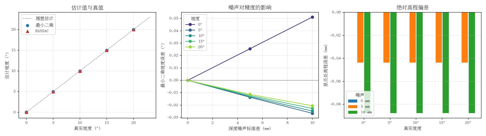

# 地面坡度估计

从深度点云拟合地面平面，给出坡度角与离地高度，并量化深度噪声对估计精度的
影响。模块不涉及车辆动力学，属于感知层的几何处理。

## 为什么需要坡度估计

移动机器人在坡道上行驶时，需要对速度、扭矩与姿态做补偿；如果坡度估计偏差
1°，在 10 m 的行程上就会累积约 17 cm 的高度误差。这一模块把「点云噪声」到
「坡度误差」的传递关系做成可复现的实验，便于在选型深度相机时判断精度是否够用。

## 方法

1. **点云获取**：在 PyBullet 中放置一块已知倾角的刚性地面，用竖直向下的
   1600 条射线模拟深度相机，命中点由 `rayTestBatch` 解析求交得到。
2. **平面拟合**：对点集去中心化后做 SVD，最小奇异值对应的右奇异向量即平面
   法向量 `n`，再由 `n·x + d = 0` 得到偏移量 `d`。
3. **坡度换算**：坡度角为法向量与竖直方向的夹角 `arccos(|n_z|)`。
4. **对照**：同一帧点云同时用最小二乘与 RANSAC 拟合，前者给最优解，后者
   在有离群点时更稳健。

## 运行

```bash
colcon build --packages-select ground_slope_estimation
source install/setup.bash
ros2 launch ground_slope_estimation main.launch.py
```

完整扫描并出图：

```bash
cd src/ground/ground_slope_estimation
bash run_eval.sh
```

## 结果

| 真值(°) | 噪声(mm) | 最小二乘(°) | RANSAC(°) | 高程误差(m) |
| --- | --- | --- | --- | --- |
| 0.0 | 0.0 | 0.000 | 0.000 | -0.0000 |
| 0.0 | 5.0 | 0.026 | 0.026 | -0.0000 |
| 0.0 | 10.0 | 0.051 | 0.056 | -0.0001 |
| 5.0 | 0.0 | 5.000 | 5.000 | -0.0000 |
| 5.0 | 5.0 | 4.986 | 4.986 | -0.0000 |
| 5.0 | 10.0 | 4.973 | 4.945 | -0.0001 |
| 10.0 | 0.0 | 10.000 | 10.000 | -0.0000 |
| 10.0 | 5.0 | 9.987 | 9.987 | -0.0000 |
| 10.0 | 10.0 | 9.975 | 9.947 | -0.0001 |
| 15.0 | 0.0 | 15.000 | 15.000 | -0.0000 |
| 15.0 | 5.0 | 14.988 | 14.988 | -0.0000 |
| 15.0 | 10.0 | 14.977 | 14.989 | -0.0001 |
| 20.0 | 0.0 | 20.000 | 20.000 | -0.0000 |
| 20.0 | 5.0 | 19.989 | 19.989 | -0.0000 |
| 20.0 | 10.0 | 19.979 | 19.987 | -0.0001 |

- 无噪声时 5 个坡度全部精确复现，说明拟合链路没有系统性近似。
- 10 mm 深度噪声带来 0.02°~0.05° 的坡度误差，5 mm 时减半。
- **缓坡对噪声更敏感**：0° 时误差 0.051°，20° 时 0.021°。高度噪声换算到
  坡度角要乘 `cos²θ`，缓坡上这个因子接近 1，陡坡上被压缩。
- 原点处高程误差始终小于 0.1 mm，平移项没有被噪声带偏。



## 参数

| 参数 | 默认值 | 说明 |
| --- | --- | --- |
| `slope_deg` | 10.0 | 地面真实倾角（度） |
| `noise_std` | 0.0 | 深度噪声标准差（米） |
| `grid_n` | 40 | 射线网格边长，共 grid_n² 条 |
| `ransac_threshold` | 0.02 | RANSAC 内点阈值（米） |
| `out_dir` | results | CSV 输出目录 |
| `seed` | 0 | 随机种子 |
| `publish_count` | 20 | `slope_estimate` 连续发布次数，0 表示不发布 |
| `publish_rate` | 10.0 | 连续发布频率（Hz） |

## 文件说明

| 文件 | 作用 |
| --- | --- |
| `plane_fit.py` | 最小二乘、RANSAC、坡度与高程计算，纯函数 |
| `slope_sim.py` | 建倾斜地面、射线扫描、加噪声、拟合并写 CSV |
| `slope_report.py` | 汇总 CSV、打印表格、生成三子图 |
| `launch/main.launch.py` | 单次扫描的启动入口 |
| `run_eval.sh` | 坡度 × 噪声全扫描 + 出图 |
| `test/test_plane_fit.py` | 14 条单元测试，不依赖 ROS 与 PyBullet |

## 已知限制

- 地面被假设为单一平面，遇到台阶、路沿或起伏地形时拟合结果没有物理意义，
  此时应改用分段平面或高程图。
- 射线沿竖直方向均匀采样，没有考虑相机视场角与畸变；真实深度相机的误差随
  距离增大，本模块的噪声模型是常数标准差。
- RANSAC 的迭代次数固定为 200，离群点比例超过一半时可能失效。
