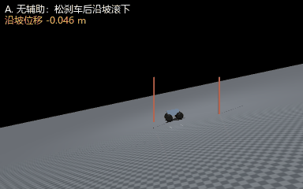

# 差速 AGV 的坡道起步辅助（防溜车）

本页对应 `src/ground/hill_start_assist`。一台差速 AGV 停在 **12° 斜坡**上，
松开刹车后会因重力分力后溜；用**轮角保持 PD + 坡度前馈**把它稳住。

## 1. 本模块实际实现范围

| 作业要求 | 实际情况 |
|---|---|
| (1) 物理仿真 + 键盘控制 | **仿真做了，键盘未做**（见 §6）。MuJoCo 倾斜地面（12°），4 轮两轴布局，真实摩擦接触（`nq=11, nu=4`） |
| (2) 传感器感知 + 运动控制 | **部分做了**。用轮编码器角度/角速度做保持控制；坡度由场景给定常数，未做 IMU 在线估坡 |
| (3) 导航与 SLAM | **不做** |
| (4) 神经网络 | **未做**（下一步） |

## 2. 原理

### 2.1 为什么会溜

车静止在倾角 $\alpha$ 的坡上时，重力沿坡分量 $mg\sin\alpha$ 由静摩擦平衡。
一旦轮子可以自由转动（相当于松开驻车），四个轮子一起滚，整车就沿坡下滑。

!!! warning "车身必须按坡度摆正"
    早期版本让车**世界竖直**地放在斜面上，三点支撑对不上，落稳阶段就翻了
    （实测俯仰 −65°），后面测到的"溜车"其实是翻倒的车身在滑。
    现在出生位姿按坡度旋转、沿斜面法向抬高一个轮半径，落稳后 4 点接触、俯仰恒等于 −12°。

### 2.2 控制律

$$
\tau_i = \underbrace{-k_p(\phi_i-\phi_{i0}) - k_d\dot\phi_i}_{\text{轮角保持 PD}} + \underbrace{\tfrac14\, m g \sin\alpha\, r}_{\text{坡度前馈，4 轮平摊}}
$$

- **PD 部分**：把轮子锁在原来的角度上，相当于电子驻车
- **前馈部分**：直接抵消重力分量，让稳态误差接近 0（只用 PD 会缓慢蠕动）

参数：$k_p=45$、$k_d=3$，前馈 0.286 N·m/轮（$m=7.0$ kg, $\alpha=12°$, $r=0.08$ m）。

## 3. 运行

### 3.1 依赖

```bash
# 基础（自检只需要这些）
sudo apt install -y python3-numpy
pip3 install mujoco==3.2.3

# 只有渲染动图才需要下面两项 —— 缺了会在 --gif 时报错
sudo apt install -y libosmesa6 libosmesa6-dev      # 否则 OSMesa 共享库找不到
pip3 install -U "PyOpenGL>=3.1.6"                  # 20.04 自带 3.1.0，缺 EGLDeviceEXT
```

评审在干净的 20.04 上实测过三种情况：
不设后端 → `X11: DISPLAY 缺失`；`MUJOCO_GL=egl` → PyOpenGL 3.1.0 没有 `EGLDeviceEXT`；
`MUJOCO_GL=osmesa` → 缺 `libosmesa6`。**先装上面两个依赖**再跑 `--gif`。

### 3.2 入口

```bash
cd src/ground/hill_start_assist

python3 main.py                 # 一条命令跑完自检（模块入口）
python3 main.py --gif           # 自检 + 渲染动图
./main.sh                       # 同上，自动在无 DISPLAY 时设 MUJOCO_GL=osmesa

# 若用 ROS 环境
roslaunch hill_start_assist hill_start.launch
```

单独跑某一步：

```bash
python3 tools/check_hill.py                 # 只跑自检
python3 -m unittest discover -s test        # 单元测试（5 项，不需要 ROS/MuJoCo）
python3 tools/make_gif.py                   # 只出图（写到 docs/img/hill_start_drive.gif）
```

自检输出四列判据：位移、末俯仰、全程俯仰峰值偏差、最小接触点数。
**俯仰峰值与接触点数都参与判定** —— 只查末俯仰会漏掉"中途翻车又爬起来"的情况。

### 3.3 虚拟机实跑输出

在 **Ubuntu 20.04 + Python 3.8.10 + mujoco 3.2.3** 的虚拟机里跑 `./main.sh`：

```text
[环境] python 3.8.10 | mujoco 3.2.3
[场景] nq=11 nu=4，7.00 kg（取自 body_mass.sum），12° 斜坡（4 轮两轴）
[控制器] {'kp': 45.0, 'kd': 3.0, 'slope_deg': 12.0, 'mass': 7.0, 'ff_per_wheel': 0.2855}

=== 松刹车后 3 s ===
  方案        沿坡位移    末俯仰   俯仰峰值偏差   最小接触   起点初速
  A. 无辅助  -2.179 m   -12.0°       0.0°        4    -0.00 m/s
  B. 有辅助  -0.008 m   -12.0°       0.0°        4    -0.00 m/s

  沿坡位移：2.179 m → 0.008 m（减少 99.65%）
[判据] 四项全部达标
[main] 退出码 0
```

### 3.4 对比动图



上半段无辅助、持续后溜；下半段有辅助、停在原地。左上角实时显示沿坡位移。

## 4. 实测结果

| 方案 | 松刹车后 3 s 沿坡位移 | 末俯仰 | 俯仰峰值偏差 | 最小接触 | 起点初速 |
|---|---|---|---|---|---|
| 无辅助 | **−2.179 m** | −12.0° | 0.0° | 4 | 0.00 m/s |
| 有辅助 | **−0.008 m** | −12.0° | 0.0° | 4 | 0.00 m/s |

沿坡位移减少 **99.65%**（2.179 m → 0.008 m）。要点：

- 两组的**末俯仰都等于坡度 −12°**，说明车是滚下去的，不是翻倒后滑的
- 两组的**起点初速都是 0.00 m/s** —— 落稳阶段就带刹，测量窗口的起点一致
- **俯仰峰值偏差与最小接触点**都纳入判据（`PITCH_TOL_DEG=3°`、至少 3 点着地）

## 5. 调试记录（按严重程度排序，均为评审复现后指出）

1. **车身没按坡度摆正 → 落稳就翻**（评审指出，最严重）。
   原先让车世界竖直地放在斜面上，三点支撑对不上，实测落稳后俯仰 −65°，
   后面测到的"溜车距离"其实是翻倒的车身在滑。
   现在：按坡度旋转 + 沿斜面法向抬高一个轮半径，并把"末俯仰是否贴近坡度"
   做成硬判据（`PITCH_TOL_DEG=3°`），翻了一律判不通过。
2. **三点支撑在斜面上不稳**：改成 **4 轮两轴**布局，俯仰静定，落稳后稳定 4 点接触。
3. **速度执行器相当于刹车**：`velocity` 执行器 `ctrl=0` 等于把轮速锁在 0，
   3 s 只移动 4.7 cm，演示不出溜车 → 改成 `motor`（力矩）执行器。
4. **出生法向量 x 分量写反 + 漏掉轮毂偏移**：法向应为 $(\sin(-\alpha),0,\cos(-\alpha))$，
   且抬高量是"轮半径 + 轮毂下移 0.02"，不是只有轮半径。错了会让车陷进地面（穿透 2.69 cm）。
5. **`peak_pitch` / `ncon` 曾是死变量**：算了却不参与判据，等于只查末俯仰，
   会漏掉中途翻车。现在两者都是硬判据。
6. **测量窗口起点带 0.33 m/s 初速**：旧版落稳阶段 `ctrl=0`，车在 0.4 s 里已经开溜，
   两组对比的起点并不相同。现改为落稳即带刹，起点初速 0.00 m/s。
7. **质量硬编码 7.0**：改为从 `m.body_mass.sum()` 读取并注入控制器，
   避免场景改动后前馈不同步。

## 6. 已知限制

1. **坡度是场景给定常数**，没有做 IMU 在线估坡。
2. **未做神经网络**（作业第 (4) 项）。
3. **未做键盘遥控与 ROS 节点**：已有统一入口 `main.py` / `main.sh` 与
   `launch/hill_start.launch`，但**没有键盘遥控**，也没有发布话题的 ROS 节点
   （`launch` 只是把 `main.py` 当普通节点跑一遍实验）；
   `models` 里的 8 个传感器是为后续 ROS 节点预留的，当前脚本读 `qpos/qvel/xpos`。
4. 残余 0.8 cm 位移来自轮子微小滚动，远低于判据 15 cm。
