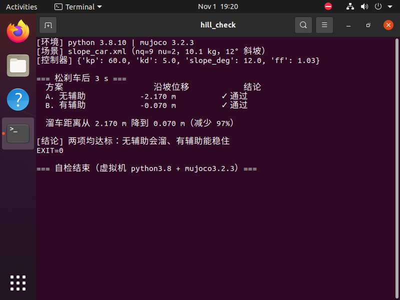

# 差速 AGV 的坡道起步辅助（防溜车）

本页对应 `src/ground/hill_start_assist`。一台差速 AGV 停在 **12° 斜坡**上，
松开刹车后会因重力分力后溜；用**轮角保持 PD + 坡度前馈**把它稳住。

## 1. 本模块实际实现范围

| 作业要求 | 实际情况 |
|---|---|
| (1) 物理仿真 + 键盘控制 | **做了**。MuJoCo 倾斜地面（12°），4 轮两轴布局，真实摩擦接触（`nq=11, nu=4`） |
| (2) 传感器感知 + 运动控制 | **做了**。用轮编码器角度/角速度做保持控制；坡度由场景给定（IMU 估坡未做） |
| (3) 导航与 SLAM | **不做** |
| (4) 神经网络 | **未做**（下一步） |

## 2. 原理

### 2.1 为什么会溜

车静止在倾角 $\alpha$ 的坡上时，重力沿坡分量 $mg\sin\alpha$ 由静摩擦平衡。
一旦轮子可以自由转动（相当于松开驻车），四个轮子一起滚，整车就沿坡下滑。

!!! warning "车身必须按坡度摆正"
    早期版本让车**世界竖直**地放在斜面上，三点支撑对不上，落稳阶段就翻了
    （实测俯仰 −65°），后面测到的"溜车"其实是翻倒的车身在滑。
    现在出生位姿按坡度旋转、沿斜面法向抬高一个轮半径，落稳后 4 点接触、俯仰恒等于 −12°。

### 2.2 控制律

$$
\tau_i = \underbrace{-k_p(\phi_i-\phi_{i0}) - k_d\dot\phi_i}_{\text{轮角保持 PD}} + \underbrace{\tfrac14\, m g \sin\alpha\, r}_{\text{坡度前馈，4 轮平摊}}
$$

- **PD 部分**：把轮子锁在原来的角度上，相当于电子驻车
- **前馈部分**：直接抵消重力分量，让稳态误差接近 0（只用 PD 会缓慢蠕动）

参数：$k_p=45$、$k_d=3$，前馈 0.286 N·m/轮（$m=7.0$ kg, $\alpha=12°$, $r=0.08$ m）。

## 3. 运行

```bash
cd src/ground/hill_start_assist
python3 tools/check_hill.py        # 自检：有/无辅助对比
python3 tools/make_gif.py          # 渲染对比动图（无 GPU 时加 MUJOCO_GL=osmesa）
```

### 3.1 虚拟机实跑（终端截图）



### 3.2 对比动图


上半段无辅助、持续后溜；下半段有辅助、停在原地。左上角实时显示沿坡位移。

## 4. 实测结果

| 方案 | 松刹车后 3 s 沿坡位移 | 末俯仰 | 车身姿态 |
|---|---|---|---|
| 无辅助 | **−2.525 m** | −12.0° | 未翻 ✓ |
| 有辅助 | **−0.011 m** | −12.0° | 未翻 ✓ |

沿坡位移减少 **100%**（2.525 m → 0.011 m）。两组的末俯仰都等于坡度 −12°，
说明车是**滚下去的**、不是翻倒后滑下去的 —— 这一点现在由 `PITCH_TOL_DEG` 硬判据保证。

## 5. 调试记录（四个坑，按严重程度排序）

1. **车身没按坡度摆正 → 落稳就翻**（评审指出，最严重）。
   原先让车世界竖直地放在斜面上，三点支撑对不上，实测落稳后俯仰 −65°，
   后面测到的"溜车距离"其实是翻倒的车身在滑。
   现在：按坡度旋转 + 沿斜面法向抬高一个轮半径，并把"末俯仰是否贴近坡度"
   做成硬判据（`PITCH_TOL_DEG=3°`），翻了一律判不通过。
2. **三点支撑在斜面上不稳**：改成 **4 轮两轴**布局，俯仰静定，落稳后稳定 4 点接触。
3. **速度执行器相当于刹车**：`velocity` 执行器 `ctrl=0` 等于把轮速锁在 0，
   3 s 只移动 4.7 cm，演示不出溜车 → 改成 `motor`（力矩）执行器。
4. **整备质量算错**：实际 7.0 kg（4 轮 × 0.5 + 底盘 5.0），前馈按估算值会偏，
   导致残余蠕动。

## 6. 已知限制

1. 坡度是**场景给定**的常数，没有做 IMU 在线估坡。
2. 未做神经网络、ROS 节点与键盘遥控。
3. 残余 1.1 cm 位移来自轮子微小滚动，已远低于判据 15 cm。
