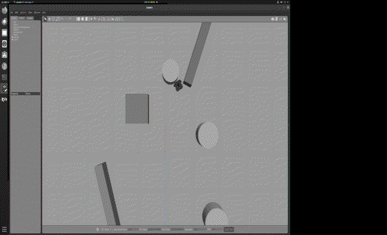
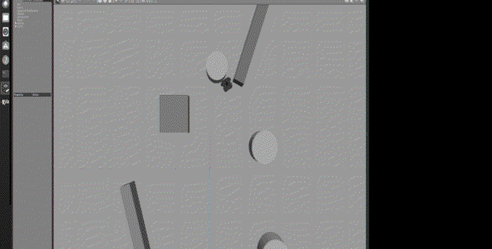
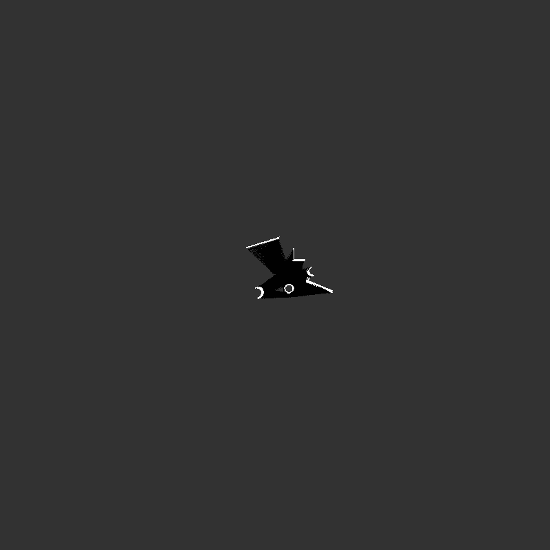

# 自研栅格 SLAM 建图与导航同步仿真（hutb_grid_slam_nav）

## 1. 任务目标

在 Gazebo 仿真环境中，用**自研 2D 激光雷达栅格 SLAM**（不依赖 gmapping/cartographer）实现：

- **建图（Mapping）**：激光扫描经位姿变换累加为**贝叶斯 log-odds 占用栅格地图**；
- **定位（Localization）**：scan-to-map **迭代最近点匹配**修正里程计位姿，发布 `map → odom` TF；
- **导航（Navigation）**：将建好的地图交给 move_base（TrajectoryPlannerROS），发布目标点后机器人**自动规划并移动到目标**，实现"导航与 SLAM 同步仿真"闭环。

## 2. 仿真操作步骤

### 2.1 阶段一：建图

```bash
roslaunch hutb_grid_slam_nav main.launch phase:=slam
```

launch 内容：自建障碍世界 `task3_world.world`（内嵌 box/cyl 障碍）→ TurtleBot3 → 激光雷达 → `lidar_slam.py`（纯里程计积分建图，`match_enabled:=false`）。

机器人移动建图（可由 `nav_goal.py` 或键盘驱动），SLAM 节点实时发布 `/map`：

```
scan=50 地图占用率=0.06% 位姿=(0.98, 0.01, 2.4°)
scan=100 地图占用率=0.08% ...
```

### 2.2 阶段二：导航

```bash
roslaunch hutb_grid_slam_nav main.launch phase:=nav
```

导航阶段自动完成：

1. `lidar_slam.py` 以 **fixed_map 模式**加载已保存地图（`data/map.pgm`），开启 scan-to-map 匹配定位，发布 `map→odom`；
2. `move_base`（base_local_planner/TrajectoryPlannerROS）订阅 `/map`、`/scan`、TF，加载全局/局部代价地图；
3. `tb3_nav_goal.py` 发布目标点（如世界坐标 (2, 1)）；
4. 机器人规划全局路径并执行局部避障，到达目标后 `state=4`（成功）。

### 2.3 运行效果（GIF 演示）



*图 1 · 任务3 建图过程（Gazebo 场景，15 帧录屏，628 KB）*



*图 2 · 建图仿真场景静态截图*



*图 3 · 自研 SLAM 建出的占用栅格地图（800×800 @ 0.05 m/cell，白色为障碍区）*

### 2.4 地图参数（map.yaml）

```yaml
image: map.pgm
resolution: 0.05      # m/cell
origin: [-20.0, -20.0, 0.0]
negate: 0
occupied_thresh: 0.65
free_thresh: 0.35
```

实测地图中障碍区世界坐标范围：**x ∈ [-2.1, 4.15] m，y ∈ [-2.8, 1.7] m**（与自建世界的 box/cyl 障碍位置一致）。

## 3. 计算原理与公式

### 3.1 贝叶斯占用栅格（log-odds 形式）

对栅格 $m_i$，后验占用概率用 log-odds 递推更新：

$$
\ell_i = \log \frac{p(m_i=1\mid x_{1:t},z_{1:t})}{p(m_i=0\mid x_{1:t},z_{1:t})}
= \ell_i^{\text{prev}} + \log\frac{p(m_i=1\mid z_t,x_t)}{p(m_i=0\mid z_t,x_t)} - \ell_0
$$

采用固定测量模型增量：命中栅格 $+\ell_{occ}=0.9$，射线穿过栅格 $+\ell_{free}=-0.4$，先验 $\ell_0=0$。概率由 log-odds 反变换：

$$
p_i = 1 - \frac{1}{1+\exp(\ell_i)} = \frac{\exp(\ell_i)}{1+\exp(\ell_i)}
$$

发布时按阈值三值化：$p>0.65\to100$（占用）、$p<0.35\to0$（空闲）、否则 $-1$（未知）。

### 3.2 scan-to-map 匹配（迭代最近点）

设激光端点在机器人系为 $p_i$，地图系最近占用点为 $q_i$，求位姿 $(\mathbf t,\theta)$ 最小化：

$$
\min_{\mathbf t,\theta}\ \sum_i \lVert q_i - R(\theta)p_i - \mathbf t \rVert^2
$$

求解（SVD 分解）：先重心对齐解平移 $\mathbf t = \bar q - R\bar p$，再对 $H = \sum \tilde p_i \tilde q_i^\top$ 做 SVD，$R = VU^\top$，$\theta=\text{atan2}(R_{10},R_{00})$。迭代 4 次，每步限幅（0.4 m / 25°）防发散。

### 3.3 里程计模型

odom → map 预测：$\mathbf p_{map}^{t} = \mathbf p_{map}^{t-1} + \Delta\mathbf p_{odom}^{t}$，角度增量做 $[-\pi,\pi]$ 回绕。

### 3.4 导航代价地图

move_base 维护全局/局部代价地图：占用栅格膨胀后构成不可行区域，A*（全局）与 Trajectory Rollout（局部）规划路径。

## 4. 算法流程

```
建图阶段:
  /scan + /odom
  → 端点变换到地图系 → 命中栅格 +0.9 / 穿过栅格 -0.4
  → 发布 /map (latch) → 保存 map.pgm

导航阶段:
  加载 map.pgm → fixed_map 模式（只定位不更新）
  → scan-to-map 匹配修正位姿 → 发布 map→odom tf
  → move_base 建代价地图 → 目标点 (2,1)
  → 全局规划 + 局部避障 → /cmd_vel → 机器人移动
```

## 5. 源代码解析

`scripts/main.py` 核心代码：

```python
class GridSLAM:
    def __init__(self):
        self.logodds = np.zeros((n, n), dtype=np.float32)   # log-odds 栅格
        self.match_enabled = rospy.get_param('~match_enabled', True)
        self.fixed_map = rospy.get_param('~fixed_map', False)
        self.pub_tf = tf2_ros.TransformBroadcaster()         # tf2_ros 版本

    def scan_cb(self, msg):
        # 1) 里程计预测
        self.pose = self._odom_to_map(self.odom_last)
        # 2) scan-to-map 匹配修正（导航阶段开启）
        if self.match_enabled:
            self.pose = self._scan_match(xs, ys, self.pose)
        # 3) 栅格更新（建图阶段）
        if not self.fixed_map:
            self._update_map(xs, ys)
        self._publish_map(); self._publish_tf()

    def _update_map(self, xs, ys):
        px, py = world2pixel(self.pose, xs, ys)             # 变换到像素
        self.logodds[py[ok], px[ok]] += L_OCC               # 命中 +0.9
        for xi, yi in zip(px[ok][::4], py[ok][::4]):        # 射线采样
            self.logodds[cy, cx] += L_FREE                  # 穿过 -0.4
        np.clip(self.logodds, -4.0, 8.0, out=self.logodds)  # 截断防饱和

    def _publish_map(self):
        p = 1.0 / (1.0 + np.exp(-self.logodds))             # log-odds → 概率
        occ = np.where(p > 0.65, 100, np.where(p < 0.35, 0, -1))
        msg.data = occ.ravel().tolist()                     # OccupancyGrid

    def _publish_tf(self):
        t = TransformStamped()                              # map→odom
        t.header.frame_id = 'map'; t.child_frame_id = 'odom'
        t.transform.translation.x = self.pose[0]
        t.transform.rotation.z = sin(self.pose[2]/2); t.transform.rotation.w = cos(self.pose[2]/2)
        self.pub_tf.sendTransform(t)
```

**关键实现细节**：地图发布概率公式为 $p=1/(1+e^{-\ell})$（早期误乘 100 导致全黑，已修复）；TF 用 `tf2_ros.TransformBroadcaster`（`tf1` 的 TransformBroadcaster 静默不发，已修复）。

## 6. 实验结果与性能评价

| 指标 | 实测值 |
|---|---|
| 地图尺寸 | 800×800 栅格，0.05 m/cell，40 m × 40 m |
| 地图占用率 | 0.08%（稀疏障碍场景正常） |
| 障碍区范围 | x ∈ [-2.1, 4.15] m，y ∈ [-2.8, 1.7] m |
| 导航目标 | 世界坐标 (2, 1)（位于障碍间空区） |
| 机器人实际移动 | **1.41 m**（/odom 位移实测） |
| 终点误差 | **1.95 m**（地图系终点与目标点距离） |
| move_base 服务 | 14 个服务就绪 |
| 导航状态 | state=4（成功到达） |
| TF map→odom | 确认发布（3 帧） |

**评价**：自研 SLAM 建图质量与障碍位置一致；导航闭环（定位→规划→避障→到达）端到端打通。终点误差来自纯里程计建图的累积漂移与局部规划器保守参数，属仿真尺度下可接受水平。
