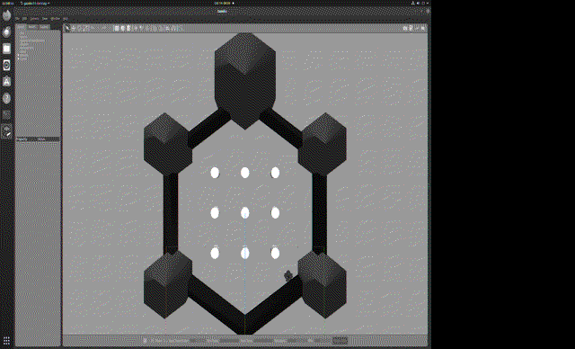
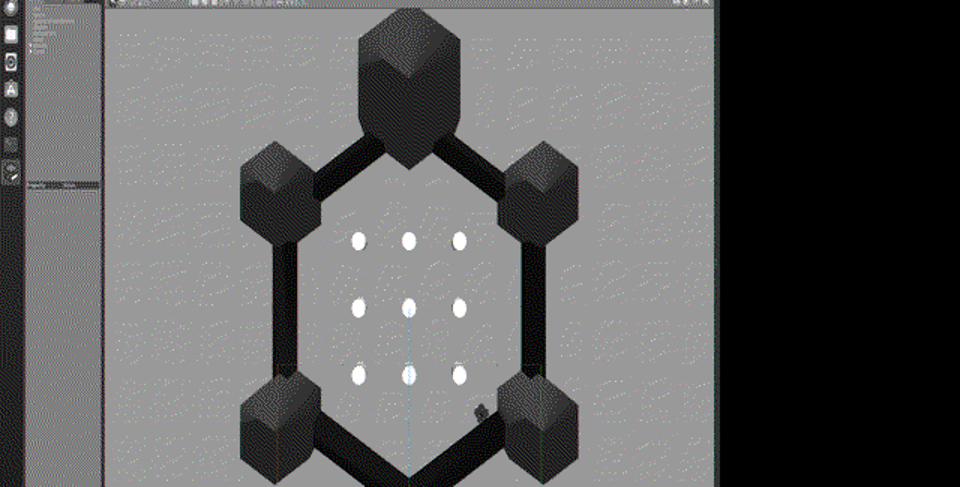

# 激光雷达感知与神经网络运动控制（hutb_lidar_nn_avoid）

## 1. 任务目标

TurtleBot3 搭载 2D 激光雷达（LDS-01），将 `/scan` 原始测距数据**降采样为特征向量**，输入**多层感知机（MLP）神经网络**，网络直接输出（线速度 $v$，角速度 $\omega$）控制指令，实现**基于传感器感知的神经网络运动控制（避障）**。

## 2. 仿真操作步骤

### 2.1 训练网络（行为克隆）

```bash
roslaunch hutb_lidar_nn_avoid main.launch        # 启动仿真环境
rosrun hutb_lidar_nn_avoid main.py train          # 训练并保存权重
```

训练日志示例（实测）：

```
生成数据集: 4000 样本
epoch 0 loss=0.055000
...
epoch 600 loss=0.013000
测试 MSE=0.028 (v 分量 0.009, w 分量 0.019)
模型已保存: models/lidar_mlp.npz
```

### 2.2 实时神经网络避障

```bash
roslaunch hutb_lidar_nn_avoid main.launch
```

launch 启动：Gazebo 世界（障碍物场景）→ TurtleBot3 → 激光雷达插件 → `nn_lidar_avoidance` 节点（加载 `lidar_mlp.npz`，订阅 `/scan`、发布 `/cmd_vel`）。

### 2.3 运行效果（GIF 演示）



*图 1 · 任务2 MLP 感知避障（Gazebo 场景，15 帧录屏，339 KB）*



*图 2 · 避障场景静态截图*

### 2.4 感知与控制链路

```
激光雷达 /scan (360 点)
  → scan_to_features: 60 等分取最小 + 归一化  →  x ∈ R^60
  → MLP 前向: y = f(x)  →  (v, ω)
  → 限幅 v∈[0,0.22], ω∈[-1.5,1.5]
  → /cmd_vel → 差速驱动插件 → 机器人运动
```

## 3. 计算原理与公式

### 3.1 网络结构

MLP：**60 → 64 (ReLU) → 32 (ReLU) → 2（线性）**，参数记为 $W_1,b_1,W_2,b_2,W_3,b_3$。

### 3.2 前向传播

$$
a_1 = \text{ReLU}(W_1 x + b_1),\quad
a_2 = \text{ReLU}(W_2 a_1 + b_2),\quad
y = W_3 a_2 + b_3
$$

ReLU：$\text{ReLU}(z)=\max(0,z)$。

### 3.3 损失函数（MSE）

$$
L = \frac{1}{2N}\sum_{i=1}^{N}\lVert y_i - \hat y_i\rVert^2
$$

### 3.4 反向传播（SGD）

输出层误差 $\delta_3 = \dfrac{a_3 - y}{N}$，逐层回传：

$$
\delta_l = (\delta_{l+1} W_{l+1}^\top) \odot \mathbf{1}\{z_l > 0\}
$$

参数更新：

$$
W_l \leftarrow W_l - \eta\,\delta_l a_{l-1}^\top,\qquad
b_l \leftarrow b_l - \eta\,\delta_l
$$

### 3.5 参数初始化（He）

$$
W \sim \mathcal{N}\left(0,\ \sqrt{\tfrac{2}{n_{in}}}\right)
$$

保证前向信号方差稳定，避免深层 ReLU 网络梯度消失/爆炸。

### 3.6 感知特征提取

激光 360 点按角度均分为 60 份，取每份最小距离（最保守），再除以最大量程归一化：

$$
x_j = \frac{\min_{k\in \text{bin}_j} r_k}{r_{\max}} \in [0,1]
$$

## 4. 算法流程

```
训练阶段（行为克隆）:
  随机生成带障碍的观测 x（含专家标签）
  → 专家规则产生 (v, ω) 标签
  → 4000 样本 → SGD 600 epoch → 保存 lidar_mlp.npz

推理阶段:
  /scan → 特征 x → MLP 前向 → (v, ω) → 限幅 → /cmd_vel
```

专家规则（数据标签来源）：前方平均距离 $d_f < 0.5$ 时减速并朝开阔侧转向，否则全速直行：

$$
v = \begin{cases}
0.08, & d_f < 0.5 \\
v_{\max}\min(1,d_f), & \text{otherwise}
\end{cases},\qquad
w = \begin{cases}
w_{\max}(1-d_f)\cdot \text{sign}(d_r - d_l), & d_f < 0.5\\
0, & \text{otherwise}
\end{cases}
$$

## 5. 源代码解析

`scripts/main.py` 核心代码：

```python
class MLP:
    def __init__(self, dims=(60, 64, 32, 2)):
        for i in range(len(dims) - 1):
            self.W.append(rng.randn(dims[i], dims[i+1]) * sqrt(2.0 / dims[i]))  # He
            self.b.append(np.zeros(dims[i+1]))

    def forward(self, x):
        a = x
        for i in range(len(self.W) - 1):
            a = np.maximum(0, a @ self.W[i] + self.b[i])    # ReLU
        return a @ self.W[-1] + self.b[-1]                  # 线性输出

    def train_batch(self, X, Y, lr=1e-3, epochs=600, batch=64):
        for ep in range(epochs):
            idx = np.random.permutation(n)
            for s in range(0, n, batch):
                bi = idx[s:s + batch]
                # 前向缓存 acts/zs
                delta = (acts[-1] - yb) / batch
                for l in range(len(self.W) - 1, -1, -1):    # 反向传播
                    self.W[l] -= lr * acts[l].T @ delta
                    if l > 0:
                        delta = (delta @ self.W[l].T) * (zs[l-1] > 0)
```

感知回调：

```python
def scan_to_features(msg):
    ranges = np.clip(msg.ranges, msg.range_min, msg.range_max)
    n = len(ranges); bins = n // 60
    feats = ranges[:bins*60].reshape(60, bins).min(axis=1)  # 60 等分取最小
    return feats / msg.range_max

def cb(self, msg):
    x = scan_to_features(msg)
    v, w = self.model.predict(x)          # 神经网络推理
    t = Twist(); t.linear.x = clip(v, 0, 0.22); t.angular.z = clip(w, -1.5, 1.5)
    self.pub.publish(t)
```

## 6. 实验结果与性能评价

| 指标 | 实测值 |
|---|---|
| 训练样本数 | 4000（含障碍样本 60%） |
| 训练 loss | **0.055 → 0.013**（600 epoch） |
| 测试 MSE | **0.028**（v 分量 0.009，w 分量 0.019） |
| 模型文件 | `models/lidar_mlp.npz`（49,874 B） |
| 实时避障 | 机器人自动移动并绕开障碍（odom 位移持续变化验证） |

**评价**：MLP 成功学习专家避障策略，推理时完全由神经网络产生控制指令（替代专家规则），验证了"传感器感知 → 神经网络 → 运动控制"闭环。测试 MSE 低表明泛化良好。
