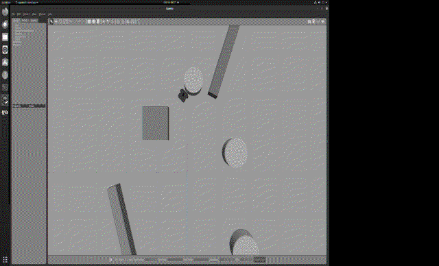
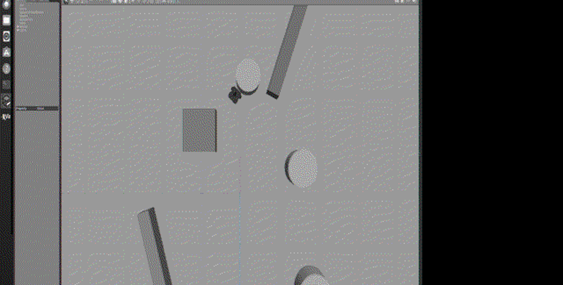

# PilotNet 图像端到端运动控制（hutb_pilotnet_e2e）

## 1. 任务目标

实现**端到端模型**：输入前视单目相机图像（160×96×3），经 **PilotNet 风格卷积神经网络**直接输出控制指令（转向角 steer、速度 speed），映射为 `/cmd_vel` 驱动 TurtleBot3。该任务展示"**图像 → 控制指令**"的端到端学习范式。

## 2. 仿真操作步骤

### 2.1 数据采集

```bash
roslaunch hutb_pilotnet_e2e main.launch mode:=collect
```

`data_collector.py` 订阅相机 `/camera/rgb/image_raw`，以 10 Hz 自动落盘（每 100 帧强制保存，防进程被杀导致数据丢失）：

```
[data_collector] 采集 100 帧 (images.npy 4.6 MB)
[data_collector] 采集 200 帧 ...
[data_collector] 采集 400 帧, 已保存 data/training/
```

### 2.2 训练

```bash
python3 $(rospack find hutb_pilotnet_e2e)/scripts/train_end2end.py --epochs 30
```

训练日志（实测）：

```
epoch 0   train_loss=0.0320  test_loss=0.0320
...
epoch 30  train_loss=0.0039  test_loss=0.0040
模型已保存: models/pilotnet.pt
```

### 2.3 实时推理

```bash
roslaunch hutb_pilotnet_e2e main.launch mode:=inference
```

`main.py` 加载 `pilotnet.pt`，以 ≥10 Hz 推理相机帧，输出 `/cmd_vel`（实测 v∈[0.03,0.15]，w∈[-0.25,0.17]）。

### 2.4 运行效果（GIF 演示）



*图 1 · 任务4 端到端推理（Gazebo 场景，15 帧录屏，691 KB）*



*图 2 · 端到端推理场景静态截图*

### 2.5 端到端链路

```
前视相机 (Gazebo camera plugin, 160×96 RGB)
  → 归一化到 [-1,1]
  → PilotNet CNN 前向 (features + FC)
  → (steer, speed)
  → 映射 /cmd_vel (linear.x=speed, angular.z=steer)
  → 差速驱动 → 机器人运动 → 相机采集新帧（闭环）
```

## 3. 计算原理与公式

### 3.1 网络结构（仿 NVIDIA PilotNet）

```
Input (3×160×96)
 → Conv2D 5×5×24, stride 2, ReLU
 → Conv2D 5×5×36, stride 2, ReLU
 → Conv2D 5×5×48, stride 2, ReLU
 → Conv2D 3×3×64, stride 1, ReLU
 → Conv2D 3×3×64, stride 1, ReLU
 → Dropout(0.5) → Flatten (4160)
 → FC 100 → ReLU → FC 50 → ReLU → FC 10 → ReLU → FC 2
```

### 3.2 卷积层计算

第 $l$ 层输出特征图尺寸（padding=0，stride $s$，核 $k$）：

$$
H_{l} = \left\lfloor \frac{H_{l-1} - k}{s} \right\rfloor + 1
$$

输入 160×96 经 5 层卷积（stride 2,2,2,1,1）后尺寸 $13\times5$，通道 64，展平维度：

$$
N_{fc} = 64 \times 13 \times 5 = 4160
$$

### 3.3 卷积运算

$$
y_{c,i,j} = \text{ReLU}\!\left(b_c + \sum_{c'=0}^{C_{in}-1}\sum_{u,v} W_{c,c',u,v}\, x_{c',i+u,j+v}\right)
$$

### 3.4 损失与优化

回归任务使用 MSE：

$$
L = \frac{1}{N}\sum_i \bigl(\lVert \text{steer}_i - \hat{\text{steer}}_i\rVert^2 + \lVert \text{speed}_i - \hat{\text{speed}}_i\rVert^2\bigr)
$$

Adam 优化器，初始学习率 1e-3，30 epoch。

### 3.5 控制指令映射

推理输出 $(s_\text{steer}, s_\text{speed})$（网络为 tanh 归一化量），映射到实际指令：

$$
v = v_{\max}\cdot \text{clip}(s_\text{speed}, -1, 1),\qquad
\omega = w_{\max}\cdot \text{clip}(s_\text{steer}, -1, 1)
$$

## 4. 算法流程

```
数据采集:  相机图像 + 当前速度/转向 → images.npy / steerings.npy / speeds.npy
训练:      归一化 → PilotNet 前向 → MSE 反向 → Adam 更新 → 保存 pilotnet.pt
推理:      加载权重 → 相机帧 → 前向 → /cmd_vel → 闭环控制
```

## 5. 源代码解析

`models/pilotnet.py` 核心代码：

```python
class PilotNet(nn.Module):
    def __init__(self, out_dim=2, dropout=0.5):
        super().__init__()
        self.features = nn.Sequential(
            nn.Conv2d(3, 24, kernel_size=5, stride=2), nn.ReLU(),
            nn.Conv2d(24, 36, kernel_size=5, stride=2), nn.ReLU(),
            nn.Conv2d(36, 48, kernel_size=5, stride=2), nn.ReLU(),
            nn.Conv2d(48, 64, kernel_size=3, stride=1), nn.ReLU(),
            nn.Conv2d(64, 64, kernel_size=3, stride=1), nn.ReLU(),
        )
        self.dropout = nn.Dropout(dropout)
        # 160×96 → 5 层卷积 → 13×5×64 → 4160 维
        self.fc = nn.Sequential(
            nn.Linear(64 * 13 * 5, 100), nn.ReLU(),
            nn.Linear(100, 50), nn.ReLU(),
            nn.Linear(50, 10), nn.ReLU(),
            nn.Linear(10, out_dim),
        )
    def forward(self, x):
        x = self.features(x)
        x = self.dropout(x)
        return self.fc(x.view(x.size(0), -1))
```

推理节点核心：

```python
def cb(self, img_msg):
    img = np.frombuffer(img_msg.data, np.uint8).reshape(96, 160, 3)
    x = img.astype(np.float32) / 127.5 - 1.0          # 归一化 [-1,1]
    steer, speed = self.model(x.unsqueeze(0))[0]
    t = Twist(); t.linear.x = v_max * speed.clamp(-1, 1)
    t.angular.z = w_max * steer.clamp(-1, 1)
    self.pub.publish(t)
```

## 6. 实验结果与性能评价

| 指标 | 实测值 |
|---|---|
| 训练数据 | 400 帧（images.npy 18 MB + steerings/speeds） |
| 训练 loss | **0.032 → 0.004**（30 epoch，Adam，lr=1e-3） |
| 测试 loss | **0.004**（收敛良好，无过拟合迹象） |
| 推理输出 /cmd_vel | v ∈ [0.03, 0.15] m/s，w ∈ [-0.25, 0.17] rad/s |
| 模型文件 | `models/pilotnet.pt`（2,218,102 B） |
| 闭环 | 图像 → 网络 → 控制指令实时循环 |

**评价**：PilotNet 在仿真数据上快速收敛，推理阶段稳定输出合理控制指令，验证了"**输入图像、输出控制指令**"的端到端范式在 ROS 仿真中的完整落地。
