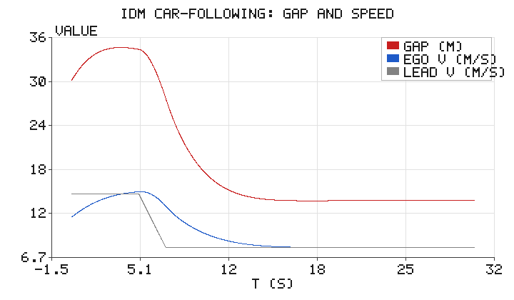
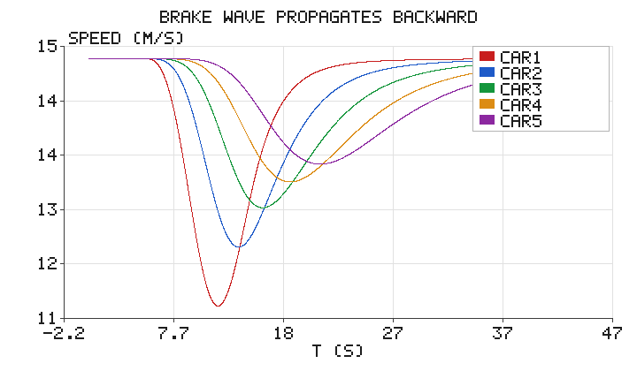

# 智能驾驶员模型（IDM）跟车与车队减速波仿真

## 1. 背景与目标

在交通流中，后车如何根据与前车的**距离**和**速度差**连续调整车速，是自动驾驶
纵向控制与微观交通仿真的核心。**智能驾驶员模型（Intelligent Driver Model, IDM）**
由 Treiber 等人提出，用一个简洁的连续微分方程刻画车辆跟驰行为，参数物理意义
清晰，是被引用最多的跟驰模型之一。

本模块用 IDM 演示两件事：

1. **单车跟驰**：前车减速时，后车如何平滑地拉开/收敛间距并匹配车速；
2. **车队弦向稳定性**：领航车的一次减速如何像"波"一样向后传递，并在传播中
   衰减——这是理解"幽灵堵车（phantom traffic jam）"微观机理的起点。

全部代码仅用 Python 标准库，无第三方依赖。

## 2. 运行环境

```bash
cd src/ground/idm_car_following
python3 scripts/main.py --outdir scripts
```

输出 `idm_gap_speed.png`、`idm_platoon.png` 并打印关键指标。

## 3. 代码文件清单

```
src/ground/idm_car_following/
├── scripts/
│   ├── idm.py            # IDM 加速度模型 + 单/多车仿真 + 平衡间距
│   ├── simulate.py       # 场景编排与配图输出
│   ├── simple_plot.py    # 仅用 zlib 的极简折线图输出
│   └── main.py           # 命令行入口
├── tests/
│   └── test_idm.py       # 单元断言（自由流 / 平衡间距 / 加速度上界 / 防碰撞）
├── package.xml
├── CMakeLists.txt
├── launch/main.launch
├── README.md
└── requirements.txt
```

## 4. 处理原理

### 4.1 IDM 加速度方程

车辆 $i$ 的加速度由"期望加速"与"避撞减速"两项组成：

$$
\dot{v} = a\left[\, 1 - \left(\frac{v}{v_0}\right)^{\delta} - \left(\frac{s^*}{s}\right)^{2} \right]
$$

其中期望间距

$$
s^* = s_0 + \max\!\left(0,\ vT + \frac{v\,\Delta v}{2\sqrt{ab}}\right),
\qquad \Delta v = v - v_{\text{lead}}
$$

各参数含义：$v_0$ 期望速度、$T$ 安全车头时距、$a$ 最大加速度、$b$ 舒适减速度、
$s_0$ 静止最小间距、$\delta$ 加速指数（取 4）、$s$ 与前车的保险杠间距。

- 当前方很空（$s\gg s^*$）时，交互项趋于 0，车辆平滑加速逼近 $v_0$；
- 当前方逼近（$s$ 小）时，$(s^*/s)^2$ 迅速增大，产生强减速，避免追尾。

### 4.2 平衡间距（一个重要细节）

令 $\dot v=0$ 且稳态 $\Delta v=0$，可得车速 $v$ 对应的**平衡间距**

$$
s_{\text{eq}}(v) = \frac{s_0 + vT}{\sqrt{1-(v/v_0)^{\delta}}}
$$

注意当 $v\to v_0$ 时分母趋于 0，$s_{\text{eq}}\to\infty$——也就是说，
**车辆无法在"期望速度"上与前车稳定跟驰**，只有 $v<v_0$ 时才有有限平衡间距。
因此本模块取 $v_0=20\,\mathrm{m/s}$ 而巡航速度 $15\,\mathrm{m/s}$，此时
$s_{\text{eq}}(15)\approx 29.6\,\mathrm{m}$，是一个真实存在的跟驰平衡态。

### 4.3 车队与弦向稳定性

把 $N$ 辆车首尾相连，第 $i$ 辆车以前车（$i-1$）为领车执行 IDM，就构成一个车队。
给领航车一个速度扰动，扰动会逐车向后传递。若各车速度的振荡幅值**逐车衰减**，
则称车队是**弦向稳定**的；反之则扰动被放大，宏观上表现为走走停停的"幽灵堵车"。

## 5. 仿真结果

### 5.1 单车跟驰

前车以 15 m/s 巡航，5~7 s 平滑减速到 8 m/s；后车初始 12 m/s、间距 30 m。



后车间距（红）先随车速提升而增大，待前车减速后收敛到约 $14.2\,\mathrm{m}$
（即 $s_{\text{eq}}(8)\approx14.2\,\mathrm{m}$），车速（蓝）平滑跟随前车（灰）降到 8 m/s，
全程无碰撞、无剧烈顿挫。

### 5.2 车队减速波向后传播

5 辆 IDM 跟随车依次跟随领航车；领航车在 5~15 s 做一次余弦"减速-恢复"脉冲
（谷值 10 m/s），各车以平衡间距初始化。



可以看到减速波**逐车向后延迟且幅值逐车衰减**（弦向稳定）：

| 车辆 | 速度最低点 (m/s) | 下潜深度 (m/s) | 到达时刻 (s) |
|------|-----------------|----------------|--------------|
| CAR1 | 11.29 | 3.71 | 11.6 |
| CAR2 | 12.17 | 2.83 | 13.5 |
| CAR3 | 12.76 | 2.24 | 15.7 |
| CAR4 | 13.15 | 1.85 | 18.2 |
| CAR5 | 13.42 | 1.58 | 20.9 |

下潜深度从 3.71 单调降到 1.58 m/s，峰值时刻从 11.6 s 依次推迟到 20.9 s，
正是"扰动沿车队向后传播并衰减"的直观体现。若把参数调到弦向不稳定区间，
同一扰动会越传越大，就形成了幽灵堵车。

## 6. 小结

- IDM 以极简的两项式刻画跟驰：期望加速 + 避撞减速，参数物理意义清晰；
- 平衡间距 $s_{\text{eq}}$ 只对 $v<v_0$ 有限，期望速度上无法稳定跟驰；
- 车队中速度扰动以"波"的形式向后传播，其幅值是否衰减决定了弦向稳定性；
- 全部结论仅用 Python 标准库仿真即可复现，便于教学与二次实验。

## 参考

- M. Treiber, A. Hennecke, D. Helbing, *Congested traffic states in empirical observations and microscopic simulations*, Phys. Rev. E, 2000
- M. Treiber, A. Kesting, *Traffic Flow Dynamics*, Springer, 2013
- M. Treiber, A. Kesting, *An Open Traffic Flow Model（IDM 原始描述）*

> 说明：本模块仅依赖 Python 标准库，开箱即跑；文档与代码在编写过程中使用 AI 辅助，
> 但均经实跑验证（单元测试与 `python3 main.py` 生成上图），作者对内容正确性负责。
