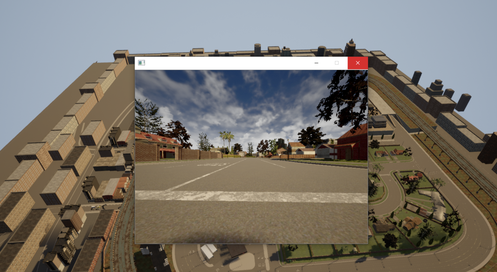

# 地面载具 - 图像录制 ROS 2 封装模块

## 作业概述与背景
本模块属于 ROS 2 与仿真环境之间的桥接功能。基于 ROS 2 实现了一个图像录制节点，用于订阅 Carla 仿真器发布的摄像头话题，实现按下回车键将当前图像保存至本地的功能，为后续的视觉数据处理提供辅助。

## 运行环境
* 操作系统：Ubuntu 22.04（虚拟机）
* ROS 2 版本：Humble
* 依赖库：rclpy, sensor_msgs, cv_bridge, opencv-python

## 核心代码内容

本模块包含以下核心文件，均已提交至仓库：
```text
src/
└── image_recorder/
    ├── main.py                 # 图像订阅与录制主程序
    ├── setup.py                # ROS 2 功能包配置文件
    ├── package.xml             # ROS 2 依赖声明文件
    ├── README.md               # 模块说明文档
    └── launch/
        └── main.launch.py      # 一键启动文件
```

## 运行步骤

1. 新建标准工作空间并进入 src 目录：

```
mkdir -p ~/ros2_ws/src
cd ~/ros2_ws/src
```
2.从 ros2 仓库拷贝模块代码到工作空间：
```
cp -r ~/OpenHUTB/ros2/src/image_recorder ~/ros2_ws/src/
cd ~/ros2_ws
```
3.编译工作空间并部署环境：
```
colcon build --packages-select image_recorder
source install/setup.bash
```
4.运行图像录制节点：
```
ros2 launch image_recorder main.launch.py
```
5.验证运行结果：终端输出 [INFO] [image_recorder_node]: Node started, waiting for images...，表示节点编译部署成功，已进入监听状态。


### 补充：连接 Carla 仿真器获取实际图像

由于本机虚拟机未安装 Carla，为了获取真实的仿真图像，通过配置宿主机与虚拟机的网络连接，实现了从宿主机 Carla 仿真器获取图像的功能。具体操作步骤如下：

1.在 Windows 宿主机上启动 Carla 仿真器，并开启 ROS Bridge。

2.在虚拟机终端中执行以下命令，确认与宿主机通信正常：
```
ros2 topic list
```
3.确认终端中出现了 /carla/ego_vehicle/camera/rgb/front/image 话题。

4.运行图像捕获节点：
```
ros2 launch image_recorder main.launch.py
```
5.节点启动成功后，即可获取到 Carla 仿真器的实时摄像头画面，效果如下图所示：



