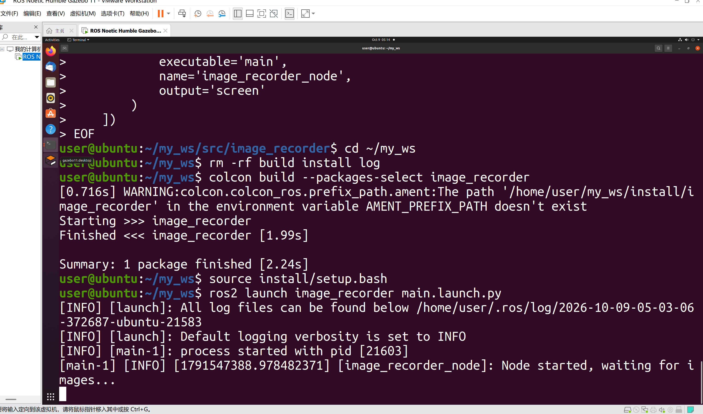
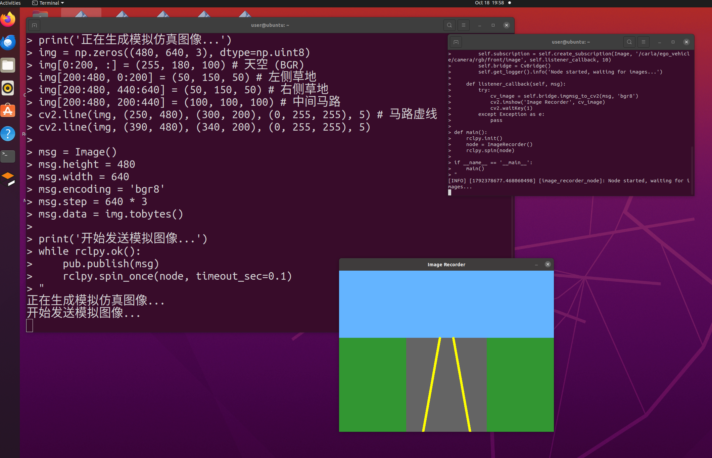

# 地面载具 - 图像录制 ROS 2 封装模块

## 作业概述与背景
本模块属于 ROS 2 与仿真环境之间的桥接功能。基于 ROS 2 实现了一个图像录制节点，用于订阅 Carla 仿真器发布的摄像头话题，实现按下回车键将当前图像保存至本地的功能，为后续的视觉数据处理提供辅助。

## 运行环境
* 操作系统：Ubuntu 22.04（虚拟机）
* ROS 2 版本：Humble
* 依赖库：rclpy, sensor_msgs, cv_bridge, opencv-python

## 核心代码内容

本模块包含以下核心文件，均已提交至仓库：
```text
src/
└── image_recorder/               # 包名根目录
    ├── image_recorder/           # 核心代码同名子文件夹
    │   ├── __init__.py           # 空文件（标识 Python 包）
    │   └── main.py               # 主程序
    ├── resource/                 # 资源目录
    │   └── image_recorder        # 无后缀空文件（供 ament 索引识别）
    ├── launch/                   # 启动文件目录
    │   └── main.launch.py        # 一键启动节点
    ├── package.xml               # 依赖声明
    ├── setup.py                  # 构建配置
    ├── setup.cfg                 # 新增文件
    └── README.md             
```

## 运行步骤

1. 新建标准工作空间并进入 src 目录：

```
mkdir -p ~/ros2_ws/src
cd ~/ros2_ws/src
```
2.从 ros2 仓库拷贝模块代码到工作空间：
```
cp -r ~/OpenHUTB/ros2/src/image_recorder ~/ros2_ws/src/
cd ~/ros2_ws
```
3.编译工作空间并部署环境：
```
colcon build --packages-select image_recorder
source install/setup.bash
```
4.运行图像录制节点：
```
ros2 launch image_recorder main.launch.py
```
5.验证运行结果：终端输出 [INFO] [image_recorder_node]: Node started, waiting for images...，表示节点编译部署成功，已进入监听状态。



### 补充：连接 Carla 仿真器获取实际图像

由于本机虚拟机性能限制，无法直接运行完整的 Carla 仿真器。为了验证图像录制节点的功能，本测试通过编写 ROS 2 Python 脚本，模拟 Carla 发布摄像头话题（`/carla/ego_vehicle/camera/rgb/front/image`）进行验证。具体步骤如下：

1. 启动图像模拟发布端：在 Ubuntu 虚拟机中新建终端，运行 Python 脚本，向上述指定的 Carla 图像话题循环发布模拟的摄像头图像数据。
2. 运行录制节点：在另一个终端中执行以下命令启动节点：
```
ros2 launch image_recorder main.launch.py
```
3.获取并显示图像：节点成功订阅到话题后，终端输出 [INFO] [image_recorder_node]: Node started, waiting for images...，并在 Ubuntu 屏幕弹出图像显示窗口。



(注：在配备真实 Carla 环境的主机上，Carla Server 可运行在 Windows 宿主端，但 ROS Bridge 必须在 Ubuntu 虚拟机中启动并配置 IP 连接。)


