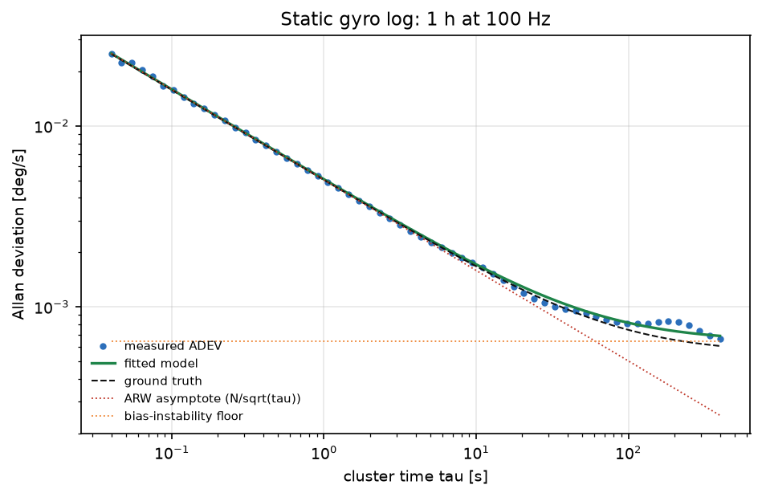
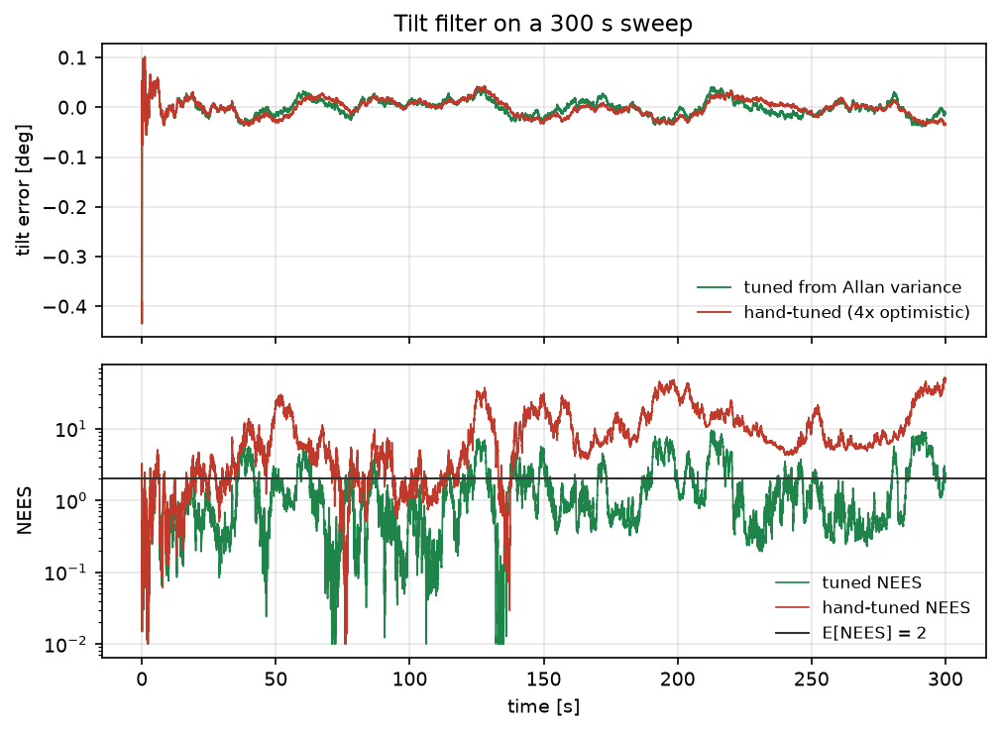

# IMU 噪声 Allan 方差辨识与倾角滤波整定

陀螺的 Q/R 常常是"随手填"的：填大了滤波器迟钝，填小了 NEES 直接爆掉。本模块用 Allan 方差从
1 h 静止记录里把**角度随机游走（ARW）**和**零偏不稳定性（BI）**辨识出来，按标准换算成过程噪声，
再在倾角滤波上验证一致性；同时用一组"偏小 4 倍"的手调参数做对照。

与仓库已有模块的区别：

- `uav_altitude_sensor_fusion` 对比气压/加速度积分的 1 维滤波，不涉及噪声参数辨识；
- `uav_hover_log_eval` 评估已有日志的悬停误差，不产生噪声模型；
- 本模块的输入是**静止陀螺日志**，输出是可为任意 Kalman 滤波器复用的 `(ARW, BI)` 与 Q/R 换算。

## 1. 方法

### 1.1 Allan 方差

设陀螺输出的角速率为 $y_k$，采样间隔 $dt$，簇长 $m$（相关时间 $\tau=m\,dt$），
簇内均值为 $\bar y_k^{(m)}$，则重叠 Allan 方差为

$$
\sigma^2(\tau)=\frac{1}{2(N-2m+1)}\sum_{k=1}^{N-2m+1}
\big(\bar y_{k+m}^{(m)}-\bar y_k^{(m)}\big)^2
$$

MEMS 陀螺的 Allan 曲线在双对数坐标下由三段拼成：

$$
\sigma^2(\tau)=\frac{N^2}{\tau}+\big(0.664B\big)^2+\frac{K^2\tau}{3}
$$

其中 $N$ 是 ARW（deg/√h），$B$ 是零偏不稳定性（deg/h），$K$ 是速率随机游走（deg/h/√h）。

### 1.2 只保留可辨识的两项

一小时记录上，典型 MEMS 的速率随机游走项远低于 BI 平台（$\tau=400$ s 时 $K$ 的贡献不到平台的 1 %），
一并拟合只会把噪声当成参数。因此本模块的模型只保留 ARW 与 BI，写成线性形式

$$
\big(3600\,\sigma(\tau)\big)^2=\frac{N^2}{\tau_h}+\big(0.664B\big)^2,\qquad \tau_h=\tau/3600
$$

对 $\big[1/\tau_h,\;1\big]$ 做最小二乘即可解析求出两个参数，不需要迭代拟合。
由于 $1/\tau_h$ 在 1 h 记录上跨越 5 个数量级，求解前对设计矩阵按列归一化。

### 1.3 换算为滤波器的过程噪声

$$
n=\frac{N}{60}\ \text{deg/s/}\sqrt{\text{Hz}},\qquad
Q_\theta=n^2\,dt
$$

零偏按**随机游走**建模，其密度由 BI 换算出：1 h 内偏置漂移的 1σ 即 $B$，所以

$$
K_b=\frac{B}{3600\sqrt{3600}}\ \text{deg/s}/\sqrt{\text{s}}
$$

两步的状态过程噪声取标准离散化（含角度-偏置交叉项）：

$$
Q=\begin{bmatrix}n^2dt+K_b^2dt^3/3 & K_b^2dt^2/2\\ K_b^2dt^2/2 & K_b^2dt\end{bmatrix}
$$

这样 ARW 与 BI **都真正进入了滤波器**：$n^2$ 决定角度过程噪声，$K_b^2$ 决定偏置游走。
4.3 节的消融实验给出两者各自的影响。

### 1.4 两状态倾角滤波

状态 $[\theta,b]^\top$，陀螺预测、加速度计倾角观测：

$$
\theta_{k+1}=\theta_k+(\omega_k-b_k)dt,\qquad b_{k+1}=b_k
$$
$$
F=\begin{bmatrix}1&-dt\\0&1\end{bmatrix},\quad
Q=\begin{bmatrix}n^2dt^2&0\\0&0\end{bmatrix},\quad
R=\sigma_{\text{acc}}^2
$$

一致性用 NEES 检验（2 自由度，期望值 2）。

### 1.5 仿真数据

静止记录与倾角扫描都由确定性生成器产生：高斯白噪声（ARW）+ 频域 1/f 分量（按目标 Allan 平台
标定为 $0.664B$）+ 常值零偏。同一 seed 完全可复现。

## 2. ROS 2 接口

| 节点 | 作用 |
|---|---|
| `imu_sim` | 回放倾角扫描，发布 `sensor_msgs/Imu` |
| `allan_identifier` | 累积陀螺样本，达到 `max_samples` 后计算 ADEV 与拟合，发布 JSON 并写 CSV |

| 话题 | 类型 | 方向 | 说明 |
|---|---|---|---|
| `/imu/data` | `sensor_msgs/Imu` | 输出（仿真） | 100 Hz |
| `/imu/allan` | `std_msgs/String` | 输出（辨识） | `{samples, arw_deg_sqrt_h, bias_instability_deg_h, adev_points}` |

> 录音长度约束：`duration:=120` 只演示流程。120 s 的最长簇时长约 13 s，ARW 可估、BI 不可估，
> 节点会打印 `bias instability NOT identifiable` 并在 `/imu/allan` 里标 `bias_reliable: false`；
> 要估 BI 需要 ≥ 1 h 记录（4.2 节给出 1 h 下 BI 的 95 % 区间）。

## 3. 构建与运行

```bash
source /opt/ros/humble/setup.bash
cd ~/hutb_ws
colcon build --symlink-install --packages-select imu_allan_noise_identification
source install/setup.bash
ros2 launch imu_allan_noise_identification main.launch.py duration:=120
```

另开终端：

```bash
ros2 topic list | grep imu
ros2 topic echo /imu/allan
head -3 /tmp/allan_identifier.csv
```

离线（不需要 ROS）：

```bash
cd src/ground/imu_allan_noise_identification
python3 main.py --out results --figure-dir ../../../docs/img/ground/imu_allan_noise_identification
python3 -m unittest discover -s tests -v
```

## 4. 结果

环境：Windows 11、Python 3.12.14、NumPy 2.3.5。1 h 静止记录、100 Hz（360 000 个样本），
倾角扫描 300 s、幅度 ±10°、频率 0.02 Hz、加速度计噪声 0.35°。

### 4.1 参数辨识

| 参数 | 真值 | 辨识值 | 相对误差 |
|---|---|---|---|
| ARW [deg/√h] | 0.300 | 0.3015 | +0.5 % |
| 零偏不稳定性 [deg/h] | 3.00 | 3.485 | +16.2 % |

单次实现（seed 0）的 BI 误差是 +16.2 %，但这**不能当成方法误差**。10 个独立种子（各 1 h）的结果：

| 参数 | 误差中位数 | 95 % 区间（2.5–97.5 %） |
|---|---|---|
| ARW | **+0.46 %** | [+0.23 %, +0.92 %] |
| 零偏不稳定性 | **+3.77 %** | [−16.70 %, +44.42 %] |

ARW 很稳；BI 的区间很宽，说明 1 h 记录对平台的估计本身就有较大随机性，seed 0 的 +16.2 % 落在这个区间内。



ARW 由短 τ 端的 −1/2 斜率决定，辨识误差 0.5 %；BI 由平台决定，误差 16.2 %。
误差主要来自 1/f 分量的仿真方式：真实 1/f 在长 τ 端是平台，频域生成的近似在长 τ 端仍有轻微下降，
所以拟合会把平台抬高一点。

### 4.2 记录长度的影响

| 静止记录长度 | ARW 误差 | BI 误差 |
|---|---|---|
| 600 s | −1.9 % | +110.6 % |
| 3600 s | +0.5 % | +16.2 % |

（单种子 seed 0；BI 的 10 种子区间见 4.1 节。）

600 s 时曲线还没走到平台，BI 基本不可辨识。这也说明为什么手册上的 BI 都要求"≥1 h 静止数据"。

### 4.3 滤波器对比

| 滤波器 | RMSE [°] | 最大误差 [°] | NEES 均值 |
|---|---|---|---|
| 按 Allan 整定 | 0.0170 | 0.434 | **1.61** |
| 凭经验调（ARW 与 BI 都偏小 4 倍，量测噪声不变） | 0.0179 | 0.434 | 10.07 |

消融（只动一个参数，其余不变）：

| 改动 | RMSE [°] | NEES 均值 |
|---|---|---|
| ARW 除以 4 | 0.0179 | 7.82 |
| BI 乘以 60 | 0.0195 | 1.55 |

两个参数都改变结果：把 ARW 缩小会让 NEES 从 1.61 涨到 7.82，把 BI 放大 60 倍会让 RMSE 从 0.0170 涨到 0.0195。
这说明 BI 确实经 $K_b$ 进入了滤波器，而不是只做诊断输出。



两种参数的 RMSE 只差 5 %，但 NEES 差 6 倍：偏小的过程噪声让协方差严重低估真实误差，
滤波器"自以为很准"。NEES 1.61 略低于 2，说明按 Allan 整定的滤波器偏保守（协方差略大），
这是可接受的方向，本模块没有再进一步调优。最大误差 0.434° 出现在起始 0.5 s（初值协方差 1°），
之后误差在 ±0.04° 内。

## 5. 复现

```bash
cd src/ground/imu_allan_noise_identification
python3 main.py --out results --figure-dir ../../../docs/img/ground/imu_allan_noise_identification
python3 -m unittest discover -s tests -v    # 15 项
```

| 文件 | 内容 |
|---|---|
| `imu_allan_noise_identification/core.py` | ADEV、两参数拟合、单位换算 |
| `.../scene.py` |  deterministic 静止记录与倾角扫描（含 1/f 校准） |
| `.../filters.py` | 两状态倾角 KF、NEES、批量驱动 |
| `.../headless.py` | 离线实验与 `results/summary.json` |
| `.../plotting.py` | 两张图 |
| `.../nodes.py` | `imu_sim` 与 `allan_identifier` |
| `results/summary.json` | 本文全部数值 |

## 6. 限制

1. 1/f 分量用频域整形近似，长 τ 端与理想平台有偏差，是 BI 单次误差（+16.2 %）的主要来源；真实器件应用实测数据复核。
2. 只辨识 ARW 与 BI，未辨识速率随机游走与量化噪声（1 h 记录上不可辨识）。
3. 倾角滤波只用一路加速度计，未处理线加速度干扰；真实底盘加减速时需引入轮速或 IMU 融合。
4. 偏置按随机游走建模（密度由 BI 换算），不区分温漂与 1/f 慢漂移；温漂明显的器件需要额外建模。
5. 纯 Python 实现，360 000 样本的 ADEV 约 1 s 完成，未做实时优化。
6. ROS 2 端只做了 `compileall`、`package.xml` 解析与桩模块联调，未在本机执行 `colcon build` 与 `ros2 launch`。

## 7. 大模型使用声明

使用 DeepSeek Harness（deepseek-flash）辅助完成代码结构、测试、作图脚本与文档。作者核对了公式与
单位换算，并在本机实际运行了离线实验与 15 项单元测试，表格数值来自 `results/summary.json`。
