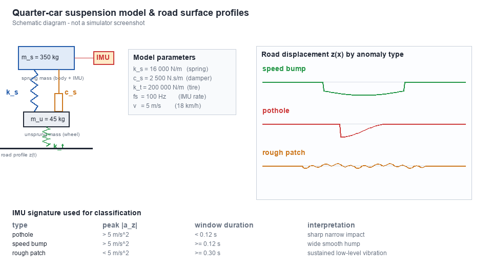
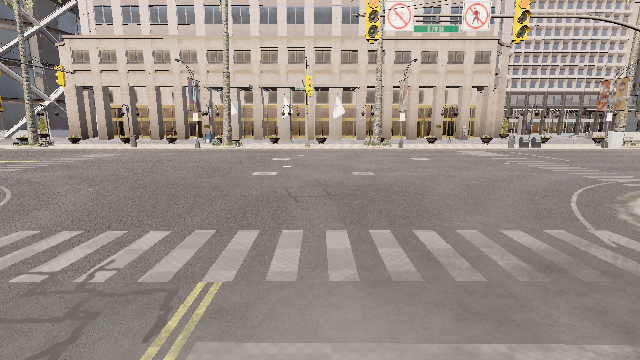
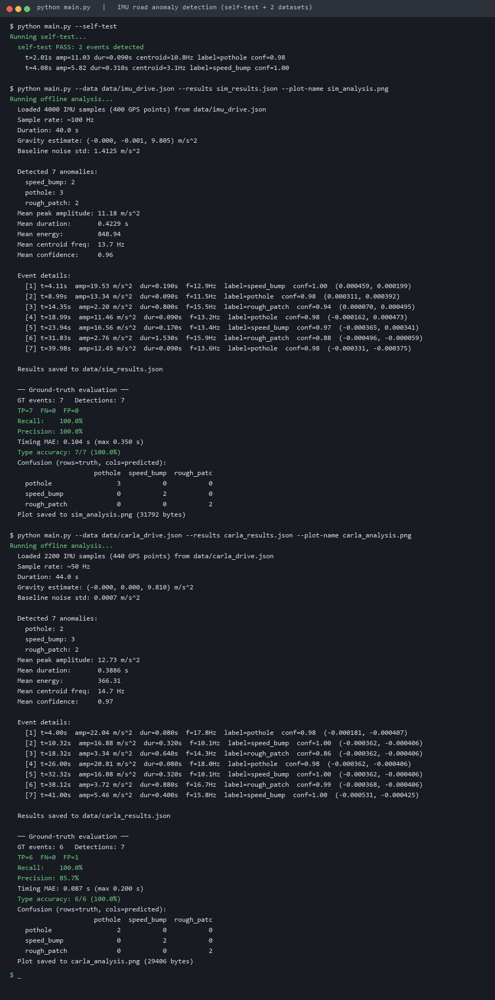
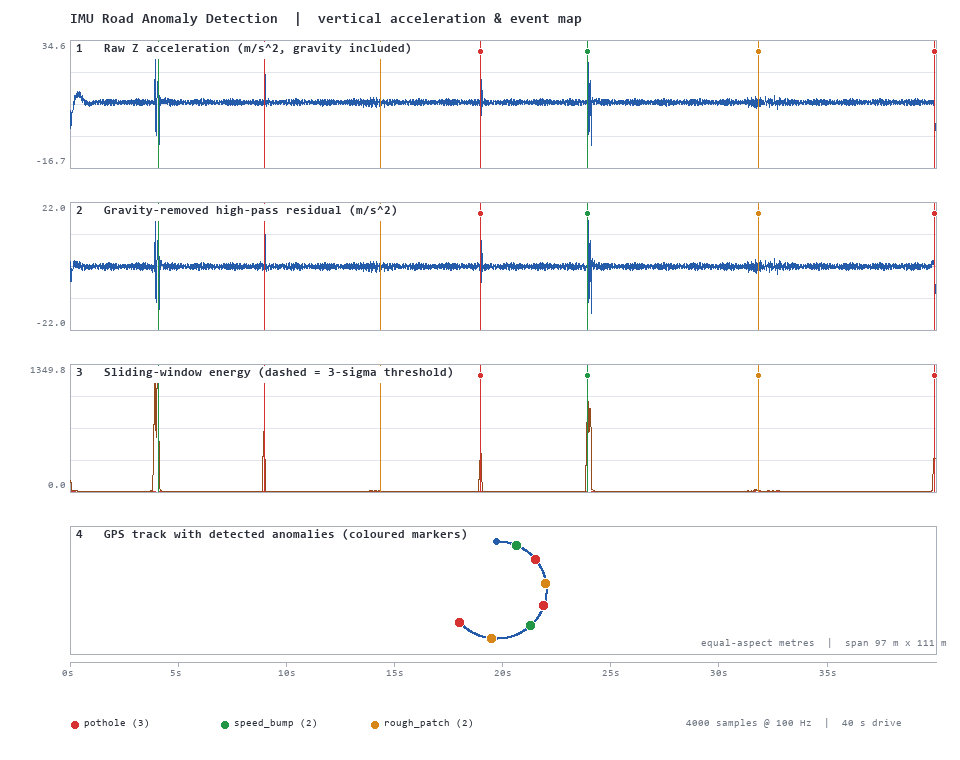
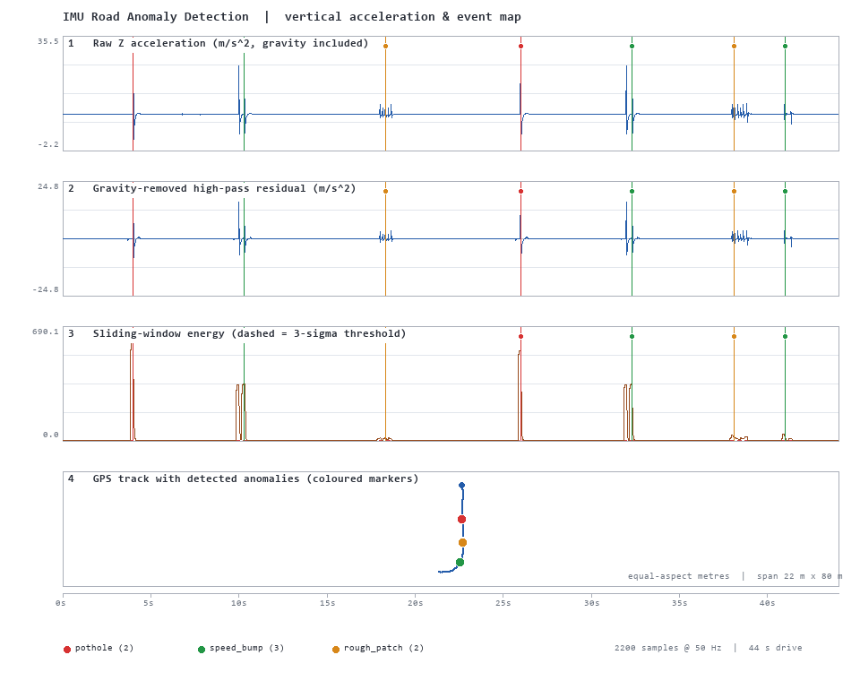

# 基于 IMU 的路面异常检测（坑洼 / 减速带 / 粗糙路面）

> 只用车载 IMU 的垂向加速度，不用相机、不用激光雷达，就能定位坑洼、减速带和
> 连续粗糙路面，并把每个事件挂到 GNSS 经纬度上。附两套带真值的数据：
> 四分之一车悬架物理仿真 + CARLA Town10HD 实采，均可一键复现。

代码位于 `src/ground/imu_road_anomaly_detection/`，运行方法见该目录
[README](https://github.com/OpenHUTB/ros2/tree/master/src/ground/imu_road_anomaly_detection/README.md)。

## 1. 概述与选题

道路病害（坑洼、破损、连续搓板路）直接影响舒适性与悬架寿命，众包巡检通常
要求「低成本 + 不依赖光照 + 可定位」。视觉方案要摄像头、要标定、夜里失效；
激光雷达成本高。IMU 几乎所有量产车都有，垂向加速度对路面激励最直接，
但仓库现有地面载具模块中，IMU 只作为融合链路的一个附属通道
（如 `carla_sensor_fusion`），**没有以 IMU 为主传感器的路面异常检测作业**。
本模块补上这个方向。

| 对比 | 相机 / LiDAR 类作业 | 本模块 |
|---|---|---|
| 主传感器 | RGB / 深度 / 点云 | `sensor.other.imu` 垂向加速度 |
| 依赖 | 光照、外参、目标可见 | 无，重力对齐即可 |
| 输出 | 目标框 / 轨迹 / 控制量 | 异常类型、峰值、时长、时刻、经纬度 |
| 可解释性 | 多为网络黑盒 | 全规则式阈值，逐条可调 |

## 2. 物理模型

路面位移 `z_r` 经轮胎刚度 `k_t` 传到非簧载质量 `m_u`，再经悬架
（`k_s`, `c_s`）传到簧载质量 `m_s`；IMU 装在车身上，测的是 `m_s` 的加速度
加重力。四分之一车模型参数见下表，示意图如下。

| 参数 | 数值 | 含义 |
|---|---|---|
| `m_s` | 350 kg | 簧载质量（车身） |
| `m_u` | 45 kg | 非簧载质量（车轮） |
| `k_s` | 16 000 N/m | 悬架刚度 |
| `c_s` | 2 500 N·s/m | 减振器阻尼 |
| `k_t` | 200 000 N/m | 轮胎刚度 |



> 上图为原理示意图，不是仿真器截图。

三类路面对应三种典型响应：坑洼是一次短促冲击，减速带是前后轴两次相隔
约 0.3 s 的隆起，粗糙路面是持续的低幅振动。分类规则正是据此设计。

## 3. 检测管线

```
IMU (ax, ay, az) + GNSS
   │
   ├─① 三轴重力投影（静态姿态）：跳过前 50 帧，取三轴中位数作固定重力向量，
   │      归一化后逐样本投影 ax·ux + ay·uy + az·uz，再减投影中位数
   ├─② 毛刺剔除：偏离中位数 > 200 m/s² 的单帧读数替换为中位数
   ├─③ 高通残差：减去 30 帧滑动均值 → 路面激励残差
   ├─④ 滑窗能量：10 帧窗口 / 3 帧步长，剔除最高 10% 后取 均值 + 3σ 为阈值
   ├─⑤ 事件分割：合并相邻超阈窗口，FWHM 修剪，最短时间窗 0.10 s
   ├─⑥ 特征：峰值 / 时长 / 能量 / 波峰系数 / 频谱质心 + 最近 GNSS
   └─⑦ 规则分类：幅值 < 5 → rough_patch；强且 ≥ 0.12 s → speed_bump；否则 pothole
```

频谱质心用 Goertzel 单频点功率估计实现，整套检测核心**零第三方依赖**，
`python main.py --self-test` 在任何 Python 3.9+ 环境都能跑。

重力这一步是**静态**姿态估计：固定重力向量不跟随车身俯仰/侧倾，横向与纵向
加速度仍会漏进垂向通道（见第 7 节 41.00 s 的误报）。

频谱质心只在**窗长分辨率足够**时才输出。长度 `n` 的窗在采样率 `fs` 下的分辨率
是 `fs/n`；10 帧 @ 100 Hz 只有 10 Hz 分辨率，此时报质心（更别说按伪 1 Hz 网格
报）没有意义，因此实现里要求 `fs/n ≤ 2 Hz`，否则记 `None`，汇总时用
`centroid_coverage`（形如 `2/7`）说明有多少事件真正解析出了质心。

### 3.1 两个必须注意的工程细节

1. **单帧冲击不能被 FWHM 剪没**：坑洼冲击在 100 Hz 下可能只占 1 帧，
   按峰值半高宽修剪后窗口长度变成 1，会被「最短时长」判断直接丢弃。
   因此修剪后强制保留包含峰值的最短时间窗。
2. **时间窗必须按秒、不能按帧**：`imu_drive.json` 是 100 Hz，CARLA 实采流
   实测是 50 Hz。若「10 帧」写死，前者是 0.1 s、后者是 0.2 s，同一个
   坑洼在实采数据里会被误判成减速带。改成 `min_span_s = 0.10 s` 后，
   两套数据的分类结果才一致。

## 4. 两套带真值的数据

### 4.1 四分之一车物理仿真（`imu_sim_gen.py`）

40 s、100 Hz、7 个带标注异常：减速带 ×2、坑洼 ×3、粗糙路面 ×2。
完全独立于 CARLA，用于验证算法本身和阈值。

### 4.2 CARLA Town10HD 实采（`imu_collect.py`）

44 s，自车 `vehicle.tesla.model3` 在 Traffic Manager 同步自动驾驶下行驶，
同时记录 IMU、GNSS 与 RGB 参考帧。真实场景截图：



**为什么要注入激励**：Town10HD 的路面网格是几何光滑的，CARLA 默认不建模
坑洼和减速带，直接开一段路只能得到噪声底、没有真值。为了在不伪造 IMU
数据流的前提下拿到带标注的真实传感器数据，采集脚本在预先声明的时刻用
CARLA 物理引擎的 `add_impulse` 给自车施加标定过的垂向冲量：

| 激励 | 建模对象 | 物理含义 |
|---|---|---|
| 单个强冲量 | pothole | 车轮掉入坑内的一次冲击 |
| 相隔 0.32 s 的两个强冲量 | speed_bump | 前轴 / 后轴依次越过减速带 |
| 5 个小幅交替冲量 | rough_patch | 连续短波长粗糙路面 |

冲量只是**激励**；IMU / GNSS 读数全部由 CARLA 物理引擎与传感器真实产生，
没有做任何信号合成。`--no-inject` 可采集完全未加激励的平路噪声底数据。
真值时刻取激励区间的**中心**（检测器报的是振动峰值时刻，不是激励起始时刻），
并记录在 `carla_drive.json` 的 `ground_truth` 里。

所以这份实采数据并不是「没有真值、只做定性验证」的数据：它带 **6 个真值事件**，
与第 6 节的定量指标（召回 / 精确率 / 时刻对齐误差 / 分类准确率）直接对应。

> 实测校准：`world.tick()` 在同步模式下推进 0.04 s 传感器时间、每 tick 产生
> 2 个间隔 0.02 s 的 IMU 样本，因此尽管请求 `sensor_tick=0.01`（100 Hz），
> 实采流有效采样率是 **50 Hz**。采集脚本按时间戳实测写入
> `scene.sample_rate_hz`，主程序也以实测间隔为准，所有阈值以秒为单位。
> 此外前 100 个 tick 作为预热丢弃，避免车辆生成瞬间的求解器暂态进入记录。

## 5. 运行效果

一条命令跑完整个模块（自测 / 两套数据 / 评估 / 出图），终端实拍输出：



四面板分析图（原始 Z 加速度 → 去重力高通残差 → 滑窗能量与 3σ 阈值 →
GPS 轨迹与事件标记）：

**物理仿真数据**：



**CARLA 实采数据**：



复现命令（在 `src/ground/imu_road_anomaly_detection/` 下）：

```bash
python main.py --self-test
python main.py --data data/imu_drive.json   --results sim_results.json   --plot-name sim_analysis.png
python main.py --data data/carla_drive.json --results carla_results.json --plot-name carla_analysis.png

# 单元测试（标准库 unittest 与 pytest 都能收集，无需 carla / numpy / Pillow）
python -m unittest discover -s tests -v
python -m pytest tests -q
```

`--no-plot` 可在没有 Pillow 的环境里跳过绘图；`sim_results.json` /
`carla_results.json` 是运行产物，不入库，上面两条命令会重新生成它们。

## 6. 定量结果

`imu_eval.py` 用 0.5 s 容差做**全局最小总时差的全局分配**（不是按真值顺序贪心找
最近检测），输出召回、精确率、时刻对齐误差、分类准确率与混淆矩阵。

| 数据集 | 真值 | 检出 | TP / FN / FP | 召回 | 精确率 | 分类准确率 | 时刻对齐误差 |
|---|---|---|---|---|---|---|---|
| 物理仿真 `imu_drive.json` | 7 | 7 | 7 / 0 / 0 | 100% | 100% | 7/7 (100%) | 0.104 s |
| CARLA 实采 `carla_drive.json` | 6 | 7 | 6 / 0 / **1** | 100% | **85.7%** | 6/6 (100%) | 0.087 s |

「时刻对齐误差」（`timing_alignment_error_s`）要按它的定义读：真值取的是激励
区间的**中心**，检测报的是**振动峰值**，两个时刻之间本身就有悬架动力学延迟
（簧上固有频率约 1.52 Hz，1/4 周期约 0.13~0.17 s 量级）。所以这 0.09~0.10 s
里混着物理延迟，不是纯算法误差，也不该拿它去和纯粹的时间戳误差比较。

频谱质心只在窗长分辨率满足 `fs/n ≤ 2 Hz` 时输出：两套数据的
`centroid_coverage` 都是 **2/7**，即 7 个事件里只有 2 个窗口长到能分辨频率。
可解析窗口上的均值 `mean_centroid` 是仿真 15.8 Hz、实采 14.9 Hz —— 它只代表
那些粗长事件（粗糙路面为主），不能读作全体事件的平均频率。

CARLA 实采的全部检出（来自 `carla_results.json`）：

| 时刻 | 峰值 | 时长 | 分类 | 是否真值 |
|---|---|---|---|---|
| 4.00 s | 22.04 m/s² | 0.080 s | pothole | ✔ |
| 10.32 s | 16.88 m/s² | 0.320 s | speed_bump | ✔ |
| 18.32 s | 3.34 m/s² | 0.640 s | rough_patch | ✔ |
| 26.00 s | 20.81 m/s² | 0.080 s | pothole | ✔ |
| 32.32 s | 16.88 m/s² | 0.320 s | speed_bump | ✔ |
| 38.12 s | 3.72 m/s² | 0.880 s | rough_patch | ✔ |
| 41.00 s | 5.46 m/s² | 0.400 s | speed_bump | ✘ 误报 |

六个真值事件全部命中、类型全部正确；唯一的误报在 41.00 s，来自车辆在路口
等红灯后重新起步时的**俯仰瞬态**（纵向加速度经车身姿态耦合进垂向轴），
幅值 5.46 m/s² 刚好越过分类门限。这里保留它而不去调阈值掩盖：它恰好说明了
"只用垂向加速度、不补偿姿态" 的真实代价，也为后续引入陀螺仪俯仰补偿提供了
明确的改进目标。仿真数据里没有起停工况，所以是 0 误报 —— 两个数字的差别
正是实采验证的意义。

指标由代码自动写入 `data/sim_results.json` 与 `data/carla_results.json`，
不是手工填表；这两个 JSON 是程序输出，按评审建议**不入库**，复跑命令即可重新生成。

## 7. 局限与后续

- 阈值在上述两份带标注数据上标定，换车型 / 悬架 / 车速需重新标定；
  100% 是**在自建数据集上**的结果，不代表真实道路泛化性能。
- 重力向量是固定向量，无法跟随动态俯仰 / 侧倾：纵向加速度会经车身姿态耦合进
  垂向轴，41.00 s 的起步瞬态误报就是这个代价；彻底消除需要姿态角或陀螺积分，
  而不是继续调阈值。
- CARLA 的「异常」是注入激励产生的，不等价于真实破损路面；真车数据需要
  额外标注与噪声底测试。
- 目前只用垂向加速度，俯仰角速度、轮速、横向加速度尚未参与判断。
- GNSS 只做最近时刻挂接，未做地图匹配。

---

**大模型使用声明**：本文档、代码及配图在 AI 助手辅助下完成，所有实验数据、
阈值与结论均由作者在 CARLA / 本地 Python 环境中实际运行核对。作者对本次
提交内容负全部责任，文责自负。
