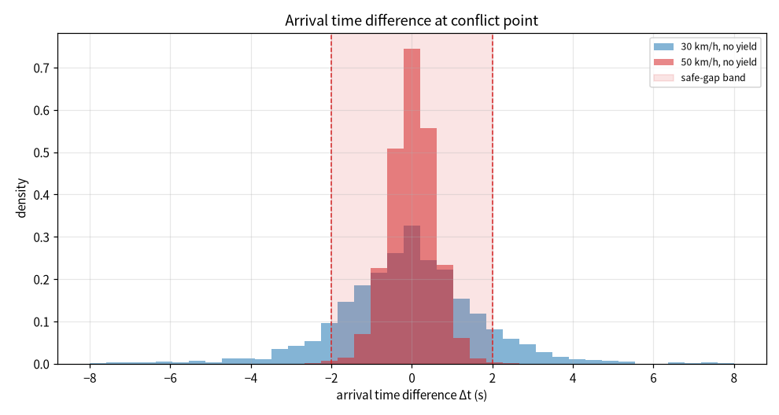
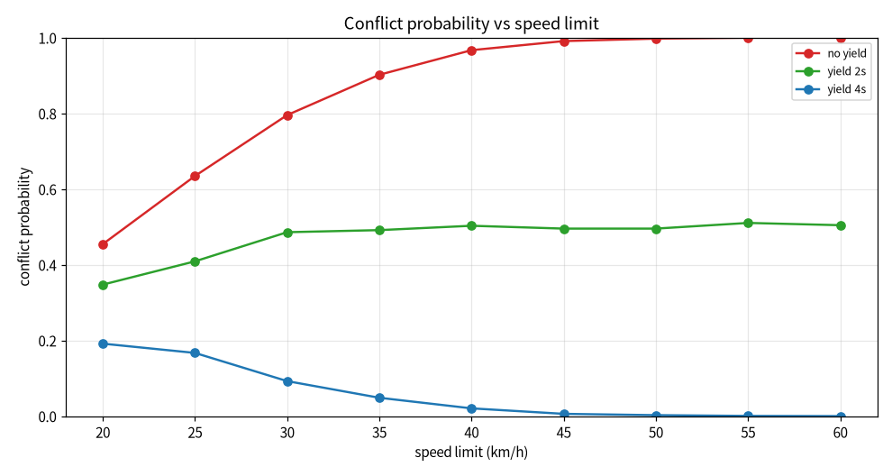
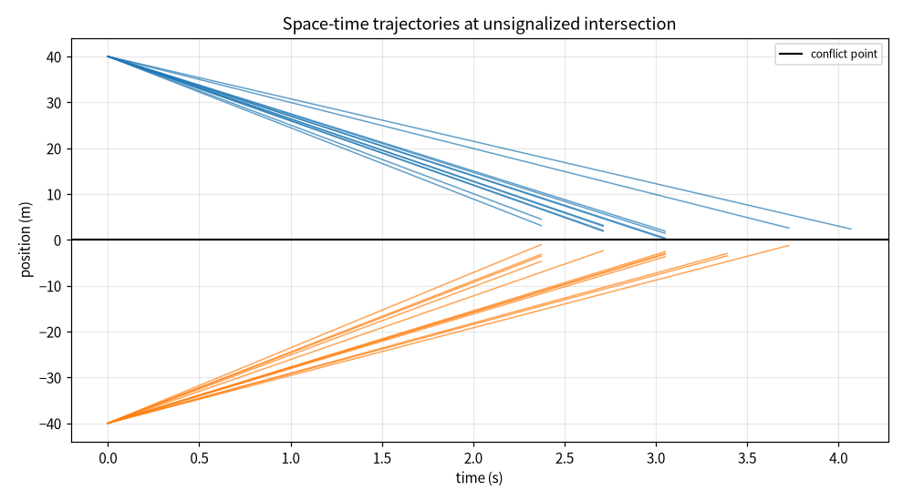
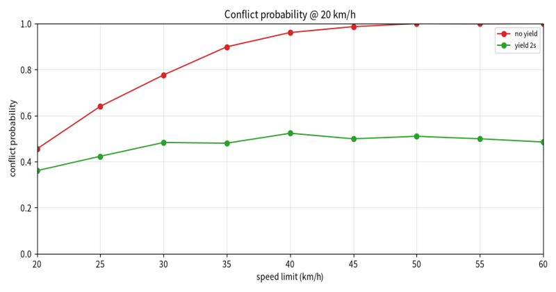
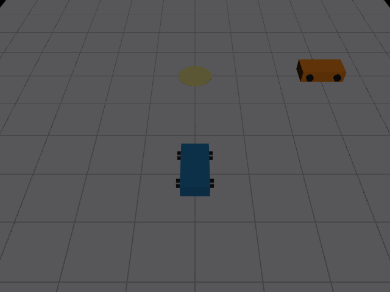

# 无信号路口冲突时序蒙特卡洛仿真

本文介绍一个纯 Python（numpy + matplotlib + Pillow）实现的交叉口冲突时序分析模块。模块模拟无信号十字交叉口两个方向的直行车，各自以带扰动的匀速驶向冲突点，按到达时间差判断是否落入安全时距阈值内构成冲突；通过蒙特卡洛仿真统计不同限速、不同让行延迟下的冲突概率，并绘制到达时间差直方图、冲突概率-限速曲线与位置-时间轨迹图。

## 1. 运行环境

| 项目 | 版本 / 说明 |
| --- | --- |
| 操作系统 | Windows 10 / 11（Linux 亦可，脚本后台出图，无需图形界面） |
| 仿真平台 | 纯 Python 数值仿真，不依赖 ROS / Gazebo / CARLA |
| Python | 3.10 ~ 3.12 |
| 依赖 | `numpy`、`matplotlib`、`Pillow`；`mujoco` 为可选依赖，仅用于路口双车场景静态图 |

### 1.1 安装依赖

1. 创建并激活虚拟环境：

   ```bash
   python -m venv conflict_env
   # Windows: conflict_env\Scripts\activate
   # Linux:  source conflict_env/bin/activate
   ```

2. 安装依赖：

   ```bash
   pip install numpy matplotlib Pillow
   # 可选：安装 mujoco 后才会输出路口双车场景静态图
   pip install mujoco>=3.0
   ```

### 1.2 验证环境

```bash
python -c "import numpy, matplotlib, PIL; print('dependencies ok')"
```

输出 `dependencies ok` 即表示依赖安装完成。

## 2. 实验原理

### 2.1 到达时间建模

两车到路口冲突点的距离均为 `D = 40 m`，车速服从带标准差的正态扰动（截断到正值）：

```
v ~ N(μ_v, σ_v²),  v ≥ v_min
t_A = D / v_A
t_B = D / v_B + delay_B
Δt = t_A − t_B
```

| 参数 | 取值 | 说明 |
| --- | --- | --- |
| 距离 D | 40 m | 两车到冲突点 |
| 车速标准差 σ_v | 1.8 m/s | 车速扰动 |
| 安全时距 T_safe | 2.0 s | `|Δt| < T_safe` 判为冲突 |
| 蒙特卡洛样本数 | 2000 | 每个情景 |
| 随机种子 | 20261111 | 结果可复现 |

### 2.2 冲突判定与概率

```
冲突样本: |Δt| < T_safe
P(冲突) = 冲突样本数 / 总样本数
```

### 2.3 对比情景

| 情景 | 限速 | B 车让行延迟 | 说明 |
| --- | --- | --- | --- |
| `speed_30` | 30 km/h | 0 s | 低速无让行 |
| `speed_50` | 50 km/h | 0 s | 中高速无让行 |
| `yield_2s` | 50 km/h | 2 s | 次路车让行 2 秒 |
| `yield_4s` | 50 km/h | 4 s | 次路车让行 4 秒 |

## 3. 代码结构

完整源码位于：[`src/ground/intersection_conflict_timing_eval/main.py`](https://github.com/OpenHUTB/ros2/tree/master/src/ground/intersection_conflict_timing_eval)

| 代码段 | 作用 |
| --- | --- |
| 仿真参数 | 距离、车速扰动、安全时距、样本数、随机种子 |
| 到达采样 | `sample_arrival()` 采样车速并计算到达时间差 |
| 冲突统计 | `conflict_probability()` 统计落入时距带的比例 |
| 批量汇总 | `summarize()` 汇总各情景指标写入 `metrics.csv` |
| 绘图 | 直方图、概率-限速曲线、时空轨迹图、演示动图逐帧渲染 |

关键采样与判定：

```python
va = np.maximum(V_MIN, rng.normal(mu, SPEED_SIGMA, n))
vb = np.maximum(V_MIN, rng.normal(mu, SPEED_SIGMA, n))
dt = DISTANCE / va - (DISTANCE / vb + delay_b)
conflict = np.mean(np.abs(dt) < T_SAFE)
```

## 4. 运行步骤

1. 安装依赖（见 1.1）。
2. 在源码目录运行：

   ```bash
   python main.py
   ```

3. 控制台打印各情景冲突概率与到达时差统计；`results/` 目录生成全部图片与数据表。

## 5. 实验结果

### 5.1 到达时间差分布



50 km/h 情景（红）到达时差集中在 0 附近、分布较窄；30 km/h 情景（蓝）分布更宽。`±2 s` 阴影带为安全时距区间，落入带内即判为冲突。

### 5.2 冲突概率随限速变化



无让行时冲突概率随限速升高趋近于 1；让行 2 秒把概率压到约 0.5；让行 4 秒后冲突概率趋近于零。

### 5.3 位置-时间轨迹



蓝色为 A 车、橙色为 B 车，各自从距冲突点 40 m 处匀速驶向 0 点（冲突点），轨迹斜率对应各自车速。

### 5.4 指标数据

| 情景 | 限速 (km/h) | 让行延迟 (s) | 冲突概率 | Δt 均值 (s) | Δt 标准差 (s) | 95% |Δt| (s) |
| --- | --- | --- | --- | --- | --- | --- |
| speed_30 | 30 | 0 | 0.802 | −0.083 | 1.825 | 3.521 |
| speed_50 | 50 | 0 | 0.997 | 0.005 | 0.572 | 1.166 |
| yield_2s | 50 | 2 | 0.482 | −2.020 | 0.542 | 2.879 |
| yield_4s | 50 | 4 | 0.002 | −4.019 | 0.576 | 4.946 |

### 5.5 演示动图



### 5.6 路口双车场景静态图



MuJoCo 离屏渲染的十字交叉口静态场景：蓝色 A 车沿纵向车道、橙色 B 车沿横向车道驶向中心冲突点（浅色圆盘），网格地面斜俯视，车体配色与时空轨迹图一致。该图仅用于展示路口交汇几何关系，冲突概率与时序结论以 5.1–5.4 的蒙特卡洛统计与指标表为准；未安装 `mujoco` 或离屏 GL 不可用时自动跳过本图，不影响曲线图、动图与数据表。

## 6. 结论

- **高速通过无信号路口冲突风险更高**：距离固定时，车速越快到达时间对速度扰动越不敏感，时差分布越窄，两车越容易同时到达冲突点；50 km/h 无让行情景冲突概率接近 1。
- **让行延迟是有效的冲突消减手段**：次路车等待 2 秒可把冲突概率从 0.997 降到 0.482，等待 4 秒后基本消除冲突；让行相当于把到达时差整体平移出安全时距带。
- **低速并非绝对安全**：30 km/h 无让行冲突概率仍有 0.802，因为车速扰动带来的到达时差更分散，但两车仍可能在相近时刻到达；路口需要配合视距让行标志、减速控制与转弯车流管理。

需要注意：本实验为匀速直行车的到达时序统计，未计入减速让行过程、驾驶员反应延迟、车型尺寸占用时间、视线遮挡与连续多车冲突；实际路口安全评价应结合实地观测与交通工程设计规范。

## 声明

本作业使用豆包（Doubao）大模型辅助编写代码与文档，作者已复核到达时间建模、冲突判定与蒙特卡洛统计，对提交内容负全部责任。
