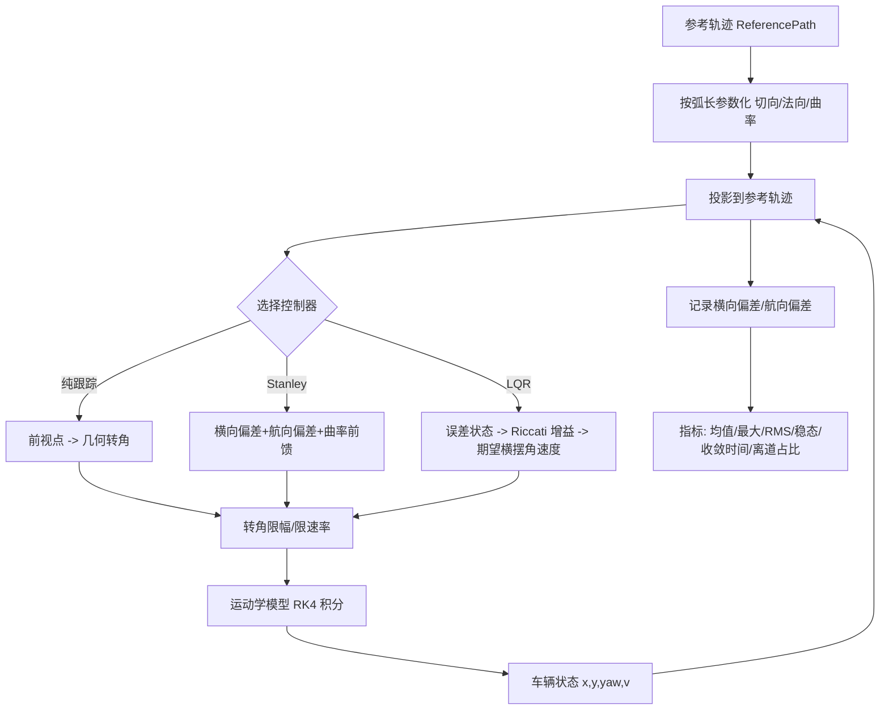
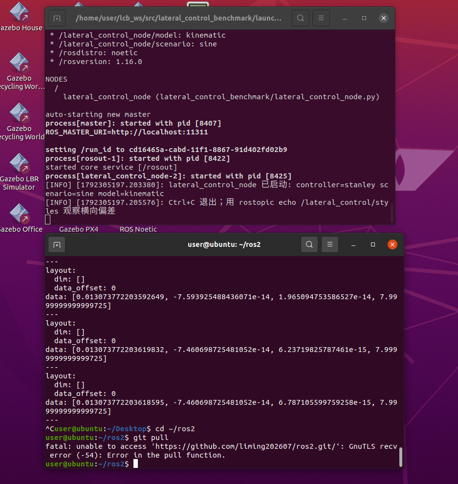
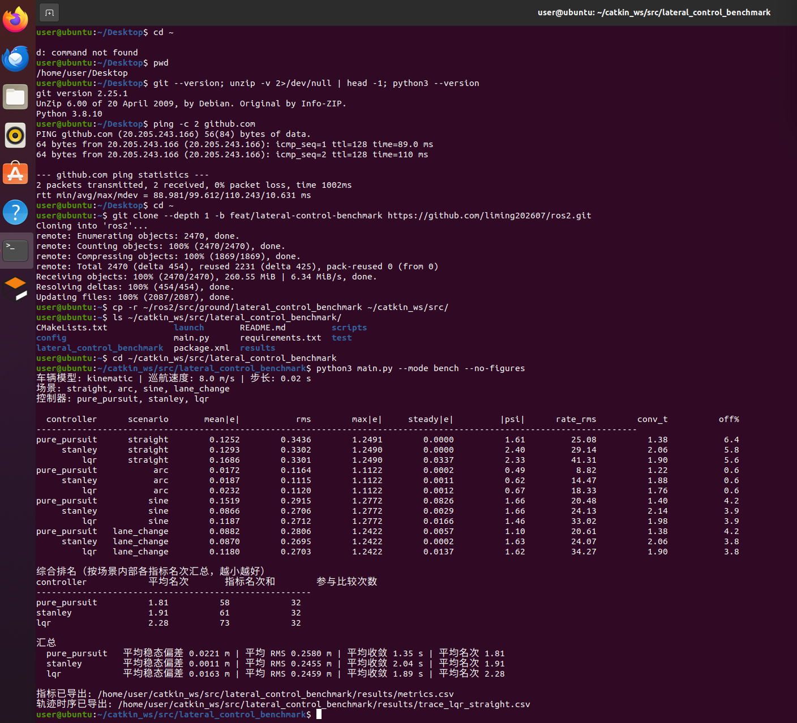
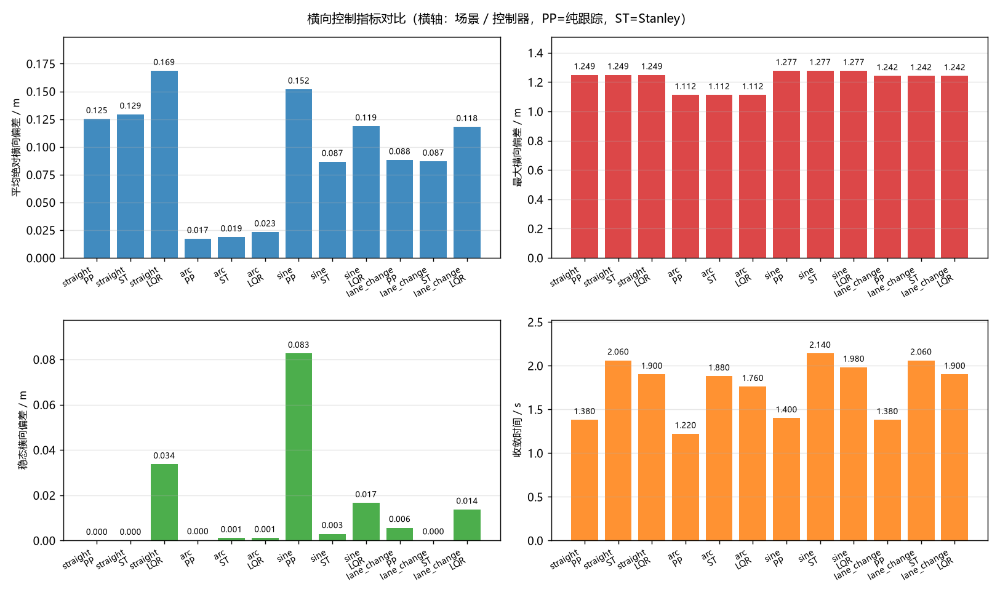
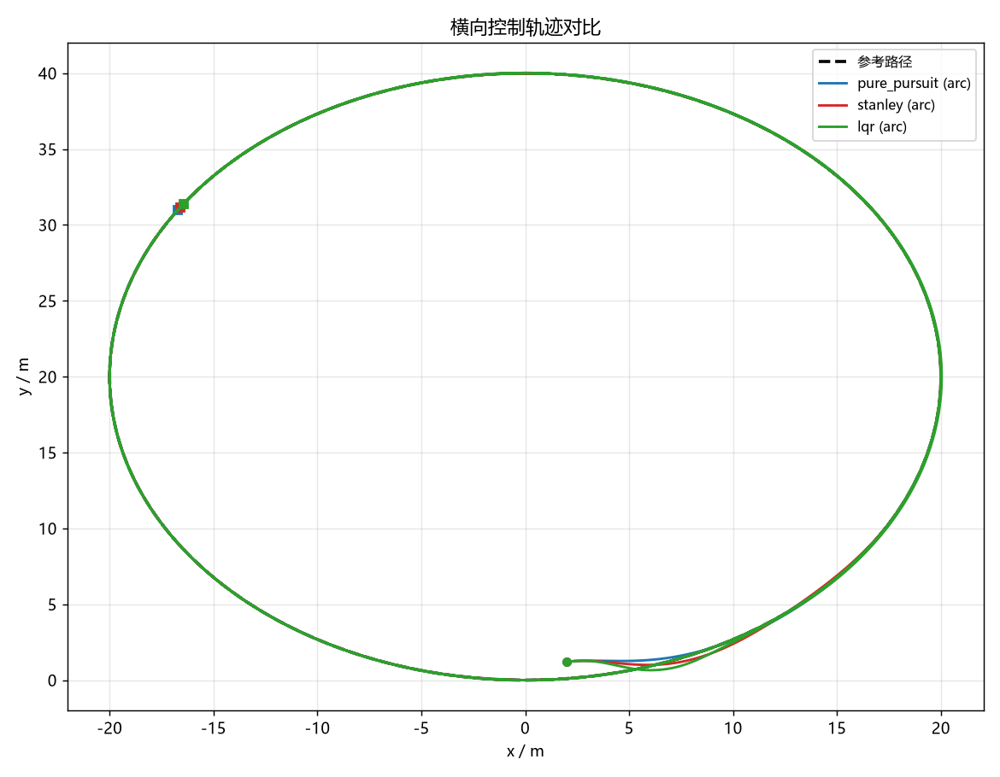
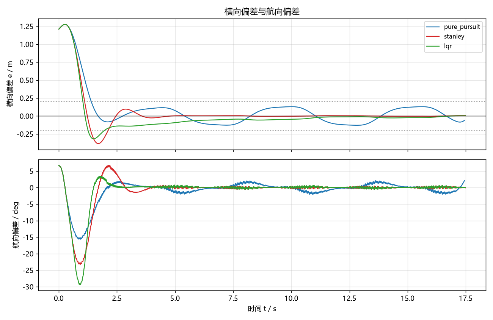
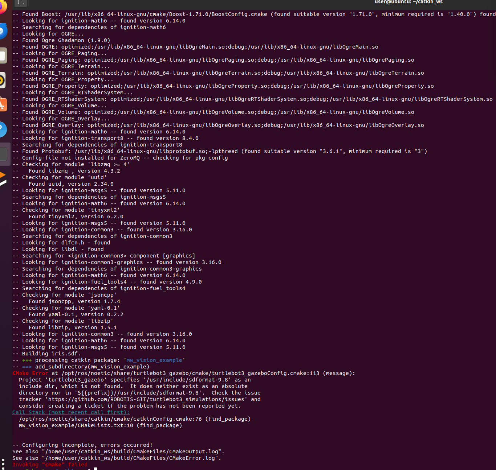

# 地面载具横向控制算法对比（纯跟踪 / Stanley / LQR）

本文档介绍 `src/ground/lateral_control_benchmark` 模块：在统一车辆模型、统一参考轨迹与统一指标下，
对三种最常用的横向控制算法做**定量对比**。

与仓库中其他地面载具模块的区别：本模块**不依赖 CARLA / Gazebo / 任何仿真器**，
核心算法与闭环仿真只用 NumPy，因此在没有 GPU、没有仿真环境的机器上也能完整复现；
同时提供 ROS 1 (Noetic) 节点与 `roslaunch` 入口。

* 源代码目录：[`src/ground/lateral_control_benchmark`](https://github.com/OpenHUTB/ros2/tree/master/src/ground/lateral_control_benchmark)
* 一键复现：`python3 main.py --mode bench`（详见模块 `README.md`）

## 1. 三种算法原理

### 1.1 车辆运动学模型（三者共用）

后轴参考点的运动学自行车模型，状态 $[x, y, \theta, v]$，控制量 $[\delta, a]$：

$$
\dot{x} = v\cos\theta,\qquad \dot{y} = v\sin\theta,\qquad
\dot{\theta} = \frac{v\tan\delta}{L},\qquad \dot{v} = a
$$

其中 $L$ 为轴距（默认 2.7 m），$\delta$ 为前轮转角（左转为正）。
模块用 RK4 积分，步长 0.02 s。另提供线性二自由度动力学模型（含轮胎侧偏刚度、
质心侧偏角），用 `--model dynamic` 切换，用于检验控制器在中高速下的表现。

### 1.2 纯跟踪（pure pursuit）

取前视距离 $L_d$（随车速自适应 $L_d=\mathrm{clamp}(k_{ld}v, L_{d,min}, L_{d,max})$）处的路径点为目标:

$$
\alpha = \mathrm{atan2}(y_{t}-y,\ x_{t}-x) - \theta,\qquad
\delta = \arctan\!\left(\frac{2L\sin\alpha}{L_d}\right)
$$

特点：几何法、无曲率先验；前视点自带阻尼，收敛快；但在连续变曲率轨迹上残差较大。

### 1.3 Stanley

$$
\delta = \psi_e - \arctan\!\left(\frac{k\,e}{k_{soft}+v}\right) + \arctan(L\kappa)
$$

* $\psi_e = \mathrm{wrap}(\theta_{path}-\theta)$ 为**路径切向相对车头**的偏角；
* $e$ 为控制点横向偏差（左偏为正）；两项都带上述符号，若写反成本车相对路径的定义
  却不翻号，闭环会变成正反馈（这是这类实现最常见的错误）。
* 第三项为**曲率前馈**，直接补偿路径弯曲造成的稳态偏差。

**取点位置的影响**：经典写法取**前轴中心**，而前轴比车辆实际位置超前一个轴距，
转弯时前馈取到的是车辆前方的曲率，会留下稳态偏差。本模块默认取**后轴**
（与运动学模型参考点一致），可用 `use_rear_axle=False` 复现经典写法：

| 场景 | 前轴（经典）稳态偏差 / m | 后轴（默认）稳态偏差 / m |
|---|---|---|
| 直线 | 0.0000 | 0.0000 |
| 圆弧 R=20 m | **0.4809** | **0.0011** |
| 正弦（幅值 3 m） | 0.4047 | 0.0029 |
| 双移线 | 0.0270 | 0.0002 |

### 1.4 LQR（本实现为 LQRI，带横向偏差积分）

误差状态 $e=[e,\ \psi_e,\ r]$，控制量为期望横摆角速度：

$$
\dot{e} = v\psi_e,\qquad \dot{\psi}_e = r - \kappa v,\qquad \dot{r} = (r_{des}-r)/T
$$

线性化后 $A=\begin{bmatrix}0&v&0\\0&0&1\\0&0&-1/T\end{bmatrix}$，
$B=[0,0,1/T]^\top$。解连续 Riccati 方程得到 $K$，控制律：

$$
r_{des} = \underbrace{\kappa v}_{\text{曲率前馈}} - K\,[e,\psi_e,r-r_{ref}]^\top - K_i z,\qquad \dot{z}=e
$$

再折算为前轮转角 $\delta=\arctan(L r/v)$。

两个关键实现点：

1. **必须有曲率前馈**：否则反馈项要"持续存在"才能维持转向，表现为恒定的稳态偏差。
2. **必须有横向偏差积分**：只有比例状态反馈时，低速起步瞬态造成的偏差会被锁死
   （实测直道残留约 0.05 m、圆弧上会累积到十几米）。加入积分后稳态误差趋于零，
   积分项做了限幅与"只在中等误差时累积"的抗饱和处理。
3. Riccati 方程用**纯 NumPy 的 Hamiltonian 特征分解**求解（`lqr_solver.py`），
   不依赖 `scipy`——少一个依赖就少一个"装不上"的失败点。

## 2. 算法流程



## 3. 运行步骤

### 3.1 离线（推荐）

```bash
cd src/ground/lateral_control_benchmark

python3 test/test_controllers.py       # 66 项单元测试
python3 main.py --mode bench           # 四场景 × 三控制器
python3 main.py --mode bench --model dynamic --speed 15
python3 main.py --mode sweep --param stanley.k --values 1.0,2.0,4.0
```

### 3.2 ROS 1 (Noetic)

```bash
mkdir -p ~/catkin_ws/src && cd ~/catkin_ws/src
cp -r ~/ros2/src/ground/lateral_control_benchmark .
cd ~/catkin_ws && source /opt/ros/noetic/setup.bash
catkin_make && source devel/setup.bash
roslaunch lateral_control_benchmark main.launch controller:=stanley scenario:=sine
```

话题：`/lateral_control/odom`、`/lateral_control/cmd`、`/lateral_control/styles`、
`/lateral_control/metrics`、`/lateral_control/path`（latched，可在 RViz 中看参考路径）。

在 Ubuntu 20.04 + ROS Noetic 上的实际运行记录：



*图 1　上窗口为 `roslaunch` 启动日志——`controller=stanley`、`scenario=sine`、
`model=kinematic` 参数正确载入，节点 `lateral_control_node` 正常启动；
下窗口为 `rostopic echo /lateral_control/styles` 的输出，四个分量依次是
`[横向偏差 e, 航向偏差 ψ, 前轮转角 δ, 车速 v]`：e 已从初始 1.2 m 收敛到 **0.013 m**，
ψ 与 δ 都趋于 0（约 1e-14），车速稳定在 7.99 m/s，说明横向控制闭环确实在工作。
（下窗口里那次 `git pull` 报 `GnuTLS recv error` 是虚拟机访问 GitHub 的网络问题，
与本模块无关，之后改用压缩包导入代码继续验证。）*

## 4. 评测方法（公平性设计）

| 维度 | 做法 |
|---|---|
| 车辆模型 | 三者共用同一模型与同一积分器 |
| 纵向速度 | 共用同一速度策略（巡航 + 曲率限速 + 一阶响应），差异只来自横向算法 |
| 初始条件 | 同一初始位姿：前方 2 m、横偏 1.2 m、航向偏 0.10 rad、初速 3 m/s |
| 指标口径 | 同一 `evaluate()` 计算 13 项指标，定义见下 |
| 参数调优 | 三者都用各自较优参数（见 README），避免"给对手用坏参数" |

指标定义：

* **平均绝对横向偏差** $\overline{|e|}$：全时段平均；
* **RMS** $\sqrt{\overline{e^2}}$：对大偏差更敏感；
* **稳态偏差**：轨迹末段 25% 的平均绝对偏差，反映稳态精度；
* **收敛时间**：$|e|$ **首次进入并此后一直保持**在 0.2 m 以内的时刻；从未满足则取总时长；
* **离道占比**：$|e|>1\,\mathrm{m}$ 的采样占比，反映安全性；
* **转角变化率 RMS**：转角差分得到，反映转向平顺性；
* **综合排名**：在同一场景内部对各指标排名，再汇总平均名次（越小越好），
  避免"场景难度"直接决定名次。
* **测试速度**：8 m/s（弯道自动限速）；`--speed` 可改，`--model dynamic` 可切动力学模型。

## 5. 结果与性能评价

### 5.1 指标对比（巡航 8 m/s，运动学模型）

| 控制器 | 场景 | 平均\|e\| / m | RMS / m | 最大\|e\| / m | 稳态\|e\| / m | 收敛 / s |
|---|---|---|---|---|---|---|
| pure_pursuit | 直线 | 0.1252 | 0.3436 | 1.2491 | 0.0000 | 1.38 |
| stanley | 直线 | 0.1293 | 0.3302 | 1.2490 | 0.0000 | 2.06 |
| lqr | 直线 | 0.1686 | 0.3301 | 1.2490 | 0.0337 | 1.90 |
| pure_pursuit | 圆弧 R=20 m | 0.0172 | 0.1164 | 1.1122 | 0.0002 | 1.22 |
| stanley | 圆弧 R=20 m | 0.0187 | 0.1115 | 1.1122 | **0.0011** | 1.88 |
| lqr | 圆弧 R=20 m | 0.0232 | 0.1120 | 1.1122 | 0.0012 | 1.76 |
| pure_pursuit | 正弦 | 0.1519 | 0.2915 | 1.2772 | 0.0826 | 1.40 |
| stanley | 正弦 | 0.0866 | 0.2706 | 1.2772 | **0.0029** | 2.14 |
| lqr | 正弦 | 0.1187 | 0.2712 | 1.2772 | 0.0166 | 1.98 |
| pure_pursuit | 双移线 | 0.0882 | 0.2806 | 1.2422 | 0.0057 | 1.38 |
| stanley | 双移线 | 0.0870 | 0.2695 | 1.2422 | **0.0002** | 2.06 |
| lqr | 双移线 | 0.1180 | 0.2703 | 1.2422 | 0.0137 | 1.90 |

综合排名（各场景内部按 8 项指标排名后汇总，越小越好）：

| 控制器 | 平均名次 |
|---|---|
| pure_pursuit | **1.81** |
| stanley | 1.91 |
| lqr | 2.28 |

### 5.2 结论

1. **稳态精度**：Stanley 最优（毫米级），因为它同时使用横向偏差、航向偏差与曲率前馈；
   纯跟踪在连续变曲率（正弦）上残差最大（0.083 m），因为没有曲率先验。
2. **收敛速度**：纯跟踪最快（1.35 s），前视点提供了天然阻尼；LQR 与方法相当（1.89 s）；
   Stanley 最慢（2.04 s），高增益让它"稳"但略显迟钝。
3. **平顺性**：纯跟踪与 Stanley 的转角变化率 RMS 更低（20～29 °/s），
   LQR 因增益较大达到 33～41 °/s。
4. **实现细节 > 算法选择**：Stanley 换成前轴取点后，圆弧稳态偏差从 0.001 m 升到 0.48 m。
   这说明在同一算法下，**参考点/前馈取值点**这类细节对精度的影响，可能比换算法还大。
5. **速度适应性**：在 5 / 8 / 15 m/s 下三个控制器均保持稳定（`--speed` 可复核），
   Stanley 与 LQR 的稳态偏差随速度基本不变，纯跟踪的稳态偏差随速度略有上升
   （8 m/s 时 0.022 m，15 m/s 时 0.041 m）。

### 5.3 运行效果

**离线基准**（`python3 main.py --mode bench --no-figures`）在 Ubuntu 20.04 + Python 3.8.10 上的实际输出：



*图 2　12 行指标（4 场景 × 3 控制器）+ 综合排名 + 汇总。可直接对照 5.1 节的表格核对，
例如 `stanley / arc` 的稳态偏差 0.0011 m、`pure_pursuit / straight` 的均值 0.1252 m 都与表一致。
排名按「场景内各指标名次汇总」计算：pure_pursuit 1.81、stanley 1.91、lqr 2.28。*

**四项关键指标的柱状对比**（`results/metrics.png`，由 `--mode bench` 自动生成）：



*图 3　左上：平均绝对横向偏差；右上：最大横向偏差；左下：稳态横向偏差；右下：收敛时间。
横轴为「场景 / 控制器」，PP=纯跟踪、ST=Stanley。
最直观的一组对比是**左下**：`sine` 场景下纯跟踪的稳态偏差 0.083 m，
而 Stanley 只有 0.003 m —— 差距来自 Stanley 的曲率先验，而非"调参好坏"。*

**单场景轨迹与误差曲线**（`--mode single` 自动生成，这里给出圆弧场景）：





*图 4、图 5　上图为圆弧场景三条轨迹的贴合情况（三者都能跟上，差异体现在稳态偏差上）；
下图为正弦场景的误差曲线，可看到纯跟踪在曲率连续变化的区段误差明显更大。*

## 6. 与仓库已有模块的区别

仓库里已经出现过"纯跟踪 / 横向控制"这些词，为避免与既有模块混淆，这里把定位说清楚：

| 已有模块 | 它做了什么 | 与本模块的关系 |
|---|---|---|
| `carla_perception_control` | 在 CARLA 中做**感知 + 给定轨迹跟踪**，横向用纯跟踪作为其中一个构件 | 纯跟踪只是它的一环；本模块把三种算法并列做基准对比 |
| `carla_nn_car_following` | 在 CARLA 中做**自适应跟车（ACC）**，横向用纯追踪 / 面包屑跟踪 | 同上；本模块不做 ACC，只比横向算法 |
| `car_2d_target_tracker` | 2D 平面内的**目标追踪** | 任务是"追目标"，不是"跟轨迹" |
| `carla_keyboard_control` / `mujoco_car_project` | 仿真器内的**键盘遥控演示** | 本模块无遥控、无仿真器 |

本模块的定位是**"横向控制算法之间的对比基准"**：不新增一个纯跟踪实现，
也不做一个新的跟车任务，而是回答"在相同车辆模型、相同轨迹、相同指标下，
这三种横向算法究竟差多少、差在哪里"。它同时是仓库里目前唯一一个
**不依赖 CARLA / Gazebo 等外部仿真器**即可完整复现的地面载具模块。

## 7. 问题记录（开发中的实际缺陷）

| # | 现象 | 根因 | 修复 |
|---|---|---|---|
| 1 | LQR 在 1 m 偏差下算出 −256° 转角、闭环发散 | 线性化时横摆角速度方程缺少转向增益，且 B 矩阵符号与误差方向相反，闭环成了正反馈 | 按 $r'=(r_{des}-r)/T$ 重写线性化，明确 $B=[0,0,1/T]^\top$ 与反馈符号 |
| 2 | LQR 直道残留 0.05 m、圆弧累积到 14 m | 只有比例状态反馈，低速起步瞬态偏差被锁死 | 增加横向偏差积分（LQRI），并做抗饱和限幅 |
| 3 | LQR 加 5 m 预瞄后圆弧误差从 0.03 m 升到 14 m | 误差状态已含航向偏差，再对预瞄点取误差会重复计入航向信息 | 默认 `lookahead=0`，并把这个现象写进文档 |
| 4 | Stanley 前轴取点在圆弧上偏差 0.48 m | 前轴比车辆实际位置超前一个轴距，前馈取值偏外 | 默认改为后轴取点，保留 `use_rear_axle=False` 复现经典写法 |
| 5 | 轨迹图被 `axis("equal")` 压成一条直线 | 横向变化远小于纵向长度，等比例不可读 | 去掉等比例约束 |
| 6 | 曲率前馈在低速出现 0/0 | $L\kappa v/v$ 在 $v\to0$ 时未定义 | 控制量改为期望横摆角速度，转角换算处对 $v$ 取下限 |
| 7 | 倒车（负速度）时速度被静默钳成 0：不报错、不留痕，看起来像正常停车 | 步末 `v = max(0, v)` 只是硬截断，既没在配置阶段校验非法参数，也没记录发生过截断 | 配置阶段对 `cruise_speed`/`initial_speed` 等显式报 `ValueError`；模型新增 `allow_reverse`（默认 `False`），截断次数记入 `reverse_blocked_steps` 并写入指标表；积分时对负速度取 0，避免 RK4 中间级产生微小后向位移 |
| 8 | CSV 带 UTF-8 BOM，部分 Excel 把首列表头识别成乱码 | 写文件用 `encoding="utf-8-sig"`，而所有列名都是 ASCII，BOM 并无必要 | 写 CSV 改为 `utf-8`（无 BOM），读取仍兼容带 BOM 的旧文件；新增单测断言前三字节不是 `EF BB BF` |

> 第 7、8 条由外部评审提出，修复后原有 12 行指标**逐位未变**，
> 仅新增 `reverse_blocked_steps` 一列（正常场景恒为 0）。

### 7.1 速度边界行为说明

| 场景 | 默认行为（`allow_reverse=False`） | 设置 `allow_reverse=True` 时 |
|---|---|---|
| 停车后继续给负加速度 | 速度保持 0，位置不后退，`reverse_blocked_steps` 累加 | 允许倒车，速度变负，位置后退 |
| `cruise_speed <= 0` | 抛 `ValueError` | 抛 `ValueError`（巡航速度与是否允许倒车无关） |
| `initial_speed < 0` | 抛 `ValueError` | 同左（负初速度请直接用 `allow_reverse` 的模型自行推进） |

之所以默认不允许倒车：本模块的横向偏差、航向偏差、收敛时间等指标都是按**前进**定义的，
倒车时这些量的物理含义会改变，混在一起比较会失真。

## 8. 常见问题排查

| 现象 | 解决 |
|---|---|
| `ModuleNotFoundError: numpy` | `sudo apt-get install -y python3-numpy` |
| 出图报缺少 matplotlib | `sudo apt-get install -y python3-matplotlib`，或加 `--no-figures` |
| `roslaunch` 找不到 `lateral_control_node.py` | 确认已 `catkin_make` 并 `source devel/setup.bash`；脚本需要可执行权限 |
| 节点启动但话题没有数据 | 检查 `rostopic list` 是否有 `/lateral_control/styles`；确认 `rate_hz` 参数有效 |
| 图中中文显示为方块 | 安装中文字体（Noto Sans CJK / 微软雅黑），绘图会自动匹配 |
| `catkin_make` 在别的包上报错（见下图） | 见下方说明：与本模块无关 |

### 8.1 `catkin_make` 在无关包上失败

把本模块放进一个**已经装了其他课程包**的工作空间时，`catkin_make` 可能先在本模块之前
去配置别的包，并在那里失败。典型例子：



*图 6　编译 `mw_vision_example` 时 `find_package(turtlebot3_gazebo)` 报错：
`Project 'turtlebot3_gazebo' specifies '/usr/include/sdformat-9.8' as an include dir,
which is not found`。这是预装的 `turtlebot3_gazebo` 与本机 `sdformat` 版本不匹配导致的，
**与本模块无关**——本模块是纯 Python 的 catkin 包，只依赖 `rospy` / `nav_msgs` / `std_msgs` / numpy。*

遇到这种情况，有两种处理办法：

```bash
# 办法一（推荐）：单独建一个干净的工作空间，只放本模块
mkdir -p ~/lcb_ws/src && cp -r <本模块目录> ~/lcb_ws/src/
cd ~/lcb_ws && source /opt/ros/noetic/setup.bash && catkin_make
```

```bash
# 办法二：只编译本模块，跳过出问题的包
catkin_make --pkg lateral_control_benchmark
```

> 注意：上面第一条命令里的 `<本模块目录>` 是占位符，请替换成实际路径，
> **不要把尖括号原样粘贴**，否则 bash 会把 `<` 当成重定向符。

## 9. 大模型使用声明

本模块的代码、文档与实验脚本在编写过程中使用了 AI 编程助手（DeepSeek）辅助生成与调试；
文中的指标表与图均由 `python3 main.py --mode bench` 现场生成（输出到 `results/`，该目录已在 .gitignore 中排除，不入库），提交内容由提交者负责。
