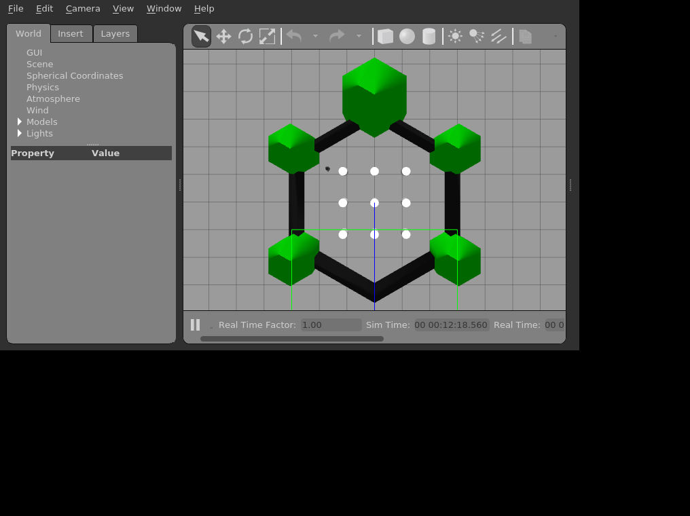
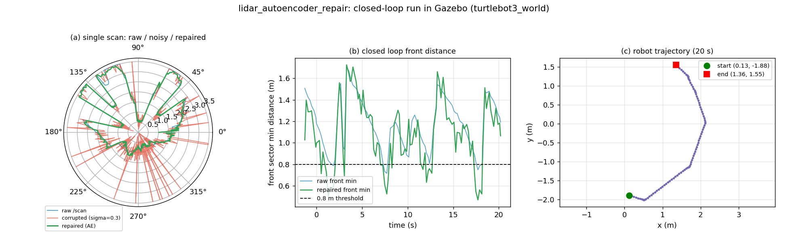

# 基于 Autoencoder 的雷达数据修复与避障

本模块提供一个 **Autoencoder 去噪 + 阈值避障** 的 ROS 节点，用于展示"传感器数据容错"与"控制逻辑"解耦的设计思路。对照的纯阈值避障实现是 master 上已有的 [`turtlebot3_lidar_avoid`](https://github.com/OpenHUTB/ros2/tree/master/src/ground/turtlebot3_lidar_avoid)（由已合并的 #245 引入，squash 提交 a8d6de5，文档见 [docs/ground/turtlebot3_lidar_avoid.md](https://github.com/OpenHUTB/ros2/blob/master/docs/ground/turtlebot3_lidar_avoid.md)）。与其相比，本模块在输入端多了一层离线训练的自编码器，能够在传感器被注入高斯噪声、椒盐噪声或随机丢点时仍保持稳定控制。

> 说明：当前实现中的噪声注入是代码主动模拟的（用于在干净的 Gazebo 仿真里复现"传感器损坏"场景），Autoencoder 权重由离线脚本 `train_autoencoder.py` 在合成数据上训练生成，所有链路均可在本地 Python + NumPy + PyTorch 环境下独立复现。

## 项目结构

```
src/ground/lidar_autoencoder_repair/
├── CMakeLists.txt              # catkin 编译规则
├── package.xml                 # 包声明（含 pip 依赖说明）
├── launch/
│   └── main.launch             # 一键启动文件
├── models/
│   ├── autoencoder_weights.pt   # 离线训练生成的权重（由 train_autoencoder.py 写入）
│   └── real_scans_sample.npz    # Gazebo 采集的 686 帧真实 /scan，供训练混入真实分布
└── scripts/
    ├── main.py                 # ROS 节点：订阅 /scan → 去噪 → 阈值避障 → 发布 /cmd_vel
    ├── train_autoencoder.py    # 离线训练脚本（无需 ROS 环境即可运行）
    └── test_offline.py         # 离线自测（mock ROS，无需真实环境即可验证控制链路）
```

## 环境与依赖

| 项目 | 版本 |
| --- | --- |
| 操作系统 | Ubuntu 20.04 |
| ROS | ROS Noetic |
| 仿真引擎 | Gazebo 11 + TurtleBot3 |
| Python | 3.8+ |
| PyTorch | ≥ 2.0（CPU 版即可） |

```bash
# Python 依赖（不在 apt 仓库，需要 pip 安装）
pip3 install torch numpy

# ROS 包依赖（apt 安装）
sudo apt install ros-noetic-turtlebot3-gazebo
```

## 离线训练（首次部署必须执行）

Autoencoder 不依赖 ROS，单独跑训练脚本即可生成权重：

```bash
cd ~/catkin_ws/src/ground/lidar_autoencoder_repair/scripts
python3 train_autoencoder.py --real-scans ../models/real_scans_sample.npz
python3 train_autoencoder.py                  # 不加 --real-scans 则只用合成数据
```

`--epochs` 默认 150，`--samples` 默认 16000，`--real-ratio` 默认 0.5；本仓库自带的权重就是用默认参数 + `--real-scans` 训练出来的。

脚本会：
1. 生成 16000 组 `(corrupted, clean)` 数据对：默认全部由 8 种几何场景合成，加 `--real-scans` 时按 `--real-ratio` 混入 Gazebo 采集的真实 `/scan`（真实帧本身就是干净输入，叠加合成噪声即可成为训练对）；
2. 在 1D 卷积自编码器上以近障碍加权 MSE 损失训练 150 epoch（<0.5 m 的束 8 倍权重、0.5~1 m 的束 4 倍权重，防止近距障碍被平滑重构导致避障漏检）；
3. 将权重写入 `../models/autoencoder_weights.pt`。

真实扫描样本随包提供在 `models/real_scans_sample.npz`（686 帧，用 `--real-scans ../models/real_scans_sample.npz` 使用）。混入真实数据是必要的：纯合成场景以"尖锐的扇区对比"为主，而 Gazebo 里实际分布是"近障碍密集 + 平滑距离梯度"，只在合成数据上训练的模型会把近距整体抬高，实测近距误差反而大于加噪输入。

训练效果示例（一次实际运行，`--real-scans ../models/real_scans_sample.npz`，其余默认）：

| 指标 | 数值 |
| --- | --- |
| 训练样本 | 16000（合成 8000 + 真实扫描 8000） |
| 训练初始 MSE | 0.476 |
| 训练收敛 MSE | 0.047 |
| 训练总耗时（CPU，6 核） | 238 s |

## 运行步骤

**终端 1 — 启动仿真环境：**

```bash
export TURTLEBOT3_MODEL=burger
roslaunch turtlebot3_gazebo turtlebot3_world.launch
```

**终端 2 — 编译并启动节点：**

```bash
cd ~/catkin_ws
catkin_make
source devel/setup.bash
roslaunch lidar_autoencoder_repair main.launch
```

节点启动后会在日志里打印权重加载结果。若 `models/autoencoder_weights.pt` 不存在，会打印红色警告并回退到随机初始化 —— 此时修复结果无意义，请先跑训练脚本。

## 核心算法

### 1. Autoencoder 架构

用 **1D 卷积**而不是全连接：雷达去噪本质上是局部平滑——相邻几束通常打在同一个物体上、距离接近，噪声表现为逐束抖动。卷积的平移等变性天然适配这种结构，压掉逐束噪声的同时能保住物体边界的距离跳变；全连接层对每个角度单独学习，学不到"邻域平滑"。

```
输入(360 束) → Conv1d(1→16,  k=5, s=2) → ReLU       180
             → Conv1d(16→32, k=5, s=2) → ReLU        90
             → Conv1d(32→64, k=5, s=2) → ReLU        45   ← 瓶颈：45 × 64 特征图
             → ConvTranspose1d(64→32)  → ReLU        90
             → ConvTranspose1d(32→16)  → ReLU       180
             → ConvTranspose1d(16→1)               360 → 输出(360 束)
```

输入输出都是完整 360 束激光扫描，与下游阈值避障的扇区划分直接对齐；瓶颈通道数 64 是实测选出来的，更窄（32）时远距离扇区会被整体压向均值，导致下游左右扇区比较翻转。

### 2. 数据流

```
  /scan (LaserScan, 360 束)
    │
    ▼
  sanitize_ranges()          ← 统一处理 NaN / Inf / ≤0 值 → 3.5 m
    │
    ▼
  corrupt_ranges()           ← 可选：注入高斯噪声 σ=0.3 + 5% 随机丢点
    │                          （模拟"传感器物理损坏"场景，干净仿真里才需要；
    │                           实际接到真实脏数据时可注释掉这一步）
    ▼
  Autoencoder.repaired       ← 权重来自 models/autoencoder_weights.pt
    │
    ▼
  扇区阈值避障                ← 本模块自定义扇区（与对照模块的 ±30°/30-90°/270-330° 不同）：
    │                          前方 = 0-15° ∪ 345-360°
    │                          左侧 = 15-60°
    │                          右侧 = 300-345°
    ▼
  /cmd_vel (Twist)
```

### 3. 与纯阈值避障的差异

需要说明的是，本模块**没有复刻**对照模块的控制器，两者的控制逻辑并不相同：

- 对照模块（master 上 `turtlebot3_lidar_avoid/turtlebot3_lidar_avoid/avoid.py`）：扇区为前方 ±30°、左侧 30-90°、右侧 270-330°（avoid.py L32-34）；控制器是 CRUISE / AVOID / EMERGENCY 三态状态机，AVOID 态按前方距离线性减速、按左右差值比例转向，EMERGENCY 态倒车（avoid.py L136-155、L212-244）。
- 本模块：扇区为前方 ±15°（0-15° ∪ 345-360°）、左侧 15-60°、右侧 300-345°；控制器是最简的二分支定值控制（front < 0.8 m 时 `x=0.05, z=±1.0` 减速转向，否则 `x=0.3` 直行），没有状态机和倒车。

刻意简化控制器是为了让对比实验只暴露一个变量——**控制输入是否经过 Autoencoder 修复**：

- 对照组：`raw_ranges`（原始数据）→ 同一套二分支控制
- 实验组：`autoencoder(corrupt(raw_ranges))`（修复后数据）→ 同一套二分支控制

要做 A/B 对比实验，只需在 `main.py` 的 `scan_callback` 中：

1. 把 `corrupted_ranges = corrupt_ranges(raw_ranges, noise_sigma=0.3)` 一行注释掉（当前提交中位于 `main.py` 第 128 行，全文共 163 行）；
2. 把控制扇区计算三行 `front = min(repaired_ranges[0:15].min(), ...)` / `left = repaired_ranges[15:60].min()` / `right = repaired_ranges[300:345].min()` 里的 `repaired_ranges` 改成 `raw_ranges`（同一提交中位于第 141-143 行）；

得到的就是"同一控制器 + 未修复输入"的对照组。这样在同一组 Gazebo 场景里可以直接比较修复前后的轨迹和出障次数——注意本模块的二分支控制器与 turtlebot3_lidar_avoid 的三态状态机并不相同，A/B 对比的变量仅是输入数据是否经过修复。

## 离线自测（无需 ROS）

为便于快速验证控制链路，`scripts/test_offline.py` 用 mock 的 rospy 与消息类型直接实例化节点并喂入合成扫描，检查 `/cmd_vel` 决策，无需 ROS 环境：

```bash
cd src/ground/lidar_autoencoder_repair/scripts
python3 test_offline.py
```

覆盖 8 项检查：权重文件存在、权重成功加载、非随机初始化（eval 模式）、开阔场景直行（30/30）、正前障碍减速转向（30/30）、镜像障碍反向转向、NaN/Inf/负值输入安全、束数不足告警。当前权重在 Ubuntu 20.04 + Python 3.8.10 + PyTorch 2.4.1（CPU）下 8/8 通过。

## 运行截图与实测数据

以下均为本仓库当前权重在本机（Ubuntu 20.04 + ROS Noetic + Gazebo 11，TurtleBot3 burger）上的实际运行结果。

### Gazebo 闭环运行



窗口底部实时显示 `Real Time Factor: 1.00`、`Sim Time 00:00:12:18.560`，即节点在 `turtlebot3_world` 里连续闭环运行了约 12 分钟，全程由 `/scan` → Autoencoder → `/cmd_vel` 驱动。

节点启动日志（`~/.ros/log/.../lidar_repair_node-1.log`）：

```
[rosout][INFO] 已加载 Autoencoder 权重: /home/user/catkin_ws/src/ground/lidar_autoencoder_repair/models/autoencoder_weights.pt
[rosout][INFO] Autoencoder 雷达修复节点已启动（模拟噪声注入 + 去噪 + 阈值避障）
```

`rostopic echo /cmd_vel` 实录（开阔段直行）：

```
linear:
  x: 0.3
  y: 0.0
  z: 0.0
angular:
  x: 0.0
  y: 0.0
  z: 0.0
```

### 闭环 20 s 记录



- 左：单帧 `/scan` 的原始曲线（蓝）、注入 σ=0.3 高斯噪声 + 5% 丢点后的输入（红）、Autoencoder 修复输出（绿）；修复曲线贴合原始轮廓，毛刺被压平。
- 中：运行 20 s 期间前方扇区最小距离，虚线为 0.8 m 转向阈值。
- 右：机器人轨迹，本段从 (0.13, −1.88) 行至 (1.36, 1.55)，位移约 3.6 m。

| 指标（本段 116 帧） | 数值 |
| --- | --- |
| 相对原始 `/scan` 的 MSE：加噪输入 → 修复输出 | 0.3128 → 0.0268（降噪 91.4%） |
| 前方扇区最小距离：原始 / 修复 | 0.717 m / 0.470 m |

修复后的前方最小距离比原始更近，是因为噪声与丢点会把近距障碍"推远"甚至抹成 3.5 m；Autoencoder 把那部分距离还原回来，恰好让下游 0.8 m 阈值重新触发，这正是引入去噪层的目的。

### 离线量化（300 帧真实扫描）

用 `models/real_scans_sample.npz`（Gazebo 采样的 686 帧真实 `/scan`）随机抽 300 帧，逐束比较加噪输入与修复输出相对真值的绝对误差：

| 指标 | 加噪输入 | 修复输出 |
| --- | --- | --- |
| 逐束绝对误差 mean / p90 | 0.371 m / 0.601 m | 0.115 m / 0.232 m |
| 误差 >0.5 m 的束占比 | 14.2% | 1.9% |
| MSE | 0.5298 | 0.0392（降噪 92.6%） |
| 近距束（<0.5 m）平均误差 | 0.778 m | 0.124 m（改善 84.0%） |

### 离线自测

`python3 test_offline.py` 输出：

```
PASS 权重文件存在于 models/
PASS 启动日志确认权重已加载
PASS 网络处于 eval 模式（非随机初始化）
PASS 开阔场景 30/30 直行 (linear.x=0.3, z=0)
PASS 正前障碍 30/30 减速左转 (x=0.05, z=+1.0)
PASS 镜像障碍右转 (z=-1.0)
PASS NaN/Inf/负值输入不崩溃且输出有限
PASS 束数不足跳过且打印告警

8/8 PASS
```
