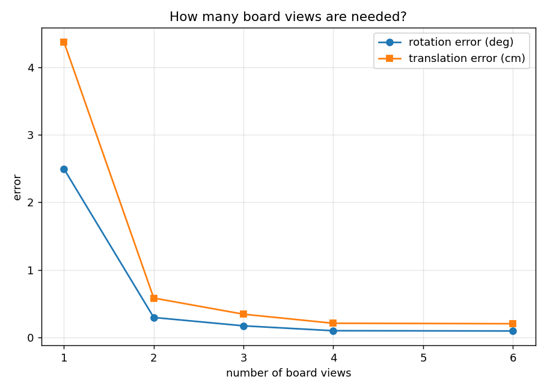
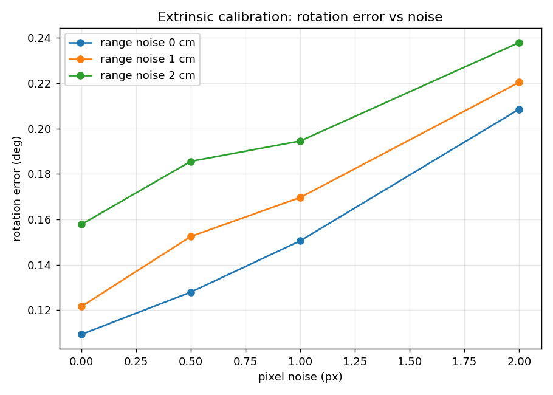
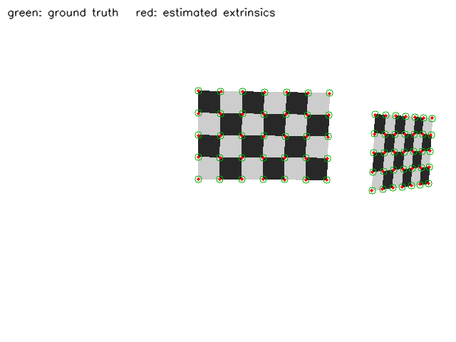

# 相机-激光雷达外参标定

本模块在**已知真值**的合成场景中完成激光雷达到相机的外参标定，并给出可量化的误差指标。仓库里原有的相机相关示例位于 `src/chap5/robot_vision`（ROS 1，以相机检测为主），没有激光雷达与相机之间的外参标定模块；本模块补上这一环，同时用合成真值回答"标定到底有多准"。

## 1. 项目简介

多传感器融合的第一步是**空间对齐**：激光雷达的点云要投影到相机图像上，必须知道两个传感器之间的旋转 $\mathbf{R}$ 和平移 $\mathbf{t}$。本模块的流程是：

```text
多姿态棋盘格（已知真值）
        ↓  投影 + 传感器噪声
3D 角点（LiDAR 系） ↔ 2D 角点（像素）
        ↓  PnP（EPnP 初值 + 迭代精化）
估计外参 (R, t)
        ↓  与真值比较
旋转误差 / 平移误差 / 重投影残差
```

与"直接拿真实数据跑一遍"相比，合成场景的价值在于**真值已知**，所以误差是可度量的，而不是只看投影图"看起来差不多"。

## 2. 环境依赖

| 项目 | 版本 |
| --- | --- |
| 操作系统 | Ubuntu 22.04 LTS |
| ROS | ROS 2 Humble（仅节点部分需要） |
| Python | 3.10.12 |
| OpenCV | 4.5.4（`opencv-python`） |
| NumPy | 1.21.5（ROS 2 Humble 自带版本） |
| Matplotlib | 3.5.1（仅绘图） |

```bash
python3 -m pip install --user -r src/ground/lidar_camera_calibration/requirements.txt
```

离线脚本只依赖 NumPy 与 OpenCV；ROS 2 节点额外依赖 `rclpy`、`sensor_msgs`、`std_msgs`。

## 3. 原理

### 3.1 投影模型

设 LiDAR 坐标系下的点为 $\mathbf{p}_l$，外参为 $(\mathbf{R}, \mathbf{t})$，则相机坐标与像素坐标为

$$
\mathbf{p}_c = \mathbf{R}\,\mathbf{p}_l + \mathbf{t}, \qquad
\begin{bmatrix} u \\ v \\ 1 \end{bmatrix}
= \frac{1}{z_c}\,\mathbf{K}\,\mathbf{p}_c
$$

其中 $\mathbf{K}$ 为相机内参矩阵（$f_x, f_y, c_x, c_y$）。本模块默认使用 640×480、$f_x=f_y=600$、$c_x=320$、$c_y=240$ 的无畸变相机；ROS 2 节点可以订阅 `/camera_info` 覆盖这组内参。

### 3.2 PnP 求解

已知 $N$ 组 3D–2D 对应点，求解 $(\mathbf{R}, \mathbf{t})$ 即 PnP 问题。本模块采用：

1. `cv2.SOLVEPNP_EPNP` 求初值（不需要初始猜测）；
2. 以该初值为起点，用 `cv2.SOLVEPNP_ITERATIVE` 最小化重投影误差。

重投影残差定义为

$$
\text{RMSE} = \sqrt{\frac{1}{N}\sum_{i=1}^{N}\left\|\mathbf{u}_i - \hat{\mathbf{u}}_i\right\|^2}
$$

### 3.3 为什么必须多姿态

单块标定板上的角点**共面**，PnP 在这种退化配置下存在位姿二义性：一个错误的位姿仍能把这一块板的点投影得很准。实测（见 6.2 节）只摆一块板时旋转误差 **2.435°**、平移误差 **4.28 cm**；摆到 3 个不同朝向的位姿后降到 **0.157° / 3.2 mm**。这就是"标定必须换姿态"的定量解释。

## 4. 系统组成

| 文件 | 作用 |
| --- | --- |
| `lidar_camera_calibration/calibration_core.py` | 场景生成、LiDAR 噪声模型、PnP 求解、误差指标、棋盘格渲染与投影叠加 |
| `lidar_camera_calibration/run_calibration.py` | 单次标定：输出估计外参与真值对照 |
| `lidar_camera_calibration/sweep_noise.py` | 像素噪声 × 测距噪声扫描 |
| `lidar_camera_calibration/sweep_views.py` | 标定板摆位次数扫描 |
| `lidar_camera_calibration/project_cloud.py` | 生成投影叠加图与误差曲线 |
| `lidar_camera_calibration/calibration_node.py` | ROS 2 节点：读取 `/camera_info`，发布标定结果 |
| `lidar_camera_calibration/main.py` | 统一入口（标准演示） |
| `launch/main.launch.py` | 一键启动节点 |

节点发布的话题：

| 话题 | 类型 | 说明 |
| --- | --- | --- |
| `/lidar_camera_calibration/extrinsics` | `std_msgs/String` | JSON：`rvec`、`t`、旋转/平移误差、重投影 RMSE、是否使用 `/camera_info` |

## 5. 运行步骤

### 5.1 构建（ROS 2 部分）

```bash
cd ~/ros2_ws
colcon build --packages-select lidar_camera_calibration --symlink-install
source install/setup.bash
```

### 5.2 离线标定（不需要 ROS）

在模块目录下直接运行：

```bash
cd src/ground/lidar_camera_calibration

# 单次标定：3 个摆位，1 px + 1 cm 噪声
python3 -m lidar_camera_calibration.run_calibration --views 3

# 摆位次数扫描（1/2/3/4/6）
python3 -m lidar_camera_calibration.sweep_views --trials 200

# 噪声敏感性扫描
python3 -m lidar_camera_calibration.sweep_noise --trials 200

# 生成投影叠加图与误差曲线（默认写入 /tmp/lidar_camera_calibration）
python3 -m lidar_camera_calibration.project_cloud --out-dir /tmp/calib_out
```

### 5.3 ROS 2 节点

```bash
ros2 launch lidar_camera_calibration main.launch.py
# 查看结果
ros2 topic echo /lidar_camera_calibration/extrinsics --once
```

节点会在收到第一条 `/camera_info` 后开始标定；若 3 秒内没收到，则使用内置默认内参并打印警告（离线演示模式）。也可以手动喂一条内参观察覆盖效果：

```bash
ros2 topic pub -1 /camera_info sensor_msgs/msg/CameraInfo \
  "{width: 640, height: 480, k: [700.0, 0.0, 320.0, 0.0, 700.0, 240.0, 0.0, 0.0, 1.0], d: [0.0, 0.0, 0.0, 0.0, 0.0]}"
```

## 6. 实测结果

数据均在 Ubuntu 22.04 + OpenCV 4.5.4 + NumPy 1.21.5 上实跑得到，噪声均为蒙特卡洛中位数。

### 6.1 单次标定

参数：3 个摆位（105 点），像素噪声 1.0 px，测距噪声 1 cm，角噪声 0.1°，随机种子 0。

| 指标 | 实测值 |
| --- | --- |
| 旋转误差 | 0.218° |
| 平移误差 | 4.6 mm |
| 重投影 RMSE | 2.35 px |
| 估计平移 | `[0.1204, −0.0259, 0.1820] m` |
| 真值平移 | `[0.1200, −0.0300, 0.1800] m` |

### 6.2 摆位次数的影响

固定 1 px + 1 cm 噪声，每个摆位组跑 200 次取中位数：

| 摆位次数 | 总点数 | 旋转误差 | 平移误差 | 重投影 RMSE |
| --- | --- | --- | --- | --- |
| 1（单板共面） | 35 | **2.435°** | **42.8 mm** | 1.863 px |
| 2 | 70 | 0.312° | 5.9 mm | 2.263 px |
| 3 | 105 | **0.157°** | **3.2 mm** | 2.188 px |
| 4 | 140 | 0.113° | 2.4 mm | 2.162 px |
| 6 | 210 | 0.096° | 2.1 mm | 2.146 px |



**结论：至少 2 个不同朝向的位姿，建议 3 个以上。** 单板共面时虽然重投影看起来不差（1.863 px），位姿误差却大了一个数量级——只看重投影残差会把错误位姿当成好结果。

### 6.3 噪声敏感性

固定 3 个摆位，每个组合跑 200 次：

| 像素噪声 | 测距噪声 | 旋转误差 | 平移误差 | 重投影 RMSE |
| --- | --- | --- | --- | --- |
| 0 px | 0 cm | 0.107° | 2.1 mm | 1.548 px |
| 1 px | 1 cm | 0.157° | 3.2 mm | 2.188 px |
| 2 px | 2 cm | 0.231° | 4.8 mm | 3.439 px |

> 0 噪声一行仍有约 0.1°，因为激光角噪声固定为 0.1°，并非实现问题。



### 6.4 投影叠加验证

把点云分别按真值与估计外参投影到同一张合成图像上：绿色圆圈为真值，红色点为估计值。



两块板上的红点与绿圈基本重合，说明估计外参可用；左板正对、右板转了 40°，正是"多姿态"的意义。

## 7. 排错

### 7.1 标定结果离谱（旋转误差几十度、平移误差几米）

最常见的原因是**标定板在画面里太小**。开发本模块时第一版把 0.24 m 宽的板放在 2 m 外，像素只占约 72 px，EPnP、RANSAC、迭代法**全部**收敛到错误位姿（实测旋转误差 168°、平移误差 2.2 m）。把板放大到 0.36 m、距离缩到 1 m（约占 200×130 px）后恢复正常。

排查顺序：

1. 检查标定板在图像中的**像素占比**，建议不小于画面的 1/6；
2. 检查是否只用了**一个姿态**（共面退化，见 6.2 节）；
3. 检查像素噪声与 3D 点噪声是否被人为放大（例如误用像素坐标当米）。

### 7.2 ROS 2 节点用了默认内参

日志出现 `未在 3.0 s 内收到 CameraInfo，使用内置默认内参` 时，说明话题名或类型不对：

1. `ros2 topic list | grep camera_info` 确认话题存在；
2. `ros2 topic info <topic>` 确认类型是 `sensor_msgs/msg/CameraInfo`；
3. 若相机内参不在 `/camera_info`，用 `-p camera_info_topic:=/your/topic` 指定。

### 7.3 `ModuleNotFoundError: No module named 'lidar_camera_calibration'`

直接运行脚本时需要让 Python 找到包：在 `src/ground/lidar_camera_calibration` 目录下执行（包就在当前目录），或先 `colcon build` 后 `source install/setup.bash` 再用 `ros2 run`。

## 8. 未验证项

- **没有接真实传感器**：全部数据来自合成场景，未使用真实相机图像与真实点云。
- **没有实现真实图像中的棋盘格检测**：当前角点由真值 3D 点投影得到；真实场景需要 `cv2.findChessboardCorners` + 点云平面拟合与角点匹配，这一步未做。
- **没有标定相机内参/畸变**：假设内参已知（或由 `/camera_info` 提供），未做相机内参标定与畸变校正。
- **没有考虑时间同步**：真实系统中点云与图像的时间戳偏差会影响标定，本模块未建模。
- **ROS 2 节点只做一次离线标定**：不订阅真实点云/图像，不是在线标定系统。

## 参考资料

- [OpenCV：Camera Calibration and 3D Reconstruction](https://docs.opencv.org/4.x/d9/d0c/group__calib3d.html)
- [OpenCV：solvePnP 文档](https://docs.opencv.org/4.x/d5/d1f/calib3d_solvePnP.html)
- [sensor_msgs/CameraInfo 消息定义](https://docs.ros.org/en/humble/p/sensor_msgs/msg/CameraInfo.html)
