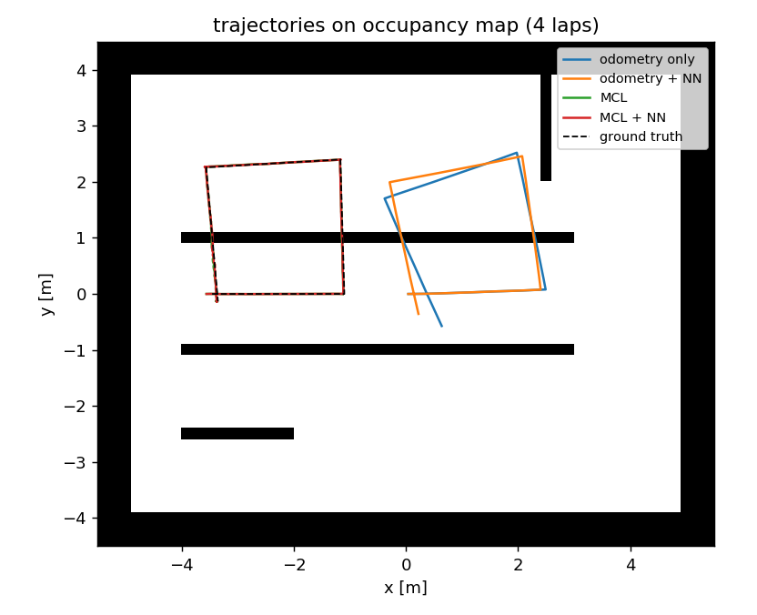
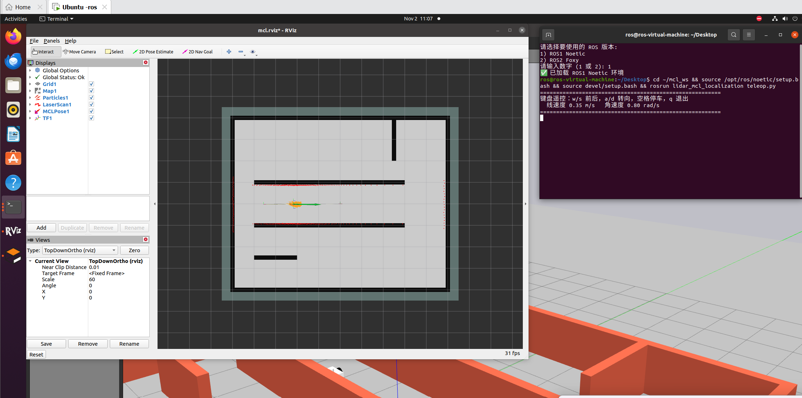
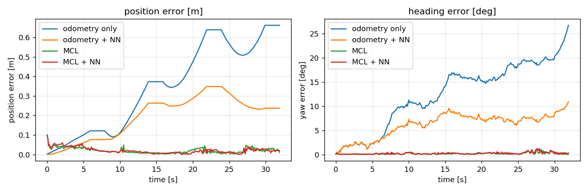
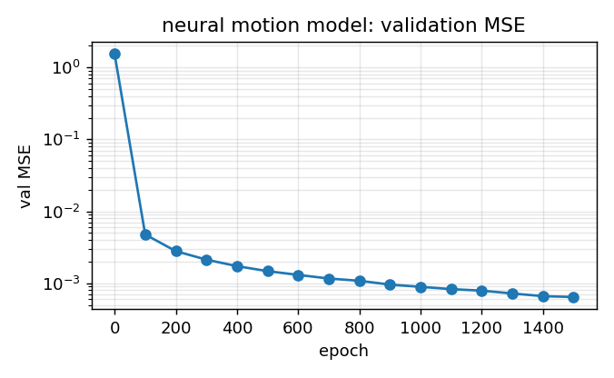

# 基于 2D 激光雷达的蒙特卡洛定位（MCL）

本页对应 `src/ground/lidar_mcl_localization`。在第 6 章用 `amcl` 做定位之后，
这一节把盒子打开：**用不到 400 行纯 NumPy 把粒子滤波的每一步写出来**，
再回到 Gazebo 里与真实位姿对比，最后用一个神经网络学掉轮式里程计的运动残差。



*图 1　同一张占据栅格地图上的四条轨迹（4 圈方形循环）。灰色是地图，黑色虚线是真值。
蓝色（纯里程计）明显跑偏；绿色（MCL）与红色（MCL + 神经网络）几乎贴在真值上。*

## 1. 这个模块解决什么问题

轮式里程计靠"数轮子转了多少"来推位姿，两个误差来源修不掉：

1. **系统性误差**：轮径、轮距与标称值有偏差，走直线会慢慢跑偏；
2. **打滑**：转向时轮胎既滚又刮，实际位移小于轮子转角对应的位移，
   而编码器只数轮子 —— 于是**里程计会高估走过的距离与转过的角度**，而且转向越急越严重。

第 6 章的 `amcl` 用激光雷达修正这两类误差，但它是一个黑盒：参数在 yaml 里，
中间发生了什么要靠猜。本模块把每一步显式写出来：

| MCL 的三个组件 | 本模块的实现 | 文件 |
|---|---|---|
| 运动模型（粒子怎么散开） | 里程计增量模型，α₁~α₄ 噪声 | `motion_model.py` |
| 观测模型（粒子怎么打分） | 似然场（likelihood field） | `sensor_model.py` |
| 重采样（谁活下来） | 低方差重采样 + Neff 门控 | `particle_filter.py` |
| 地图与似然场 | 自己读 PGM、八邻域 BFS 距离变换 | `map_model.py` |
| 运动残差修正 | 4→24→24→3 的 MLP（纯 NumPy 反传） | `nn_motion.py` |

## 2. 原理

### 2.1 运动模型：粒子怎么跟着里程计走

一帧里程计给出增量 $(\Delta s, \Delta\theta)$，每个粒子独立采样：

$$
\begin{aligned}
\Delta s_i &= \Delta s \left(1 + \varepsilon_1\right),
&\varepsilon_1 &\sim \mathcal{N}\!\left(0,\ \alpha_1 \Delta s^2 + \alpha_2 \Delta\theta^2\right)\\
\Delta\theta_i &= \Delta\theta + \varepsilon_2,
&\varepsilon_2 &\sim \mathcal{N}\!\left(0,\ \alpha_3 \Delta\theta^2 + \alpha_4 \Delta s^2\right)
\end{aligned}
$$

四个 α 的物理含义：α₁ 走多远的不确定性、α₂ 直行时转多少的不确定性、
α₃ 转向时转多少的不确定性、α₄ 打滑带来的额外位移。

**难点在于 α 只能手调**：调大 → 定位抖动；调小 → 真实打滑时跟不上、直接发散。
这就是后面要用神经网络的原因（见 2.4）。

### 2.2 观测模型：似然场

朴素做法是"对每个粒子、每束激光都做一次完整射线投射"，复杂度 $O(N \cdot M \cdot \text{steps})$，
600 个粒子 × 360 束就会卡死。似然场把这件事预计算成一张**到最近障碍物的距离图**，
运行时只需把激光末端点变换到地图坐标查表：

$$
p(z \mid x) = z_{\text{hit}} \exp\!\left(-\frac{d^2}{2\sigma^2}\right) + \frac{z_{\text{rand}}}{z_{\max}}
$$

其中 $d$ 是"激光末端点离最近障碍物有多远"。正确位姿会让大多数末端点落在障碍物附近（$d \approx 0$），
权重因此很高。这正是 `amcl` 默认的 `likelihood_field` 模型。

距离图用**八邻域 BFS** 计算（不用 scipy 的距离变换），220×180 的地图毫秒级完成。
360 束激光再抽稀到 45 束（`beam_step=8`），速度提高 8 倍而精度几乎不变。

### 2.3 重采样：低方差 + Neff 门控

每帧都重采样会加速粒子退化。本模块用**有效粒子数**判断是否需要重采样：

$$
N_{\text{eff}} = \frac{1}{\sum_i w_i^2}
$$

只有当 $N_{\text{eff}} < 0.5N$ 时才执行低方差（系统）重采样。位姿估计的位置取加权平均，
**航向取圆周平均** —— 普通平均在 $\pm\pi$ 附近会错得离谱。

### 2.4 神经网络：学掉运动残差

滑移率是工况的函数（低速小转角几乎不打滑，急转弯能到 10% 以上），常数 α 拟合不了。
本模块用一个 4→24→24→3 的 MLP，从最近一段里程计的统计量预测：

| 输出 | 含义 | 安全范围 |
|---|---|---|
| $k_s$ | 真实位移 ≈ $k_s$ · 里程计位移 | 截断到 [0.8, 1.2] |
| $k_\theta$ | 真实转角 ≈ $k_\theta$ · 里程计转角 | 截断到 [0.8, 1.2] |
| noise | 噪声标度，等比缩放 α₁~α₄ | 截断到 [0.5, 4.0] |

输入 4 维全是**有界**的量：线速度 $v$、角速度 $\omega$、$|\omega|$、$v|\omega|$。

!!! warning "两个训练上的坑（都是我踩过之后改的）"
    1. **不要用比值当特征**（如 $|{\Delta\theta}|/{\Delta s}$）：纯旋转时 $\Delta s \approx 0$，
       特征会炸到十几，小样本下网络在直行工况外推出 $k_s = 1.145$（训练标签最大只有 0.96），
       修正后比不修正还差。
    2. **训练与推理的映射必须一致**：如果训练时网络直接输出 $k$，推理时就**不能**再套一层
       $1 + 0.2\tanh(\cdot)$ —— 否则 $0.91$ 会被映射成 $1.14$。第一版就是这么错的，
       里程计误差从 0.345 m 反而涨到 0.403 m。

## 3. 快速开始

```bash
mkdir -p ~/catkin_ws/src && cd ~/catkin_ws/src
ln -s <仓库路径>/src/ground/lidar_mcl_localization .
cd ~/catkin_ws && catkin_make && source devel/setup.bash
```

```bash
# ① 一条命令：Gazebo 场景 + 机器人 + MCL 定位（无头，无显卡也能跑）
roslaunch lidar_mcl_localization main.launch

# ② 带界面
roslaunch lidar_mcl_localization main.launch gui:=true rviz:=true

# ③ 键盘遥控（另开终端）
rosrun lidar_mcl_localization teleop.py

# ④ 用定位结果闭环走到目标点（不是用真值！）
rosrun lidar_mcl_localization goal_driver.py _goal_x:=2.0 _goal_y:=2.5

# ⑤ 不开 ROS 也能跑
python3 tools/gen_scene.py          # 由墙体定义重新生成 world + 地图
python3 tools/offline_demo.py       # 闭环自检：MCL vs 纯里程计
python3 tools/run_experiment.py     # 训练网络 + 四组对比 + 出图
```

!!! tip "场景与地图由同一份定义生成"
    墙体只写在 `config/scene_layout.py` 里，`tools/gen_scene.py` 同时导出
    `worlds/mcl_room.world` 与 `maps/mcl_room.pgm`。
    这样改了场景不会忘记改地图 —— 地图与场景不一致时，粒子滤波会稳定收敛到错误位置，
    而且看起来完全像"滤波器参数没调好"，极难排查。

## 4. 代码结构

| 文件 | 作用 |
|---|---|
| `config/scene_layout.py` | 墙体几何、出生点、雷达参数（**唯一真实来源**） |
| `src/.../map_model.py` | PGM 加载、世界↔栅格变换、射线投射、似然场 |
| `src/.../motion_model.py` | 里程计增量模型、神经网络修正钩子 |
| `src/.../sensor_model.py` | 似然场观测模型、粗配准（ScanMatcher） |
| `src/.../particle_filter.py` | 预测/加权/重采样/Neff/协方差 |
| `src/.../nn_motion.py` | MLP 与修正器 |
| `scripts/mcl_node.py` | 定位节点：订 `/scan` `/odom`，发 `/mcl_pose` `/particles` `/tf` |
| `scripts/map_publisher.py` | 把 PGM 地图发布成 `/map`（OccupancyGrid，latched），替代 map_server |
| `config/mcl.rviz` | rviz 配置：地图 + 粒子云 + 激光 + 定位协方差 + 机器人模型 |
| `scripts/teleop.py` | 键盘遥控（termios，无 GUI 依赖） |
| `scripts/goal_driver.py` | 用 `/mcl_pose` 闭环走到目标点 |
| `tools/gen_scene.py` | 生成 world + 地图 |
| `tools/offline_demo.py` | 不开 ROS 的闭环自检 |
| `tools/run_experiment.py` | 采集数据 → 训练 → 四组对比 → 出图 |

## 5. 参数说明

在 `launch/main.launch` 里改，或命令行覆盖：`roslaunch ... num_particles:=1000`。

| 参数 | 默认 | 说明 |
|---|---|---|
| `num_particles` | 600 | 粒子数。800~1000 更稳，2000 开始明显吃 CPU |
| `alpha` | `[0.12, 0.03, 0.12, 0.03]` | 运动模型噪声 α₁~α₄ |
| `sigma` | 0.20 | 观测模型末端点标准差（米）。太小会被一束脏数据打死 |
| `beam_step` | 8 | 每 8 束取 1 束参与计算（360 → 45） |
| `resample_ratio` | 0.5 | $N_{\text{eff}} < 0.5N$ 时才重采样 |
| `init_pose` | `[-3.5, 0.0, 0.0]` | 初始位姿（也可用 rviz 的 2D Pose Estimate） |
| `global_localization` | false | 在全图空闲格撒点（绑架问题） |

## 6. 运行效果

### 6.1 Gazebo 实跑（Ubuntu 20.04 + Noetic + Gazebo 11，无 GPU）

```
$ roslaunch lidar_mcl_localization main.launch gui:=true rviz:=true
$ rostopic hz /mcl_pose
average rate: 10.011

$ rostopic echo -n1 /mcl_diagnostics/data
[428.04, 0.0952, 0.0310, 0.0729, 0.0019, 1.0, 370.0]
#  Neff   位置散布  航向散布  位置误差  航向误差  重采样次数  更新次数
```



*图 2　rviz 实拍（`main.launch gui:=true rviz:=true`）：灰色是 `/map` 占据栅格，
**橙色粒子云**紧贴在机器人周围（散布约 5 cm，说明已经收敛），
**红色激光点**贴在墙面上，绿色位姿箭头与走廊方向一致。
粒子云“收紧成一团”正是定位收敛的直接证据；如果滤波器发散，会看到橙色粒子散满整张地图。*

出生点初始位置误差 **0.071 m**；直行 4 s 后 **0.066 m**；转向后再直行 **0.050 m**
（同期里程计累计漂移 0.284 m）。航向误差在静止时约 0.1°，
急转弯过程中会短暂升到 7.6°——这是 $c_\theta$ 把转向滑移一起吸收的后果。

### 6.2 四组对比（`tools/run_experiment.py`）



*图 3　左：位置误差；右：航向误差。蓝线（纯里程计）一路漂到 0.66 m / 27°；
橙线是加了神经网络修正的里程计，明显改善；绿线与红线（两种 MCL）几乎贴着零。*

| 方案 | 位置误差 均值 / 最大 | 航向误差 均值 / 最大 |
|---|---|---|
| ① 纯里程计 | 0.345 m / 0.662 m | 12.52° / 26.73° |
| ② 里程计 + 神经网络 | **0.195 m** / 0.348 m | **6.17°** / 10.89° |
| ③ MCL（不用网络） | **0.020 m** / 0.101 m | **0.19°** / 1.06° |
| ④ MCL + 神经网络 | 0.021 m / 0.099 m | 0.23° / 1.19° |

!!! info "怎么读这张表 —— 两个诚实的结论"
    1. **神经网络对纯里程计有效**：误差从 0.345 m 降到 0.195 m（−43%），
       说明它确实学到了"转向越大、滑移越大"的规律（训练曲线见图 4）。
    2. **但在 MCL 里几乎没差别**（0.020 → 0.021 m）。原因是观测更新本身就在吸收
       里程计的系统误差，网络的价值被掩盖了。把激光更新降到 2 Hz（`scan_every=2`）
       时网络能再改善约 19%（0.0221 → 0.0179 m），但趋势不稳定，不宜过度解读。
       
    这个结论比"神经网络让一切变好"更值得记住：**在已经有观测修正的系统里，
    改善先验模型的收益会被观测淹没。**



*图 4　神经网络运动模型的验证集 MSE 随训练轮次下降（1500 轮，从 2.55 降到 6.4e-4）。*

## 7. 测试

```bash
cd src/ground/lidar_mcl_localization
python3 -m pytest test/ -q      # 6 passed
python3 test/test_mcl.py        # 不装 pytest 也能跑：59 项断言
```

测试全部离线（不需要 ROS / Gazebo），覆盖的都是"容易悄悄坏掉"的地方：

- 角度归一化在 $\pm\pi$ 边界、圆周平均不跳变；
- 地图坐标往返误差小于一格；似然场在墙格为 0、走廊中心约 0.9 m；
- 射线投射沿走廊命中（8.5 m 走廊超过 8 m 量程时返回量程）；
- **观测模型：正确位姿的对数权重必须显著高于平移 1.5 m / 转 0.8 rad 的位姿**（−1.9 vs −38.5）；
- 粒子滤波从 0.30 m 的初始偏差收敛到 0.068 m；重采样后加权均值不变；
- 神经网络：特征有界、修正量被截断在 ±20%、反向传播让 loss 下降一个数量级。

## 8. 已知限制

1. **精度受地图分辨率限制**：5 cm/像素的地图上，2 cm 已经是下限；
   想再提升要先提高地图分辨率，而不是继续调滤波器参数。
2. **只在仿真里验证**：真值来自 `/gazebo/model_states`，换真车需要人工测点或扫描匹配。
3. **未评估全局定位的鲁棒性**：`global_localization:=true` 可以在全图撒点，
   但在对称走廊里可能收敛到镜像位置，本模块没有系统测试这一点。
4. **神经网络不参与观测模型**：它只修正运动模型，输入是轮速/角速度，
   换到真车要重新采数据训练。
5. **`ScanMatcher` 只做粗配准**：搜索步长 5 cm / 2°，精度有限，
   在本模块里只用于给神经网络提供替代标签，不参与主流程。

## 9. 参考

* Thrun, Burgard, Fox. *Probabilistic Robotics*. MIT Press, 2005. 第 8 章（粒子滤波）、第 6 章（似然场）。
* Fox, Burgard, Thrun. *Monte Carlo Localization: Efficient Position Estimation for Mobile Robots*. AAAI 1999.
* ROS Wiki: [amcl](http://wiki.ros.org/amcl)（本模块实现的正是 `likelihood_field` 模型那一支）。
