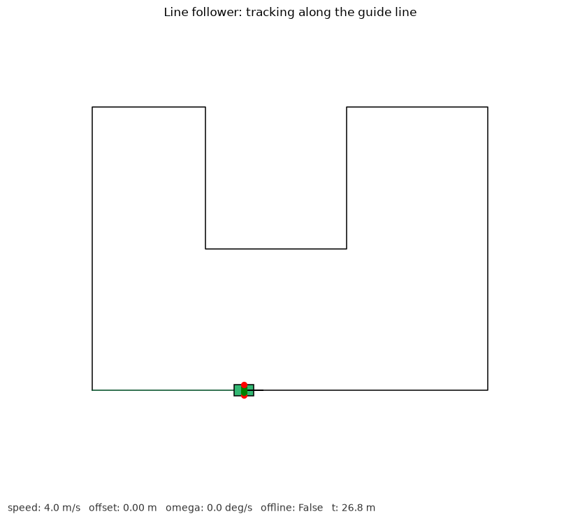

# 巡线小车仿真（色带中线 PD 跟踪）

纯 NumPy + Matplotlib 实现的二维巡线小车仿真，不依赖 ROS / Gazebo / CARLA / MuJoCo。
黑色引导线构成一条带内凹弯的闭合赛道，小车车头一排虚拟光传感器读取压线情况，
控制器沿路径取预瞄目标点（pure pursuit 思想），按朝向误差 PD 控制转向角速度
沿中线巡线。

- 源码：[`src/ground/line_follower_car`](../../src/ground/line_follower_car)
- 作者：jiangdong000

## 环境

- Python 3.8+（纯 Python，跨平台；Linux / Windows / macOS 均可运行）
- NumPy、Matplotlib（见模块 `requirements.txt`）

```bash
pip install -r src/ground/line_follower_car/requirements.txt
```

## 运行

```bash
python3 src/ground/line_follower_car/main.py --demo --outdir demo_out
```

无窗口评测：

```bash
python3 src/ground/line_follower_car/main.py --headless --duration 90 --outdir demo_out
```

## 实现

赛道拐点闭合后按 0.5 m 均匀采样成路径点序列。控制流程：

1. 沿前进方向取第 `LOOKAHEAD` 个采样点作为预瞄目标 `(tx, ty)`；
2. 目标方位角 `α = atan2(ty - y, tx - x)`，朝向误差 `err = normalize(α - θ)`；
3. 角速度 `ω = Kp·err + Kd·derr/dt`；
4. 独轮运动学积分：

```
x += v · cosθ · dt
y += v · sinθ · dt
θ += ω · dt
```

车顶五个传感器横向分布在 `-0.9 … 0.9 m`，探测下方路径距离，压线（距离 ≤ 线宽
一半）显示绿色，否则红色。脱线判定：到路径最近距离连续 15 步超过 `OFFLINE_E`
（1.5 m）置 `offline`。

## 评测指标

`metrics.json`：

| 字段 | 含义 |
|---|---|
| `steps` | 仿真步数 |
| `path_length` | 累计行驶里程（米） |
| `mean_abs_offset` | 平均绝对横向偏差（米） |
| `max_abs_offset` | 最大绝对横向偏差（米） |
| `offline` | 是否持续脱线 |
| `finished` | 是否跑完一圈 |

## 测试

```bash
python3 -m unittest discover -s src/ground/line_follower_car/tests -v
```

## 参数

| 参数 | 默认值 | 说明 |
|---|---|---|
| `SPEED` | 4.0 m/s | 巡线速度 |
| `KP` / `KD` | 1.8 / 0.25 | 朝向误差比例 / 微分增益 |
| `LOOKAHEAD` | 8 点 | 沿路径向前看的采样点数（约 4 m） |
| `OFFLINE_E` | 1.5 m | 脱线距离阈值 |

## 限制

- 赛道为预设折线，传感器为几何距离判定，未接入真实摄像头图像。
- 直角弯偏差峰值较大，靠预瞄点提前转向，不做车速自适应减速。
- 独轮模型不阿克曼转向半径约束。

## 运行截图

**巡线小车沿引导线跟踪（绿色为压中线的传感器）：**


