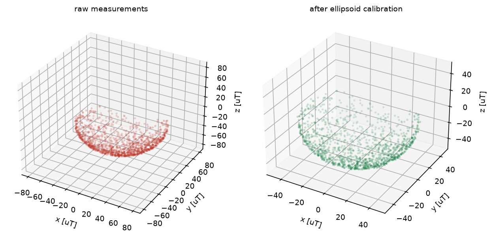
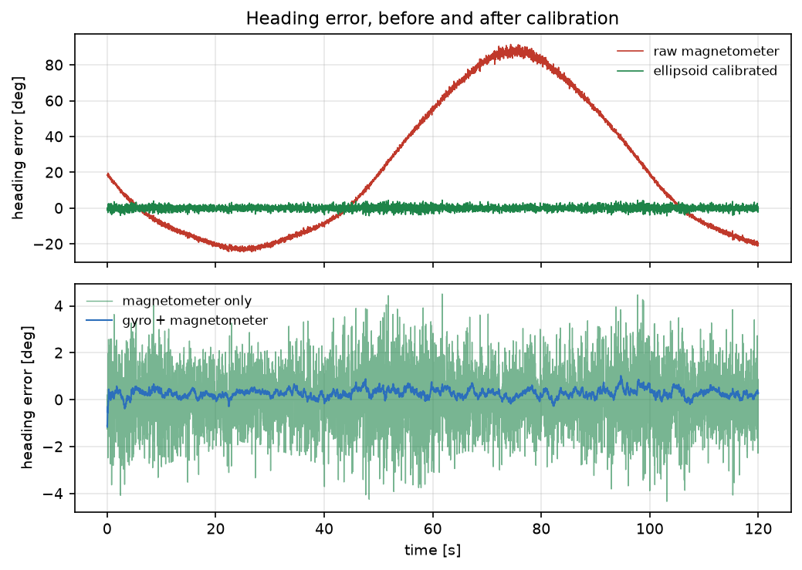

# 磁力计硬磁/软磁标定与倾角补偿航向

磁力计在机器人本体上几乎一定被磁化：硬磁带来固定偏置，软磁把测量球压成椭球。不标定时航向误差
可达几十度，只补硬磁也还有 10° 量级。本模块做完整的椭球标定，并把标定后的航向与陀螺融合。

与仓库已有模块的区别：

- 仓库里没有磁力计/罗盘相关模块（`mag`、`compass`、`hard_iron` 关键词命中数为 0）；
- `imu_allan_noise_identification` 辨识的是陀螺噪声，本模块处理的是磁力计的空间畸变；
- `uwb_range_odom_fusion` 用外部测距约束位置，本模块用椭球约束航向。

## 1. 方法

### 1.1 畸变模型

$$
\mathbf{m}=A\,\mathbf{s}+\mathbf{b}+\mathbf{n}
$$

其中 $\mathbf{s}$ 是真实地磁（模长 $B=48\ \mu T$，磁倾角 60°），$\mathbf{b}$ 是硬磁偏置，
$A$ 是软磁矩阵。仿真取 $b=(20,-15,8)\ \mu T$、$A=\mathrm{diag}(1.28,0.84,1.12)$ 加 0.10 的交叉项，
测量噪声 0.5 µT。

### 1.2 椭球拟合

校正的目标是找到 $W,\mathbf{b}$ 使

$$
\lVert W(\mathbf{m}-\mathbf{b})\rVert=B
$$

对 $(\mathbf{b},W)$ 做 Gauss–Newton（数值雅可比 + LM 阻尼），初值由球拟合给出。
残差是几何距离而不是代数距离，避免"$r=-1$"归一化带来的偏置。

### 1.3 旋转自由度与对称平方根

$\lVert W\mathbf{x}\rVert$ 只约束 $W^\top W$：任意正交阵 $R$ 给出同样的范数，也就是椭球拟合
**无法确定旋转**。常规做法是取对称正定解

$$
W=\left(W^\top W\right)^{1/2}
$$

这与"软磁矩阵对称"的物理假设一致；不取对称解时，球面残差同样很小，但航向会被旋转量污染——
本模块第一版就踩了这个坑（残差 0.48 µT 但航向误差 21.7°）。

### 1.4 倾角补偿与融合

用重力向量求横滚/俯仰：

$$
\phi=\arctan\frac{a_y}{a_z},\qquad
\theta=\arctan\frac{-a_x}{\sqrt{a_y^2+a_z^2}}
$$

把磁场旋到水平面后取

$$
\psi=\arctan\frac{-\left(m_y\cos\phi-m_z\sin\phi\right)}
{m_x\cos\theta+m_y\sin\theta\sin\phi+m_z\sin\theta\cos\phi}
$$

再与陀螺做一维卡尔曼：预测 $\psi\leftarrow\psi+\omega\,dt$，观测为磁航向，角度差用
$\arctan2(\sin\Delta,\cos\Delta)$ 归一化。

## 2. ROS 2 接口

| 节点 | 作用 |
|---|---|
| `mag_sim` | 回放带畸变的磁力计与重力向量 |
| `mag_calibrator` | 累积样本后拟合椭球，发布偏置/矩阵/残差/航向 |

## 3. 构建与运行

```bash
source /opt/ros/humble/setup.bash
cd ~/hutb_ws
colcon build --symlink-install --packages-select mag_hard_soft_iron_calibration
source install/setup.bash
ros2 launch mag_hard_soft_iron_calibration main.launch.py samples:=600
```

离线：

```bash
cd src/ground/mag_hard_soft_iron_calibration
python3 main.py --out results --figure-dir ../../../docs/img/ground/mag_hard_soft_iron_calibration
python3 -m unittest discover -s tests -v
```

## 4. 结果

环境：Windows 11、Python 3.12.14、NumPy 2.3.5。标定样本 1200 个（姿态覆盖偏航全域、俯仰 ±60°、横滚 ±45°），
航向实验 120 s / 50 Hz。

### 4.1 标定精度

| 指标 | 数值 |
|---|---|
| 偏置误差 | **0.90 µT**（硬磁真值模长 26.1 µT，约 3.4 %） |
| 软磁矩阵相对误差 | **1.1 %** |
| 拟合残差 RMS | **0.46 µT**（测量噪声 0.5 µT） |



左图是原始测量：球心被硬磁推到 (20, -15, 8)，形状被软磁压扁；右图是标定后，已回到以原点为心的球面。

### 4.2 航向误差

| 航向来源 | RMSE | 最大误差 | 偏置 |
|---|---|---|---|
| 原始磁力计 | 42.65° | 91.51° | +20.45° |
| 仅硬磁补偿（球拟合） | 10.53° | 22.41° | −2.08° |
| 椭球标定 | 1.26° | 4.51° | +0.06° |
| 陀螺 + 磁力计融合 | **0.33°** | **1.17°** | +0.28° |



只补硬磁能把 42.65° 降到 10.53°，但剩余误差来自软磁的各向异性；椭球标定把它压到 1.26°，
再加陀螺融合到 0.33°——陀螺负责短期平滑，磁力计负责长期不漂。

### 4.3 倾角补偿

用真实磁场 + 重力做倾角补偿，平均误差 0.40°、最大 1.65°（姿态角 ±4°/±2°）。
不做补偿时误差随俯仰增大，这也是机器人上必须接加速度计的原因。

## 5. 复现

```bash
cd src/ground/mag_hard_soft_iron_calibration
python3 main.py --out results --figure-dir ../../../docs/img/ground/mag_hard_soft_iron_calibration
python3 -m unittest discover -s tests -v    # 15 项
```

| 文件 | 内容 |
|---|---|
| `mag_hard_soft_iron_calibration/core.py` | 椭球拟合入口、球拟合基线、倾角/航向、航向滤波 |
| `mag_hard_soft_iron_calibration/ellipsoid.py` | Gauss–Newton（LM 阻尼 + 数值雅可比） |
| `mag_hard_soft_iron_calibration/scene.py` | 确定性标定扫掠与航向实验 |
| `mag_hard_soft_iron_calibration/headless.py` | 实验与 `results/summary.json` |
| `mag_hard_soft_iron_calibration/plotting.py` | 两张图 |
| `mag_hard_soft_iron_calibration/nodes.py` | `mag_sim` / `mag_calibrator` |
| `results/summary.json` | 本文全部数值 |

## 6. 限制

1. 软磁按对称矩阵建模，未含安装旋转；若传感器与机体系有夹角，需要额外标定安装矩阵。
2. 标定假设环境磁场恒定、无 nearby 铁磁干扰；实际场景需要先排除电机/结构件干扰。
3. 只用椭球几何约束，未利用 GPS 航迹或双天线做绝对校准。
4. 航向滤波为一维标量滤波，未与陀螺零偏联合估计；长时间静止时陀螺零偏会进入航向。
5. 噪声按高斯白噪声建模，未包含磁干扰的尖峰（需要额外做野值剔除）。
6. ROS 2 端只做了 `compileall`、`package.xml` 解析与桩模块联调，未在本机执行 `colcon build` 与 `ros2 launch`。

## 7. 大模型使用声明

使用 DeepSeek Harness（deepseek-flash）辅助完成代码、推导整理、测试与文档。作者核对了椭球拟合、
对称平方根与倾角补偿公式，并在本机实际运行了离线实验与 15 项单元测试，数值来自 `results/summary.json`。
