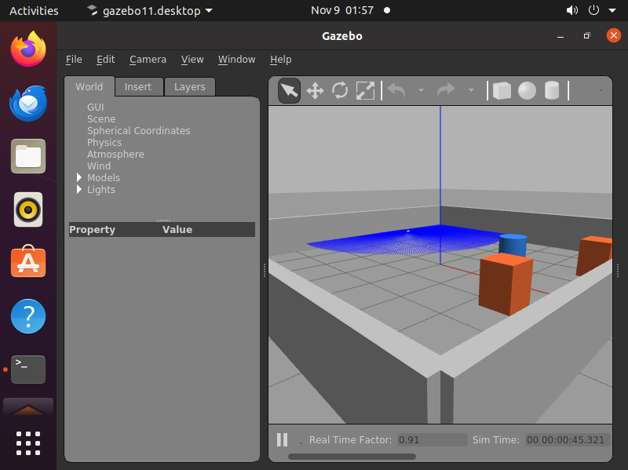
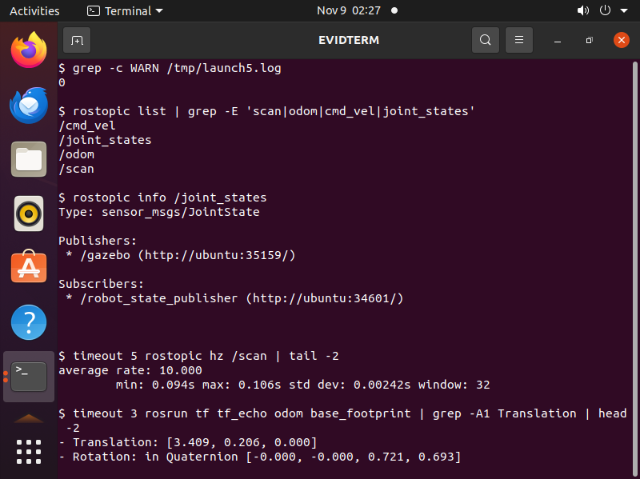
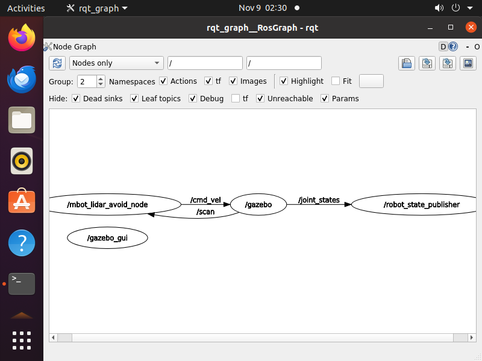
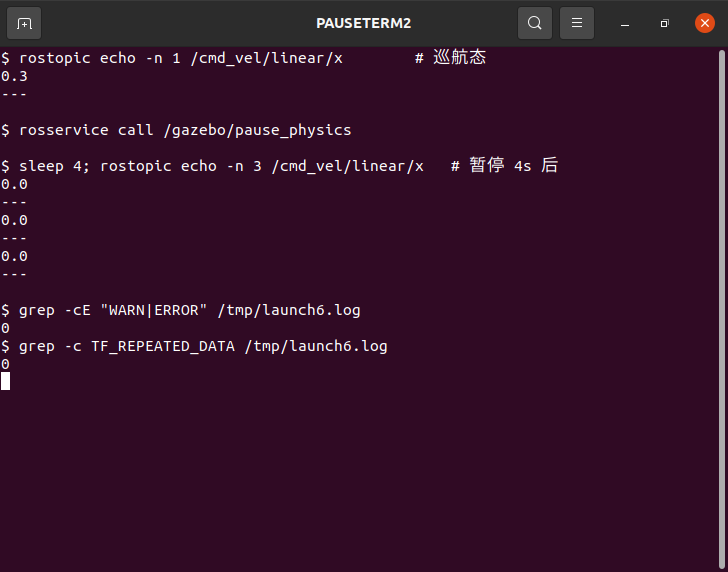

# Mbot 雷达感知自主避障仿真（ROS 1 Noetic）

> ROS 1 Noetic + Gazebo 11 + Mbot 差速底盘。包内自带 URDF、world 与 launch，可独立运行，不依赖 `turtlebot3_*`。

## 1. 项目概述

节点订阅 `/scan` 2D 激光雷达数据，按**扇区最小距离 + 滞回状态机**输出 `/cmd_vel` 速度指令，让 Mbot 在未知静态环境中自主避障。

控制分为三个状态：

| 状态 | 触发条件 | 行为 |
| :--- | :--- | :--- |
| `cruise` 巡航 | 前方 ≥ `safe_distance`（0.80 m） | 直行；侧向过近时朝更宽一侧轻微让开 |
| `avoid` 避障 | 前方 < `safe_distance` | 减速并朝更宽一侧转向；前方 > `exit_distance`（1.00 m）才退出 |
| `escape` 脱困 | 前方 < `danger_distance`（0.30 m） | 倒车并转向远离更近一侧；后方两侧都堵时原地旋转 |

`safe_distance` 与 `exit_distance`、`danger_distance` 与 `danger_exit_distance` 成对使用构成**滞回**，避免在阈值边界反复切换造成转向抖动。

## 2. 环境版本

| 项目 | 版本 |
| :--- | :--- |
| 操作系统 | Ubuntu 20.04 LTS |
| ROS | ROS Noetic（catkin） |
| 仿真引擎 | Gazebo 11 |
| 语言 | Python 3.8 |

## 3. 依赖安装

```bash
sudo apt update
sudo apt install -y ros-noetic-gazebo-ros ros-noetic-gazebo-ros-pkgs \
                     ros-noetic-robot-state-publisher ros-noetic-urdf
```

## 4. 项目文件结构

本模块位于仓库的 `src/ground/` 下：

```text
src/ground/mbot_gazebo_lidar_avoid/
├── README.md                       # 环境 / 构建 / 启动 / 停止 / 参数说明
├── LICENSE                         # MIT
├── CMakeLists.txt                  # catkin 编译与安装规则（含 launch/config/urdf/worlds）
├── package.xml                     # 包元信息
├── config/
│   └── lidar_avoid.yaml            # 全部可调参数（rosparam）
├── launch/
│   └── main.launch                 # 一键启动 Gazebo + Mbot + 避障节点
├── urdf/
│   └── mbot_lidar.urdf             # Mbot 差速底盘 + 2D 激光雷达
├── worlds/
│   └── lidar_avoid_world.world     # 封闭场地 + 障碍物
└── scripts/
    └── main.py                     # 避障节点（可执行）
```

对应的教程文档即本文，位于 `docs/ground/mbot_lidar_avoid.md`。

## 5. 构建

本包必须放进 catkin 工作空间的 `src/` 下才能编译。**不要直接用仓库根目录 `catkin_make`**：
仓库 `src/` 中还有 ROS 2（ament）以及依赖 CARLA / MuJoCo 的包，会被一起配置并大概率失败。

方式一（推荐）：新建独立工作空间，只放入本包：

```bash
mkdir -p ~/mbot_ws/src
cp -r <仓库根目录>/src/ground/mbot_gazebo_lidar_avoid ~/mbot_ws/src/
cd ~/mbot_ws
catkin_make
source devel/setup.bash
```

方式二：已有 `~/catkin_ws`，把本包软链接进去：

```bash
mkdir -p ~/catkin_ws/src
ln -s <仓库根目录>/src/ground/mbot_gazebo_lidar_avoid \
      ~/catkin_ws/src/mbot_gazebo_lidar_avoid
cd ~/catkin_ws
catkin_make
source devel/setup.bash
```

方式三：确实要在多包仓库里原地编译时，只构建本包及其依赖：

```bash
cd <仓库根目录>
catkin_make --only-pkg-with-deps mbot_gazebo_lidar_avoid
source devel/setup.bash
```

验证安装空间（可选）：

```bash
cd ~/mbot_ws
catkin_make install
source install/setup.bash
```

`CMakeLists.txt` 已把 `launch/`、`config/`、`urdf/`、`worlds/` 安装到 share 目录，因此 `catkin_make install` 后仍可用 `roslaunch` 找到 launch 文件。

## 6. 启动与停止

启动：

```bash
roslaunch mbot_gazebo_lidar_avoid main.launch
```

可选参数：`gui:=false`（无界面）、`x:=` / `y:=` / `yaw:=`（初始位姿）。

停止：

- 在 `roslaunch` 终端按 `Ctrl+C`。节点注册了 `rospy.on_shutdown`，退出前发布零速度。
- 或 `rosnode kill /mbot_lidar_avoid_node`。
- 清理残留：`killall -9 gazebo gzserver gzclient roslaunch`。

## 7. 参数

参数全部放在 `config/lidar_avoid.yaml`，由 launch 以 rosparam 加载。
节点**只在启动时读取一次参数**，`rosparam set` 之后不会生效；修改后请重新 `roslaunch`，
或 `rosnode kill /mbot_lidar_avoid_node` 后重启节点。本模块未实现 `dynamic_reconfigure`。

| 参数 | 默认值 | 说明 |
| :--- | :--- | :--- |
| `cruise_speed` | 0.30 | 巡航线速度 (m/s) |
| `avoid_speed` | 0.10 | 避障线速度 (m/s) |
| `reverse_speed` | -0.12 | 脱困倒车速度 (m/s) |
| `turn_rate` | 1.20 | 避障转向角速度 (rad/s) |
| `rotate_rate` | 0.90 | 脱困旋转角速度 (rad/s) |
| `safe_distance` | 0.80 | 进入避障阈值 (m) |
| `exit_distance` | 1.00 | 退出避障阈值 (m) |
| `danger_distance` | 0.30 | 进入脱困阈值 (m) |
| `danger_exit_distance` | 0.50 | 退出脱困阈值 (m) |
| `side_distance` | 0.45 | 侧向障碍影响转向的阈值 (m) |
| `rear_block_distance` | 0.35 | 后方受阻阈值，决定倒车或原地旋转 (m) |
| `front_half_deg` | 20.0 | 前扇区半角 (°) |
| `side_deg` | 60.0 | 侧扇区外边界 (°) |
| `rear_deg` | 150.0 | 后扇区外边界 (°) |
| `scan_timeout` | 1.5 | `/scan` 超时停车秒数 |
| `range_max` | 3.5 | 距离上限裁剪 (m) |
| `control_rate` | 10.0 | watchdog 频率 (Hz) |

## 8. 核心算法

### 8.1 扇区划分（不依赖束数与 `angle_min`）

每个扫描点的角度用 `angle = angle_min + i * angle_increment` 换算，归一化到 `[-π, π]` 后按角度分扇区：

| 扇区 | 角度范围 | 用途 |
| :--- | :--- | :--- |
| 前方 | \|θ\| ≤ 20° | 判定直行 / 避障 / 脱困 |
| 左侧 | +20° ~ +60° | 转向方向、侧向让开 |
| 右侧 | −60° ~ −20° | 转向方向、侧向让开 |
| 左后 | +60° ~ +150° | 判断能否倒车 |
| 右后 | −150° ~ −60° | 判断能否倒车 |

因为按真实角度换算，360 束、720 束以及 `angle_min = -π` 的雷达都能正常工作，不会因束数不同而误判、也不会左右扇区错位。

### 8.2 决策流程

```
/scan
  │
  ▼
过滤 NaN/Inf/非正值 → 按角度归入五个扇区 → 各取最小距离
  │
  ▼
前方 < danger_distance ──► escape：倒车 + 转向；后方被堵则原地旋转
前方 < safe_distance   ──► avoid ：减速 + 朝宽侧转向（> exit_distance 才退出）
其他                   ──► cruise：直行（侧向过近时轻微让开）
  │
  ▼
/cmd_vel
```

### 8.3 安全保护

| 保护类型 | 触发条件 | 行为 |
| :--- | :--- | :--- |
| NaN / 非正值过滤 | 扫描点为 NaN、`-inf` 或 ≤ 0 | 跳过该点 |
| 无回波 | 扫描点为 `+inf` | 按 `range_max` 处理（空旷场地不会误判为数据不可用） |
| 数据不可用 | `ranges` 为空、`angle_increment` 非法、无任何合法点 | 停车并告警 |
| 扫描超时 | 超过 `scan_timeout` 秒未收到 `/scan` | 停车并告警（10 Hz 墙钟 watchdog） |
| 未就绪 | 节点启动后尚未收到扫描 | 停车 |
| 退出停车 | `Ctrl+C` / `rosnode kill` | `rospy.on_shutdown` 发布零速度 |

超时判断使用**墙钟** `time.time()`，watchdog 是独立的 `threading.Thread`，不读 `/clock`。
因此即使 `rosservice call /gazebo/pause_physics` 暂停物理、仿真时钟停走，或 `gzserver`
崩溃导致 `/clock` 不再更新，节点仍会在 `scan_timeout` 秒后持续发布零速度，
不会让最后一条 `cmd_vel` 滞留在控制器里。

### 8.4 话题与 TF

| 方向 | 话题 / TF | 发布者 | 说明 |
| :--- | :--- | :--- | :--- |
| 订阅 | `/scan` | `libgazebo_ros_laser.so` | 360 束，`angle_min = -π`，10 Hz |
| 发布 | `/cmd_vel` | `mbot_lidar_avoid_node` | 速度指令 |
| 发布 | `/odom` | `libgazebo_ros_diff_drive.so` | `child_frame_id = base_footprint`，`odometrySource = world` |
| 发布 | `/joint_states` | `libgazebo_ros_diff_drive.so` | `publishWheelJointState = true`，两个驱动轮 |
| 发布 | `/tf` | 差速插件 + `robot_state_publisher` | `odom → base_footprint → base_link → laser_link` 及左右轮 |

`base_footprint` 在地面（`base_footprint → base_link` 的 origin z = 0.11，等于轮子最低点到
`base_link` 的距离），所以 `/odom` 的 z 约为 0，后续接 `move_base` / `nav2` 时不会多出 10 cm 偏置。

## 9. 测试

**测试位置说明**：本模块的测试放在仓库根目录 `tests/` 下，这是本仓库**离线逻辑测试**的既定约定，
而不是遗漏：`master` 的 `tests/` 目录已有 46 个同类回归测试（例如 `tests/test_twist_to_control_local.py`
测的正是 `src/ground/twist_to_control` 这个包），`.github/workflows/air_bridge_tests.yml`
的 `Local tests (no ROS / simulator)` 作业也以 `paths: tests/**` 触发。
包内 `test/`（如 `src/air/uav_landing_monitor/tests/`）放的是需要 ROS 环境的包内用例；
本模块的离线用例桩化了 `rospy`，与 `test_*_local.py` 同属一类，因此跟仓库根目录的用例放在一起。

仓库级 pytest 测试位于 `tests/test_mbot_lidar_avoid.py`，桩化 `rospy`，不需要 ROS / Gazebo：

```bash
python3 -m pytest tests/test_mbot_lidar_avoid.py -v
```

覆盖内容：

- **扇区换算**：360 束 / `angle_min=0`；720 束 / `angle_min=-π`；左右扇区不错位
- **回调与发布链路**：真实 `_scan_callback` → `Publisher.publish`
- **异常输入**：NaN / `-inf` 过滤、`+inf` 按 `range_max` 视为空旷、全 NaN、空 `ranges`、`angle_increment` 非法
- **控制行为**：滞回不抖动、脱困倒车、后方受阻原地旋转、侧向让开
- **安全保护**：扫描超时（墙钟 watchdog，不依赖 `/clock`）、未收到扫描、shutdown 停车、
  状态机读写加锁（callback 与 watchdog 线程共用一把 `threading.RLock`）
- **工程完整性**：launch 内容、CMakeLists 安装规则、`package.xml` 与 `LICENSE`

离线用例共 30 个（`30 passed`）。

仿真集成测试 `tests/test_mbot_lidar_avoid_launch.py`（需要 ROS Noetic + Gazebo）：

```bash
# 静态校验：URDF 插件 filename、check_urdf、roslaunch --nodes 解析
# 端到端用例默认跳过 -> 5 passed, 1 skipped
python3 -m pytest tests/test_mbot_lidar_avoid_launch.py -v

# 端到端：自动启动 headless Gazebo，验证 /scan、/odom、/cmd_vel 有数据
# 全部 6 个用例执行 -> 6 passed
MBOT_LAUNCH_TEST=1 python3 -m pytest tests/test_mbot_lidar_avoid_launch.py -v
```

端到端用例使用独立的 `ROS_MASTER_URI` / `GAZEBO_MASTER_URI`（随机空闲端口）和独立进程组，
因此不会干扰同机上已经运行的 rosmaster / Gazebo；结束时只 `SIGINT` 自己的进程组，
不使用 `pkill -f gzserver` 这类会误伤其他实例的清理方式。

## 10. 实验指标

| 指标项 | 数值 |
| :--- | :--- |
| 传感器 | 2D 激光雷达 `/scan`，360 束，量程 0.10–3.50 m |
| 避障触发距离 | 0.80 m（退出 1.00 m） |
| 脱困触发距离 | 0.30 m（退出 0.50 m） |
| 巡航线速度 | 0.30 m/s |
| 避障线速度 | 0.10 m/s |
| 脱困倒车速度 | −0.12 m/s |
| 转向 / 旋转角速度 | 1.20 / 0.90 rad/s |

## 11. 运行效果

以下截图来自 Ubuntu 20.04 + ROS Noetic + Gazebo 11 虚拟机的真实运行（`roslaunch mbot_gazebo_lidar_avoid main.launch`）。

**Gazebo 仿真画面**：



封闭场地、三块障碍物，以及机器人位置周围的蓝色激光扫描扇形（URDF 中
`<visualize>true</visualize>` 的效果），底部状态栏 `Real Time Factor: 0.91`、
`Sim Time: 00:00:45.321`。

**同一台机器上的终端实测**（launch 启动后采集）：



```text
$ grep -c WARN /tmp/launch5.log
0

$ rostopic list | grep -E 'scan|odom|cmd_vel|joint_states'
/cmd_vel
/joint_states
/odom
/scan

$ rostopic info /joint_states
Type: sensor_msgs/JointState

Publishers:
 * /gazebo (http://ubuntu:35159/)

Subscribers:
 * /robot_state_publisher (http://ubuntu:34601/)

$ timeout 5 rostopic hz /scan | tail -2
average rate: 10.000
	min: 0.094s max: 0.106s std dev: 0.00242s window: 32

$ timeout 3 rosrun tf tf_echo odom base_footprint | grep -A1 Translation | head -2
- Translation: [3.409, 0.206, 0.000]
- Rotation: in Quaternion [-0.000, -0.000, 0.721, 0.693]
```

`odom -> base_footprint` 的平移 z 为 `0.000`（`/odom` 里约 1e-06），说明 `base_footprint`
确实落在接地平面，不再有 10 cm 偏置。

**rqt_graph 计算图**：



`mbot_lidar_avoid_node` 从 `/scan` 取数据、向 `/cmd_vel` 发指令。`/scan` 与 `/joint_states`
的发布者都显示为 `/gazebo`，因为两个 Gazebo 插件都挂在同一个 gzserver 节点名下；
`/robot_state_publisher` 订阅 `/joint_states` 并发布轮子 TF。图中没有 `/odom` 这条边，
是因为它当时没有订阅者、被 rqt_graph 的 “Dead sinks” 选项隐藏，并非没有发布
（`test_gazebo_topics_end_to_end` 会断言 `/odom` 持续有数据）。

`WARN` 计数为 0，说明差速插件已按 ROS 1 参数名完整配置：`wheelTorque` 10、`wheelAcceleration` 3.0、
`updateRate` 100、`odometrySource` world、`publishTf` 1、`publishWheelJointState` true、
`publishOdomTF` true、`publishWheelTF` false、`rosDebugLevel` na。若写成 `maxWheelTorque` /
`maxWheelAcceleration` / `publishOdom`（ROS 1 插件并不识别这些名字），插件会退回默认扭矩 5、
默认加速度 0，并逐项打印 `missing <wheelTorque> default is 5` 之类的 WARN。

TF 树为 `odom -> base_footprint -> base_link -> laser_link`：`publishOdomTF` 由差速插件发布
`odom -> base_footprint`（`robotBaseFrame` 设为 `base_footprint`），`robot_state_publisher`
再发布 `base_footprint -> base_link` 等固定关节，因此 `base_link` 不会出现两个父坐标系。

`publishWheelJointState` 打开后，差速插件发布 `/joint_states`（两个驱动轮），
`robot_state_publisher` 据此发布轮子 TF，RViz 中轮子会随里程计转动，无需额外的
`joint_state_publisher`。`publishWheelTF` 必须设为 **false**：插件自己也发
`base_link -> *_wheel_link` 的话，同一个 TF 就有两个发布者，实测会持续刷
`TF_REPEATED_DATA`（`msg received out-of-order`）。

实测对比（headless 启动后 `rostopic hz /tf`）：

```text
publishWheelTF = false   ->  average rate: 148.693   # odom TF + robot_state_publisher 的轮子 TF
publishWheelTF = true    ->  average rate: 349.450   # 轮子 TF 又被插件发了一遍
```

两种配置下 `tf_echo base_link left_wheel_link` 都能解析出 `[0.000, 0.190, -0.050]`，
说明轮子 TF 由 `robot_state_publisher` 提供即可，关掉插件的重复发布不影响显示。

### 11.1 暂停物理后的停车保护

watchdog 用墙钟线程，不依赖 `/clock`。实测把物理暂停后（`/scan` 停止更新），节点仍在
`scan_timeout`（1.5 s）内把速度清零。下面是与截图逐字对应的实测输出：



```text
$ rostopic echo -n 1 /cmd_vel/linear/x      # 巡航态
0.3
---
$ rosservice call /gazebo/pause_physics
$ sleep 4; rostopic echo -n 3 /cmd_vel/linear/x   # 暂停 4s 后
0.0
---
0.0
---
0.0
---
$ grep -cE "WARN|ERROR" /tmp/launch6.log
0
$ grep -c TF_REPEATED_DATA /tmp/launch6.log
0
```

`/gazebo/pause_physics` 是 `std_srvs/Empty`，调用成功时不打印内容，因此第二行命令下面没有输出。
暂停后连续 3 帧都是 `0.0`，说明 watchdog 在墙钟上正常触发；同一份日志里 `WARN|ERROR` 与
`TF_REPEATED_DATA` 都是 0。

端到端集成测试输出（`MBOT_LAUNCH_TEST=1`）：

```text
PASS  test_urdf_plugins_have_filename
PASS  test_diff_drive_plugin_is_gazebo_ros_impl
PASS  test_launch_refers_to_existing_files
PASS  test_urdf_valid_with_check_urdf
PASS  test_launch_nodes_resolvable
PASS  test_gazebo_topics_end_to_end

6 passed in 15.52 seconds
```

（耗时为虚拟机 Noetic 环境的一次实测，随机器性能变化；不带 `MBOT_LAUNCH_TEST` 时为 `5 passed, 1 skipped`。）

`test_gazebo_topics_end_to_end` 会真实启动 headless Gazebo，确认 `/scan`、`/odom` 有数据，发 `cmd_vel` 直行 3 秒后 `/odom` 位移增长 > 0.01 m，验证驱动插件与避障节点工作正常。

## 12. 许可证

MIT License，见 `src/ground/mbot_gazebo_lidar_avoid/LICENSE`。
