# MNIST 手写数字视觉感知与机器人运动控制

!!! abstract "任务定位"

    本模块对应课程任务 **(2) 传感器感知及运动控制**：使用传感器（摄像头/虚拟相机）获取的数据进行感知，
    并用感知结果对机器人进行运动控制。感知算法为**卷积神经网络（CNN）**，控制对象为 ROS2 自带的
    turtlesim 二维小车机器人。整个模块**不依赖任何物理仿真器**（turtlesim 为 ROS2 自带组件），
    在 Ubuntu 20.04 + ROS2 Humble 上开箱即用。

**效果演示**（检测节点识别到数字后，控制节点经防抖确认驱动 turtlesim 执行对应动作）：

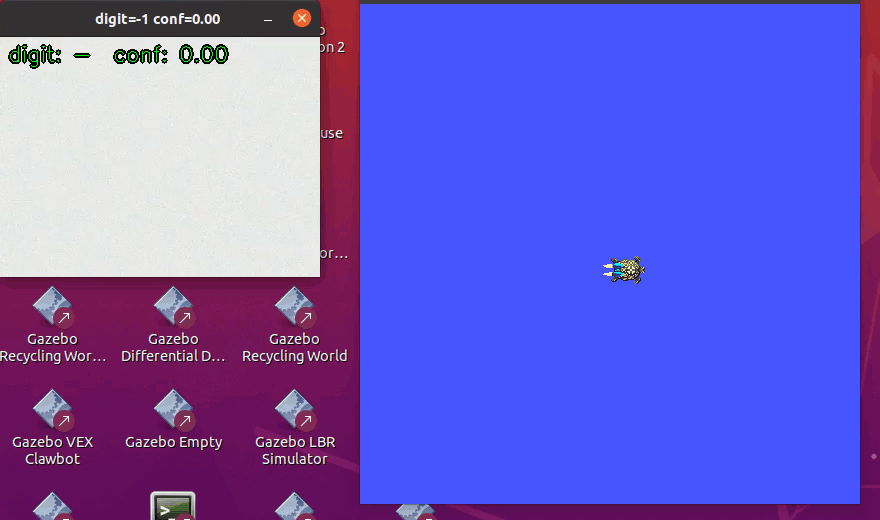

源码位置：`src/ground/mnist_digit_control/`（含 `main.py` 一键入口与 launch 文件）。

## 1. 系统架构

系统由两个 ROS2 节点组成，通过话题解耦，数据流如下：

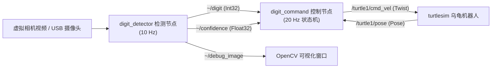

| 话题 | 类型 | 频率 | 说明 |
| --- | --- | --- | --- |
| `/digit_detector/digit` | `std_msgs/Int32` | 10 Hz | 当前帧识别数字，-1 表示未检测到 |
| `/digit_detector/confidence` | `std_msgs/Float32` | 10 Hz | 对应的 softmax 置信度 |
| `/digit_detector/debug_image` | `sensor_msgs/Image` | 10 Hz | 叠加检测框的可视化图像 |
| `/mnist_digit_control/action` | `std_msgs/String` | 事件 | 当前执行动作名（detector 叠加显示） |
| `/turtle1/cmd_vel` | `geometry_msgs/Twist` | 20 Hz | 速度指令 |
| `/turtle1/pose` | `turtlesim_msgs/Pose` | 62.5 Hz | 乌龟位姿（旋转闭环反馈） |

检测节点在 OpenCV 窗口中实时显示识别结果；控制节点把稳定确认后的数字映射为运动动作：

| 数字 | 动作 | 数字 | 动作 |
| --- | --- | --- | --- |
| 2 | 前进 | 8 | 后退 |
| 4 | 左移 | 6 | 右移 |
| 7 | 左转 90° | 9 | 右转 90° |
| 1 | 左转 45° | 3 | 右转 45° |
| 0 | 原地旋转 360° | 5 | 停止 |

## 2. 运行环境（实测）

| 项目 | 版本 |
| --- | --- |
| 系统 | Ubuntu 20.04.6 LTS（VMware 虚拟机，6 核 / 7.7 GB） |
| ROS2 | Humble |
| Python | 3.8.10 |
| PyTorch | 2.4.1+cpu（仅训练与推理） |
| OpenCV / numpy | 4.5.2 / 1.21.0（系统 ROS 自带） |

## 3. 运行步骤

### 3.1 获取源码与安装依赖

```bash
mkdir -p ~/mnist_ws && cd ~/mnist_ws
git clone https://github.com/OpenHUTB/ros2.git src   # 或仅复制 src/ground/mnist_digit_control
cd ~/mnist_ws/src/ground/mnist_digit_control

# PyTorch CPU 版（约 190 MB）；OpenCV/numpy 使用系统 ROS 自带版本
python3 -m pip install -r requirements.txt --index-url https://download.pytorch.org/whl/cpu
```

### 3.2 构建（colcon build）

```bash
cd ~/mnist_ws
source /opt/ros/humble/setup.bash
colcon build --packages-select mnist_digit_control
source install/setup.bash
```

### 3.3 生成演示场景视频（首次运行前）

仓库按约定不入库视频类二进制文件，4 个场景视频用以下命令一键重新生成
（自动下载 MNIST 并合成，约 1~2 分钟，产物在 `src/ground/mnist_digit_control/videos/`）：

```bash
cd ~/mnist_ws/src/ground/mnist_digit_control
python3 main.py scenes
```

训练好的 CNN 权重 `models/mnist_cnn.pth` 已随仓库提交，**无需重新训练**即可运行；
如需复现训练过程，执行 `python3 main.py train`（见 4.1 节）。

### 3.4 一键启动

```bash
# 方式一：main.py 一键入口（首次自动构建）
cd ~/mnist_ws/src/ground/mnist_digit_control
python3 main.py

# 方式二：launch 启动
ros2 launch mnist_digit_control mnist_digit_control.launch.py

# 指定其他场景视频 / 真实摄像头：
ros2 launch mnist_digit_control mnist_digit_control.launch.py \
    source:=video source_path:=/abs/path/scene_rotated.mp4
ros2 launch mnist_digit_control mnist_digit_control.launch.py source:=webcam
```

launch 文件会同时启动 `turtlesim_node`、`detector`、`commander` 三个可执行项，并自动定位包内的
模型权重与默认场景视频（优先 `scene_paper.mp4`）。

### 3.5 运行现象

启动后约 2~3 秒（PyTorch 导入）出现两个窗口：左侧为检测节点可视化，右侧为 turtlesim。
以默认 `scene_paper.mp4` 视频源为例，完整运行日志如下（终端截图）：

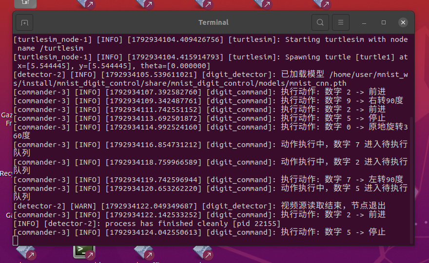

关键日志解读：

- `数字指令控制节点就绪，等待识别数字……`：控制节点 20 Hz 状态机开始运行；
- `已加载模型 …/mnist_cnn.pth`：CNN 权重加载完成，检测节点开始以 10 Hz 处理视频帧；
- `执行动作: 数字 2 -> 前进`：数字连续 6 帧稳定且置信度 ≥ 0.7，触发动作；
- `动作执行中，数字 7 进入待执行队列`：360° 旋转等长动作执行期间到达的稳定数字被排队，
  动作结束后依次执行（详见 5.4 节）；
- `视频源读取结束，节点退出`：视频播放完毕，检测节点干净退出，控制节点继续执行完队列后回到空闲态。

检测节点特写：绿色框为数字外接矩形（绿色 = 置信度过门限，橙色 = 未过门限），
下方橙色文字为控制节点反馈的当前动作名：

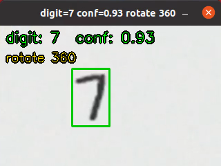

一段演示结束后 turtlesim 画出完整运动轨迹（前进 → 右转 90° → 前进 → 停止 → 360° 旋转 → 左转 90° → 前进 → 停止）：

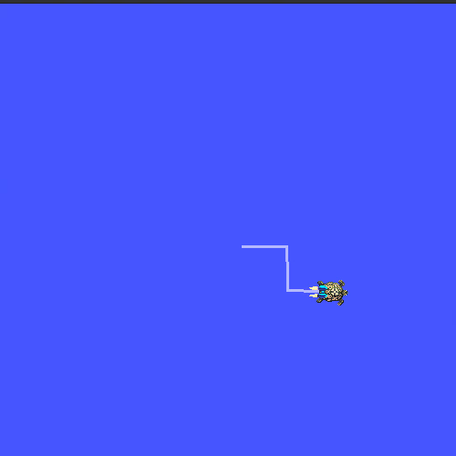

### 3.6 停止与清理

终端按 `Ctrl+C` 退出 launch（SIGINT 会传播到全部三个节点）；异常退出时可清理残留进程：

```bash
pkill -f 'ros2 launch'
pkill -f 'turtlesim_node'
pkill -f 'digit_detector|digit_command'
```

## 4. 训练与离线评价步骤

### 4.1 训练 CNN

```bash
cd ~/mnist_ws/src/ground/mnist_digit_control
python3 main.py train          # 自动下载 MNIST 到 data/mnist/ 并训练
```

超参数与训练曲线（4 epoch，约 31 s，CPU）：

| 参数 | 值 | 参数 | 值 |
| --- | --- | --- | --- |
| 优化器 | Adam | batch size | 128 |
| 学习率 | 0.001 | 随机种子 | 42 |
| 参数量 | 206,922 | 权重文件 | `models/mnist_cnn.pth`（约 0.8 MB） |

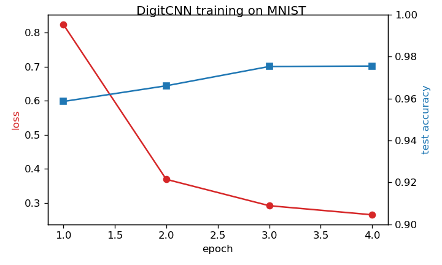

测试集准确率逐 epoch 为 95.86% → 96.61% → 97.53% → **97.55%**。混淆矩阵显示主要混淆集中在
4/9、7/2、9/4 等字形相近类别：

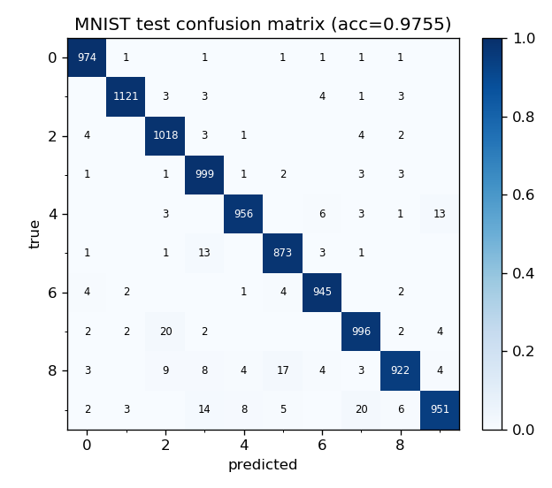

### 4.2 生成多场景虚拟相机视频

测试虚拟机没有摄像头设备，`scripts/make_scene_videos.py` 用 MNIST **测试集**数字合成 4 个场景的
"虚拟相机"视频，模拟真实拍摄条件（背景噪声、模糊、随机位置、旋转、极性反转）：

```bash
python3 main.py scenes
```

| 场景 | 模拟条件 |
| --- | --- |
| `scene_paper.mp4` | 纸质背景 + 深色墨迹数字 |
| `scene_dark.mp4` | 深色背景 + 白色数字（极性反转） |
| `scene_rotated.mp4` | 数字随机旋转 ±10°~25° |
| `scene_screen.mp4` | 深蓝屏幕背景 + 亮绿色数字 |

每个视频按固定指令序列 `[2,9,2,5,0,7,2,5]` 依次显示数字共 16.4 s，并写出帧区间真值
`artifacts/scene_ground_truth.json`。视频开头有 1.2 s 纯背景"空白段"——系统实际运行时节点间
DDS 互相发现需要时间，若视频第 0 帧就出现数字，最早的识别结果可能在对端订阅建立前发布而丢失。

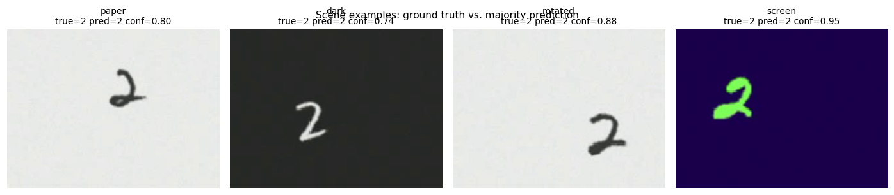

### 4.3 多场景离线评价

```bash
python3 main.py eval
```

### 4.4 控制精度评价

`scripts/evaluate_control.py` 让评价节点扮演"理想检测器"（以置信度 0.95 发布指定数字），
对每种动作重复 3 次并读取 `/turtle1/pose` 测量实际运动：

```bash
python3 scripts/evaluate_control.py
```

## 5. 原理与公式

### 5.1 图像预处理：Otsu 自适应二值化与 MNIST 归一化

真实相机画面背景复杂，检测前需要把数字从背景中分割出来。设灰度图像素灰度 $I(x,y) \in [0,255]$。

**极性自动判断**：用图像四周 5 像素的环带均值 $\bar{b}$ 估计背景亮度。若 $\bar{b} > 127$（浅背景深数字），
用 `THRESH_BINARY_INV`（前景取 1）；否则（深背景亮数字，如白板字、屏幕字）用 `THRESH_BINARY`。
这使得同一个网络可以同时识别"纸上黑字"与"屏幕亮字"。

**Otsu 大津法**：遍历阈值 $t$，把像素分为前景/背景两类，最大化类间方差：

$$
\sigma_B^2(t) = w_0(t)\,w_1(t)\,\big[\mu_0(t) - \mu_1(t)\big]^2, \qquad
t^{*} = \arg\max_{t \in [0,255]} \sigma_B^2(t)
$$

其中 $w_0, w_1$ 为两类像素占比，$\mu_0, \mu_1$ 为两类灰度均值。随后用 3×3 开运算去除孤立噪点，
取**最大连通域**外接矩形（面积 < 60 像素视为无目标，返回 -1）。

**MNIST 风格归一化**：MNIST 训练样本是"白字黑底、数字笔画居中于 20×20、整体画布 28×28"的格式，
推理输入必须与训练分布一致。把裁剪块统一为白字黑底（若亮像素占多数则反相），
补成正方形后缩放到 20×20，居中粘贴到 28×28 黑色画布上。

### 5.2 卷积神经网络

网络结构（输入 $1 \times 28 \times 28$）：

| 层 | 输出尺寸 | 说明 |
| --- | --- | --- |
| Conv2d(1→16, 3×3, pad=1) + ReLU | 16×28×28 | 提取边缘/笔画纹理 |
| MaxPool2d(2) | 16×14×14 | 下采样 |
| Conv2d(16→32, 3×3, pad=1) + ReLU | 32×14×14 | 组合成局部形状 |
| MaxPool2d(2) | 32×7×7 | 下采样 |
| Flatten + Linear(1568→128) + ReLU + Dropout(0.25) | 128 | 分类头 |
| Linear(128→10) | 10 | 类别 logits |

**卷积层**：输出特征图上每个位置是输入局部感受野与卷积核的内积加偏置：

$$
Y_{c_{out}}(i, j) = \sum_{c_{in}=1}^{C_{in}} \sum_{u=-1}^{1} \sum_{v=-1}^{1}
X_{c_{in}}(i+u,\, j+v) \, W_{c_{out}, c_{in}}(u, v) + b_{c_{out}}
$$

**ReLU 激活**引入非线性：$\mathrm{ReLU}(x) = \max(0, x)$。

**最大池化**取 2×2 窗口内最大值，使特征对小的平移鲁棒：
$P(i,j) = \max_{(u,v) \in 2\times2} Y(2i+u,\, 2j+v)$。

**输出层 softmax** 把 10 维 logits $z_k$ 归一化为概率：

$$
p_k = \frac{\exp(z_k)}{\sum_{j=1}^{10} \exp(z_j)}
$$

**训练损失**为交叉熵，配合 Adam 优化器（一阶/二阶矩自适应学习率）最小化：

$$
\mathcal{L} = -\frac{1}{N} \sum_{n=1}^{N} \log p_{y_n}(x_n)
$$

CPU 上单帧前向推理耗时约 0.2 ms（实测见 8.1 节），远快于 10 Hz 的处理节拍。

### 5.3 指令防抖与状态机

单帧识别不可靠（噪声帧、过渡帧会瞬间误识），控制节点用**滑动窗口多数投票**确认指令：
维护最近 `stable_frames=6` 个识别结果，仅当窗口全为同一数字 $d$ 且置信度 $c \ge 0.7$ 时触发。
状态机如下：

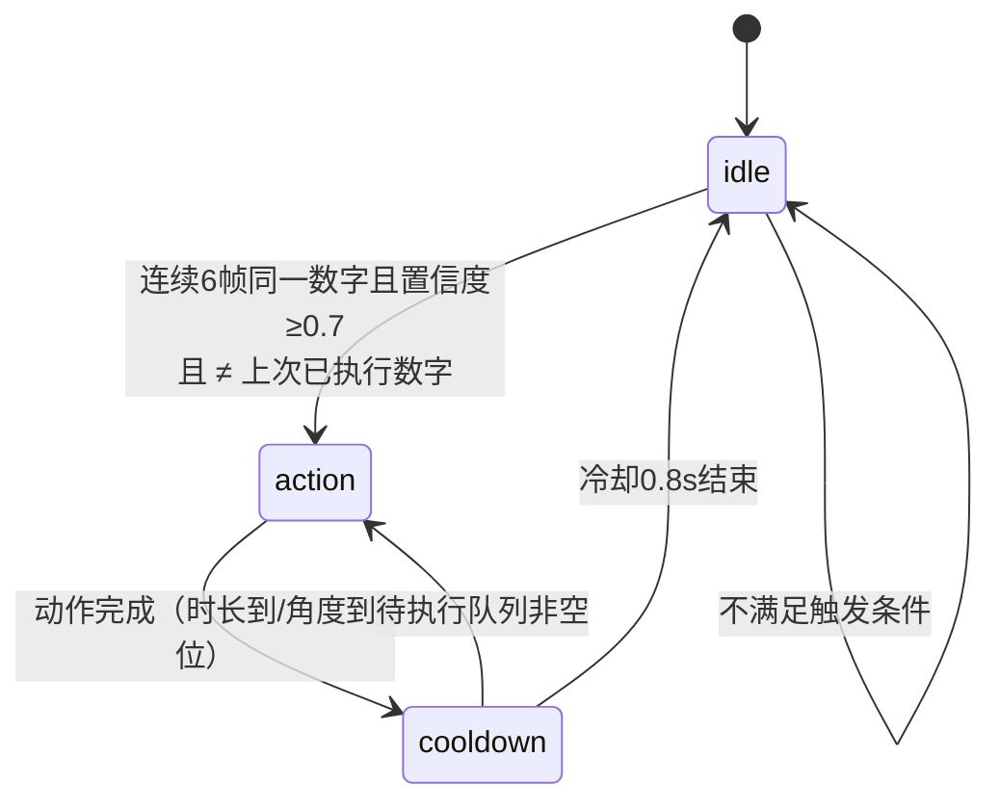

两条防重复/防丢指令规则（对应源码 `_on_digit`）：

1. **边沿触发**：`last_executed` 记录上次触发的数字，同一数字持续出现只执行一次；
   连续 ≥ 3 帧未检测到数字（`miss_count ≥ 3`）后复位，允许同一数字再次触发。
2. **待执行队列**：动作执行期间（`state == "action"`）到达的稳定数字进入 `pending` 队列，
   冷却结束后立即执行，避免 360° 旋转这类约 4.8 s（含冷却）的长动作吞掉期间到来的指令。

### 5.4 旋转闭环 P 控制

平移动作为 1 s 定时长的开环速度脉冲（turtlesim 体坐标平移）。旋转动作则基于位姿反馈闭环。
设目标转角 $\theta_{ref}$（如 ±45°、±90°、360°），每拍累加乌龟实际转角并计算误差：

$$
\Delta\theta_k = \mathrm{wrap}\big(\theta_k - \theta_{k-1}\big), \qquad
e_k = \theta_{ref} - \sum_{i \le k} \Delta\theta_i
$$

其中 `wrap` 把角差展开到 $(-\pi, \pi]$，保证 90° 以内的转角走最短方向：

$$
\mathrm{wrap}(a) = \big( a + \pi \big) \bmod 2\pi - \pi
$$

**比例（P）控制律**，输出限幅到 $\omega_{max} = 2.0\ \mathrm{rad/s}$：

$$
\omega_k = \mathrm{clip}\big(K_p \, e_k,\ -\omega_{max},\ +\omega_{max}\big), \qquad K_p = 3.0
$$

当 $|e_k| < \varepsilon$（$\varepsilon = 0.03\ \mathrm{rad} \approx 1.7°$）连续 3 拍成立视为到位。
注意到位后必须**显式发布零速指令**：turtlesim 会保持最后一次收到的速度继续运动，
若验证帧不发指令，乌龟会冲过容差并在极限环附近震荡。

### 5.5 turtlesim 运动学

turtlesim 是二维差速式运动学模型，收到 $(v_x, v_y, \omega)$ 后按当前朝向积分位置：

$$
\dot{x} = v_x \cos\theta - v_y \sin\theta, \qquad
\dot{y} = v_x \sin\theta + v_y \cos\theta, \qquad
\dot{\theta} = \omega
$$

 turtlesim 以约 62.5 Hz 更新位姿并发布 `/turtle1/pose`，控制节点以 20 Hz 发布速度指令。

## 6. 算法流程

### 6.1 检测节点（10 Hz 定时回调）

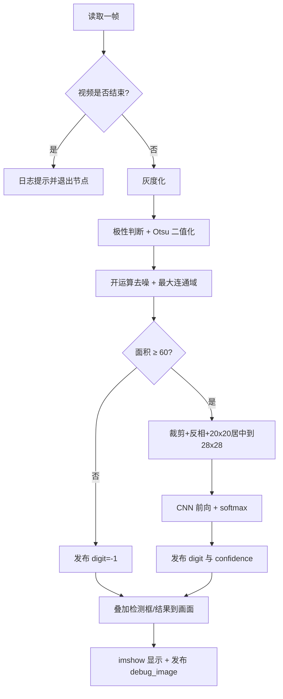

### 6.2 控制节点（20 Hz 状态机 tick）

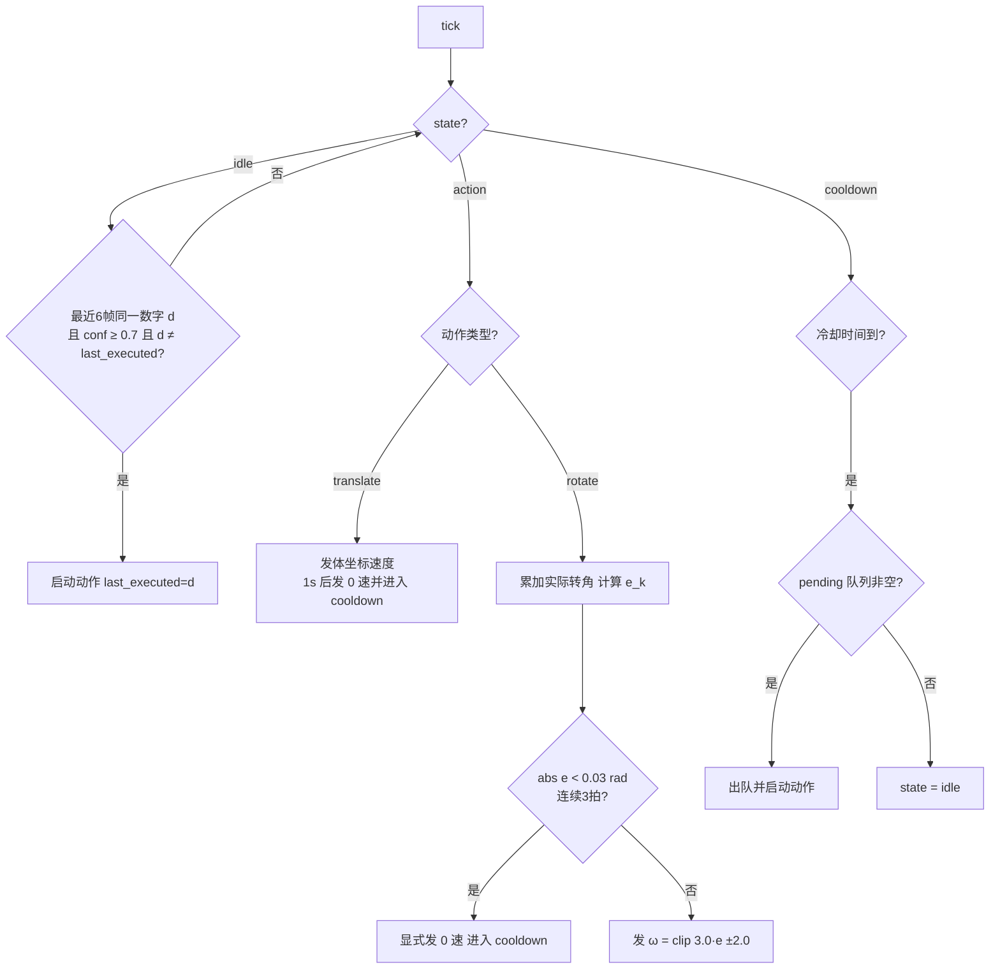

## 7. 源码解析

完整源码见 [`src/ground/mnist_digit_control/`](https://github.com/OpenHUTB/ros2/tree/master/src/ground/mnist_digit_control)，
这里解析三个核心片段。

### 7.1 预处理：极性判断 + Otsu（`preprocess.py::extract_digit`）

```python
# 用边缘一圈估计背景亮度，判断极性
border = np.concatenate([
    frame_gray[0:5, :].ravel(), frame_gray[-5:, :].ravel(),
    frame_gray[:, 0:5].ravel(), frame_gray[:, -5:].ravel(),
])
bg_mean = float(border.mean())
# 浅背景深数字 -> 前景取反（INV）；深背景亮数字 -> 直接取前景
flags = cv2.THRESH_BINARY_INV + cv2.THRESH_OTSU if bg_mean > 127 else cv2.THRESH_BINARY + cv2.THRESH_OTSU
_, binary = cv2.threshold(frame_gray, 0, 255, flags)
```

`cv2.threshold` 的阈值参数传 0 时由 `THRESH_OTSU` 标志自动计算 5.1 节的最优阈值 $t^{*}$。
之后开运算、取最大连通域、外接矩形四周扩边 10%（给笔画留边），交由
`_normalize_mnist` 完成 20×20 居中归一化。

### 7.2 CNN 推理（`detector_node.py::tick`）

```python
digit28, box = extract_digit(gray)          # 预处理得到 28x28 输入
digit, conf = -1, 0.0
if digit28 is not None:
    x = torch.from_numpy(digit28.astype(np.float32)[None, None] / 255.0)
    with torch.no_grad():
        logits = self.model(x)
        probs = torch.softmax(logits, dim=1)[0]
    conf, digit = float(probs.max()), int(probs.argmax())
self.pub_digit.publish(Int32(data=digit))   # -1 表示未检测到
self.pub_conf.publish(Float32(data=conf))
```

输入张量归一化到 $[0,1]$（与训练一致），`no_grad` 关闭梯度记录以省内存；
`digit=-1` 与"未过置信门限"在下游语义不同：前者表示"目标消失"（用于复位防重复锁），
后者表示"看到了但不确定"。

### 7.3 旋转闭环与零速保持（`command_node.py::_step_action`）

```python
dtheta = wrap_angle(self.pose.theta - self.yaw_prev)   # 最短角差展开
self.yaw_prev = self.pose.theta
self.yaw_accum += dtheta                               # 累计实际转角
err = target - self.yaw_accum
if abs(err) < self.tol:
    self.on_target_ticks += 1
    # 必须显式发布 0 速：turtlesim 会保持上一次速度继续转，
    # 若验证帧不发布指令，误差会在容差附近形成极限环震荡
    self._publish_twist(0.0, 0.0, 0.0)
    if self.on_target_ticks >= 3:
        return False                                    # 动作完成
else:
    self.on_target_ticks = 0
    w = max(-self.w_max, min(self.w_max, self.kp * err))  # P 控制律 + 限幅
    self._publish_twist(0.0, 0.0, w)
```

## 8. 多场景测试与性能评价

!!! note "指标定义"

    - **原始识别准确率**：每段数字显示区间内，帧级识别结果的众数等于真值的段数占比（16 帧/段）；
    - **门限后准确率**：众数按"置信度 ≥ 0.7 的帧"重新投票后的准确率（低于门限记为 -1，即拒绝识别）；
    - **检测率**：段内有效前景帧占比（未把数字分割出来的帧记为漏检）；
    - **平均置信度 / 单帧推理耗时**：段内所有有效帧的均值，耗时在 6 核 VM 的 CPU 上测得。

### 8.1 多场景识别性能

4 个场景 × 8 段数字，共 32 段、512 个评价帧（每段 16 帧，`scene_eval.json`）：

| 场景 | 原始识别准确率 | 门限后准确率 | 检测率 | 平均置信度 | 单帧推理耗时 (ms) |
| --- | ---: | ---: | ---: | ---: | ---: |
| scene_paper（纸面黑字） | 100.00% | 100.00% | 100.00% | 0.894 | 0.20 |
| scene_dark（深底白字） | 87.50% | 87.50% | 100.00% | 0.887 | 0.18 |
| scene_rotated（旋转 ±10°~25°） | 100.00% | 87.50% | 100.00% | 0.849 | 0.21 |
| scene_screen（屏幕亮字） | 100.00% | 100.00% | 100.00% | 0.962 | 0.22 |
| **平均** | **96.88%** | **93.75%** | **100.00%** | 0.898 | 0.20 |

失败案例分析（各 1 段误识）：

- `scene_dark` 的数字 9 被识别为 7，段平均置信度仅 0.60（低于 0.7 门限），**门限机制正确拒绝**了该误识
  （`gated_majority = -1`），系统不会执行错误动作——这正是置信门限的设计目的；
- `scene_rotated` 的数字 5 原始众数碰巧正确但置信度仅 0.58，同样被门限拒绝，损失一次正确触发。
  旋转是本模型的主要弱点（训练集 MNIST 数字接近直立），后续可通过训练数据随机旋转增广改善。

### 8.2 控制精度

`evaluate_control.py` 对每种动作重复 3 次（共 27 次动作，全部正常完成）：

| 动作 | 标称值 | 实测（3 次均值 ± 最大偏差） |
| --- | --- | --- |
| 右转 45° | -45.0° | 误差 ≤ 1.70° |
| 左转 45° | +45.0° | 误差 ≤ 1.70° |
| 右转 90° | -90.0° | 误差 ≤ 1.70° |
| 左转 90° | +90.0° | 误差 ≤ 1.70° |
| 原地旋转 360° | 360.0° | 误差 ≤ 1.70° |
| 前进/后退/左移/右移 | 位移 1.0 | 0.944 ~ 0.992 |

旋转闭环在 45°/90°/360° 三种目标下稳态误差都不超过 1.70°（即容差 0.03 rad）；
平移位移偏差约 1%~6%，来自 turtlesim 的 62.5 Hz 离散积分与动作启动延迟，
属开环动作的预期精度。下图左为连续 3 次"左转 90°"的航向跟踪曲线（约 1.8 s 平滑收敛、无超调），
右为各动作误差统计：

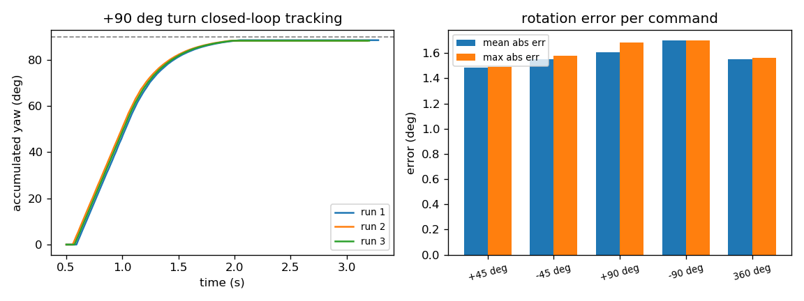

### 8.3 演示实测（GIF 录制对应的完整闭环）

默认 `scene_paper.mp4` 源下指令序列 `[2,9,2,5,0,7,2,5]` 的 **8/8 个指令全部触发执行**
（见 3.5 节终端日志）。其中 360° 旋转（约 4.8 s）执行期间到来的数字 7、2、5 被**待执行队列**
保存并在动作结束后依次执行，无指令丢失。

## 9. 已知问题与调参记录

调试过程中发现并修复的三个典型问题，供复现者参考：

1. **长动作吞指令 → 待执行队列**。最初 360° 旋转执行期间到来的数字会被直接丢弃。
   根因是状态机在 `action` 态只执行当前动作、不缓存新指令；加入 `pending` 队列后（5.3 节），
   长动作期间的稳定识别结果在冷却结束后依次执行。
2. **turtlesim 速度保持 → 显式零速**。turtlesim 收到速度指令后会持续按该速度运动直到下一条指令。
   旋转到位后的"验证帧"若不发指令，乌龟以 $\omega_{max}$ 冲过容差再被拉回，形成极限环；
   在到位验证帧显式发布 $(0,0,0)$ 后消除。
3. **DDS 发现延迟 → 视频起始空白段**。launch 同时拉起三个节点，早期发布的识别结果可能在
   控制节点订阅建立前丢失（表现为第一个指令偶发不触发）。为虚拟相机视频增加 1.2 s 起始空白段后，
   第一个指令稳定触发。

另有一处显示限制：OpenCV 的 `putText` 不支持中文，因此叠加在画面上的动作名使用英文
（如 `rotate 360`），ROS 日志仍输出中文动作名。

## 10. 大模型使用声明

本模块代码与文档在 OpenHUTB 课程任务要求下使用大模型辅助编写，作者已逐行审查、
在 Ubuntu 20.04 + ROS2 Humble 虚拟机中实际运行验证（含训练、多场景评价、控制精度评价与 GIF 录制），
并对提交内容负全部责任。
