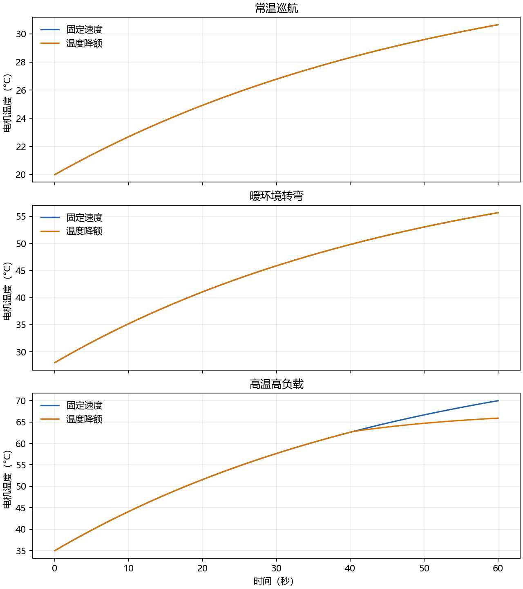

# 电机热场景对比评价

该工具在三个独立配置的环境温度和负载工况中，对比固定速度与温度降额运行。热模型以电流平方作为发热项，并按速度调整散热系数。

## 结果

每步 0.01 秒、共运行 6,000 步时，高温高负载场景下固定速度的峰值温度为 69.951 °C；温度降额后的峰值为 65.889 °C，平均速度从 0.800 降至 0.758 m/s，降额状态占 32.65% 的仿真步。

本次运行汇总见 `../img/ground/motor_thermal_scenario_evaluator/scenario_summary.csv`。

## 验证

测试覆盖六种工况/策略组合、输出行数、曲线生成、非法时长处理，并断言高温高负载降额后峰值温度下降。
