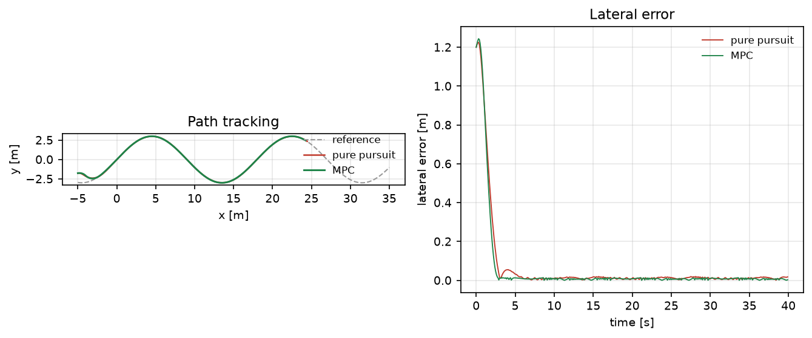
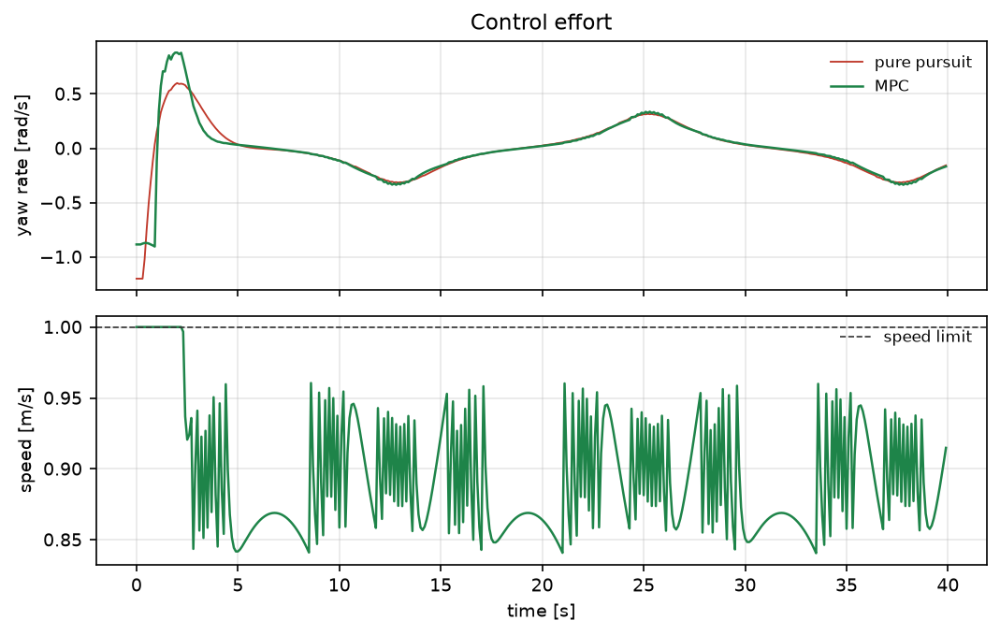

# 线性 MPC 路径跟踪与纯追踪对比

纯追踪靠一个前视点就能跑，但它的角速度容易贴限幅；MPC 把未来 25 步的跟踪误差、控制量和增量放进
一个带箱约束的二次规划里。本模块实现完整的线性时变 MPC（线性化 → 拼接 → QP → 坐标下降），
并在同一条 S 形参考、同一个初始偏差下与纯追踪做定量对比。

与仓库已有模块的区别：

- `ros2_pure_pursuit` 与 `lateral_control_benchmark` 里已有纯追踪/Stanley/LQR，但**没有 MPC**；
- 本模块的重点是约束下的预测控制：偏航角速度最大值 0.904 rad/s，而纯追踪会顶到 1.2 rad/s 限幅；
- 同时给出计算代价（27 ms/step vs 0.06 ms/step），说明什么时候不该用它。

## 1. 方法

### 1.1 模型与线性化

单向车模型

$$
x_{k+1}=x_k+v_k\,dt\cos(\theta_k+\tfrac12\omega_k dt),\quad
y_{k+1}=y_k+v_k\,dt\sin(\theta_k+\tfrac12\omega_k dt),\quad
\theta_{k+1}=\theta_k+\omega_k dt
$$

在每个参考点 $(x_r,u_r)$ 处求雅可比 $A_k=\partial f/\partial x$、$B_k=\partial f/\partial u$，
得线性预测模型。

### 1.2 预测与代价

把 $N=25$ 步的状态写成控制偏差 $\Delta u$ 的仿射函数

$$
\mathbf{x}=\mathbf{x}_{\text{nom}}+S\,\Delta u
$$

目标函数

$$
J=\sum_{k=1}^{N}\lVert \mathbf{x}_k-\mathbf{x}^{ref}_k\rVert_Q^2
+\sum_k \lVert \Delta u_k\rVert_R^2
$$

其中 $Q=\mathrm{diag}(30,30,2)$、$R=0.05$。展开后得到标准型
$\min \tfrac12\Delta u^\top H\Delta u+g^\top\Delta u$，约束为每一步控制偏差的箱约束。

### 1.3 坐标下降求解

箱约束 QP 用循环坐标下降：

$$
\Delta u_i\leftarrow
\mathrm{clip}\!\left(\Delta u_i-\frac{(H\Delta u+g)_i}{H_{ii}},\,l_i,\,u_i\right)
$$

对严格凸问题收敛到全局最优，且不需要因子分解或 active-set 维护；80 轮扫描足够。

### 1.4 参考与控制量

参考速度 0.9 m/s，前馈角速度取 $\omega_{ref}=v\,\kappa(s)$（$\kappa$ 由参考路径的航向-弧长斜率给出），
所以 MPC 求解的是"相对前馈的修正量"，这也是它能稳定跑完整条 S 形曲线的前提。

## 2. ROS 2 接口

| 节点 | 作用 |
|---|---|
| `mpc_reference` | 发布参考路径与预报的闭环轨迹 |
| `mpc_tracker` | 与参考节点共用实现，可独立接入外部 `/odom`（当前为演示入口） |

## 3. 构建与运行

```bash
source /opt/ros/humble/setup.bash
cd ~/hutb_ws
colcon build --symlink-install --packages-select mpc_path_tracking
source install/setup.bash
ros2 launch mpc_path_tracking main.launch.py duration:=20
```

离线：

```bash
cd src/ground/mpc_path_tracking
python3 main.py --out results --figure-dir ../../../docs/img/ground/mpc_path_tracking
python3 -m unittest discover -s tests -v
```

## 4. 结果

环境：Windows 11、Python 3.12.14、NumPy 2.3.5。参考为 40 m 长 S 形曲线，速度 0.9 m/s，
初始横向偏差 1.2 m、航向偏差 20°，控制 10 Hz、仿真 40 s。

| 指标 | 纯追踪 | MPC |
|---|---|---|
| 横向 RMSE | 0.215 m | **0.212 m** |
| 稳态 RMSE（t > 5 s） | 0.013 m | **0.008 m** |
| 收敛到 0.15 m 的时间 | 2.5 s | **2.2 s** |
| 终点误差 | 0.018 m | **0.003 m** |
| 偏航角速度最大值 | 1.200 rad/s（贴限幅） | **0.904 rad/s** |
| 偏航角速度 RMS | 0.245 rad/s | 0.264 rad/s |
| 角速度抖动（差分 RMS） | 0.029 | 0.050 |
| 单步求解耗时 | 0.06 ms | 27.2 ms |





三点结论：

1. 精度上两者接近（0.212 vs 0.215 m），MPC 的稳态误差和终点误差更小；
2. 关键差别在**约束余量**：纯追踪的最大偏航角速度顶到 1.2 rad/s 限幅，MPC 只用 0.904 rad/s，
   在同样精度下留出 25 % 的控制余量；
3. 代价是计算量：27 ms/step（10 Hz 下约 27 % 单核占用）且角速度抖动更大（0.050 vs 0.029），
   所以低算力平台或需要极平滑控制时，纯追踪仍然更划算。

## 5. 复现

```bash
cd src/ground/mpc_path_tracking
python3 main.py --out results --figure-dir ../../../docs/img/ground/mpc_path_tracking
python3 -m unittest discover -s tests -v    # 11 项
```

| 文件 | 内容 |
|---|---|
| `mpc_path_tracking/core.py` | 模型、线性化、QP 拼接、坐标下降求解 |
| `mpc_path_tracking/scene.py` | S 形参考、闭环仿真、纯追踪基线、指标 |
| `mpc_path_tracking/headless.py` | 实验与 `results/summary.json` |
| `mpc_path_tracking/plotting.py` | 两张图 |
| `mpc_path_tracking/nodes.py` | 参考与跟踪节点 |
| `results/summary.json` | 本文全部数值 |

## 6. 限制

1. 线性时变 MPC + 一阶线性化，未做实时迭代（RTI）或非线性 MPC；大偏差时线性化误差明显。
2. 箱约束只限幅值，未把加速度作为硬约束（用偏差权重软化），所以速度会短暂到 1.0 m/s。
3. 参考速度恒定，未做曲率相关的速度规划；急弯处会牺牲精度。
4. 坐标下降在 Python 里 27 ms/step，未做热启动与稀疏化；实时实现应换 OSQP 或 C++。
5. 只对比了纯追踪，未与 Stanley/LQR 在同一指标下比较。
6. ROS 2 端只做了 `compileall`、`package.xml` 解析与桩模块联调，未在本机执行 `colcon build` 与 `ros2 launch`。

## 7. 大模型使用声明

使用 DeepSeek Harness（deepseek-flash）辅助完成代码、推导整理、测试与文档。作者核对了线性化雅可比
（与有限差分一致到 1e-5）、QP 最优性条件与坐标下降收敛性，并在本机实际运行了离线实验与 11 项单元测试。
