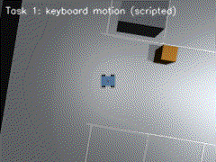
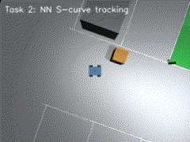
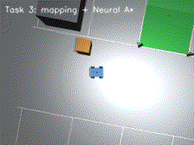

# MuJoCo 自动泊车模块实现文档

> 依据 `pr5-docs` 分支的真实代码（`src/ground/mujoco_auto_parking`：包内 19 个 `.py`、4 个训练脚本、9 个测试、4 个 launch、10 个模型文件）逐文件核对写成。
> 面向对象：想读懂实现、想改代码、想复现结果的人。

---

## 1. 模块概览

一个四轮差速车在 MuJoCo 里完成「键盘遥操 → 感知+轨迹跟踪 → 建图导航 → 端到端视觉控制」四级递进任务。四个任务共用同一套仿真基座与同一套纯 NumPy 神经网络栈，区别只在**控制信号的来源**：

| 任务 | 控制信号来源 | 感知输入 | 关键算法 |
| --- | --- | --- | --- |
| ① 键盘遥操 | 按键 | 无 | 差速运动学 |
| ② 感知+轨迹跟踪 | MLP 回归 | LiDAR 120 束 / 32×24 图像 | 纯跟踪 + 神经网络 |
| ③ 建图导航 | MLP 跟随规划路径 | LiDAR 建图 | 占据栅格 + Neural A* |
| ④ 图像端到端 | CNN 回归 | 84×84 灰度图 | 行为克隆 |

**技术特征**

- 无 PyTorch / TensorFlow / OpenCV 依赖，网络前向与反向传播全部手写（`nn_core.py` 提供 MLP + Adam，`end_to_end_networks.py` 提供卷积算子）。
- 无 Gazebo、无 Nav2，SLAM 与规划都是自实现，代码可读性优先于工程完备性。
- 每个任务都有「训练网络 vs 零权值」消融，用来证明控制量确实来自学习而不是硬编码。

## 2. 目录结构

```
src/ground/mujoco_auto_parking/
├── mujoco_auto_parking/          # Python 包（19 个 .py，含 __init__.py）
│   ├── simulator.py              # MuJoCo 适配层
│   ├── kinematics.py             # 差速运动学 + 指令看门狗
│   ├── camera_sensor.py          # 离屏 RGB/深度渲染
│   ├── lidar_sensor.py           # 射线投射 2D 雷达
│   ├── nn_core.py                # NumpyMLP + Adam + npz 存取
│   ├── keyboard_teleop_node.py   # 任务① 节点
│   ├── parking_perception.py     # 任务② 感知网络（雷达/图像两套）
│   ├── perception_node.py        # 任务② 感知节点
│   ├── trajectory_control.py     # 任务② 控制网络 + 专家律
│   ├── trajectory_control_node.py # 任务② 控制节点
│   ├── occupancy_map.py          # 任务③ 占据栅格
│   ├── neural_path_planner.py    # 任务③ A* / Neural A*
│   ├── navigation.py             # 任务③ 编排层
│   ├── navigation_node.py        # 任务③ 节点
│   ├── end_to_end_networks.py    # 任务④ 卷积网络
│   ├── end_to_end_node.py        # 任务④ 节点
│   ├── simulation_node.py        # 仿真主节点
│   └── resources.py              # 包内路径解析
├── launch/                       # main / task2 / task3 / task4
├── models/                       # MJCF 场景 + 训练好的 npz + 训练日志
├── train/                        # 4 个训练脚本
├── test/                         # 9 个测试
├── tools/                        # GIF 录制、Word 导出、一键回归
├── main.py / main.sh             # CLI 入口
└── config/simulation.yaml        # 运行时参数
```

## 3. 环境与构建

| 组件 | 版本 |
| --- | --- |
| Ubuntu | 22.04（本项目在 WSL2 中实测） |
| ROS 2 | Humble |
| Python | 3.10 |
| MuJoCo | 3.12.0 |

```bash
cd <仓库根目录>                       # 仓库根即 colcon 工作空间
source /opt/ros/humble/setup.bash
colcon build --packages-select mujoco_auto_parking --symlink-install
source install/setup.bash
cd src/ground/mujoco_auto_parking
```

运行依赖只有三个：`mujoco`、`numpy`、`PyYAML`（见 `requirements.txt`）。文档与工具链的依赖单独放在 `tools/requirements-docs.txt`。

**WSL2 必读**：MuJoCo 默认 GLFW 离屏上下文在 WSL 下可能崩，且崩溃是**静默**的——`CameraSensor._init_renderer` 会跳过渲染，`render_rgb` 返回全黑图。此时任务④的网络看到全 0 输入，输出退化为常量 `v=0.225`。脚本 `main.sh` 默认设 `MUJOCO_GL=osmesa`，桌面或 WSLg 环境可用 `--gui` 切回 `glfw`。

### CLI 一览（`main.py`）

```
--launch           任务①仿真 + 键盘
--task2            任务②感知与轨迹控制
--task3            任务③建图与导航
--task4            任务④端到端控制
--test             任务①测试
--test-sensors     传感器测试
--test-nn          任务②网络测试
--test3            任务③测试
--test4            任务④闭环 + 消融
--eval-trajectory  轨迹跟踪评估
--train            重训任务②控制网络
--train-planning   训练 Neural A*
--train-e2e        训练端到端 CNN
--pytest           全部 pytest
--check-model      检查 MJCF 对象
--gui              切 glfw 渲染后端
```

## 4. 仿真基座

### 4.1 场景模型

`models/parking_lot.xml` 定义场景，关键对象：

| 对象 | 类型 | 位置 | 说明 |
| --- | --- | --- | --- |
| `chassis` | body | `(-6, 0, 0.16)` | 车体自由关节起点 |
| `left_front` / `left_rear` / `right_front` / `right_rear` | actuator | `(±0.20, ±0.24, -0.08)` | 四轮，控制量单位 rad/s |
| `front_camera` | camera | `(0.31, 0, 0.06)`，xyaxes `0 -1 0 / 0 0 1` | 任务②④的视觉输入 |
| `overview_camera` | camera | `(0, 0, 12)`，fovy 75 | 俯视录制 |
| `follow_camera` | camera | `(0, 0, 6)`，fovy 60 | 跟随录制 |
| `imu_site` / `lidar_site` | site | `(0,0,0.08)` / `(0,0,0.15)` | 传感器安装点 |
| `target_slot` | site | `(0.25, 3.75, 0.02)` | 目标车位标记（绿色） |

`models/diff_drive.xml` 是纯车体模型，供不需要场景的单元测试使用。

### 4.2 `MujocoSimulation`：仿真适配层

对外只暴露 6 个语义化方法，把 MJCF 的 id 查找、自由关节索引、执行器限幅全部封装掉：

| 方法 | 作用 |
| --- | --- |
| `apply_wheel_speeds(left, right)` | 左轮 → 前左/后左，右轮 → 前右/后右；按 `actuator_ctrlrange` 逐轮裁剪 |
| `step()` | 推进一个物理步（`model.opt.timestep`） |
| `reset()` | 恢复初始 qpos/qvel，ctrl 清零 |
| `set_pose(x, y, yaw)` | 瞬移车体，qvel 清零，用于测试与训练起点 |
| `planar_state()` | 读 `xpos`/`xquat` 得平面位姿，读局部速度得 v/ω |
| `chassis_quaternion()` | 供 TF 发布 |

两个设计细节值得注意：

1. **平面状态用 `xpos`/`xquat` 而不是 qpos**。qpos 是关节空间坐标，`xpos` 是全局位姿，四轮悬挂姿态变化不会污染平面状态。
2. **速度取局部坐标系**（`mj_objectVelocity(..., flg_local=1)`），`velocity[3]` 是沿车头方向线速度，`velocity[2]` 是 yaw 角速度。这样任务②④的特征与标签不依赖车头朝向，网络学到的量是无量纲的相对误差。

### 4.3 `simulation_node`：仿真主节点

| 参数 | 代码默认 | yaml 实际 | 说明 |
| --- | --- | --- | --- |
| `model_file` | `models/parking_lot.xml` | 同 | |
| `wheel_radius` / `track_width` / `max_wheel_speed` | 0.08 / 0.48 / 8.0 | 同 | 与 `DriveGeometry` 一致 |
| `command_timeout` | 0.5 | 同 | 超时无指令则归零 |
| `sim_rate` | **500.0** | **200.0** | yaml 覆盖，实际 200 Hz |
| `publish_rate` | 50.0 | 同 | 状态发布频率 |
| `sensor_publish_divider` | 5 | 同 | 传感器每 5 个 tick 发一次 → **10 Hz** |
| `camera_width/height` | 320 / 240 | 同 | |
| `lidar_beams` / `lidar_range` | 120 / 8.0 | 同 | |
| `enable_camera` / `enable_depth` | True / True | 同 | |

发布 `/odom`、`/clock`、`/tf`、`/camera/image_raw`、`/camera/depth`、`/scan`；订阅 `/cmd_vel`。

`sim_rate` 这一处代码默认值与 yaml 值不同，容易被误读：**看 yaml 的那份，实际跑的是 200 Hz**。

### 4.4 传感器

**`Lidar2D`** — 不用 MuJoCo 自带 raycast，自己对 120 条射线做几何求交：

```
num_beams 120，fov 360°，min_range 0.12 m，max_range 8.0 m
sensor_offset (0, 0, 0.15)，noise_std 0（默认无噪声）
```

360° 覆盖、无噪声是刻意选择：任务②③要验证「网络能不能从几何里学到位姿」，加噪声会把误差来源混在一起。

**`CameraSensor`** — 包装 `mujoco.Renderer`，提供 `render_rgb()` / `render_depth()` / `create_image_msg()`。渲染初始化失败时不抛异常，而是降级成占位图（全黑 RGB、满量程深度），保证上层逻辑不因渲染环境缺失而中断。

### 4.5 运动学与指令看门狗

`DriveGeometry.wheel_speeds(v, ω)`：

```python
left  = (v - 0.5 * track_width * ω) / wheel_radius
right = (v + 0.5 * track_width * ω) / wheel_radius
# 若峰值超过 max_wheel_speed，按比例缩放两轮
```

限幅用**等比缩放**而不是逐轮裁剪——逐轮裁剪会改变左右轮速比，等于偷偷改掉转弯半径；等比缩放保持转向几何不变，只是整体减速。这是差速车限幅的正确做法。

`CommandWatchdog(timeout=0.5)`：记录最后一次有效指令的时间戳，超时后 `current()` 返回 `(0, 0)`。作用是话题断流时车不会带着最后一帧指令一直跑。

## 5. 任务①：键盘遥操

`keyboard_teleop_node.py`，节点名 `keyboard_teleop_node`。

| 参数 | 默认 |
| --- | --- |
| `linear_speed` | 0.35 m/s |
| `angular_speed` | 0.9 rad/s |
| `publish_rate` | 20 Hz |

| 按键 | 动作 |
| --- | --- |
| W / ↑ | 前进 |
| S / ↓ | 后退 |
| A / ← | 左转 |
| D / → | 右转 |
| 空格 / 0 | 急停 |
| Q / Esc | 退出 |

按键映射 → 生成 `(v, ω)` → 发布 `/cmd_vel`（Twist，队列 10）。定时器 20 Hz 重发，保证 `command_timeout=0.5` 之内始终有指令；松开按键发零速度。

键盘节点需要真实终端；由 launch 启动时如果没有 TTY，会只发布零速度，这种情况可以在另一个终端单独跑：

```bash
ros2 run mujoco_auto_parking keyboard_teleop_node
```

不按键也可以直接发一帧速度验证链路：

```bash
ros2 topic pub --once /cmd_vel geometry_msgs/msg/Twist \
  "{linear: {x: 0.35}, angular: {z: 0.0}}"
```

观察画面用 `rqt_image_view` 订阅 `/camera/image_raw`。

这一层的意义是提供**人工可验证的基线**：如果键盘都开不动，问题在仿真层而不在算法层。



> 动图见 [task1_teleop.gif](../img/ground/mujoco_auto_parking/task1_teleop.gif)（3.6 MB）。

## 6. 任务②：感知 + 轨迹跟踪

链路上有两条独立网络，串起来构成「看图/看雷达 → 输出速度」。

### 6.1 感知网络：从 LiDAR 回归车位相对位姿

```
PERCEPTION_SIZES = (120, 64, 64, 4)
输入   120 束归一化距离（r / 8.0，NaN→8.0，逐束裁剪到 [0, 8]）
输出   [dx/5, dy/5, sin(dθ), cos(dθ)]，tanh
解码   dx = out0 * 5, dy = out1 * 5, dθ = atan2(out2, out3)
```

两个工程细节：

1. **角度用 sin/cos 双分量编码**。直接回归 `dθ` 会在 ±π 处出现数值跳变（-3.14 与 +3.14 相邻但损失巨大），sin/cos 编码让误差连续，`atan2` 解码天然处理绕圈。
2. **输入重采样**。`perception_features` 用 `np.interp` 把任意长度扫描重采样到固定的 120 束，雷达配置变了不用改网络。

另有一套视觉感知 `ImagePerceptionNetwork`：`32×24×3 = 2304 → 128 → 64 → 4`，同一个解码头。`perception_node` 默认用视觉那套（`models/perception.npz`），发布 `/parking/perception`（Float64MultiArray），数据为 `[dx, dy, dθ, 1.0]`——第 4 位是代码里硬编码的 `1.0` 占位，**不是**网络输出的置信度，订阅方不要按置信度解释。

### 6.2 控制网络：从跟踪误差到速度

```
CONTROL_SIZES = (5, 64, 64, 2)
特征  [ex/1.0, ey/0.5, eψ/π, v/1.0, v_ref/0.6]      车体系误差 + 当前速度 + 参考速度
输出  v = v_ref * (out0 + 1) / 2      裁剪到 [0, 1.1 * v_ref]
      ω = 1.2 * out1                  裁剪到 ±1.2
```

特征全部无量纲化（除以各自的量程），使不同起点、不同参考速度下输入分布一致。

**专家律**（`expert_from_features`，训练标签的来源）：

```python
α = wrap(eψ + atan2(ey, 1.0))                         # 合成朝向前视误差
v = v_ref * max(0.15, 1.0 - 0.6 * min(|eψ|, 1.0))     # 偏差越大越减速
ω = 2.0 * v * sin(α)                                   # 纯跟踪律，前视距离 1.0 m
ω = clip(ω, -1.2, 1.2)
```

这是「纯跟踪（pure pursuit）」的解析形式，不是神经网络——**专家是规则，学生是网络**，行为克隆的标准配置。

### 6.3 参考轨迹与评估

- `build_s_curve(length=4.0, amplitude=1.0, num_points=200)`：`y = sin(πs/L)` 的 S 形曲线，按起点位姿旋转平移。
- `ReferenceTrajectory.lookahead(x, y, distance=0.8)`：先找最近点，再沿折线累积前进 0.8 m 得到前视目标点。
- `evaluate_tracking(max_time=15.0)`：闭环跑 S 曲线，返回 RMSE、最大误差、航向 RMSE、是否到达。

> 15 s 窗长是任务②的设定。恒定 0.225 m/s 跑满 15 s 只有 3.375 m，够不到 4.0 m 曲线末端，所以零权值判「未到达」。任务④的同类消融用 20 s，两表数字不可横向比较。

### 6.4 节点

`trajectory_control_node` 参数：`trajectory='s_curve'`、`v_ref=0.45`、`control_rate=20.0`；订阅 `/odom`（用里程计当位姿），发布 `/cmd_vel`。

### 6.5 实测结果

环境：WSL Ubuntu 22.04 + ROS 2 Humble + MuJoCo 3.12（2026-10-18）。

| 项 | 结果 |
| --- | --- |
| 视觉感知（80 个测试位姿） | MAE dx 0.34 m、dy 0.20 m、dθ 0.05 rad |
| 视觉感知零权值消融 | dθ 误差 2.58 rad |
| 控制网络与几何专家 | 相关系数 v 0.9989、ω 0.9995 |
| 闭环 S 曲线（训练网络） | RMSE 0.359 m，到达终点 |
| 闭环 S 曲线（零权值） | RMSE 0.704 m，未到达 |

启动：`./main.sh --task2`；训练 `./main.sh --train`；测试 `--test-sensors`、`--test-nn`、`--eval-trajectory`。



> 动图见 [task2_s_curve.gif](../img/ground/mujoco_auto_parking/task2_s_curve.gif)（1.8 MB）。

## 7. 任务③：建图 + Neural A*

### 7.1 占据栅格

```
尺寸    200 × 200，分辨率 0.1 m，原点 (-10, -10)  →  覆盖 20 × 20 m
更新    每条射线用 Bresenham 取格子
        末端之前：log-odds += free_log_odds (-0.4)
        命中末端：log-odds += occupied_log_odds (+0.85)
        整体裁剪到 clamp 区间
```

命中格子加到 +0.85、扫过格子减 0.4，这个不对称设计让障碍格需要**多次命中**才稳定为占据，而空闲格一次扫过就是空闲——对应「漏检比误检更危险」的保守倾向。未探索区域在 `to_occupancy_grid(unknown_as_free=True)` 下按空闲处理，否则起点附近未扫到的格子会把 A* 堵死。

### 7.2 基线 A* 与 Neural A*

`BaselineAStarPlanner(resolution=0.1, clearance_m=0.35)`：8 邻域（直行 1.0、斜行 1.414），先做障碍膨胀（`clearance_cells = ceil(clearance/resolution)`），再用「视线检查」做路径平滑（`_smooth_path` 逐点尝试直连，`_line_of_sight` 判断）。

`NeuralAStarPlanner` 在其上增加一个**神经引导场 Φ(x,y) ∈ [0,1]**：

```
特征 13 维（起点、终点相对位置 + 障碍膨胀图局部统计）
网络 13 → 64 → 32 → 1，隐藏 tanh，输出 sigmoid
用法 f = g + λ * (-Φ)         λ = 0.35
硬约束 Φ[障碍] = 0            不依赖网络精度，安全层由代码保证
```

设计要点：

1. **引导场只影响搜索顺序，不改变可行性**。障碍格被代码强制置 0，即使网络输出错误，A* 仍然不会穿墙。
2. **有解析回退**。`planner_weights.npz` 缺失时退化为椭圆走廊先验（`analytic_guidance`），功能不中断，只是启发式变弱。
3. **提前终止**：扩展点距目标 ≤1.5 格就收尾，末端精确性交给跟踪控制器，省掉最后几格的无意义扩展。

训练脚本 `train_neural_astar.py`：60×60 栅格随机障碍，每个栅格采样 600 组起终点，监督目标是「到目标的最短路径距离场」。

### 7.3 编排层与节点

`NavigationCore` 把三件事串起来：`update_map`（雷达→栅格）→ `plan`（Neural A* → 折线 → 参考轨迹）→ `control`（复用任务②的控制网络跟随）。

`navigation_node` 参数：

| 参数 | 默认 |
| --- | --- |
| `planner_weights` | `models/planner.npz` |
| `controller_weights` | `models/trajectory.npz` |
| `goal` | `'0.25,1.2'` |
| `replan_period` | 1.0 s |
| `control_rate` | 20.0 Hz |
| `map_publish_period` | 1.0 s |

订阅 `/odom`、`/scan`；发布 `/cmd_vel`、`/map`（OccupancyGrid）、`/global_path`（Path）。

注意 `goal` 与 `target_slot` 不同：`target_slot` 在 `(0.25, 3.75)`，`goal` 默认是 `(0.25, 1.2)`——导航目标是车位前方的接近点，不是车位本身。

### 7.4 实测结果

环境同上（2026-10-18）。

| 项 | 结果 |
| --- | --- |
| 上/下两个车位入口目标 | 均在约 14.3 s 到达，终点误差约 0.34 m |
| 建图覆盖率 | 约 55% |
| Neural A* 单次规划 | 约 300 ms，展开节点约 420 |
| 引导场训练验证 | 相关系数 0.99993 |

启动：`./main.sh --task3`，或 `ros2 launch mujoco_auto_parking task3.launch.py goal:=0.25,-1.2` 指定上/下排车位入口；训练引导网络 `--train-planning`；测试 `--test3`。



> 动图见 [task3_navigation.gif](../img/ground/mujoco_auto_parking/task3_navigation.gif)（2.3 MB）。

## 8. 任务④：图像端到端 CNN

### 8.1 网络

```
输入   84×84 灰度（0.299/0.587/0.114 加权，最近邻缩放到 84）
conv1  8 个 5×5，stride 2   → 8×40×40
conv2  16 个 3×3，stride 2  → 16×19×19
pool   2×2 平均池化          → 16×9×9 = 1296
fc1    1296 → 64，ReLU
fc2    64 → 2，tanh
参数   84,514（权值文件另存 img_mean / img_std）
```

卷积用 `im2col` 展开成矩阵乘，反向用 `col2im` 散射累加；池化反向把梯度**均分**回 4 个格。输出层用小初始化（`normal(0, 0.01)`）而不是 He，避免 tanh 初始饱和导致 `1 - out² ≈ 0`、梯度消失。

动作解码：

```
v  = clip(0.45 * (out0 + 1) / 2, 0, 0.45)
ω  = clip(1.2 * out1, -1.2, 1.2)
```

### 8.2 训练

专家是任务②的控制网络，沿 S 曲线在 5 个起点采集，每 0.02 s 控制周期存一帧（每 2 周期取 1 帧），共 1,571 张。标签按上面解码公式反解：`v_label = 2v/0.45 - 1`、`ω_label = ω/1.2`。

25 epoch、batch 32、lr 1e-3、Adam、验证集 20%。训练损失从 0.0358 降到 0.000307，验证 0.000471，最近 200 样本相关系数 v=0.9978、ω=0.9994。

### 8.3 节点

`end_to_end_node` 只订阅 `/camera/image_raw`、只发布 `/cmd_vel`，**不读里程计、不读雷达**。参数：`weights_file`、`architecture`、`image_topic`、`nominal_speed`。

图像解码两个坑（`_on_image` 里已处理）：

1. `message.step` 可能大于 `width*3`（行对齐填充），必须先用 `step` 重排再裁列，直接按 `width*3` reshape 会把图切歪。
2. `bgr8` 必须 `[..., ::-1]` 翻转，否则红蓝通道互换，模型看到的颜色和训练时不一致。

闭环评估 `closed_loop(max_time=20.0)`：CNN RMSE 0.355 m、最大 0.549 m、单帧推理 1.9 ms；零权值 0.684 m / 1.001 m。


> 动图见 [task4_end_to_end.gif](../img/ground/mujoco_auto_parking/task4_end_to_end.gif)（1.8 MB）。

## 9. 节点与话题总表

| 节点（可执行名） | 订阅 | 发布 | 任务 |
| --- | --- | --- | --- |
| `simulation_node` | `/cmd_vel` | `/odom`、`/clock`、`/tf`、`/camera/image_raw`、`/camera/depth`、`/scan` | 底座 |
| `keyboard_teleop_node` | 键盘（非 ROS） | `/cmd_vel` | ① |
| `perception_node` | `/camera/image_raw` | `/parking/perception`（Float64MultiArray，`[dx, dy, dθ, 1.0]`） | ② |
| `trajectory_control_node` | `/odom` | `/cmd_vel` | ② |
| `navigation_node` | `/odom`、`/scan` | `/cmd_vel`、`/map`、`/global_path` | ③ |
| `end_to_end_node` | `/camera/image_raw` | `/cmd_vel` | ④ |

**同一时刻只能有一个节点发布 `/cmd_vel`**。四个 launch 文件各自只起「仿真 + 一个控制节点」的组合，就是为了避免多源抢指令。

## 10. 训练产物

| 文件 | 大小 | 内容 |
| --- | --- | --- |
| `models/perception.npz` | 1.19 MB | 图像感知 2304-128-64-4 |
| `models/trajectory.npz` | 20 KB | 控制网络 5-64-64-2 |
| `models/planner.npz` | 13 KB | Neural A* 引导场 13-64-32-1 |
| `models/e2e_small_cnn_bc.npz` | 333 KB | 端到端 CNN + img_mean/img_std |
| `*_training.csv` | 0.5~3.6 KB | 逐 epoch 训练/验证损失 |

权值与 `img_mean`/`img_std` 必须同文件保存：推理时的归一化依赖训练集统计量，分开存会量纲错位。

## 11. 测试矩阵

| 文件 | 覆盖 |
| --- | --- |
| `test_kinematics.py` | 差速换算、限幅等比、非法输入 |
| `test_resources.py` | 包内路径解析 |
| `test_simulator_contract.py` | MJCF 对象存在性（body/joint/actuator/camera/site） |
| `test_sensors.py` | 雷达角度覆盖、深度量程、图像消息字段 |
| `test_sim_teleop.py` | 模型对象、前进运动、原地转向、相机断言 |
| `test_task2_nn.py` | 感知编码/解码可逆、零权值、控制网络 |
| `test_task3_nav.py` | 栅格更新、A* 可行性、Neural A* 扩展节点数 |
| `test_trajectory_tracking.py` | 跟踪 RMSE 阈值、专家律 |
| `test_task4_e2e.py` | 闭环 RMSE / 到达 / 推理时延 / 零权值更差 |

## 12. 工具链

```bash
./main.sh --train-e2e        # 采集 + 训练 + 落盘
./main.sh --test4            # 闭环 + 消融
./main.sh --gui --launch     # 桌面环境看渲染
tools/make_gifs.py           # 录 4 个任务的 GIF
tools/export_word.py         # 5 篇文档导出 Word（断言五个一级标题齐全）
tools/verify_all.sh          # 一键回归
```

## 13. 已知限制

1. **行为克隆只覆盖 S 曲线**，不是完整倒车入库策略。专家只在这条曲线上示范过，换路线要重新采集。
2. **纯图像对光照/颜色/视角敏感**，当前场景光照固定，换车漆或换天光需重训。
3. **没有显式安全层**：`/cmd_vel` 直接下发，实车部署需外挂最小距离/碰撞保护。
4. **训练与部署分辨率不一致**：任务④训练用 160×120、部署用 320×240，都缩到 84×84；形状对齐但高频细节不同，属于潜在分布偏移。
5. **`target_slot` 与 `goal` 不是同一个点**：`(0.25, 3.75)` 是车位标记，`(0.25, 1.2)` 是导航接近点，改混了会导致导航提前停在车位外。
6. **WSL 渲染静默降级**：初始化失败不报错，只返回全黑图；任务④会退化到恒定输出，且日志里只有一条 WARN 容易漏看。

## 14. 当前范围

| 阶段 | 内容 |
| --- | --- |
| PR1 | 任务①物理仿真、停车场场景、键盘控制、基础 ROS 接口 |
| PR2 | 任务②相机/深度/激光雷达、视觉车位感知网络、给定 S 曲线跟踪、训练与零权值消融 |
| PR3 | 任务③log-odds 占据栅格建图、Neural A* 规划、神经网络路径跟踪与导航闭环 |
| PR4 | 任务④前视图像 → `[速度, 转向]` 端到端 CNN、训练/测试/ROS 封装与闭环消融 |

## 15. 文档与证据

单文件页只讲实现；四个任务的操作步骤与更多截图在分页里：

- [模块总览（课程作业视角）](./mujoco_auto_parking/overview.md)
- [任务①：物理仿真与键盘控制](./mujoco_auto_parking/01_physical_simulation_keyboard.md)
- [任务②：感知与给定轨迹控制](./mujoco_auto_parking/02_perception_trajectory_control.md)
- [任务③：建图与导航](./mujoco_auto_parking/03_slam_navigation.md)
- [任务④：图像端到端控制](./mujoco_auto_parking/04_end_to_end.md)

证据与工具：

- 实测证据：[证据目录与回归日志](../evidence/mujoco_auto_parking/README.md)（4 个训练 CSV 与报告同目录）
- Word 报告：[mujoco_auto_parking_report.docx](../evidence/mujoco_auto_parking/mujoco_auto_parking_report.docx)
- 一键回归：`bash tools/verify_all.sh`（六个入口的退出码写入 `docs/evidence/mujoco_auto_parking/verification/summary.txt`，该目录由脚本运行时创建、未入库）
- GIF 录制：`python3 tools/make_gifs.py`
- Word 导出：`pip install -r tools/requirements-docs.txt` 后运行 `python3 src/ground/mujoco_auto_parking/tools/export_word.py`（脚本会重新打开 docx 并断言五个一级标题都在）
