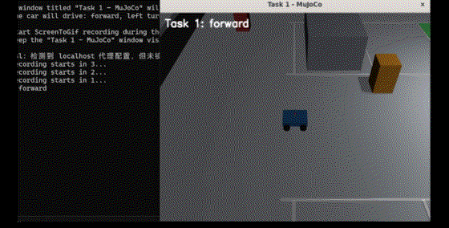
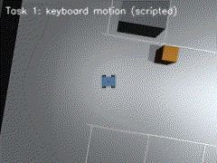
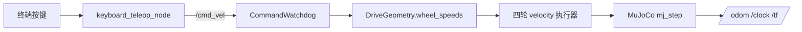

# 任务①：物理仿真与键盘运动控制

> 对应课程任务（1）：对车辆进行物理仿真，通过键盘对机器人进行运动控制。

## 1. 场景与车模

`models/parking_lot.xml` 在同一份 MJCF 中定义：

- 约 20 m × 20 m 的停车场、边界墙、立柱、通道障碍物；
- 上下两排垂直车位、目标车位绿色区域、车位入口的两根绿色立柱；
- 四轮差速小车：车身 0.60 m × 0.42 m × 0.14 m，车轮半径 0.08 m，轮距 0.48 m；
- 前视相机 `front_camera`、俯视相机 `overview_camera`、跟随相机 `follow_camera`、激光雷达安装点 `lidar_site`。

小车初始位姿为 `(-6, 0, 0)`，位于停车场通道西侧，面向 +x。





## 2. 差速运动学

设左右轮角速度为 \(\omega_L,\omega_R\)，车轮半径 \(r\)，轮距 \(b\)，则车体线速度 \(v\) 和角速度 \(\omega\) 为：

\[
v = \frac{r(\omega_L+\omega_R)}{2}, \qquad
\omega = \frac{r(\omega_R-\omega_L)}{b}
\]

给定车体速度指令 \((v,\omega)\)，反解左右轮目标角速度：

\[
\omega_L = \frac{v - \frac{b}{2}\omega}{r}, \qquad
\omega_R = \frac{v + \frac{b}{2}\omega}{r}
\]

`DriveGeometry.wheel_speeds()` 还会按 `max_wheel_speed` 等比例裁剪，避免一侧轮速超限导致比例失真。

## 3. 键盘映射

| 按键 | 动作 | 发布到 `/cmd_vel` |
| --- | --- | --- |
| W / ↑ | 前进 | `linear.x = +0.35` |
| S / ↓ | 后退 | `linear.x = -0.35` |
| A / ← | 左转 | `angular.z = +0.9` |
| D / → | 右转 | `angular.z = -0.9` |
| 空格 / 0 | 急停 | 全零 |
| Q / Esc | 退出 | 全零 |

键盘节点持续以 20 Hz 发布最近一次指令；松开按键不会立刻停，按空格急停。仿真节点还有 0.5 s 的 `CommandWatchdog`，超过 0.5 s 没有新指令会自动归零。

## 4. 算法流程



## 5. 仿真节点

`simulation_node.py` 每 20 ms 触发一次：

1. 从 `CommandWatchdog` 读取当前 \((v,\omega)\)；
2. 调用 `DriveGeometry.wheel_speeds()` 得到左右轮角速度；
3. 连续执行 4 个 5 ms 物理步（200 Hz 物理、50 Hz 发布）；
4. 发布 `/odom`、`/clock`、`/tf`，并按 10 Hz 发布相机/雷达（任务②使用）。

采用墙钟定时器（`use_sim_time: false`），仿真节点自己发布 `/clock` 给其它节点用，避免“等待 `/clock` 导致定时器不触发”的启动死锁。

## 6. 源码解析

| 文件 | 函数/类 | 作用 | 对应公式 |
| --- | --- | --- | --- |
| `models/parking_lot.xml` | `chassis`、四轮 hinge、velocity 执行器 | 车模与执行器 | — |
| `mujoco_auto_parking/simulator.py:30` | `MujocoSimulation` | 加载模型、设位姿、步进、读平面状态 | — |
| `simulator.py:92` | `apply_wheel_speeds()` | 左/右轮速度映射到四个执行器 | \(\omega_L,\omega_R\) |
| `simulator.py:112` | `set_pose()` | 设置 `(x,y,yaw)`，用于测试和训练 | — |
| `simulator.py:126` | `planar_state()` | 读 `x,y,yaw,vx,wz` | — |
| `simulation_node.py:62` | `SimulationNode` | ROS2 仿真节点 | — |
| `simulation_node.py:163` | `_on_timer()` | 每 20 ms 步进并发布 | — |
| `keyboard_teleop_node.py:26` | `command_for_key()` | 键位 → 速度指令 | — |
| `keyboard_teleop_node.py:56` | `KeyboardTeleopNode` | 终端读取与 `/cmd_vel` 发布 | — |

## 7. 运行与测试

```bash
cd ~/auto_parking_ws
source /opt/ros/humble/setup.bash
colcon build --packages-select mujoco_auto_parking --symlink-install
source install/setup.bash
cd src/mujoco_auto_parking
./main.sh --launch
```

无窗口测试：

```bash
./main.sh --test
```

实测输出（2026-10-18，WSL Ubuntu 22.04 + ROS2 Humble + MuJoCo 3.12）：

| 检查 | 结果 |
| --- | --- |
| 模型对象 | 差速车、四轮执行器、前视/俯视/跟随相机、激光雷达安装点、目标车位全部存在 |
| 前进 0.5 s | x 从 -6.000 到 -5.850 m |
| 后退 0.5 s | x 从 -6.000 到 -6.150 m |
| 左转 0.5 s | yaw 从 0 到约 +0.109 rad |
| 右转 0.5 s | yaw 回到约 -0.011 rad |
| 键盘映射 | W/S/A/D/方向键/空格/退出键全部通过 |
| Watchdog | 0.5 s 超时后速度归零 |
| pytest | 18 项通过 |

## 8. 已知限制

- GIF 使用脚本化的“前进—左转—前进—停止”序列，不是人工实时按键；键盘节点本身已在测试中覆盖。
- 轮胎采用 MuJoCo 圆柱几何和默认摩擦，没有单独建模悬架、轮胎侧偏和打滑。
- 任务①只验证运动响应，不涉及感知和规划。
