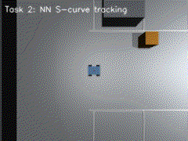
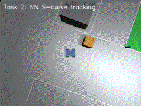

# 任务②：传感器感知与给定轨迹控制

> 对应课程任务（2）：使用传感器获取的数据进行感知，并对机器人进行运动控制（感知 + 给定轨迹的控制）。

本任务包含两个神经网络：

1. **车位视觉感知网络**：前视相机图像 → 目标车位相对位姿 \((dx,dy,d\theta)\)；
2. **给定轨迹控制网络**：车辆跟踪误差 → 速度/转向指令。

## 1. 传感器

| 传感器 | 话题 | 说明 |
| --- | --- | --- |
| 前视相机 | `/camera/image_raw` | RGB8，320×240 |
| 深度相机 | `/camera/depth` | 32FC1，单位 m，最大 10 m |
| 2D 激光雷达 | `/scan` | 120 束，360°，0.12～8 m |
| 里程计 | `/odom` | MuJoCo 真值位姿与速度 |

相机和激光雷达由 `simulation_node` 每 5 次发布（10 Hz）刷新一次；无窗口渲染使用 `MUJOCO_GL=osmesa`。





## 2. 车位感知网络

### 2.1 输入与输出

前视相机图像先降采样到 \(32\times24\) 的 RGB，再展平成 2304 维：

\[
\mathbf{x}=\mathrm{flatten}\left(\mathrm{resize}_{32\times24}(I)\right)/255
\]

网络为 4 层 MLP：

\[
2304 \rightarrow 128 \rightarrow 64 \rightarrow 4
\]

隐藏层 `tanh`，输出层 `tanh`。四个输出编码为：

\[
\left[\frac{dx}{5},\ \frac{dy}{5},\ \sin d\theta,\ \cos d\theta\right]
\]

解码：

\[
dx=5o_0,\qquad dy=5o_1,\qquad d\theta=\operatorname{atan2}(o_2,o_3)
\]

其中 \((dx,dy,d\theta)\) 是目标车位中心在车体系下的相对位置与相对航向。目标车位中心为 \((0.25,3.75)\)，目标航向为 \(-\pi/2\)（车尾朝车位、车头朝通道）。

### 2.2 数据与训练

- 在停车场通道内随机采样 2000 个车体位姿，车头朝向目标车位并叠加 \(\pm0.6\) rad 扰动；
- MuJoCo 渲染前视图像，仿真真值给出标签；
- 80% 训练 / 20% 验证，Adam，学习率 \(10^{-3}\)，batch 128，80 epoch，损失为 MSE；
- 权值保存为 `models/perception.npz`。

训练脚本：`train/train_perception.py`。

### 2.3 实测

| 指标 | 结果 |
| --- | --- |
| MAE \(dx\)（80 个测试位姿） | 0.342 m |
| MAE \(dy\) | 0.202 m |
| MAE \(d\theta\) | 0.054 rad |
| 零权值 \(d\theta\) 误差 | 2.583 rad |
| 推理 | 单帧 MLP，CPU 实时 |

## 3. 给定轨迹控制网络

### 3.1 参考轨迹

在车体初始位姿上生成一条 S 曲线：

\[
x(s)=x_0+s,\qquad y(s)=y_0+A\sin\left(\frac{\pi s}{L}\right),\qquad s\in[0,L]
\]

其中 \(L=4.0\) m、\(A=1.0\) m。航向由切线得到：

\[
\psi(s)=\operatorname{atan2}\left(\frac{dy}{ds},1\right)
\]

`ReferenceTrajectory` 提供最近点与 0.8 m 前视点查询。

### 3.2 网络输入输出

状态特征：

\[
\mathbf{z}=\left[\frac{e_x}{1},\ \frac{e_y}{0.5},\ \frac{e_\psi}{\pi},\ \frac{v}{1},\ \frac{v_{ref}}{0.6}\right]
\]

其中 \(e_x,e_y\) 为参考点在车体系下的纵向/横向误差，\(e_\psi\) 为航向误差。网络：

\[
5 \rightarrow 64 \rightarrow 64 \rightarrow 2
\]

输出经 `tanh` 解码：

\[
v = v_{ref}\cdot\frac{o_0+1}{2},\qquad \omega = 1.2\,o_1
\]

### 3.3 专家与训练

专家采用纯跟踪律：

\[
\alpha=e_\psi+\operatorname{atan2}(e_y,1.0)
\]

\[
v = v_{ref}\max\left(0.15,\ 1-0.6\min(|e_\psi|,1)\right)
\]

\[
\omega = \frac{2v\sin\alpha}{1.0}
\]

在 20000 个随机状态上采样专家动作，训练 80 epoch、batch 256、Adam、MSE。与专家相关系数：

| 输出 | 相关系数 |
| --- | --- |
| \(v\) | 0.9989 |
| \(\omega\) | 0.9995 |

训练脚本：`train/train_trajectory.py`，权值：`models/trajectory.npz`。

### 3.4 闭环实测

| 控制器 | RMSE | 最大误差 | 到达终点 | 用时 |
| --- | --- | --- | --- | --- |
| 训练网络 | 0.359 m | 0.551 m | 是 | 11.6 s |
| 零权值 | 0.704 m | 1.001 m | 否 | 15 s 超时 |

零权值网络输出恒定 \(v=0.225\) m/s、\(\omega=0\)，在 S 弯道上跑偏；训练网络能回到并跟随参考轨迹，说明控制量确实来自网络。

## 4. ROS 2 节点与话题

```bash
./main.sh --task2
```

| 节点 | 订阅 | 发布 |
| --- | --- | --- |
| `simulation_node` | `/cmd_vel` | `/odom`、`/clock`、`/tf`、`/camera/image_raw`、`/camera/depth`、`/scan` |
| `perception_node` | `/camera/image_raw` | `/parking/perception` = `[dx,dy,dtheta,confidence]` |
| `trajectory_control_node` | `/odom` | `/cmd_vel` |

## 5. 源码解析

| 文件 | 函数/类 | 作用 |
| --- | --- | --- |
| `camera_sensor.py:20` | `CameraSensor` | MuJoCo 离屏 RGB/深度渲染 |
| `lidar_sensor.py:9` | `Lidar2D` | `mj_ray` 120 束 2D 扫描 |
| `parking_perception.py:115` | `image_features()` | 图像降采样与展平 |
| `parking_perception.py:45` | `relative_slot_pose()` | 车位相对位姿标签 |
| `parking_perception.py:135` | `ImagePerceptionNetwork` | 加载权值并推理 |
| `perception_node.py:16` | `PerceptionNode` | 图像订阅与感知结果发布 |
| `trajectory_control.py:20` | `build_s_curve()` | 生成 S 曲线 |
| `trajectory_control.py:80` | `TrajectoryController` | 状态特征、推理、专家 |
| `trajectory_control.py:164` | `evaluate_tracking()` | 闭环跟踪评估 |
| `trajectory_control_node.py:24` | `TrajectoryControlNode` | 生成参考轨迹并发布 `/cmd_vel` |
| `train/train_perception.py` | — | 2000 张图像训练感知网络 |
| `train/train_trajectory.py` | — | 2 万样本行为克隆 |

## 6. 已知限制

- 感知依赖目标车位的绿色立柱/绿色区域，换场景需重新采集和训练；
- 感知 \(dx\) 误差约 0.34 m，适合“接近车位”级导航，最终泊入还需要任务③/④的闭环修正；
- 控制网络在给定 S 曲线特征空间上训练，尚未覆盖倒车、档位切换和末端位姿约束；
- 深度相机只发布数据，本任务的感知网络使用的是 RGB 图像。
