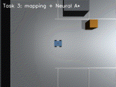
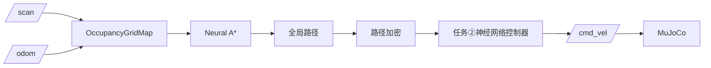

# 任务③：建图与导航（Neural A*）

> 对应课程任务（3）：在虚拟环境中实现对机器人的建图和导航，导航与 SLAM 的同步仿真。

本任务由三部分组成：

1. 2D log-odds 占据栅格建图；
2. Neural A* 全局规划（规划算法为神经网络引导）；
3. 任务②的神经网络轨迹控制器跟踪全局路径，形成导航闭环。



## 1. 占据栅格建图

地图参数：

| 参数 | 值 |
| --- | --- |
| 尺寸 | 200 × 200 |
| 分辨率 | 0.1 m |
| 范围 | \([-10,10]\times[-10,10]\) m |
| 空闲更新 | \(l_{free}=-0.4\) |
| 占据更新 | \(l_{occ}=+0.85\) |
| 截断 | \([-4,4]\) |

每个激光束从机器人当前栅格出发，用 Bresenham 画到命中点：

- 射线经过的格子更新为“空闲”；
- 命中格子更新为“占据”；
- 对数几率累加后截断：

\[
L_t=\operatorname{clip}\left(L_{t-1}+\Delta L,\,-4,\,4\right)
\]

占据概率：

\[
P(occ)=\frac{1}{1+e^{-L_t}}
\]

代码：`occupancy_map.py:30` 的 `OccupancyGridMap.update()`，Bresenham 在 `occupancy_map.py:9`。

## 2. Neural A*

### 2.1 引导场网络

对每个栅格构造 13 维特征：

- 相对目标坐标 2 维；
- 椭圆走廊坐标 1 维；
- 到目标距离 1 维；
- 3×3 邻域占据 9 维。

网络：

\[
13 \rightarrow 64 \rightarrow 32 \rightarrow 1
\]

隐藏层 `tanh`，输出 `sigmoid`，输出值 \(\Phi\in[0,1]\) 表示该栅格位于最优走廊中的概率。

### 2.2 启发式

经典 A*：

\[
f(n)=g(n)+h(n)
\]

Neural A*：

\[
f(n)=g(n)+h(n)\left[1+\lambda\left(1-\Phi(n)\right)\right],\qquad \lambda=0.35
\]

\(\Phi\) 越接近 1，启发式越接近欧氏距离；越接近 0，代价被抬高，搜索会避开这些格子。

### 2.3 训练

训练标签来自解析椭圆走廊先验：

\[
\Phi_{label}=\exp\left(-\frac{d_s+d_g-d_{sg}}{2}\right)
\]

其中 \(d_s,d_g\) 为到起点/终点的距离，\(d_{sg}\) 为起终点距离。障碍栅格标签硬置 0。

- 200 张随机 60×60 栅格，每张采样 600 个自由格；
- 60 epoch、batch 512、Adam、MSE；
- 验证 MSE \(9\times10^{-6}\)，引导场相关系数 0.99993。

训练脚本：`train/train_neural_astar.py`，权值：`models/planner.npz`。

### 2.4 规划对比

合成 80×80 栅格、同一组起终点：

| 规划器 | 展开节点 | 规划时间 | 路径 |
| --- | --- | --- | --- |
| 经典 A* | 1370 | — | 有效 |
| Neural A* | 659 | 66.7 ms | 有效 |

Neural A* 展开节点减少约 52%。

## 3. 导航闭环

`NavigationCore` 每 1 s 重新规划一次：



路径先用 0.2 m 步长加密，再按相邻点方向赋航向，交给 `TrajectoryController` 跟踪。未知栅格在规划时视为可通行，随着车辆前进不断被观测修正。

### 实测

两个场景：上排车位入口 \((0.25,1.2)\)、下排车位入口 \((0.25,-1.2)\)。

| 场景 | 到达 | 用时 | 终点误差 | 建图覆盖 | 最小离障 |
| --- | --- | --- | --- | --- | --- |
| 上排入口 | 是 | 14.3 s | 0.34 m | 55.3% | 0.77 m |
| 下排入口 | 是 | 14.3 s | 0.34 m | 56.9% | 1.32 m |

## 4. ROS 2 节点与话题

```bash
./main.sh --task3
# 指定下排入口：
ros2 launch mujoco_auto_parking task3.launch.py goal:=0.25,-1.2
```

| 节点 | 订阅 | 发布 |
| --- | --- | --- |
| `simulation_node` | `/cmd_vel` | `/odom`、`/scan`、`/clock`、`/tf` |
| `navigation_node` | `/odom`、`/scan` | `/map`、`/global_path`、`/cmd_vel` |

## 5. 源码解析

| 文件 | 函数/类 | 作用 |
| --- | --- | --- |
| `occupancy_map.py:30` | `OccupancyGridMap` | 栅格地图与 log-odds 更新 |
| `occupancy_map.py:66` | `update()` | 逐束 Bresenham 更新 |
| `neural_path_planner.py:35` | `analytic_guidance()` | 椭圆走廊标签 |
| `neural_path_planner.py:48` | `guidance_features()` | 13 维逐格特征 |
| `neural_path_planner.py:123` | `BaselineAStarPlanner` | 经典 A* 基线 |
| `neural_path_planner.py:269` | `NeuralAStarPlanner` | 神经引导 A* |
| `neural_path_planner.py:350` | `NeuralAStarPlanner.plan()` | 带 \(\Phi\) 的搜索 |
| `navigation.py:54` | `NavigationCore` | 建图、重规划、控制 |
| `navigation.py:129` | `run_episode()` | 双场景闭环评估 |
| `navigation_node.py:16` | `NavigationNode` | `/map`、`/global_path`、`/cmd_vel` |

## 6. 已知限制

- 没有回环检测，长距离/大场景会累积里程计漂移；当前停车场约 20 m，误差可控；
- 未知栅格按可通行处理，可能先规划穿过未观测区域，再在重规划中修正；
- 规划器没有显式建模车辆非完整约束，路径跟踪由任务②网络完成；
- 目标设为车位入口，不包含最终倒车入库；最终泊车由任务④的端到端模型演示。
