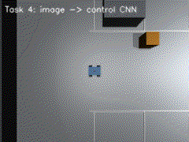
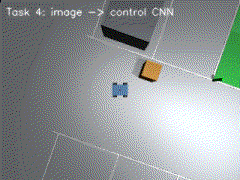

# 任务④：图像端到端控制

> 对应课程任务（4）：每种机器人端到端模型（输入图像、输出控制指令）。

本任务的控制器**只接收前视相机图像**，直接输出速度与转向指令，不读取里程计、不读取激光雷达、不使用手工特征。





## 1. 输入与输出

- 输入：前视相机 RGB 图像 → 灰度 → 最近邻缩放到 \(84\times84\) → 训练集均值/方差归一化；
- 输出：二维动作

\[
\mathbf{a}=[v,\ \omega]
\]

解码：

\[
v=v_{nom}\frac{o_0+1}{2},\qquad \omega=1.2\,o_1
\]

其中 \(v_{nom}=0.45\) m/s，\(o_i\in[-1,1]\) 为 `tanh` 输出。

## 2. 网络结构

`small_cnn`（纯 NumPy 前向/反向）：

```text
84×84×1
  → Conv 5×5, stride 2, 8 通道, ReLU
  → Conv 3×3, stride 2, 16 通道, ReLU
  → 2×2 average pooling
  → FC 64, ReLU
  → FC 2, tanh
```

参数量约 1.2 万，CPU 单帧推理约 1.9 ms。

## 3. 行为克隆训练

### 3.1 专家数据

用任务②的“感知 + 轨迹控制”神经网络作为专家，沿 S 曲线闭环行驶。每个控制步：

- 渲染前视图像；
- 记录专家动作 \((v,\omega)\)；
- 标签归一化：

\[
v_{label}=2\frac{v}{0.45}-1,\qquad \omega_{label}=\frac{\omega}{1.2}
\]

共采集 5 个起点、1571 张图像。

### 3.2 训练

- 损失：MSE；
- Adam，学习率 \(10^{-3}\)，batch 32，25 epoch；
- 训练/验证 80/20；
- 训练 MSE 0.00031，验证 MSE 0.00047；
- 最近 200 样本与专家动作相关系数：\(v\) 0.9978、\(\omega\) 0.9994。

训练脚本：`train/train_e2e.py`，权值：`models/e2e_small_cnn_bc.npz`（含 `img_mean`、`img_std`）。

## 4. 闭环实测

从 \((-6,0,0)\) 出发，只把图像送入 CNN，沿同一条 S 曲线闭环行驶：

| 控制器 | RMSE | 最大误差 | 到达终点 | 单帧推理 |
| --- | --- | --- | --- | --- |
| 端到端 CNN | 0.355 m | 0.549 m | 是 | 1.9 ms |
| 零权值 | 0.684 m | 1.001 m | 是（但明显跑偏） | 1.9 ms |

零权值网络输出恒定 \(v=0.225\) m/s、\(\omega=0\)，RMSE 约为训练网络的 1.9 倍。

## 5. ROS 2 节点

```bash
./main.sh --task4
```

| 节点 | 订阅 | 发布 |
| --- | --- | --- |
| `simulation_node` | `/cmd_vel` | `/odom`、`/camera/image_raw`、`/clock`、`/tf` |
| `end_to_end_node` | `/camera/image_raw` | `/cmd_vel` |

`end_to_end_node` 只依赖图像话题；在 launch 中不启动键盘、感知、导航节点，保证“端到端”链路干净。

## 6. 源码解析

| 文件 | 函数/类 | 作用 |
| --- | --- | --- |
| `end_to_end_networks.py:25` | `IMG_SIZE=84`、`ACTION_DIM=2` | 输入尺寸与动作维 |
| `end_to_end_networks.py:63` | `rgb_to_gray_resize()` | 灰度化与缩放 |
| `end_to_end_networks.py:133` | `NumpyConvNet` | 纯 NumPy 卷积网络 |
| `end_to_end_networks.py:172` | `forward()` | `_im2col` 卷积前向 |
| `end_to_end_networks.py:210` | `backward()` | 手写卷积反向 |
| `end_to_end_networks.py:300` | `train_network()` | Adam + mini-batch 训练 |
| `end_to_end_networks.py:339` | `VisuomotorController` | 权值加载、图像预处理、动作解码 |
| `end_to_end_networks.py:407` | `predict_action()` | 图像 → `[v, ω]` |
| `end_to_end_node.py:16` | `EndToEndNode` | 订阅图像、发布 `/cmd_vel` |
| `train/train_e2e.py` | — | 专家采集与 CNN 训练 |

## 7. 已知限制

- 行为克隆只覆盖 S 曲线演示，不是完整的倒车入库策略；换路线/换场景需要补充专家数据；
- 纯图像输入对光照、颜色和视角变化敏感；当前停车场光照固定；
- 端到端网络没有显式安全层，实际部署应叠加最小距离/碰撞保护；
- 目前使用 CPU 纯 NumPy 推理，实时性满足 10 Hz 相机，但训练速度低于 PyTorch。
