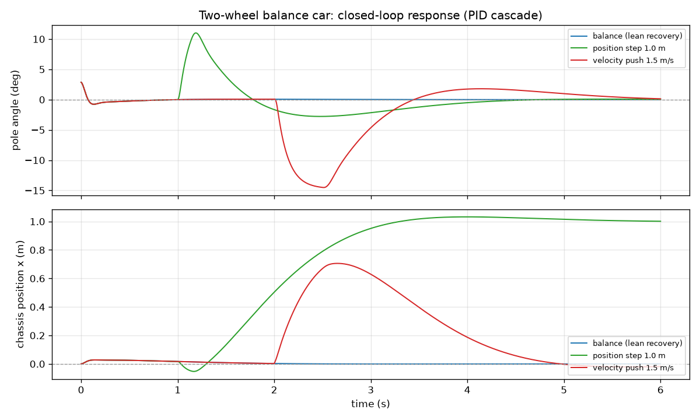
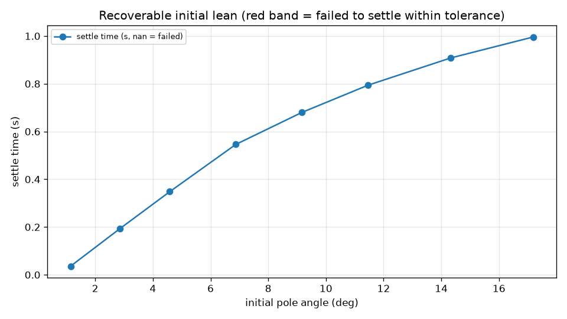

# MuJoCo 两轮自平衡小车 PID 控制仿真

> 地面载具选题：倒立摆两轮车的**双环级联 PID**控制。
> 本文重点不是"能让它站住"，而是**把控制品质变成可复算的数字**：
> 稳定时间、超调、稳态误差、抗扰恢复时间、可恢复倾角边界。

## 1. 项目介绍

基于 MuJoCo 物理引擎实现两轮倒立摆小车：底盘沿 x 滑移、两个车轮由电机驱动、
摆杆绕 y 轴自由转动（模型见
[`balance_car.xml`](https://github.com/OpenHUTB/ros2/blob/master/src/ground/mujoco_balance_car/balance_car.xml)）。
控制采用**双环级联 PID**：

$$
\underbrace{e_x = x^\* - x}_{\text{位置误差}}
\ \xrightarrow[\text{位置环}]{\text{PID}}\
\theta^\* \in [-0.25, 0.25]\ \text{rad}
\ \xrightarrow[\text{倾角环}]{\text{PID}}\
\tau \in [-2, 2]\ \text{N·m}
$$

外环把"位置误差"翻译成"该往哪个方向倾、倾多少"（输出限幅相当于限速），内环负责把
倾角追到这个期望值。**平衡靠内环，位置保持靠外环慢慢把倾角目标收回来。**

模块**不依赖 ROS**，只依赖 `mujoco` + `numpy`；`launch` 只是多一种启动方式。
原因：评测机常没有图形界面，`python3 main.py` 必须在任何机器上都能直接跑通。

### 1.1 与仓库已有模块的区别

| 模块 | 控制算法 | 是否给离线指标 | 是否需要 ROS |
|---|---|---|---|
| [`balance_bot`](../balance_bot/) | 倾角 PD + MLP 策略克隆 | 是（另一套口径） | 是 |
| **本模块** | **双环级联 PID** | **是（稳定时间 / 超调 / 稳态误差 / 抗扰 / 倾角边界）** | **否** |
| [`mujoco_car_avoidance`](../mujoco_car_avoidance/) | 射线感知 + 分级减速 | 是 | 是 |

## 2. 计算原理

### 2.1 为什么双环而不是单环

单环直接把位置误差映射成力矩，只能把车"推向目标"，没法同时保证摆杆不倒——摆杆倒下
以后位置再准也没有意义。级联把两件事分开：外环决定倾角目标（被限幅，相当于限速），
内环负责平衡。

### 2.2 级联 PID 与全状态 PD 等价（调参的关键认识）

把两级 PID 展开，并记底层 `ctrl = −τ`：

$$
\mathrm{ctrl} = k_\theta\,\theta + k_\omega\,\dot\theta
+ k_x\,(x - x^\*) + k_v\,\dot x,
\qquad k_x = k_p^{a}k_p^{p},\ \ k_v = k_p^{a}k_d^{p}
$$

也就是说，**级联 PID 在代数上就是全状态 PD**。实用的结论：调参不必在两个外环增益上
盲试，可以直接对 \((k_\theta, k_\omega, k_x, k_v)\) 做网格搜索，再按
`k_p^p = k_x/k_\theta`、`k_d^p = k_v/k_\theta` 反解回级联形式。

### 2.3 电机符号：为什么底层要取反

底盘只能沿 x 平移。给车轮**正力矩**时，地面反作用力把底盘推向 **+x**，摆杆因惯性向
**−x** 后仰（开环实测：`ctrl=+1` → `vx=+2.85 m/s`，`angle=−0.78 rad`）。因此平衡律为
`ctrl ∝ +θ`，而内环 PID 输出的是"平衡力矩"，在底层统一取一次反号 `ctrl = −τ`。
该符号集中在 `env.py` 的 `MOTOR_SIGN` 并由单测保护，避免"调出来的负号"散落在循环里。

### 2.4 位置控制是非最小相位系统

想**后退**必须先让摆杆**后仰**，而后仰的初始力矩方向却是**向前**——非最小相位。
直接后果：位置环必须比倾角环**慢得多**。实测把 `kp_pos` 从 0.5 加到 2~8 时，会出现
周期约 10 s、幅度逐渐增大的慢振荡（见 §5 调参记录）。

### 2.5 两个实测踩到的实现细节

- **微分对测量值求导**（derivative on measurement）。若对"误差"求导，外环给出的目标
  倾角变化率会混进微分项，位置误差快速变化时踢出力矩尖峰——实测直接导致上面的慢振荡。
- **积分限幅（anti-windup）**。输出饱和时积分项继续累加，退出饱和要很久才退回来，
  表现为"冲过目标再慢慢爬回"。

## 3. 源码解析

| 文件 | 作用 |
|---|---|
| `main.py` | 课程约定的入口（薄壳），转发到 `mujoco_balance_car/cli.py` |
| `cli.py` | 命令行：`--headless`（默认）/ `--gui` / `--selftest` / `--launch` |
| `config.py` | PID 与场景参数集中定义（含默认增益的来源说明） |
| `env.py` | 模型封装：按文件位置解析 XML、复位、步进、扰动、状态读取、`MOTOR_SIGN` |
| `pid.py` | PID：积分限幅 + 微分对测量值可切换 |
| `controller.py` | 双环级联：位置环 → 目标倾角 → 倾角环 → 力矩 |
| `metrics.py` | 纯函数指标：`settle_time` / `peak_overshoot` / `steady_state_error` 等 |
| `runner.py` | 三个场景 + 倾角扫描 + 指标/序列 CSV 导出 |
| `plotting.py` | matplotlib 可选出图（缺依赖时只写 CSV，退出码仍为 0） |
| `launch/main.launch.py` | `ros2 launch` 入口，`save_dir` / `duration` / `lean` 全部透传 |
| `test/test_balance_logic.py` | 22 项单测：PID / 指标 / 控制器 + 仿真集成 + 仓库约定 |

`metrics.settle_time` 的口径值得单独说明：它返回**进入判据带并一直保持到结束**的最早
时刻，全程未进带则返回 `nan`（而不是 0）。这样"没收敛"不会被统计成"0 秒稳定"。

## 4. 仿真运行步骤

### 4.1 环境依赖（本机实测）

| 组件 | 实测版本 / 说明 |
|---|---|
| 操作系统 | Windows 11 原生（Linux/macOS 同样可用） |
| Python | 3.12.14 |
| MuJoCo | **3.2.7**（3.17.0 的 DLL 在本机被 Smart App Control 拦截，见 FAQ） |
| numpy | 2.3.5 |
| matplotlib | 3.11.2（可选，只用于出图） |
| 图形界面 | 默认不需要；`--gui` 才需要 `mujoco-python-viewer` + `glfw` |

```bash
cd src/ground/mujoco_balance_car
pip install -r requirements.txt      # mujoco>=3.0.0 + numpy
pip install matplotlib               # 可选：需要 PNG 曲线时
```

### 4.2 一键运行（默认离线批跑，无需图形界面）

```bash
python3 main.py                      # 等价于 --headless，产物写到 ./shots
bash main.sh                         # Linux/macOS 包装脚本
main.bat                             # Windows 包装脚本
```

可调参数：

```bash
python3 main.py --duration 8 --lean 0.1 --save_dir shots
python3 main.py --kp-angle 30 --kd-angle 3.5 --kp-pos 0.2 --kd-pos 0.2
python3 main.py --selftest           # 22 项单元测试（约 1 s）
python3 main.py --no-plot            # 只出 CSV，不画图
```

### 4.3 可视化窗口（可选）

```bash
pip install mujoco-python-viewer glfw
python3 main.py --gui
```

| 按键 | 功能 |
|---|---|
| `R` | 复位仿真（倾角回到初始值） |
| `↑` | 给底盘一个向前的速度脉冲（1.5 m/s） |
| `↓` | 给底盘一个向后的速度脉冲（−1.5 m/s） |
| `ESC` | 关闭窗口 |

### 4.4 通过 ROS 2 launch 启动（可选）

```bash
cd ~/ros2_ws
colcon build --packages-select mujoco_balance_car --symlink-install
source install/setup.bash
ros2 launch mujoco_balance_car main.launch.py duration:=8 lean:=0.15 save_dir:=/tmp/balance_shots
```

> 本模块不依赖 ROS：以上只是"用统一方式启动"的便利入口。**只想验证算法时不需要
> `colcon`**，直接 `python3 main.py` 即可。

## 5. 运行效果

### 5.1 三场景闭环响应



上图：蓝=初始倾角 0.05 rad 的平衡恢复；绿=第 1 s 位置阶跃到 1.0 m；红=第 2 s 被
1.5 m/s 推一把。下图是对应底盘位置。平衡恢复几乎瞬间完成（0.19 s）；位置阶跃有约
3% 超调后收住；被推之后先被顶出约 0.7 m、摆杆最大后仰 15°，约 4 s 内回到原位。

### 5.2 可恢复初始倾角



稳定时间随初始倾角近似线性增长：1.15° → 0.036 s，17.19° → 0.996 s；8 档全部成功
（红带用于标记失败档，本次没有出现）。

### 5.3 实测指标

口径：判据带宽为**倾角 0.01 rad（0.57°）、位置 0.02 m**；数值可由 `balance_metrics.csv`
与各 `*_series.csv` 复算。仿真为定步长 0.002 s、无随机扰动，因此结果可逐位复现。

| 场景 | 指标 | 数值 |
|---|---|---|
| 平衡恢复（初始 0.05 rad） | 稳定时间 | **0.194 s** |
| | 最大倾角 | 0.050 rad（未超调） |
| | 末态倾角 / 位置误差 | −1.1e−5 rad / 1.2e−5 m |
| 位置阶跃 1.0 m | 到位时间（自阶跃起） | **3.752 s** |
| | 超调 | **3.23%** |
| | 稳态位置误差 | 0.004 m |
| | 过程最大倾角 | 0.192 rad |
| 速度扰动 1.5 m/s | 最大位移偏离 | 0.706 m |
| | 位置 / 倾角恢复时间 | **3.86 s / 3.37 s** |
| | 过程最大倾角 | 0.253 rad |
| 初始倾角扫描 | 成功率 | **8/8（1.15°~17.19°）** |
| | 稳定时间范围 | 0.036 ~ 0.996 s |

终端输出示例（本机实测）：

```
环境: mujoco 3.2.7 / numpy 2.3.5 / Python 3.12.14

=== 场景指标 ===
scenario         metric                        value
----------------------------------------------------
balance          angle_settle                 0.19400
balance          angle_max_abs                0.05000
balance          angle_steady_err             0.00002
balance          pos_steady_err               0.00001
balance          final_angle                 -0.00001
balance          upright                        True
position_step    pos_settle                   3.75200
position_step    pos_overshoot_pct            3.22942
position_step    pos_steady_err               0.00407
position_step    final_pos                    1.00143
position_step    angle_max_abs                0.19226
position_step    reached                        True
disturbance      pos_max_dev                  0.70568
disturbance      pos_recover_time             3.86000
disturbance      angle_recover_time           3.37200
disturbance      angle_max_abs                0.25339
disturbance      final_pos                   -0.01860
disturbance      recovered                      True

可恢复倾角：8/8 档成功（最大成功倾角 0.300 rad）
```

## 6. 调参记录

| 阶段 | 现象 | 原因 / 处理 |
|---|---|---|
| 原参数（`kp_angle=12, kd=3.5, kp_pos=0.5, kd_pos=0.1`） | 平衡场景**不收敛**：倾角停在 −0.086 rad，位置缓慢振荡 | 只闭合了倾角环，外环增益与内环不匹配 |
| 加大 `kp_pos` 到 2~8 | 出现周期约 10 s、幅度递增的慢振荡 | 位置控制是非最小相位，外环必须显著慢于内环 |
| 内环微分改为对测量值求导 | 慢振荡消失 | 原实现把外环目标倾角的变化率也微分了进去 |
| 四维增益网格搜索 | 得到 `kθ=30, kω=3.5, kx=6, kv=6` | 反解为 `kp_angle=30, kd_angle=3.5, kp_pos=0.2, kd_pos=0.2` |

## 7. 常见问题

**Q1：`import mujoco` 报 `OSError: [WinError 4551] 应用程序控制策略阻止了此文件`？**
Windows Smart App Control 拦截了该版本 DLL。换 `pip install "mujoco==3.2.7"` 即可
（本机实测通过）；或自行关闭智能应用控制（该开关不可逆，请评估后再动）。

**Q2：`--gui` 报缺少 `mujoco_viewer` / `glfw`？**
GUI 是可选依赖：`pip install mujoco-python-viewer glfw`。无图形界面请直接
`python3 main.py`（默认 headless）。

**Q3：`ros2 launch` 找不到可执行文件？**
需要先 `colcon build --packages-select mujoco_balance_car` 并 `source install/setup.bash`。
不装 ROS 也能验证算法：`python3 main.py`。

**Q4：为什么默认不弹窗，和旧文档写的不一样？**
仓库约定要求 `main` 脚本能直接跑通，而评测机常无图形界面，所以默认改为离线批跑；
交互式可视化改由 `--gui` 提供，功能与原来一致（R 复位、↑/↓ 扰动、ESC 退出）。

**Q5：指标里的"稳定时间"是从 0 开始算的吗？**
不是。位置阶跃与速度扰动的时间都**已减去事件时刻**，读到的就是"事件发生后多久稳定"。

## 8. 已知限制

- 只做一维平衡（底盘沿 x 滑移），没有转向自由度，不是完整的差速机器人。
- 电机力矩当作理想输入，未建模电流环、轮胎打滑与传感器噪声。
- 指标在 MuJoCo 定步长 0.002 s 的仿真里成立；真实系统上稳定时间会明显变长。
- 可恢复倾角只验证到 0.30 rad（17.2°）；更大初值会因力矩饱和（±2 N·m）直接倒。
- 可视化窗口需要图形界面与额外依赖，本次未在无头环境中截图验证（只用 `--headless`）。
