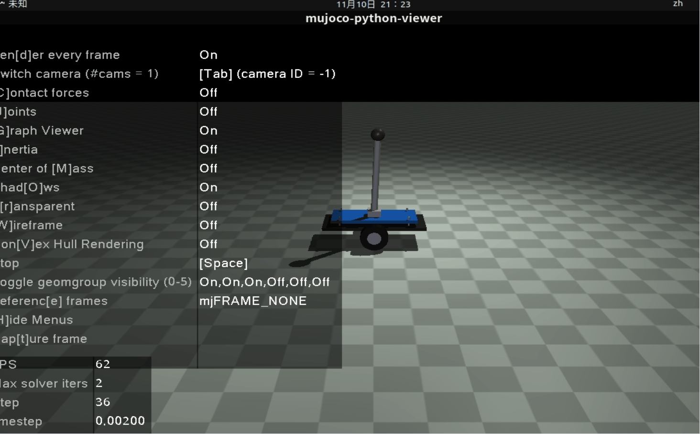
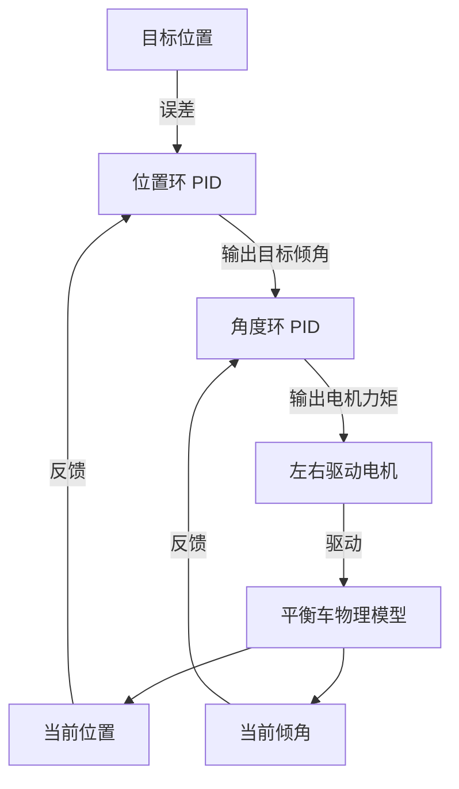

# MuJoCo 两轮自平衡小车 PID 控制仿真

## 项目目的
本项目旨在通过 MuJoCo 物理仿真引擎，验证双环串级 PID 控制算法在两轮自平衡小车上的有效性。通过不断优化参数，提升了系统的动态响应速度与抗扰动精度，为后续复杂的机器人控制提供可靠的理论与算法验证平台。

## 项目介绍
基于 MuJoCo 物理引擎实现的两轮自平衡小车仿真项目，采用双环 PID 控制算法实现倒立摆动态平衡与位置保持。纯 Python 实现，无 ROS 依赖，可直接在 Ubuntu 虚拟机运行。

## 环境依赖
- Ubuntu 22.04（虚拟机兼容）
- Python 3.10+
- 依赖库：mujoco、mujoco-python-viewer、numpy

## 运行方式

### 一键运行
```bash
chmod +x main.sh
./main.sh
```

### 手动运行

```bash
pip install -r requirements.txt
python3 main.py
```

## 操作说明

| 按键 | 功能 |
|------|------|
| R | 重置仿真状态 |
| 方向键 ↑| 给小车施加向前速度扰动 |
| 方向键 ↓| 给小车施加向后速度扰动 |
| ESC| 关闭仿真窗口 |

## 运行效果


## 效果说明

1. 启动后摆杆从微小偏移自动恢复垂直，保持动态平衡。
2. 施加前后扰动后，小车可自动回到初始位置，摆杆维持直立。
3. 可通过调整 main.py 中 PID 参数优化平衡响应速度与稳定性。

## 系统控制原理

本项目采用**双环串级 PID** 控制算法实现两轮自平衡。外环为位置环，控制小车的前进后退；内环为角度环，控制倒立摆的平衡。



## 调参经验 

双环 PID 的调试极其讲究顺序，本项目的参数整定过程如下：

1. 先调内环（角度环）：将 pos_pid 的输出固定为 0，单独调 angle_pid。先设 ki=0, kd=0，逐渐增大 kp 直到倒立摆能勉强立住但会有剧烈等幅震荡；随后逐渐增加 kd 抑制震荡。为了消除静差，角度环取 ki=0.05，并在 pid_controller.py 中对积分项做了限幅；位置环取 ki=0，因为外环输出已限幅在 ±0.15 弧度，不需要积分补偿。
2. 后调外环（位置环）：在角度环能完美保持直立后，加入 pos_pid。为了避免外环输出过大导致内环崩溃，pos_pid 的输出需要做严格的限幅（本项目限制在 -0.15 ~ 0.15 弧度之间）。
3. 抗积分饱和：在真实的物理系统中，积分项容易无限累加。本项目在 pid_controller.py 中对积分项做了 ±1.0 的限幅。当前 ki=0.05 下积分项贡献较小，该限幅主要用于后续调大 ki 时避免积分饱和。
