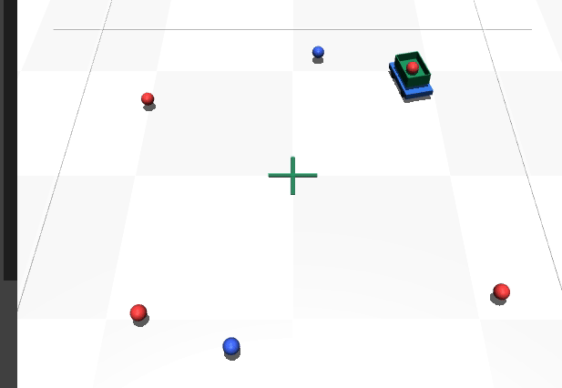

# MuJoCo小车 搜集小球仿真

## 实验简介
本实验使用MuJoCo搭建差速四轮小车，在 6×6 m 平面场地内自动搜集 6 个散布小球（4 红 2 蓝）：小车每帧寻找最近的未收集球，差速转向驶近，距离小于 0.35 m 即收入车上绿色收集筐，全部收完自动停车，无需人工干预。

## 运行环境
Ubuntu20.04 + Python3 + mujoco

## 运行步骤
```bash
# 1. 安装依赖
pip install mujoco

# 2. 运行仿真（源码位于 src/ground/mujoco_ball_collect/main.py）
python3 src/ground/mujoco_ball_collect/main.py
```

运行后弹出 MuJoCo 可视化窗口：小车在场地内自动收集 6 个小球，球逐个弹入车上绿色收集筐，全部收完后小车自动停车。



## 说明
本作业的代码与文档在编写过程中使用了 AI 大模型辅助，本人已核对并确认提交内容，对提交内容负责。
