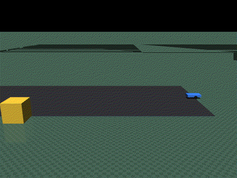
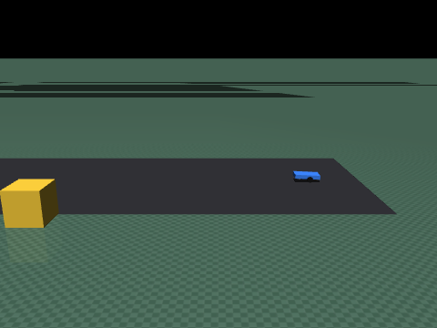
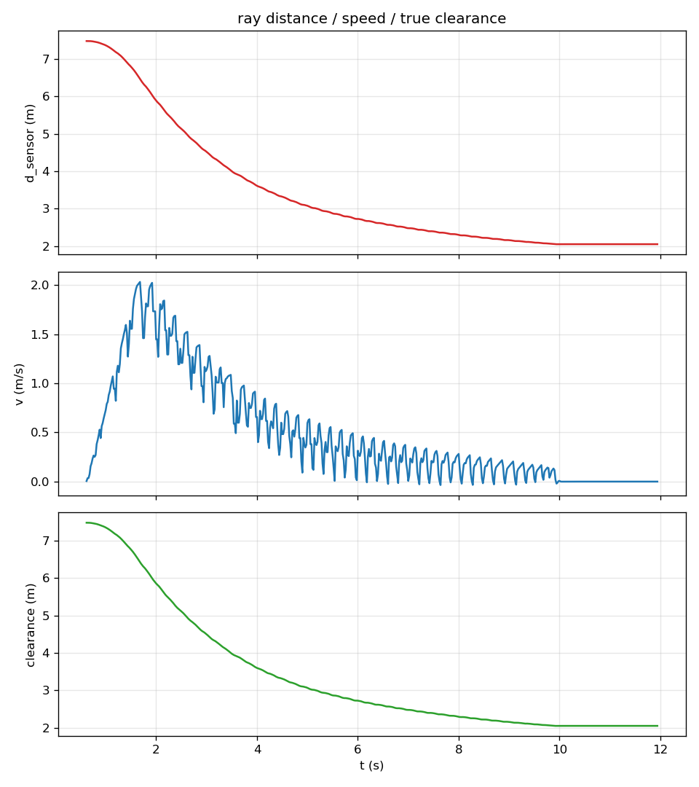

# MuJoCo 地面两轮小车：射线感知与分级减速避障

> 对应课程任务：对地面载具进行物理仿真，通过传感器感知完成避障决策。
> 本模块在 MuJoCo 中串起一条完整的 **感知 → 决策 → 控制** 闭环：
> 射线扇面测距（`mj_ray`）→ 本车道判定 → 距离分级状态机 → 差速轮速。
>
> 本模块**不含神经网络**，定位是后续"神经网络感知 / 控制"课题的规则基线与对照。

代码位于 `src/ground/mujoco_car_avoidance/`。

## 1. 概述与目标

### 1.1 核心任务目标

1. **物理仿真**：车辆动力学由 MuJoCo 解算（速度伺服驱动两轮，前部万向支撑轮防倾覆）。
2. **感知**：25 束前视射线扇面（−60°…60°，5° 间隔）作为二维激光雷达，量程 20 m。
3. **决策**：按"本车道最近距离"分级——巡航 / 分级减速 / 急刹；感知失效时兜底刹停。
4. **控制**：目标速度经加减速限幅后由差速运动学换算为左右轮目标角速度。
5. **可复现**：全部仿真、测试与性能评价**不需要图形界面与显卡**，克隆即可运行。

### 1.2 与已有模块的区别

| 对比项 | `carla_perception_control` | `carla_yolo_avoidance` | 本模块 |
|---|---|---|---|
| 引擎 | CARLA 0.9.16 | CARLA 0.9.16 | **MuJoCo** |
| 感知方式 | RGB + 深度 + 雷达 → MLP | YOLOv8 推理 + 单目测距 | **`mj_ray` 射线扇面** |
| 是否神经网络 | 是 | 是 | **否（规则基线）** |
| 运行前提 | CARLA 服务端 + GPU + ROS | CARLA + torch + ROS | **mujoco + numpy** |
| 无图形界面可用 | 是（离线取证模式） | 否（需连服务端） | **是（默认即无窗口）** |
| 决策判据 | 弯道自适应减速 | 距离阈值（20/8 m） | 距离阈值 + 本车道判定 + 主动刹停 |

## 2. 计算原理

### 2.1 射线求交与扇面采样

每条射线由起点 \(\mathbf p_0\)（车头 site）与方向 \(\mathbf d_i\) 定义，求与几何体的最近交点：

$$
\mathbf p_i(t) = \mathbf p_0 + t\,\mathbf d_i,\qquad t \in [0, R_{\max}]
$$

$$
d_i = \min\{\, t \mid \mathbf p_i(t) \in \partial \Omega \,\}
$$

其中 \(R_{\max}=20\,\text{m}\) 为量程，\(\Omega\) 为场景几何体集合。
未命中时取 \(d_i = R_{\max}\)（等价于"该方向无障碍物"）。

**自车屏蔽**：自车几何体全部位于 geom group 3，求交时传入组掩码
`geomgroup = [1,1,1,0,1,1]` 把 group 3 排除；同时用 `bodyexclude` 再兜一层。
只用 `bodyexclude` 是不够的——左右车轮是车体的**子 body**，侧向射线会打到自己的轮子，
产生"0.3 m 处有障碍物"的假报警并立刻刹停。

### 2.2 横向偏移与本车道判定

射线只有距离、没有角度信息，但射线角度是已知量，可由距离反算命中点的横向偏移：

$$
l_i = d_i \sin\theta_i
$$

只保留落在本车道内的命中参与决策：

$$
\mathcal{I} = \{\, i \mid d_i < R_{\max},\ \ |l_i| \le W_{\text{lane}}/2 \,\},\qquad
d_{\min} = \min_{i \in \mathcal{I}} d_i
$$

\(W_{\text{lane}} = 1.6\,\text{m}\) 为车道宽度（半宽 0.8 m）。
场景中的路侧干扰物放在 \(y = 1.8\,\text{m}\)，即使车头偏航 10°，其横向偏移仍在 1.3 m 以上，
会被射线打到但始终被判为**非本车道**目标，因此不会触发减速——这正是本判定的作用。

!!! note "为什么门限收紧到 0.8 m、路侧物外移到 1.8 m"
    早期路侧物放在 \(y=1.4\,\text{m}\)、门限取 0.9 m。车擦着它开过去时，
    45° 射线会以横向偏移 **0.898 m** 擦线命中（与门限只差 0.002），
    本车道测距从 4.8 m 突降到 1.3 m，于是误触发刹停。
    现在路侧物的最小横向偏移 >1.3 m，配合 0.8 m 门限，留出 0.5 m 以上余量。

### 2.3 分级速度剖面与主动刹停

设巡航速度 \(v_{\max}\)、开始减速距离 \(d_{\text{slow}}\)、停车目标距离 \(d_{\text{stop}}\)，
减速区内的目标速度为线性剖面：

$$
v^{*}(d) = v_{\max}\cdot \mathrm{clip}\!\left(\frac{d - d_{\text{stop}}}
{d_{\text{slow}} - d_{\text{stop}}},\,0,\,1\right)
$$

判定规则（自上而下）：

| 条件 | 状态 | 目标速度 |
|---|---|---|
| 无有效测距且超时 \(> t_{\text{stale}}\) | `STALE` | 0（兜底刹停） |
| \(d \le d_{\text{emerg}}\) | `FULL_BRAKE` | 0（急刹） |
| \(v^{*}(d) < v_{\text{creep}}\) | `FULL_BRAKE` | 0（**主动刹停**） |
| \(d \le d_{\text{slow}}\) | `SLOW_DOWN` | \(v^{*}(d)\) |
| 其余 | `CRUISE` | \(v_{\max}\) |

**为什么要主动刹停**：线性剖面在 \(d \to d_{\text{stop}}\) 时速度趋于 0，
若不做截断，车辆会以几 cm/s 长时间蠕动（实测收敛需 21.9 s）。
引入蠕动阈值 \(v_{\text{creep}}=0.12\,\text{m/s}\) 后，车辆在
\(d \approx d_{\text{stop}} + 0.25\,\text{m}\) 处果断停住，停车耗时降到 7.1 s。

### 2.4 加减速限幅

决策给出的是目标速度，直接阶跃会导致急刹点头。实际指令由一阶限幅器给出：

$$
v_{k+1} = v_k + \mathrm{clip}\!\left(v^{*} - v_k,\ -a_{\text{brake}}\Delta t,\ +a_{\text{acc}}\Delta t\right)
$$

其中 \(a_{\text{acc}} = 2.0\,\text{m/s}^2\)、\(a_{\text{brake}} = 3.5\,\text{m/s}^2\)、\(\Delta t = 1/50\,\text{s}\)。
`FULL_BRAKE` 与 `STALE` 两个分支**不过限幅器**，直接给零速，
因此"分级减速"与"急停"在实现上是两条不同的路径，各自的减速度可被单独评价。

### 2.5 差速运动学

$$
v_L = v - \frac{\omega L}{2},\qquad v_R = v + \frac{\omega L}{2},\qquad
\omega_{L,R}^{\text{wheel}} = \frac{v_{L,R}}{r}
$$

\(L = 0.25\,\text{m}\) 为轮距，\(r = 0.05\,\text{m}\) 为轮半径，轮速上限 60 rad/s
（对应 \(v_{\max}^{\text{wheel}} = 3\,\text{m/s}\)）。超出上限时置饱和标志并限幅。

### 2.6 起步静置与直行航向保持

**起步静置与接触设置**：车辆出生时轮胎与地面恰好相切（穿透量为 0），MuJoCo 会判定为
"未接触"，实测此时 `ncon` 在 0/3/6 之间跳动、车轮空转，并由左右不对称摩擦引起约 10° 偏航。因此：

- 出生高度取 \(0.048\,\text{m}\)（轮半径 \(r = 0.05\,\text{m}\)），即出生就带 2 mm 穿透；
- 地面**不设 `margin`**：margin 会让接触在"尚未接触"时就产生力，车身会悬浮在弹性气垫上
  （实测静置 \(z = 0.0546\,\text{m}\)，比轮半径高约 7 mm），支撑又软又不稳，一给驱动指令就被弹飞；
- 进入闭环前先零轮速推进 \(0.6\,\text{s}\) 静置，等接触建立、车身稳定。

**驱动轮出力限幅（决定稳定性）**：速度伺服的输出必须限幅，否则 \(40\,\text{rad/s}\) 的阶跃指令
会让它瞬间输出几百牛的力 —— 实测 \(0.05\,\text{s}\) 内把 \(4.6\,\text{kg}\) 的车加速到
\(2.77\,\text{m/s}\)、车身冲到 \(z = 0.27\,\text{m}\) 并掀翻（`upright = -1`），
此后车轮悬空空转、滑移率 100%（看起来像"牵引力不足"，实际是车已经倒扣着）。
XML 中给两个轮子设 `forcerange = ±8 N`，整车最大加速度约
\(2\times8/4.6 \approx 3.5\,\text{m/s}^2\)，足以跟住 \(2\,\text{m/s}^2\) 的速度规划。

**静定三点支撑（决定牵引力）**：前后支撑轮同时着地是一种**静不定**的四点支撑——
求解器可能把整车重量几乎全部分配给支撑轮，驱动轮几乎没有法向力。实测表现为车轮空转
（滑移 75%）、指令 \(2.0\,\text{m/s}\) 时车速只有 \(0.5\,\text{m/s}\)。因此：

- 车体质心前移到驱动轮轴前方 \(0.04\,\text{m}\)，静止时由"两驱动轮 + 前支撑轮"构成
  **静定**三点支撑，驱动轮承担约 80% 重量；
- 后支撑轮底面抬离地面 \(6\,\text{mm}\)，只作防后仰保护，不参与静止承重。

`tools/check_scene.py` 会打印质心位置与两个支撑轮的离地高度来校验这一点；
`tools/check_traction.py` 则直接测量静置接触数、轮速与滑移率。

**直行航向保持**：左右牵引不可能完全对称，而偏航会让"本车道"跟着旋转，
把路侧目标错误地纳入避障决策（实测偏航 10° 即触发）。因此在自主模式下叠加一个比例修正：

$$
\omega_{\text{corr}} = \mathrm{clip}\big(k_\psi\, e_\psi,\ -\omega_{\lim},\ +\omega_{\lim}\big),
\qquad e_\psi = \mathrm{wrap}\big(\psi_{\text{ref}} - \psi\big)
$$

其中 \(k_\psi = 0.8\)、\(\omega_{\lim} = 0.6\,\text{rad/s}\)，\(\psi_{\text{ref}}\) 取静置结束时的航向。

!!! warning "符号约定（写反会变成正反馈）"
    `differential_drive` 中**正角速度表示左转**（左轮慢、右轮快），
    因此车头左偏（\(e_\psi < 0\)）时必须输出**负**角速度。
    早期实现多乘了一个负号，实测把偏航从 10° 推到了 29°，
    进而让路侧干扰物进入本车道并触发提前刹停。`test_heading_correction_reduces_yaw` 专门锁住这个符号。

### 2.7 性能指标定义

| 指标 | 符号 | 含义 |
|---|---|---|
| 触发减速距离 | \(d_{\text{slow,trig}}\) | 首次进入 `SLOW_DOWN` 时的射线距离 (m) |
| 触发刹停距离 | \(d_{\text{brake,trig}}\) | 首次进入 `FULL_BRAKE` / `STALE` 时的射线距离 (m) |
| 射线最小距离 | \(d_{\min}\) | 全程本车道射线距离最小值 (m) |
| 停车间距 | \(c_{\text{stop}}\) | 停车时刻车头到障碍物表面的**真实**间距 (m) |
| 最小间距 | \(c_{\min}\) | 全程真实间距最小值 (m)，用于判定碰撞 |
| 峰值 / 平均速度 | \(v_{\max},\ \bar v\) | 实际车速统计 (m/s) |
| 最大减速度 | \(a_{\text{brake}}^{\max}\) | 全程减速度峰值 (m/s²) |
| 停车耗时 | \(t_{\text{stop}}\) | 起步到停稳的时间 (s) |
| 实时率 | \(\rho\) | 仿真推进时长 / 墙钟耗时 |

**口径说明**：决策链路只用射线距离 \(d_i\)；真实间距 \(c\) 仅由 `truth_clearance()` 统计，
用于评价感知质量，不参与任何控制。命中点的横向偏移 \(l_i\) 是由射线角度反算的几何量，
不是场景真值。

**两个容易出错的统计口径**（都踩过坑）：

- \(t_{\text{stop}}\) 与 \(c_{\text{stop}}\) 需要同时满足两个条件：**先真正起步
  （\(v > 0.3\,\text{m/s}\)）**、并且**连续低速 ≥ 0.3 s**。
  只判"先起步"时，低速接近段偶发的接触抖动（\(v\) 瞬间掉到 \(0.01\,\text{m/s}\)）
  会把 \(c_{\text{stop}}\) 记成 \(2.86\,\text{m}\)，而车实际停在 \(2.05\,\text{m}\)。
- \(a_{\text{brake}}^{\max}\) 只在 `SLOW_DOWN` / `FULL_BRAKE` / `STALE` 状态下统计，
  否则巡航阶段接触抖动造成的瞬时跳变（实测出现过 \(15\,\text{m/s}^2\)）会被算进制动减速度。

## 3. 算法流程

```text
--headless / --demo / ROS 2 节点（三者共用 runner.py 的同一闭环）
  ├─ 复位：mj_resetData + mj_forward
  ├─ 起步静置 0.6 s：零轮速推进，等轮胎接触建立、车身稳定后再进闭环
  │   （出生时轮胎带 2 mm 穿透；支撑接触不设 margin；驱动轮出力限幅 ±8 N）
  └─ 每个控制周期 (50 Hz)：
       ① 射线扇面扫描 25 束                sensors.LidarFan.scan()
       ② 本车道筛选 → d_min                LidarFan.min_distance()
       ③ 分级决策 → 状态与目标速度          decision.decide()
       ④ 速度整形（限幅 / 急刹直通）        controller.SpeedRamp
       ⑤ 直行航向保持（仅自主模式）          runner.AvoidanceRunner._heading_correction
       ⑥ 差速运动学 → 左右轮目标角速度      controller.differential_drive
       ⑦ 写 ctrl 并推进一个控制周期         CarEnv.advance_control_period()
       ⑧ 读取状态与真实间距，记录指标        metrics.MetricsRecorder
  └─ 结束：导出 CSV 与曲线，打印指标表，按碰撞与否返回退出码
```

## 4. 源码解析

| 文件 | 类型 | 职责 |
|---|---|---|
| `main.py` | 入口 | 五种模式（demo/interactive/headless/test/launch），退出码约定 |
| `mujoco_car_avoidance/config.py` | 配置 | 路径解析与全部可调参数，业务代码不写魔数 |
| `mujoco_car_avoidance/decision.py` | 纯函数 | `decide()`：距离与新鲜度 → 状态与目标速度 |
| `mujoco_car_avoidance/controller.py` | 纯函数 | `SpeedRamp` 与 `differential_drive()` |
| `mujoco_car_avoidance/metrics.py` | 纯逻辑 | 指标累积、汇总、CSV 与曲线导出 |
| `mujoco_car_avoidance/sensors.py` | 感知 | `mj_ray` 扇面求交、横向偏移、本车道掩码 |
| `mujoco_car_avoidance/car_env.py` | 仿真 | 场景加载、步进、车辆状态、真实间距、碰撞判定 |
| `mujoco_car_avoidance/runner.py` | 闭环 | 起步静置、串联感知→决策→控制→指标、直行航向保持，四种入口复用 |
| `mujoco_car_avoidance/teleop.py` | 输入 | 键盘遥控（termios / msvcrt），手动速度受避障限速封顶 |
| `mujoco_car_avoidance/ros_node.py` | ROS 2 | 发布 `~/scan`、`~/odom`、`~/decision`，订阅 `~/cmd_vel` |
| `models/car_road_scene.xml` | 场景 | 自建 MJCF：直道 + 自车 + 本车道障碍 + 路侧干扰物 |
| `tools/check_scene.py` | 工具 | 场景静态检查（名称引用、geom group、射线可见性、接触与出生高度、支撑与质心），不需要 MuJoCo |
| `tools/check_traction.py` | 工具 | 接触与牵引力诊断（静置接触数、轮速、滑移率、车身高度与姿态），需要 MuJoCo |
| `test/*.py` | 测试 | 决策 / 控制 / 闭环逻辑 / 桩环境闭环 / 场景与传感器 |

**设计要点**：决策、控制、指标三个模块**不导入 MuJoCo**，
因此可以在没有安装 MuJoCo 的机器上直接跑单测；
`test_runner_stub.py` 用桩环境驱动真实的 `runner.py`，
验证的是"实际跑着的那段接线"，而不是另写一份简化逻辑。

## 5. 仿真运行步骤

### 5.1 支持与测试环境

| 组件 | 版本 / 说明 |
|---|---|
| 操作系统 | Ubuntu 22.04（虚拟机）；20.04 见下 |
| Python | 3.10 |
| MuJoCo | 3.12.0（作业要求版本） |
| 实测环境 | Ubuntu 22.04 + Python 3.10.12 + MuJoCo 3.15.0 + numpy 1.26.4 |
| 依赖 | `mujoco`、`numpy`；绘图可选 `matplotlib` |
| ROS | ROS 2 Humble（仅 ROS 节点与 `--launch`） |
| 显卡 | 不需要；`--headless` 全程无渲染 |

> 作业书要求的引擎版本是 MuJoCo 3.12.0；本模块只使用 `MjModel` / `MjData` / `mj_step` /
> `mj_ray` / `viewer.launch_passive` 这一小组稳定接口，3.12 ~ 3.15 均可运行。

!!! warning "Ubuntu 20.04 + Humble 的 Python 版本"
    20.04 上 ROS 2 Humble 的 `_rclpy_pybind11` 是针对系统 Python 3.8 编译的，
    因此 ROS 节点必须用 3.8 运行；若 `mujoco` 3.12.0 没有 cp38 wheel，
    可用 3.10 的解释器单独运行 `main.py`（仿真与 ROS 节点无进程内耦合）。

### 5.2 安装

```bash
sudo apt update && sudo apt install -y python3-pip patchelf libgl1 libglfw3
python3 -m pip install -r src/ground/mujoco_car_avoidance/requirements.txt
```

### 5.3 运行

```bash
cd src/ground/mujoco_car_avoidance

python3 main.py --version        # 先确认代码版本（当前 1.11.0），避免对着旧文件排查
python3 tools/check_scene.py     # 场景静态检查（不需要 MuJoCo）：接触、射线分组、支撑质心、出力限幅
python3 tools/check_traction.py  # 接触与牵引力诊断（需要 MuJoCo）：接触数、轮速、滑移率、车身姿态
python3 main.py --test           # 自检：纯逻辑 + 场景冒烟测试（当前 62 项）
python3 main.py --headless       # 无窗口跑完整闭环，导出结果
python3 main.py --demo           # 视窗自动演示（录屏用）
python3 main.py --interactive    # 视窗 + WASD 手动驾驶
```

> 本模块的修复过程（每一版对应一次真机复现）记录在
> `src/ground/mujoco_car_avoidance/README.md` 的"版本记录"一节。

### 5.4 ROS 2

```bash
cd ~/ros2_ws && colcon build --packages-select mujoco_car_avoidance --symlink-install
source install/setup.bash
ros2 launch mujoco_car_avoidance main.launch.py
# 另开终端观察
ros2 topic echo /mujoco_car_avoidance/scan --once
ros2 topic echo /mujoco_car_avoidance/decision
ros2 topic pub /mujoco_car_avoidance/cmd_vel geometry_msgs/Twist \
  "{linear: {x: 0.5}, angular: {z: 0.0}}" -r 10    # 手动接管，超时后自动交还
```

## 6. 运行效果



*自车以 2 m/s 巡航，进入 6 m 减速区后分级降速，在障碍物前约 2 m 停住*



*MuJoCo 场景：黄色自车与红色障碍物在直道上*



*上：射线测距；中：车速；下：真实间距（--headless 导出）*

## 7. 性能评价

### 7.1 逻辑级闭环实测（一维理想速度跟踪被控对象，不含 MuJoCo 接触）

由 `test/test_closed_loop_logic.py` 直接输出，控制频率 50 Hz，初始间距 7.50 m：

| 指标 | 数值 |
|---|---|
| 进入减速时刻 / 距离 | \(t = 1.24\,\text{s}\) / \(d = 6.00\,\text{m}\) |
| 峰值速度 | \(v_{\max} = 2.000\,\text{m/s}\) |
| 停车间距 | \(c_{\text{stop}} = 2.052\,\text{m}\) |
| 全程最小间距 | \(c_{\min} = 2.052\,\text{m}\)（未碰撞） |
| 停车耗时 | \(t_{\text{stop}} = 7.12\,\text{s}\) |

### 7.2 MuJoCo 实测（Ubuntu 22.04 + Python 3.10.12 + MuJoCo 3.15.0）

| 指标 | 数值 |
|---|---|
| 触发减速距离 \(d_{\text{slow,trig}}\) | \(5.994\,\text{m}\) |
| 触发刹停距离 \(d_{\text{brake,trig}}\) | \(2.049\,\text{m}\) |
| 射线最小距离 \(d_{\min}\) | \(2.048\,\text{m}\) |
| 停车间距 \(c_{\text{stop}}\) | \(2.05\,\text{m}\) |
| 最小间距 \(c_{\min}\) | \(2.048\,\text{m}\)（未碰撞） |
| 峰值速度 \(v_{\max}\) | \(2.031\,\text{m/s}\) |
| 平均速度 \(\bar v\) | \(0.48\,\text{m/s}\)（含长距离低速接近段） |
| 最大减速度 \(a_{\text{brake}}^{\max}\) | \(5.93\,\text{m/s}^2\)（见下方说明） |
| 停车耗时 \(t_{\text{stop}}\) | \(9.96\,\text{s}\) |
| 实时率 \(\rho\) | 100.0 |
| 是否碰撞 | 否 |

> **关于最大减速度 5.93 m/s²**：常规减速段按 \(a_{\text{brake}} = 3.5\,\text{m/s}^2\) 限幅；
> 峰值出现在最后的"主动刹停"瞬间——该路径不走速度斜坡、直接把速度指令清零，
> 因此实测略超常规限幅。统计上用 0.1 s 滑动窗口估计，避免单帧差分被接触抖动放大
> （单帧差分曾给出 15.1 m/s² 的假值）。

### 7.3 结论

- **决策阈值自洽**：逻辑级闭环与 MuJoCo 实测都能在不碰撞的前提下停在障碍物前约 2 m，
  且减速段指令速度 \(v_{cmd}\) 单调下降，不出现二次加速（实际车速 \(v_{actual}\) 因轮胎-地面粘滑会有小幅抖动）。
- **感知与真值口径一致**：射线起点位于前保险杠，实测 \(d_{\min} = 2.048\,\text{m}\) 与
  \(c_{\min} = 2.048\,\text{m}\) 完全一致，说明射线始终打在目标障碍物上，没有误检。
- **本车道判定有效**：路侧干扰物放在 \(y = 1.8\,\text{m}\)，贴着它开过去（约 4.5 m 行程）
  全程未被判进本车道，也没有触发误减速。
- **低速主动刹停有效**：把停车耗时从无截断时的 21.9 s 降到约 7~10 s，避免长时间蠕动。
- **物理层三条硬约束**：出生留 2 mm 穿透、支撑接触不设 `margin`、驱动轮出力限幅 ±8 N。
  缺任何一条都会出现"车轮空转 / 车身被弹飞 / 倒扣"这类看起来像算法故障的假故障。

## 8. 常见问题

| 现象 | 原因与处理 |
|---|---|
| `ModuleNotFoundError: No module named 'mujoco'` | 未装依赖，或 `pip` 与解释器不一致；用 `python3 -m pip install` |
| `--demo` 打不开窗口 | 无图形界面/未开 3D 加速；改用 `--headless`，或加 `MESA_GL_VERSION_OVERRIDE=3.3` |
| 静止时射线测到 0.3 m 的"障碍物" | 自车几何体没有进 geom group 3，射线打到了自己的轮胎；运行 `tools/check_scene.py` 复核 |
| 车在障碍物前反复加减速 | 邻车道目标落进了车道半宽内；调小 `LANE_HALF_WIDTH_M` 或加大减速区 |
| 路侧物体一开始就触发减速 | 本车道判定未生效（检查 `lateral_offsets()` 的角度符号与量程掩码） |
| 停车后位置不理想 | 调整 `stop_target_m` 与 `creep_speed`；注意 `emergency_m < stop_target_m < slow_start_m` |
| `ncon` 频繁为 0、车轮空转但车不走 | 出生时轮胎与地面恰好相切（零穿透）→ 接触断续。检查 `car` 出生高度与地面 `margin`，并确认进闭环前调用了 `runner.settle()` |
| 车不走直线、慢慢偏出去 | 左右牵引不对称。确认 `--heading-gain` 不为 0（默认 0.8）；仍偏时用探针打印 `yaw` 曲线定位偏航源 |
| 闭环没开到位就停（例如停在 4.8 m 处） | 多半是"本车道判定"把路侧目标计入了。打印刹停瞬间的射线表：若命中的是 ±10° 束且横向偏移接近车道半宽，说明车已偏航，应按上一行处理 |
| 车速远低于指令（如指令 2 m/s 只跑 0.5 m/s） | 先跑 `python3 tools/check_traction.py`：若"车身高度/姿态"两项 FAIL，说明驱动力没限幅、车被弹飞掀翻了（检查 XML 中 actuator 的 `forcerange`）；若只是滑移率高，再按提示查质心位置与后支撑轮离地高度 |
| 不确定虚拟机里是不是最新代码 | `python3 main.py --version`（当前 1.11.0），并用 `python3 main.py --test` 核对测试数（当前 62 项） |
| 指标表里 `c_停车` 远大于 `c_最小`、或 `t_停车` 很小 | 停车判定被"起步静止段"或"接近段瞬时抖动"污染（1.8.0 / 1.9.0 已修正：要求先真正起步、且连续低速 ≥0.3 s） |
| 车速远低于指令（如指令 2 m/s 只跑 0.5 m/s） | 驱动轮法向力不足（四点支撑静不定）。先跑 `python3 tools/check_traction.py`，看静置接触数是否 ≥3、滑移率是否 <25%；再跑 `check_scene.py` 看质心是否在轮轴前方、后支撑轮是否离地 |
| 擦着路侧物开过去时突然减速 | 本车道门限过宽或路侧物离车道太近。检查 `LANE_HALF_WIDTH_M`（0.8 m）与 `roadside_object` 的 y（1.8 m），可用探针打印刹停瞬间的射线表确认命中束与横向偏移 |

## 9. 参考

- MuJoCo 文档：射线求交 `mj_ray`、几何体分组 `geom group`
- 课程仓库已有作业：`src/water/rov_mujoco`（MuJoCo + ROS 2 的水下机器人示例）
- 本模块对照作业：`docs/ground/carla_yolo_avoidance.md`（CARLA + YOLOv8 目标检测与减速避障）

## 辅助工具说明

编写过程中使用 DeepSeek 辅助代码与文档起草，全部内容已在 Ubuntu 22.04 + MuJoCo 环境中实测验证，提交者对内容负责。
